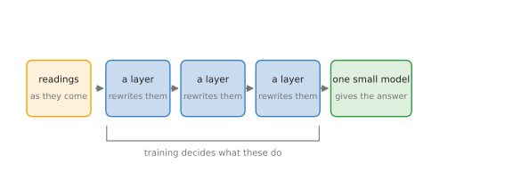
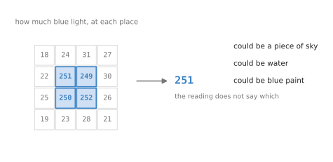
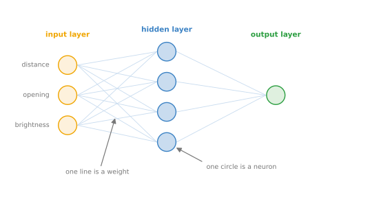

# Neural networks and neurons

The chapter before this one, starting at [how rules do the
work](../01_what-learning-means/01_how-rules-do-the-work.md), explained what a
model is. A model is a formula with adjustable numbers inside it, and training is
the search for good values for those numbers. What that chapter did not say is
what the formula looks like on the inside. This chapter opens one up, and this
page is the map of what you will find. Nearly every model in this book is a
**neural network**, so this page says what that word means, what the smallest
piece of one is called, and what all the surrounding words mean, so that the rest
of the chapter can use them without stopping to explain them.

This page is for a reader who knows that a model is trained from examples rather
than written out as rules. You need no mathematics beyond multiplying and adding,
because nothing here is worked out with numbers. This page is deliberately the
one page of the chapter with no arithmetic on it. The arithmetic starts on [the
smallest network](02_the-smallest-network.md) and does not stop until the chapter
ends.

When you reach the end of this page you will be able to say what a neural network
is in one sentence, you will know why there is anything at all between the
readings and the answer, you will know what a neuron, a layer, a weight and a bias
are, and you will know which parts of a network a person chooses and which parts
the problem decides for them.

## Contents

1. [What a neural network is](#1-what-a-neural-network-is)
2. [Why there is anything in the middle](#2-why-there-is-anything-in-the-middle)
3. [The words, on one picture](#3-the-words-on-one-picture)
4. [What you choose and what you are given](#4-what-you-choose-and-what-you-are-given)
5. [Where to read next](#5-where-to-read-next)

---

## 1. What a neural network is

The shortest honest answer is one sentence, and the rest of this chapter is that
sentence worked out slowly. A neural network takes the numbers you give it,
rewrites them several times over, and hands the rewritten numbers to one small
model at the end that gives the answer.

That is genuinely all of it. The small model at the end is the kind of thing the
chapter before already built: a few numbers multiplied by a few weights, added up,
and turned into an answer. What a neural network adds is everything before that
last step, which is a run of stages that each take a list of numbers and give back
a different list of numbers.

The picture below draws that shape. Read it from left to right.

Each of the boxes in the middle is a **layer**, and the whole picture is a network
with three of them. Nothing in those boxes is more complicated than multiplying
and adding, followed by one simple rule. The power does not come from any one
stage being clever. It comes from there being several of them, one after another.

Two words follow straight from that picture. A **neuron** is the smallest piece a
layer is built from, and it does one multiply-and-add of its own. A layer is a
group of neurons that all read the same numbers at the same time. So a network is
built from layers, a layer is built from neurons, and a neuron is a few
multiplications and an addition. Every one of those claims is worked out with real
numbers later in the chapter, starting on [the smallest
network](02_the-smallest-network.md).

The obvious question is why the middle is there at all, since the small model at
the end could have read the original numbers directly.
[Why there is anything in the middle](#2-why-there-is-anything-in-the-middle)
answers it, because that answer is the reason neural networks exist.

---

## 2. Why there is anything in the middle

This section comes now because the picture above has a part that looks like waste.
The readings go in, several stages rewrite them, and only then does anything give
an answer. Why not hand the readings straight to the model at the end? The answer
is that a raw reading usually says very little on its own, and the stages in the
middle are what turn readings into something worth answering from.

Start with what a raw reading is like. A camera reports, for every point it can
see, how much light of each colour arrived there. One of those numbers might be
251 out of a possible 255 for blue.

The picture below shows a small patch of such numbers, with one of the bright ones
picked out.

A 251 means a lot of blue light arrived at that point. It does not say whether
that light came from a piece of sky, from water, or from a wall painted blue. The
number is true and it is useless, because what we want to know is nothing like
what the number measures.

Data of that kind is called **unstructured**. Unstructured means that the numbers
are not already the quantities you care about: pictures, sound and raw sensor
traces are all unstructured in this sense. Data where the numbers already are the
quantities you care about is called **structured**, and a table of a robot's joint
angles, forces and temperatures is structured, because each column already means
something on its own.

For a long time the way to deal with unstructured data was to turn it into
structured data by hand. Somebody who understood the problem would decide what to
measure, write a program to measure it, and hand the measurements to the model.
To tell birds apart you might measure the length of the beak, the width of the
wings and the main colour. Those measured quantities are called **features**, and
a feature is a number worked out from the raw readings that says something useful
about them.

Working out features by hand was slow and it was the thing that limited what could
be built, because every new problem needed a person to sit down and invent a new
set of features for it. Somebody could spend years on the features for one narrow
job. That was the bottleneck.

The stages in the middle of a neural network are there to remove that bottleneck.
Each layer takes the numbers it is given and produces a different set of numbers,
and the numbers it produces are features. The difference from the old way is that
nobody decides what those features measure. Training decides, by choosing the
weights, and it decides them for the particular job the network is being trained
for. So the middle of a network is where the features come from, and that is the
whole reason it is there.

This also explains why the thing at the end can stay simple. By the time the
numbers reach it, they are no longer raw readings. They are a description of the
input, built for the job in hand, and a simple model is enough to answer from a
good description. [A network on a robot](04_a-network-on-a-robot.md) shows that
happening on one grasp, with every number written out.

Before any of that can be worked through, the words have to be nailed down, and
[the words, on one picture](#3-the-words-on-one-picture) does that.

---

## 3. The words, on one picture

This section comes now because the chapter uses these words on every page after
this one, and most of them have a second name from somewhere else that you will
also meet. Each word is marked on one small network below, and then explained
under it.

The picture below shows a network with three numbers going in, four neurons in the
middle, and one number coming out.

The circles on the left are the **input layer**. It is called a layer out of habit
rather than accuracy, because it does no arithmetic at all; it is just the numbers
arriving. The circle on the right is the **output layer**, and it gives the
answer. Everything between the two is a **hidden layer**, and hidden only means
that nobody outside the network reads those numbers.

One circle in a hidden layer is a **neuron**. Some people call it a unit or a
node, and all three words mean the same thing here. A neuron reads every number
that reaches it, multiplies each one by a number of its own, adds the results
together, adds one more number, and applies a simple rule to the total.

The numbers a neuron multiplies by are its **weights**, one for each input, and
the extra number it adds at the end is its **bias**. Those are the numbers that
training changes, and they are the only ones. If you have done linear regression
before, you have met both under other names: a weight is a coefficient, and a bias
is an intercept. Nothing about them is different here, only the vocabulary. When
people say a model's weights have been published, they mean all of these numbers,
biases included.

Two more words describe the shape rather than the parts. Every input in the
picture is joined to every neuron in the next layer, and a layer arranged that way
is **fully connected**, also called dense. The arrows only ever go left to right,
with nothing ever looping back, and a network built that way is **feedforward**.
The whole arrangement, meaning how many layers there are, how wide each one is and
which rule follows each, is the network's **architecture**.

The last word is the one in the name of the field. A network is called **deep**
when it has many layers, and deep learning is simply the use of networks with many
layers. There is no line at which a network becomes deep, and nothing changes at
any particular depth.

Those words are enough to read the rest of the chapter. What they do not yet say
is which of these things a person decides, and
[what you choose and what you are given](#4-what-you-choose-and-what-you-are-given)
settles that.

---

## 4. What you choose and what you are given

This section comes last because it is the one that tells you what you actually do
when you build a network, and that only makes sense once the parts have names. The
useful split is between what the problem hands you and what is left for you to
decide.

The table below sets the two sides against each other. Read it a row at a time:
the left column is fixed before you start, and the right column is yours.

The left column is not a choice. How many numbers go in is decided by what the
robot reports, the answer is whatever the job needs, and the examples are whatever
you have. The right column is where all the design happens, and it is almost
entirely about the middle of the network.

There is one catch in the right column, and it is worth knowing early. The rule
that follows the last layer is not free, because it has to be able to produce the
kind of answer the job needs. A job that wants one probability needs a rule that
can only ever give a number between 0 and 1. A job that wants a plain number, such
as a distance in millimetres, needs no rule at all.
[Activation functions](06_activation-functions.md) covers these rules in full.

The rule of thumb for everything else is to start with the simplest network that
could possibly do the job, and to make it more complicated only when it is not
good enough. That is why the chapter starts where it does: [the smallest
network](02_the-smallest-network.md) builds the simplest network there is, which
has no hidden layer at all, and then adds exactly one.

---

## 5. Where to read next

- [The smallest network](02_the-smallest-network.md) is the next page. It builds
  the simplest network that exists, shows what it cannot do, and adds one layer in
  the middle.
- [One neuron](03_one-neuron.md) opens a single neuron and works all of its
  arithmetic out by hand.
- [The words everyone uses](../01_what-learning-means/06_the-words-everyone-uses.md)
  places neural networks inside the wider set of words, such as artificial
  intelligence, machine learning and deep learning.
- [What a model is](../01_what-learning-means/03_what-a-model-is.md) is the page
  this one assumes, if parameters, training and inference are not yet familiar.
- [The score of being wrong](../03_how-training-works/01_the-score-of-being-wrong.md)
  starts the chapter that explains how the weights and biases are actually found.
