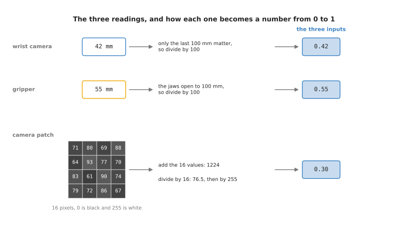
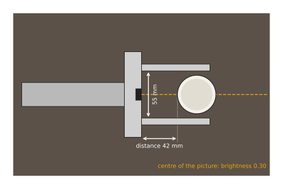
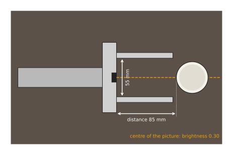
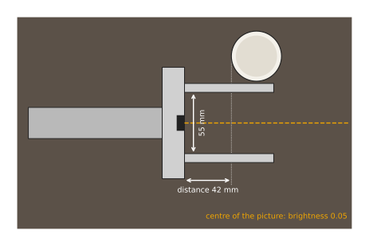

# The grasp example

Every page after this one works on the same job: a robot arm reaching for a cup.
This page sets that job out once, with drawings. It shows what the arm looks like,
what question the network is asked, which three numbers the arm reports, and how
those numbers are made. It also fixes three moments of the reach that later pages
put through a network. When a later page uses the example, it links to the part
of this page it needs, rather than describing the arm again.

When you reach the end you will know what each of the three readings measures,
how a raw sensor value becomes a number between 0 and 1, and what the right
answer is at each of the three moments. That last part matters, because it is how
you check a network on the later pages: you already know what it should say.

## Contents

1. [The arm, the gripper and the cup](#1-the-arm-the-gripper-and-the-cup)
2. [The three readings](#2-the-three-readings)
3. [Three moments of the reach](#3-three-moments-of-the-reach)
4. [Where to read next](#4-where-to-read-next)

---

## 1. The arm, the gripper and the cup

This section comes first because the numbers on every later page are
measurements of the scene drawn here.

The picture below looks down on the table from above. The arm comes in from the
left. At its end is the gripper, which is a flat palm with two fingers that close
towards each other. A small camera sits in the middle of the palm and looks
forward between the fingers. The cup stands on a dark table in front of the
gripper.

The fingers are 80 millimetres long, and the cup is 45 millimetres across. So the
cup fits between the fingers when the gap between them is wider than 45
millimetres. The cup is far enough in when its near side is less than about 60
millimetres from the palm, because then the fingertips reach past its middle.

The arm is moving towards the cup with the gripper open. At some moment a program
has to decide whether to close the fingers. Closing at the wrong moment is
expensive. Too early, and the fingers shut on air. Aimed wrongly, and they knock
the cup over. So the question the network is asked is this: if the gripper closed
now, would the grasp hold?

Nobody can write that rule down exactly. The answer depends on how far away the
cup is, on how wide the fingers are open, on whether the thing in front of the
camera is the cup at all, and on how those three combine. That combination is the
kind of job that [where rules stop
working](../01_what-learning-means/02_where-rules-stop-working.md) says a model is
for.

The network answers with one number between 0 and 1, read as how likely the grasp
is to hold. The network does not move anything. A plain program written by a
person reads that number and acts on it: it closes the gripper above some level,
and keeps moving below it. Nearly every learned model sits inside a working robot
in this way.

The network cannot look at the drawing. It is handed three numbers, and
[the three readings](#2-the-three-readings) says what they are.

---

## 2. The three readings

The section before drew the scene. This section turns it into the three numbers
that the network actually receives.

The first reading is the **distance**. The camera in the palm also measures depth,
which means it reports how far away each point in front of it is. The program
takes the nearest point it can see and reports how far that is from the palm. In
the drawing it is 42 millimetres.

The second reading is the **opening**. The gripper reports the gap between its
fingers itself. In the drawing it is 55 millimetres.

The third reading is the **brightness**. The program takes a small square of 16
pixels from the centre of the camera picture, which is the spot straight ahead of
the palm, and works out how bright it is. The cup is pale and the table is dark,
so a bright centre means the cup is straight ahead.

These three readings arrive in different units. A network cannot do anything
sensible with a 42 standing next to a 0.3, because a weight that suits one would
be far too large or far too small for the other. So each reading is first turned
into a number between 0 and 1. That step is called **scaling**.

The picture below shows how each of the three readings is scaled, one per row.

The distance is divided by 100 millimetres, because only the last 100 millimetres
of the reach matter for this question. So 42 millimetres becomes 0.42. The opening
is divided by 100 millimetres too, because the fingers open 100 millimetres at
most. So 55 millimetres becomes 0.55. The sixteen pixel values add up to 1,224, so
their average is 76.5. A pixel value runs from 0 for black to 255 for white, so
dividing 76.5 by 255 gives 0.30.

So the arm's state at this moment is the three numbers 0.42, 0.55 and 0.30, always
in that order. The order never changes, because the first weight of every neuron
multiplies the first number. If the program ever swapped two readings, every
weight would multiply the wrong thing. The answer would then be wrong, and nothing
would report an error.

One moment proves little about a network, so
[three moments of the reach](#3-three-moments-of-the-reach) fixes three different
ones to test it on.

---

## 3. Three moments of the reach

The section before turned one moment into three numbers. A network has to give
the right answer at many moments, so this section fixes three of them, each with
its readings and the answer a person watching would give.

The first moment is the one already drawn. The picture below shows it again with
only its readings marked.

The cup's near side is 42 millimetres from the palm, so the fingertips reach past
its middle. The fingers are open 55 millimetres, which clears a cup 45 millimetres
across. The centre of the picture is on the cup, so the brightness is 0.30. The
readings are 0.42, 0.55 and 0.30. Closing now should hold, so a good network
should give a number close to 1. This moment is called **ready to close**.

In the second moment the arm is further back. The picture below shows it.

The cup's near side is now 85 millimetres from the palm, which is beyond the ends
of the fingers. The opening and the brightness have not changed, because the
fingers are as wide as before and the camera still looks straight at the cup. The
readings are 0.85, 0.55 and 0.30. Closing now would shut the fingers on air, so a
good network should give a number close to 0. This moment is called **too far
away**.

In the third moment the arm is aimed beside the cup. The picture below shows it.

The cup is just as close as in the first moment, so the nearest point the camera
sees is still 42 millimetres away. But the cup is off to one side, outside the
fingers. The centre of the picture now falls on the dark table, so the brightness
drops to 0.05. The readings are 0.42, 0.55 and 0.05. Closing now would miss the
cup, so a good network should again give a number close to 0. This moment is
called **aimed beside the cup**.

The third moment is the hardest of the three. Its distance and opening are the
same as in the moment where closing works, and only the brightness tells the two
apart. A network that looked only at the distance would get it wrong.

These are the three moments that the later pages use. [A network on a
robot](05_a-network-on-a-robot.md) puts all three through one network and
compares its answers with the right ones.

---

## 4. Where to read next

- [One neuron](03_one-neuron.md) is the next page. It takes the readings of the
  first moment and works out by hand what one neuron does with them.
- [The smallest network](04_the-smallest-network.md) puts four such neurons
  between the readings and the answer, and works the first moment through it.
- [A network on a robot](05_a-network-on-a-robot.md) runs all three moments
  through that network.
