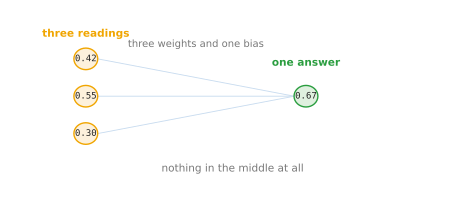
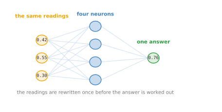
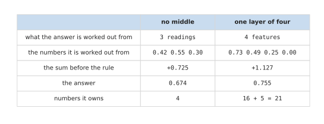

# The smallest network

[Neural networks and neurons](01_networks-and-neurons.md) said that a network
rewrites its numbers a few times and hands the result to one small model at the
end. That is a description, and a description is easy to nod along to without
understanding. So this page builds the smallest network that exists, which has no
middle at all, and then adds exactly one layer to it. Both are worked out on the
same moment of the same robot arm, so the only thing that changes between them is
the middle.

The order matters here. Starting with the simplest network and making it more
complicated only when it has to be is not just how this page is written; it is how
networks are actually designed. If the simplest thing does the job, you stop.

This page is for a reader who has read [neural networks and
neurons](01_networks-and-neurons.md) and can multiply and add. The arithmetic is
all small enough to check by hand, and every number in every picture was worked
out and printed by `docs/diagrams/inside_a_network_0.py`. The weights were chosen
by hand rather than trained, so that you can see what each one is doing.

When you reach the end you will know what the smallest possible network looks
like, why it is the same thing as a model you have already met under another name,
what adding one layer in the middle changes, and what that layer costs in numbers
owned.

## Contents

1. [A network with no middle at all](#1-a-network-with-no-middle-at-all)
2. [What drawing it that way shows you](#2-what-drawing-it-that-way-shows-you)
3. [One layer in the middle](#3-one-layer-in-the-middle)
4. [The two side by side](#4-the-two-side-by-side)
5. [Where to read next](#5-where-to-read-next)

---

## 1. A network with no middle at all

The smallest network is the one with nothing between the readings and the answer.
The readings arrive, one neuron multiplies each of them by a weight, adds the
results together, adds a bias, and turns the total into the answer. That is one
layer, and a network cannot have fewer.

The job it is doing here runs through the whole chapter. A robot arm is reaching
for a cup, and the question is whether closing the gripper now would hold. The arm
reports three numbers at this moment: the distance to the cup is 0.42, the gripper
opening is 0.55, and the brightness of the patch where the cup should be is 0.30.
All three have been scaled to sit between 0 and 1, which [one
neuron](03_one-neuron.md#2-what-one-neuron-is-made-of) explains, so that no
reading counts for more simply because of the unit it was measured in.

The picture below draws the whole network.

The three weights are -2.00, +1.50 and +0.80, and the bias is +0.50. Multiplying
and adding gives a total of +0.725. The answer wanted is a probability, meaning a
number between 0 and 1, so that total is passed through a rule that squeezes any
number into that range. The rule is called the **sigmoid**, and all you need to
know here is its shape: a large negative number comes out near 0, a large positive
number comes out near 1, and 0 comes out as exactly one half.
[Activation functions](06_activation-functions.md) returns to these rules
properly. The total of +0.725 comes out as 0.674, so this network says the grasp
has about a two in three chance of holding.

This network owns four numbers in all: three weights and one bias. That is the
smallest a network gets.

It is also something you may already have met. A model that multiplies its inputs
by coefficients, adds them up and squeezes the total into a probability is
logistic regression, which is one of the oldest and plainest tools in statistics.
Nothing has been added to it here. The only thing that has changed is that it has
been drawn as circles and lines rather than written as a formula, and
[what drawing it that way shows you](#2-what-drawing-it-that-way-shows-you) is
about why that redrawing is worth anything at all.

---

## 2. What drawing it that way shows you

The section before ended on a picture of something you could have written on one
line. So the fair question is what the picture bought, and the answer is one
specific thought that the formula does not invite.

Look again at where the lines go. The readings are fixed, because the arm reports
what it reports. The answer is fixed, because the job needs what it needs. What is
not fixed is the space between them, and in the picture that space is completely
empty.

Once the space is visible, it is obvious that something could be put in it. The
readings do not have to go straight to the answer. They could go to a handful of
neurons first, and those neurons could hand their results to the answer instead.
That is the entire idea of a neural network, and it is much easier to have while
looking at a picture with a gap in the middle than while looking at a line of
algebra.

It is worth being precise about why the gap is the only place to work. The
readings cannot be changed, since they are what the sensors give. The answer
cannot be changed, since a grasp either holds or it does not. So the middle is the
only part anyone has any freedom over, and every decision about a network's shape
is a decision about the middle. That is also why
[neural networks and neurons](01_networks-and-neurons.md#4-what-you-choose-and-what-you-are-given)
put the design choices and the fixed parts in two columns.

[One layer in the middle](#3-one-layer-in-the-middle) does the obvious thing and
fills the gap.

---

## 3. One layer in the middle

This section comes now because the section before found the gap and left it
empty. It puts four neurons into that gap, which makes this the smallest network
that has a middle at all. Counting the layers that do
arithmetic, it has two: the layer of four neurons, and the output neuron that
reads them.

The four neurons all read the same three readings, and each one has its own three
weights and its own bias. Because the weights differ, the four neurons give four
different numbers from the same three readings. Those four numbers are the
features that [neural networks and
neurons](01_networks-and-neurons.md#2-why-there-is-anything-in-the-middle)
described, and here they are 0.725, 0.490, 0.250 and 0.000.

The picture below draws the same readings going into the same job, with the layer
added.

The output neuron no longer reads the arm at all. It reads the four features,
multiplies each by a weight of its own, adds a bias, and puts the total through
the same sigmoid as before. The total this time is +1.127, and the answer is
0.755.

Two things about that are worth separating. The answer moved from 0.674 to 0.755,
which on its own proves nothing, because the weights were chosen by hand and could
have been chosen to move it the other way. What matters is what the network can
now do rather than what it did on this one moment. With no middle, the answer was
forced to rise and fall in step with the readings in a single fixed way. With the
middle, four neurons each look at the readings differently, and the answer is
built from their four verdicts instead of from the readings directly.

That is the whole reason for the middle, and [what a network can
learn](10_what-a-network-can-learn.md) is where it is shown rather than asserted.
The one thing to carry forward is that the four features are not written down
anywhere by a person. Training sets the twelve weights and four biases that
produce them, and whatever those weights end up being is what the features mean.

Two networks have now answered the same question, so
[the two side by side](#4-the-two-side-by-side) puts their numbers against each
other and asks what the middle cost.

---

## 4. The two side by side

This section puts the two networks against each other, because the comparison is
the point of the page and it is easy to lose in the prose.

The table below gives both. Read it one row at a time: the left column names what
is being compared, and the other two columns are the network without a middle and
the network with one.

The row worth staring at is the last one. The network with no middle owns 4
numbers. Adding four neurons takes that to 21, because the layer of four neurons
owns 12 weights and 4 biases, and the output neuron owns 4 weights and 1 bias. So
a middle of four neurons made the network five times larger.

That ratio is the trade that the rest of the chapter keeps returning to. A middle
gives the network somewhere to build a description of the input, and it is paid
for in numbers owned, in memory and in arithmetic. [Layers, depth and
width](07_layers-and-depth.md) takes the trade seriously, and [layers, depth and
width, worked out](08_layers-and-depth-worked-out.md) counts it exactly.

One honest note about the sizes here. Four neurons is not a realistic middle; it
is a middle small enough to print. A layer in a working model usually holds
hundreds or thousands of neurons, and a network usually has many such layers. The
arithmetic does not change at all with the size, which is why it is worth
following while the numbers are still small.

---

## 5. Where to read next

- [One neuron](03_one-neuron.md) is the next page, and it opens one of the circles
  in these pictures and works all of its arithmetic out by hand.
- [A network on a robot](04_a-network-on-a-robot.md) follows this same two-layer
  network through one moment with every number written out, and says what each
  part of it means for the arm.
- [Activation functions](06_activation-functions.md) explains the rule at the end
  of each neuron, including the sigmoid used on this page, and shows why a network
  with no such rule collapses back to the network with no middle.
- [What a model is](../01_what-learning-means/03_what-a-model-is.md) is where the
  idea of fitting a model to examples is built from the beginning.
