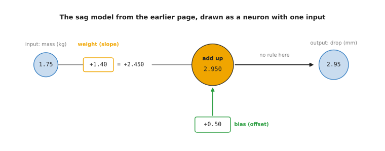
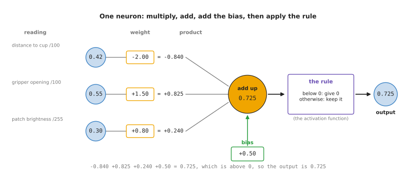
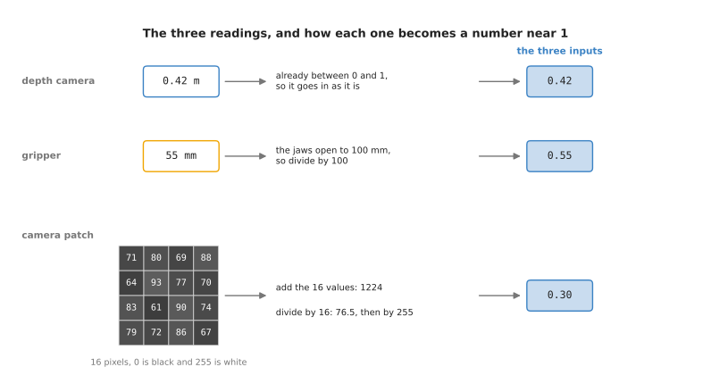
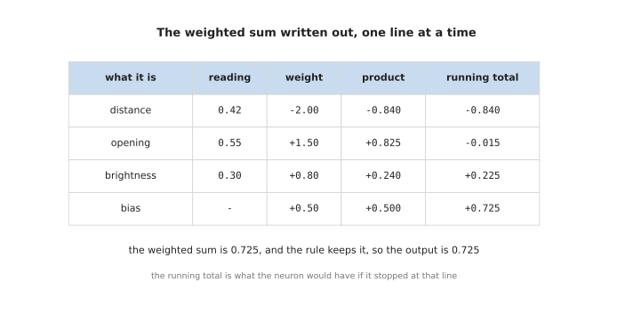
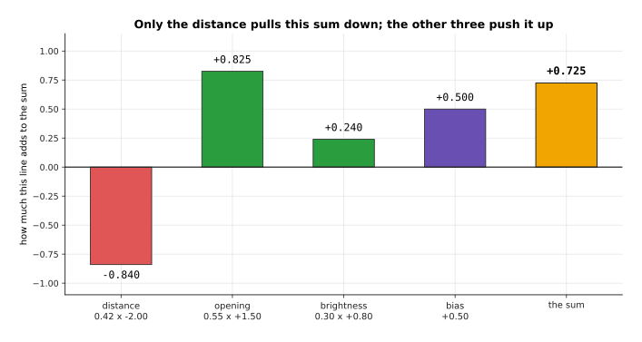
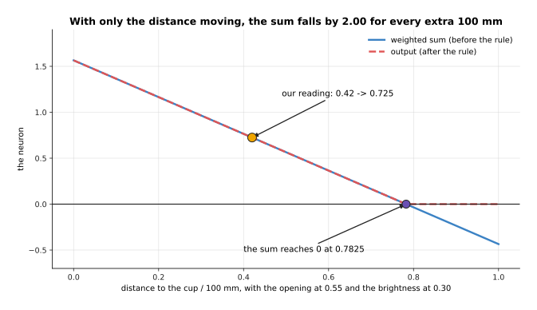
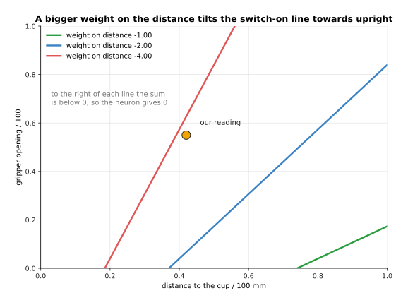
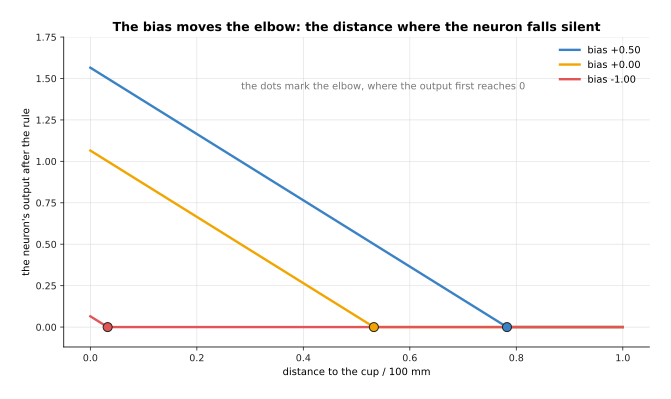

# One neuron, worked out by hand

The page before this one, [the smallest network](02_the-smallest-network.md),
drew neurons as circles and told you what each one gives without ever opening one.
This page opens one. A neuron is the smallest part that a neural network is built
from, and it is one small piece of arithmetic that owns a few numbers of its own.
It is worked out here in full with real numbers, so that nothing in the rest of
the chapter stays a word you have to accept without checking it. Everything is worked out on one
made-up moment of one grasp, in which a robot arm is reaching for a cup.

When you reach the end of this page you will know which four numbers one neuron
owns, what each of those numbers changes, and at which reading the neuron stops
answering. The page ends on a limit that no choice of those four numbers can pass,
because the line that divides the neuron's yes from its no is always straight.
[Activation functions](06_activation-functions.md) is the page that passes that
limit, so this page is what you need before that one.

## Contents

1. [From a model to a neuron](#1-from-a-model-to-a-neuron)
2. [What one neuron is made of](#2-what-one-neuron-is-made-of)
3. [The weighted sum, line by line](#3-the-weighted-sum-line-by-line)
4. [What changes when a weight or the bias changes](#4-what-changes-when-a-weight-or-the-bias-changes)
5. [Where to read next](#5-where-to-read-next)
6. [Using it in Python](#6-using-it-in-python)

---

## 1. From a model to a neuron

This section connects the word model to the word neuron, and it says where the
numbers that go into a neuron come from. The earlier page
[what a model is](../01_what-learning-means/03_what-a-model-is.md) covers models
in full, with every step worked out. This section repeats only the part that this
page needs.

A **model** is a formula with adjustable numbers inside it, together with the
values that those numbers have been given. You hand the model some numbers, it
does its arithmetic, and it hands back an answer. The numbers you hand it are its
**inputs**, and the answer is its **output**. The adjustable numbers inside it are
its **parameters**, and finding good values for them is called **training**.

The earlier page built the smallest useful model. A robot arm bends a little when
a mass hangs on its wrist, so the tool tip sits lower than the controller expects.
That bending is called sag. Somebody measured the sag for six masses and fitted a
straight line to the measurements. The result was the formula
sag = 1.4 x mass + 0.5. Its input is the mass in kilograms. Its output is the drop
of the tool tip in millimetres. Its two parameters are 1.4 and 0.5.

That formula already has the shape of a neuron. The picture below redraws it in
the shape that the rest of this page uses for a neuron. Read it from left to
right.



The input of 1.75 kg is multiplied by 1.4, which gives 2.45. Then 0.5 is added,
which gives 2.95. So the model predicts a drop of 2.95 mm. A number that
multiplies an input is called a **weight**. A number that is added at the end,
whatever the input is, is called a **bias**. So the slope of the sag line is a
weight, and its offset is a bias.

A neuron does the same arithmetic with two changes. First, it can take several
inputs, and each input gets its own weight. Second, it passes its total through a
simple rule before it hands the total on. The sag model has no rule, which is why
the picture says "no rule here". The section
[why multiplying and adding is not enough](06_activation-functions.md#1-why-multiplying-and-adding-is-not-enough) explains why a neuron needs one.

A **neural network** is a model built from many neurons. The outputs of some
neurons become the inputs of others, and the whole network is still one formula
with parameters inside it. So the relation between the two words is this. A
neuron is the smallest piece, and a network is a model made by joining many of
those pieces together. Every weight and every bias of every neuron is one
parameter of the model. The page after this one,
[layers and depth](07_layers-and-depth.md), shows how the neurons are joined.

The inputs come from outside the model, because a model never reads a sensor
itself. A program on the robot reads the sensors at one moment. It turns each
reading into one number, and it puts those numbers in a fixed order. That ordered
list of numbers is what arrives at the model, and each number in the list is one
input. The order matters, because the first weight always multiplies the first
number in the list. If the program swapped two readings, each weight would
multiply the wrong reading. The answer would be wrong, and nothing would report an
error.

For the sag model the list holds one number, which is the mass. The neuron on the
rest of this page reads three numbers. They come from three sensors on an arm at
the moment it reaches for a cup. The next section,
[what one neuron is made of](#2-what-one-neuron-is-made-of), shows those three readings and the four
numbers the neuron owns, because both have to be known before any arithmetic can
start.


---

## 2. What one neuron is made of

The section before this one showed that a neuron is the sag model with more
inputs and a rule at the end. Before you can watch a neuron work, you need to know
what goes into it and which numbers belong to it, and this section lays both out.
The smallest function of that kind that is worth looking at is one neuron with
three inputs. The numbers that go into a neuron are called its **inputs**. The
single number that comes out of it is called its **output**. Between the inputs
and the output there are only four numbers, and those four numbers belong to the
neuron itself.

The picture below follows one set of three inputs through the whole neuron, from
left to right, and shows every number on the way.



In that picture the three readings 0.42, 0.55 and 0.30 are multiplied by the
three numbers -2.00, +1.50 and +0.80. The three results and one more number,
+0.50, are added together, and they make 0.725. The rule at the end passes 0.725
through without changing it, because 0.725 is above 0.

Those three readings come from a robot arm that is about to close its gripper on
a cup. The first reading is the distance from the gripper to the cup in metres,
and a depth camera has measured it as 0.42. A depth camera is a camera that
reports how far away each point in front of it is. The second reading is how far
open the gripper is, and the gripper reports it as 55 millimetres. The third
reading is how bright the small patch of the camera picture is at the place where
the cup should be.

Those three readings arrive in three different units. A neuron cannot do anything
sensible with a 0.42 standing next to a 55, because the number that makes the
second reading count would have to be a hundred times smaller than the number
that makes the first one count. So each reading is first turned into a number
between 0 and 1, and that step is called scaling.

The picture below shows the three readings on three rows, and each row shows how
one raw reading becomes a scaled number.



The distance is already between 0 and 1, so it goes in as it is. The gripper
opening of 55 millimetres is divided by 100, because the jaws open to 100
millimetres at most. The sixteen pixel values in the patch add up to 1,224, so
their average is 76.5 out of a possible 255. Dividing 76.5 by 255 gives 0.300.

So the three numbers that reach the neuron are 0.42, 0.55 and 0.30. Now the four
numbers that the neuron owns come in. Each input has one number of its own, which
is called a **weight**. A weight says how much that input counts and in which
direction. The neuron also has one further number, which is called its **bias**,
and the bias is added to the total whatever the inputs are.

The weight on the distance is -2.00. The weight on the opening is +1.50. The
weight on the brightness is +0.80. The bias is +0.50. These are the same four
numbers that the first picture in this section showed in its boxes. That is four
numbers for a neuron with three inputs.

A weight below 0 means that the neuron's answer gets smaller as that reading gets
bigger. A weight above 0 means the opposite, so the answer gets bigger as that
reading gets bigger. The weights here were picked so that this neuron answers one
question, which is whether the arm is near a bright object with its gripper open.
That combination is the moment when closing the gripper is likely to work. The
distance has a minus weight because being far away counts against that moment.
The other two readings have plus weights because they count in favour of it. In a
real network nobody picks these four numbers by hand, because training picks
them, and the chapter [how training
works](../03_how-training-works/01_the-score-of-being-wrong.md) explains that
search.

The three readings here are of three different kinds: a distance, an opening and
a brightness. Nothing requires that. A neuron only ever sees numbers, so its
inputs can all be of one kind, such as sixteen pixel brightnesses. They can also
be of different kinds, as they are here. What matters is that each reading is
scaled first, so that no reading counts for more just because of its unit.

This page uses three readings so that you can follow the arithmetic by hand. A
real robot might have 50 readings, and nobody decides which of them go to which
neuron. In the usual layout, every neuron receives all 50 readings, and each
neuron has 50 weights of its own. Training then sets those weights. When training
leaves a neuron's weight on one reading close to 0, that neuron in effect ignores
that reading. So the combination of readings that each neuron responds to is found
by training, and no person chooses it. [Layers, depth and
width](07_layers-and-depth.md) describes this layout, which is called a [fully
connected layer](07_layers-and-depth.md#2-fully-connected-and-what-joining-everything-costs).

The inputs and the four numbers are now all on the table. The next section,
[the weighted sum](#3-the-weighted-sum-line-by-line), puts them together into the one number the neuron
works with.


---

## 3. The weighted sum, line by line

The section before gave the three inputs and the four numbers of the neuron, so
the neuron can now do its first job. Everything else on this page changes one of
these numbers and watches what happens to the result, so this calculation is the
one to follow closely. That job is to work out the **weighted sum**, which
means multiplying each input by its own weight, adding those results together,
and then adding the bias. The whole calculation is short enough to write out
completely.

```
distance     0.42  x  -2.00  =  -0.840      running total  -0.840
opening      0.55  x  +1.50  =  +0.825      running total  -0.015
brightness   0.30  x  +0.80  =  +0.240      running total  +0.225
bias                  +0.50  =  +0.500      running total  +0.725
```

The picture below is the same calculation as a table. Read it one row at a time,
from left to right, and the last column keeps the total so far.



The three products are -0.840, +0.825 and +0.240. The bias adds +0.500 more. The
running total after the last row is +0.725, and that number is the weighted sum.

The running total in the last column is worth following. After the distance alone
the total is below 0. Only when the opening is added does the total rise back
above 0. This is what a weighted sum does, because it lets several readings pull
the answer in different directions, and the weights decide which reading pulls
hardest.

The picture below draws each row of the table as one bar, so you can see which
readings push the total up and which one pulls it down.



Only the distance pulls this sum down, because it is the only reading with a
minus weight. The opening pushes the sum up the hardest, by +0.825.

The table and the bars describe one moment, with the arm standing still at 0.42
metres. A robot does not stand still, so the useful question is how the sum
changes as the readings change. The answer tells you where the neuron says yes
and where it says no, and that dividing point is what the rest of this page is
about. The next two pictures answer that question, first for one reading and then
for two.

The next picture holds the opening at 0.55 and the brightness at 0.30, and it
moves the distance from 0 to 1 metre. Only one input changes, and that input is
multiplied by one fixed weight, so the answer has to be a straight line. The line
falls by exactly 2.00 for every extra metre, because the weight on the distance
is -2.00.



At 0 metres the sum is 1.565. At our reading of 0.42 metres it is 0.725. It
crosses 0 at 0.7825 metres, and after that point the rule holds the output at 0.

That crossing point at 0.7825 metres is the distance at which this neuron stops
answering. A neuron reads all of its readings at once, though, so one reading at a
time does not show the whole decision. When two readings move together, the place
where the sum crosses 0 is no longer a single point. It becomes a line across the
picture, with yes on one side of it and no on the other.

The picture below sweeps the distance along the bottom and the gripper opening up
the side. The colour gives the weighted sum at each pair of readings, and the
black line marks every pair where the sum is exactly 0.


Over the whole square the sum runs from -1.260 to +2.240. The line where the sum
is exactly 0 reaches an opening of 0.84 at a distance of 1 metre, and it leaves
the square through the bottom edge. Our own reading sits well inside the part
where the sum is above 0.

The straightness of that line is the most important limit of a single neuron,
and [why multiplying and adding is not enough](06_activation-functions.md#1-why-multiplying-and-adding-is-not-enough) returns to it. Before that,
the next section, [what changes when a weight or the bias changes](#4-what-changes-when-a-weight-or-the-bias-changes), moves
that line by changing the neuron's four numbers, because those four numbers are
the only thing training can change.


---

## 4. What changes when a weight or the bias changes

The section before ended with a straight line that divides yes from no. This
section asks what moves that line. The question matters because training, which
the next chapter explains, does nothing except change weights and biases. So what
these four numbers control is everything that training can do to one neuron.

This section changes one of the four numbers at a time and shows what the neuron
does differently. There are three things to see. The sign of a weight decides
what the neuron is for. The size of a weight decides how much the neuron cares
about that reading. The bias decides where the neuron stops answering.

Start with the sign. Keep the same three readings, and change the weight on the
distance from -2.00 to +2.00. The distance row then gives +0.840 instead of
-0.840, and the sum rises from +0.725 to +2.405. With the minus weight the neuron
answers whether the arm is close to the object. With the plus weight it answers
whether the arm is far from it. The robot did not change, and only one weight did.

Now the size. The picture below draws the line where the sum is exactly 0, for
three sizes of the weight on the distance. The other numbers stay as they were.



The bigger the weight, the closer to upright the line stands. An upright line
means that the distance alone decides whether the neuron is on, and the opening
hardly matters.

Last, the bias. It is added whatever the readings are, so it moves the line
without tilting it. The picture below shows this with only the distance moving.



With the bias +0.50 the output reaches 0 at 0.7825 metres. With 0.00 it reaches 0
at 0.5325 metres. With -1.00 it reaches 0 at only 0.0325 metres. So a lower bias
makes the neuron stop answering at a shorter distance.

Those four numbers are the only freedom this neuron has. Whatever you do to them,
the dividing line stays straight. That is where this page stops and the next one
starts, because [why multiplying and adding is not
enough](06_activation-functions.md#1-why-multiplying-and-adding-is-not-enough)
shows why a straight line is a problem, and why the rule at the end of the neuron
is the thing that solves it.


---

## 5. Where to read next

- [A network on a robot](04_a-network-on-a-robot.md) is the next page. It puts
  this neuron back among the other three and follows one whole grasp from the
  sensors to the decision.
- [Activation functions](06_activation-functions.md) takes the straight dividing
  line that this page ended on and shows the one small rule that lets a neuron
  bend it.
- [Layers, depth and width](07_layers-and-depth.md) joins many copies of this
  neuron into a layer, stacks those layers, and explains what each extra layer
  adds and what it costs.
- [The shape of the numbers](09_the-shape-of-the-numbers.md) explains how these
  weights are stored and multiplied, and why the hardware is built the way it is.
- [The score of being wrong](../03_how-training-works/01_the-score-of-being-wrong.md)
  starts the chapter that searches for the weights and biases this page chose by
  hand.
- [Inside a neural network](../../07_learned-models/01_what-models-are/03_inside-a-neural-network.md)
  is the short version of the same ideas in the catalogue of models, and it
  carries on into the layer types used for pictures and sentences.

---

## 6. Using it in Python

Everything on this page is one line of PyTorch, which is the library most of this
book's models are built with. The code below builds the same neuron as
[what one neuron is made of](#2-what-one-neuron-is-made-of), puts the same three
readings through it, and checks the arithmetic of
[the weighted sum](#3-the-weighted-sum-line-by-line).

```python
import torch
from torch import nn

neuron = nn.Linear(in_features=3, out_features=1)   # 3 weights + 1 bias
with torch.no_grad():                               # fix them by hand, as this page did
    neuron.weight.copy_(torch.tensor([[-2.0, 1.5, 0.8]]))
    neuron.bias.copy_(torch.tensor([0.5]))

readings = torch.tensor([[0.42, 0.55, 0.30]])       # the three scaled readings
total = neuron(readings)                            # the weighted sum
print(f"{total.item():.4f}")                        # 0.7250
print(sum(p.numel() for p in neuron.parameters()))  # 4
```

The class is called `nn.Linear` and not `nn.Neuron`, because it is written to hold
a whole layer of neurons at once. Asking for one output is how you get a single
neuron out of it. The library gives you the weights, the bias, the multiplying and
the adding, so you never write the arithmetic of
[the weighted sum](#3-the-weighted-sum-line-by-line) yourself.

Each number is printed to four decimal places on purpose. PyTorch works in a
number format called float32, which keeps only about seven digits, so the full
printout would end in digits that depend on the order in which the machine added
things up. The page [the shape of the numbers](09_the-shape-of-the-numbers.md)
explains that format and the smaller ones that models are run in.

What you have to decide is none of the arithmetic and all of the shape. You choose
how many inputs the layer takes and how many neurons it has, which
[layers, depth and width](07_layers-and-depth.md) is about. You also choose which
rule to apply after it, which [activation functions](06_activation-functions.md)
weighs up. You do not choose the weights or the bias, because training chooses
those.
