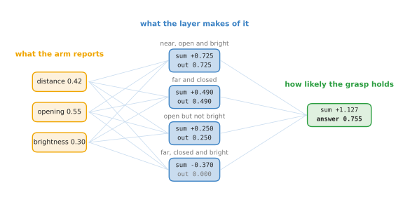
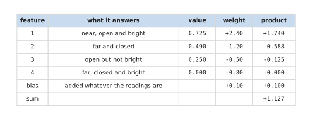
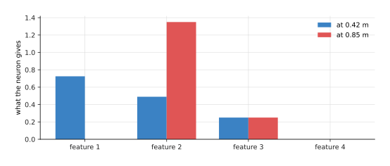
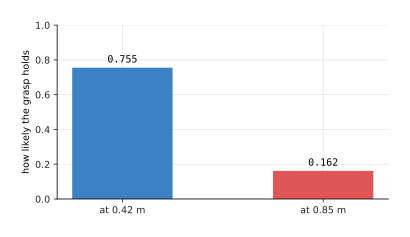

# A network on a robot

[One neuron](03_one-neuron.md) worked one neuron out in full, and [the smallest
network](02_the-smallest-network.md) put four of them between the readings and the
answer. Both pages were about the machinery. This page is about what the machinery
is for. It takes one moment of one robot arm, puts it through the whole network
from the sensors to the answer, and says at every step what the numbers mean for
the arm rather than only what they are.

The reason to do this now, before the chapter goes any further, is that a network
is easy to follow as arithmetic and hard to connect to a machine. It is worth
seeing once that nothing mysterious happens in between: a sensor reading becomes a
number, numbers become features, features become one answer, and a program on the
robot acts on that answer.

The network here is the two-layer one from the smallest network, with the same
weights, so nothing new has to be set up.

When you reach the end you will have followed one moment from three sensors to one
decision, you will know what each of the four features is saying about the arm,
and you will have seen the same network answer differently when the arm moves.

## Contents

1. [The question the network is asked](#1-the-question-the-network-is-asked)
2. [From the arm's readings to four features](#2-from-the-arms-readings-to-four-features)
3. [From four features to one answer](#3-from-four-features-to-one-answer)
4. [The same network at a different moment](#4-the-same-network-at-a-different-moment)
5. [Where to read next](#5-where-to-read-next)

---

## 1. The question the network is asked

Everything on this page depends on the question being a real one, so it is worth
stating carefully before any arithmetic starts.

A robot arm is reaching for a cup on a table. The gripper is open and moving
towards it. At some moment the controller has to decide whether to close the
gripper, and closing it at the wrong moment is expensive: too early and the
gripper shuts on air, too late and it pushes the cup over. So the question is
whether closing now would result in a grasp that holds.

Nobody can write that rule down. The right moment depends on how far away the cup
is, on how wide the gripper is open, on whether the thing in front of the gripper
is really the cup, and on how those three combine. That combination is exactly the
kind of thing the chapter [where rules stop
working](../01_what-learning-means/02_where-rules-stop-working.md) says a model is
for.

The network is asked for one number between 0 and 1, read as how likely the grasp
is to hold. A program on the robot, not the network, decides what to do with that
number: close above some level, keep moving below it. The network makes no
decision and moves nothing. It answers a question, and a plain program written by
a person acts on the answer. That division is worth remembering, because it is how
nearly every learned model sits inside a working robot.

Three readings go in, and
[from the arm's readings to four features](#2-from-the-arms-readings-to-four-features)
follows them.

---

## 2. From the arm's readings to four features

This section is the first half of the network, and it is where the readings stop
being readings. Before anything can be multiplied, each sensor has to give one
number, and the three numbers have to be on a comparable scale.

The distance to the cup comes from a depth camera, which is a camera that reports
how far away each point in front of it is. At this moment it reads 0.42 metres.
The gripper opening comes from the gripper itself, which reports 55 millimetres
out of the 100 it can open, so the number used is 0.55. The brightness comes from
a small patch of the camera picture where the cup should be, averaged and divided
by its largest possible value, which gives 0.30. [One
neuron](03_one-neuron.md#2-what-one-neuron-is-made-of) works that scaling out in
full.

So the arm's state at this moment is the three numbers 0.42, 0.55 and 0.30, in
that fixed order. The order matters and never changes, because the first weight of
every neuron always multiplies the first number. If the program ever swapped two
readings, every weight would be multiplying the wrong thing, and nothing would
report an error.

The picture below follows those three numbers through the whole network, so you
can see both halves at once before reading about either.

Each of the four neurons reads all three numbers and gives one number back, so the
layer turns three numbers into four. Those four are the features. What makes this
example readable is that the weights were chosen by hand so that each neuron has a
description a person can state, which is not true of a trained network.

The first neuron has a minus weight on distance and plus weights on opening and
brightness, so it answers how near, open and bright this moment is. Its sum is
+0.725. The second has the opposite weights on the first two, so it answers how
far and closed the arm is, and its sum is +0.490. The third watches for a wide
gripper with nothing bright in front of it, and gives +0.250. The fourth, which
would answer about being far, closed and bright, reaches -0.370.

That last one matters. The rule at the end of each neuron turns any total below 0
into 0, so the fourth feature is exactly 0.000. The neuron is not saying "a
little"; it is saying nothing at all about this moment. A quarter of this layer is
silent here, and that is normal rather than a fault. [Activation
functions](06_activation-functions.md#2-the-rectified-linear-unit) is where that
rule and its cost are worked out.

So the three readings have become the four features 0.725, 0.490, 0.250 and
0.000, and the second half of the network never sees the arm again. What that
second half does with them is
[from four features to one answer](#3-from-four-features-to-one-answer).

---

## 3. From four features to one answer

This section is the other half. The output neuron reads only the four features,
and its job is to weigh them against each other.

Its four weights say which features count for the grasp and which count against
it. The first feature, near and open and bright, is the one that speaks in favour,
so its weight is the largest at +2.40. The other three count against, with weights
of -1.20, -0.50 and -0.80. The bias is +0.10.

The picture below is that arithmetic as a table. Read one row at a time: the
feature, what it answers, its value, its weight, and the product of the last two.

The first feature contributes +1.740, which is almost everything. The second takes
away 0.588 and the third takes away 0.125. The fourth takes away nothing at all,
because its value is 0, and that is worth noticing: a silent feature cannot push
the answer in either direction however large its weight is. Adding the bias gives
a total of +1.127.

That total is then squeezed into a probability by the sigmoid, which gives 0.755.
So the network's answer is that this grasp has about a three in four chance of
holding, and a program on the robot decides whether three in four is good enough
to close on.

It is worth seeing what the whole network amounts to. Twenty-one numbers, sixteen
in the layer and five in the output neuron, turned three sensor readings into one
decision. No part of it is more than multiplication, addition and two simple
rules. The thing that would make it useful on a real arm is not more cleverness in
any step; it is having far more readings, far more neurons, and weights found by
training instead of chosen by hand.

A single moment proves little, though, so
[the same network at a different moment](#4-the-same-network-at-a-different-moment)
moves the arm and asks the same question again.

---

## 4. The same network at a different moment

This section asks what happens when the arm is somewhere else. Nothing about the
network changes. The weights, the biases and the shape all stay exactly as they
were, and only the readings move.

The arm is now further away, at 0.85 metres instead of 0.42, with the gripper
opening and the brightness unchanged. That is a moment where closing the gripper
would obviously be wrong, so a network worth anything should say so.

The picture below gives the four features at both moments side by side.

The first feature falls from 0.725 to 0.000, because the arm is no longer near.
The second rises from 0.490 to 1.350, because it answers how far and closed the
arm is, and the arm is now much further. The third is unchanged at 0.250, which
makes sense: it asks about the gripper and the brightness, and neither of those
moved. The fourth stays at 0.000.

Those four numbers then go through the same output neuron. The one feature that
spoke in favour has gone silent, and the one that speaks against has nearly
tripled, so the total falls from +1.127 to -1.645.

The picture below gives the answer at both moments.

The answer falls from 0.755 to 0.162. The same twenty-one numbers that said the
grasp would probably hold now say it probably would not, and nothing was changed
to make that happen.

That is what a model is, seen from the robot's side. The numbers inside it are
fixed once training ends, and the whole of its behaviour comes from running those
fixed numbers over whatever the sensors currently say.

---

## 5. Where to read next

- [One neuron of that network](05_one-neuron-of-that-network.md) is the next page.
  It opens one of the four neurons above and shows why it answers what it answers.
- [Activation functions](06_activation-functions.md) explains the rule that held
  the fourth feature at 0.000, and why a network without such a rule could not do
  any of this.
- [Layers, depth and width](07_layers-and-depth.md) takes the layer of four
  neurons and asks what happens when it is wider, and when there are more layers
  after it.
- [The score of being wrong](../03_how-training-works/01_the-score-of-being-wrong.md)
  starts the chapter that would find these twenty-one numbers from recorded
  grasps, instead of a person choosing them.
- [Behaviour cloning and action chunks](../12_models-that-act/01_behaviour-cloning-and-action-chunks.md)
  is where a network stops answering questions about a robot and starts deciding
  what it does next.
