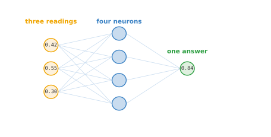
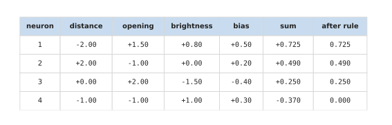
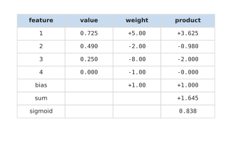
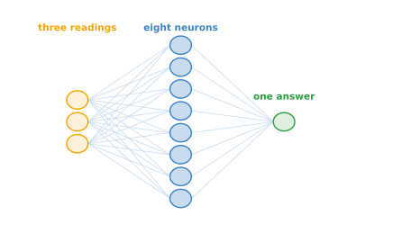
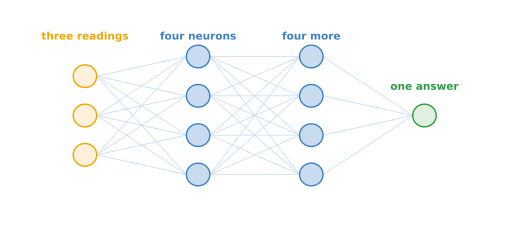
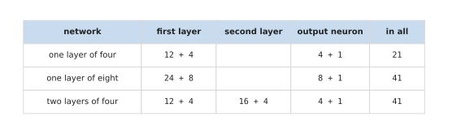

# The smallest network

[One neuron](03_one-neuron.md) worked one neuron out by hand. This page joins
neurons into a network. It starts with the smallest network that has anything in
the middle: three readings, one layer of four neurons, and one neuron at the end
that gives the answer. It works one moment of the grasp through that network with
every number written out. Then it makes the network bigger in the two ways a
network can grow, by making the layer wider and by adding a second layer, and it
counts what each of the three networks costs.

The moment used here is the first one in [the grasp
example](02_the-grasp-example.md#3-three-moments-of-the-reach), in which the
gripper is ready to close on the cup. Its readings are 0.42, 0.55 and 0.30.

When you reach the end you will know what each neuron of a small network does
with those three readings, how the neuron at the end turns four numbers into one
probability, and how many numbers a network owns when it is made wider or deeper.

## Contents

1. [One layer of four neurons](#1-one-layer-of-four-neurons)
2. [The layer, worked out](#2-the-layer-worked-out)
3. [The neuron at the end, worked out](#3-the-neuron-at-the-end-worked-out)
4. [A wider layer, and a second layer](#4-a-wider-layer-and-a-second-layer)
5. [What each network owns](#5-what-each-network-owns)
6. [Where to read next](#6-where-to-read-next)

---

## 1. One layer of four neurons

This section draws the network before any arithmetic, so that you know where each
number on the rest of the page belongs.

The picture below shows the whole network. Read it from left to right.

The three circles on the left are the readings. Each of the four neurons in the
middle is a neuron like the one on [one neuron](03_one-neuron.md). It reads all
three readings, multiplies each by a weight of its own, adds a bias of its own,
and puts the total through the rule. So each of the four neurons owns three
weights and one bias.

Each neuron gives one number, so the layer turns three numbers into four. Those
four numbers are the **features** that [neural networks and
neurons](01_networks-and-neurons.md#2-why-there-is-anything-in-the-middle)
described: numbers worked out from the readings that say something useful about
them.

The circle on the right is the neuron at the end. It never reads the arm. It reads
only the four features, multiplies each by a weight of its own, adds a bias, and
turns the total into a probability. Counting the layers that do arithmetic, this
network has two: the layer of four neurons, and the neuron at the end.

The first thing to work out is what the four neurons give, and [the layer, worked
out](#2-the-layer-worked-out) does that.

---

## 2. The layer, worked out

The section before said that each of the four neurons owns three weights and a
bias. This section gives those numbers and works out the four features from them.

The table below has one row for each neuron. The columns headed distance, opening
and brightness hold that neuron's weight on each reading. The bias column holds
its bias. The sum column is the three readings multiplied by the three weights,
added together, with the bias added. The last column is what is left after the
rule.

The first row is the neuron that [one neuron](03_one-neuron.md) worked out in
full, with the weights -2.00, +1.50 and +0.80 and the bias +0.50. Its sum is
+0.725.

The other three rows work the same way. Take the last one. Its weights are -1.00,
-1.00 and +1.00, and its bias is +0.30. The distance gives 0.42 x -1.00 = -0.420.
The opening gives 0.55 x -1.00 = -0.550. The brightness gives 0.30 x +1.00 =
+0.300. Adding those three and the bias gives -0.420 - 0.550 + 0.300 + 0.300 =
-0.370.

The rule at the end of each neuron is the one from [one
neuron](03_one-neuron.md#1-what-one-neuron-is-made-of): a total below 0 becomes
0, and any other total passes through unchanged. So the first three sums pass
through, and the fourth becomes 0.000. The four features are 0.725, 0.490, 0.250
and 0.000.

The weights in this table were chosen by hand, so that each neuron answers a
question a person can state, such as whether the arm is near the cup with the
gripper open and the cup straight ahead. [A network on a
robot](05_a-network-on-a-robot.md#1-what-each-of-the-four-features-says) says what
each of the four answers. In a trained network the weights are found by training,
and the features usually have no such tidy description.

The four features now go to the neuron at the end, and [the neuron at the end,
worked out](#3-the-neuron-at-the-end-worked-out) follows them there.

---

## 3. The neuron at the end, worked out

The section before turned the three readings into four features. This section
turns those four features into the network's answer.

The neuron at the end owns four weights, one for each feature, and one bias. A
weight above 0 means that feature counts for the grasp holding. A weight below 0
means it counts against. The table below works the arithmetic out one row at a
time: the feature's value, its weight, and the product of the two. The last three
rows give the bias, the sum and the answer.

The first feature has the weight +5.00, and 0.725 x 5.00 = +3.625. The second has
the weight -2.00, and 0.490 x -2.00 = -0.980. The third has the weight -8.00, and
0.250 x -8.00 = -2.000. The fourth has the weight -1.00, but its value is 0, so it
adds nothing. A feature of 0 cannot push the answer either way, however large its
weight is. Adding the bias of +1.00 gives a total of +3.625 - 0.980 - 2.000 + 1.000
= +1.645.

The answer wanted is a probability, meaning a number between 0 and 1. So the
neuron at the end uses a different rule. It is called the **sigmoid**, and it
squeezes any number into that range. A large negative number comes out near 0, a
large positive number comes out near 1, and 0 comes out as exactly one half. The
total of +1.645 comes out as 0.838. So the network says that if the gripper
closed now, the grasp would hold about five times in six. [Activation
functions](07_activation-functions.md) explains both rules properly.

The four weights and the bias of this neuron were chosen by hand too. They were
chosen so that the three moments of the grasp example come out the way a person
watching the arm would judge them, and [a network on a
robot](05_a-network-on-a-robot.md) checks all three.

That is the smallest network with a middle, worked out completely. A working
network is bigger, and [a wider layer, and a second
layer](#4-a-wider-layer-and-a-second-layer) shows the two ways it can grow.

---

## 4. A wider layer, and a second layer

The network so far has one layer of four neurons. There are only two ways to make
it bigger: put more neurons in that layer, or add another layer after it. This
section draws one of each, keeping the same three readings and the same single
answer.

The first way makes the layer wider. The picture below has one layer of eight
neurons instead of four.

Every one of the eight neurons still reads the three readings. So the network now
works out eight features from the readings instead of four, and the neuron at the
end weighs eight numbers against each other. A wider layer gives the network more
separate questions to ask about the readings at the same time.

The second way makes the network deeper. The picture below keeps the first layer
of four neurons and adds a second layer of four after it.

The neurons in the second layer never read the arm. Each one reads the four
features of the first layer, so it works out a feature of features. The neuron at
the end then reads those. A second layer lets the network build its questions out
of the answers to simpler ones.

Neither picture has numbers in its circles. Working an answer out would need new
weights, and weights picked by hand for eight neurons, or for a second layer, mean
nothing in particular. What the two shapes can do differently is the subject of
[layers, depth and width](08_layers-and-depth.md). What can be worked out now is
what each one costs, and [what each network owns](#5-what-each-network-owns) counts
it.

---

## 5. What each network owns

Every weight and every bias is a number the network owns, which training has to
find and which a computer has to store. This section counts them for the three
networks on this page.

A layer of neurons that reads a list of numbers owns one weight for every pair of
a number read and a neuron, plus one bias for each neuron. So a layer of 4 neurons
reading 3 readings owns 3 x 4 = 12 weights and 4 biases.

The table below counts the three networks. Read it a row at a time. Each middle
column gives the weights plus the biases of one layer, and the last column adds
them all up.

The network with one layer of four owns 21 numbers. Making that layer eight
neurons wide takes it to 41. Adding a second layer of four instead also takes it to
41, because the second layer owns 4 x 4 = 16 weights and 4 biases.

So here the two ways of growing cost exactly the same. That is a coincidence of
these sizes, but it makes the point clearly. The cost of a network is set by how
many numbers it owns, and a wider network and a deeper one can own the same number
while doing different things with them. [Layers, depth and
width](08_layers-and-depth.md) shows what each one does, and [layers, depth and
width, worked out](09_layers-and-depth-worked-out.md) counts the cost for larger
networks.

These sizes are far from realistic. A layer in a working model usually holds
hundreds or thousands of neurons, and a network usually has many layers. The
arithmetic does not change at all with the size, which is why it is worth
following while the numbers are still small.

---

## 6. Where to read next

- [A network on a robot](05_a-network-on-a-robot.md) is the next page. It runs
  all three moments of the grasp example through the network with one layer of
  four, and says what each feature means for the arm.
- [Activation functions](07_activation-functions.md) explains the two rules used
  on this page, and shows why a network without them is no better than one neuron.
- [Layers, depth and width](08_layers-and-depth.md) compares the wider network and
  the deeper one, and says what each extra layer gives you.
