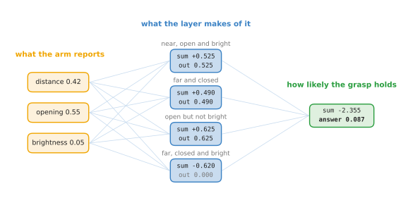
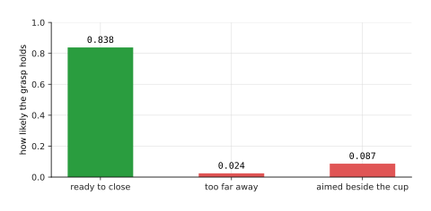

# A network on a robot

[The smallest network](04_the-smallest-network.md) worked one moment of the grasp
through a network of four neurons and one neuron at the end, and it got the answer
0.838. That page was about the arithmetic. This page is about whether the answer
is any good. A network is only useful if it gives the right answer at every moment
of the reach, so this page puts all three moments of [the grasp
example](02_the-grasp-example.md#3-three-moments-of-the-reach) through the same
network and compares each answer with the one a person watching would give.

The network is the one from the smallest network, with the same weights, so
nothing new has to be set up. Only the readings change from one moment to the
next.

When you reach the end you will know what each of the four features says about
the arm, how the features move when the arm moves, and how the same fixed
twenty-one numbers give a high probability at one moment and a low one at the
others.

## Contents

1. [What each of the four features says](#1-what-each-of-the-four-features-says)
2. [Ready to close](#2-ready-to-close)
3. [Too far away](#3-too-far-away)
4. [Aimed beside the cup](#4-aimed-beside-the-cup)
5. [What the network amounts to](#5-what-the-network-amounts-to)
6. [Where to read next](#6-where-to-read-next)

---

## 1. What each of the four features says

The three moments differ in which features rise and which fall, so this section
first says what each feature is watching for. The weights of each neuron are in
[the layer, worked out](04_the-smallest-network.md#2-the-layer-worked-out).

The first neuron has a minus weight on the distance and plus weights on the
opening and the brightness. So it is large when the cup is near, the gripper is
open and the cup is straight ahead. It answers "near, open and bright", and it is
the one feature that speaks for closing.

The second neuron has a plus weight on the distance and a minus weight on the
opening. So it is large when the cup is far away or the gripper is nearly shut. It
answers "far and closed".

The third neuron has a plus weight on the opening and a minus weight on the
brightness. So it is large when the gripper is open but nothing bright is
straight ahead. It answers "open but not bright". That is the sign of a gripper
aimed at empty table.

The fourth neuron would answer "far, closed and bright". None of the three moments
has all three of those, so it stays at 0 in every one of them.

The neuron at the end has a weight of +5.00 on the first feature and minus weights
on the other three. So the first feature pushes the answer up, and the others
pull it down. The third has the largest minus weight, -8.00, because an open
gripper with nothing in front of it is the clearest sign that closing would miss.

With that in mind, [ready to close](#2-ready-to-close) runs the first moment.

---

## 2. Ready to close

This is the moment the smallest network already worked out, shown here as one
picture so that the other two moments can be set beside it. The arm is drawn at
this moment in [the grasp
example](02_the-grasp-example.md#3-three-moments-of-the-reach): the cup is between
the fingers, 42 millimetres from the palm.

The picture below follows the readings 0.42, 0.55 and 0.30 through the whole
network. Each neuron's box gives its sum and what the rule leaves of it, and the
box on the right gives the total and the answer.

The first feature is 0.725, so the one feature that speaks for closing is strong.
The second is 0.490 and the third is 0.250, so the features that speak against are
weak. The total is +1.645, and the answer is 0.838. A person watching would say
closing now should hold, and the network agrees.

The next question is whether the network says no when it should, and [too far
away](#3-too-far-away) moves the arm back to find out.

---

## 3. Too far away

The moment before showed the network saying yes. This section moves the arm back,
so that closing would obviously fail, and checks that the network says no.

The cup's near side is now 85 millimetres from the palm, beyond the ends of the
fingers. The opening and the brightness are the same as before. The picture below
follows the readings 0.85, 0.55 and 0.30 through the same network.

The first feature has fallen from 0.725 to 0.000. The cup is no longer near, so
the first neuron's sum drops below 0, to -0.135, and the rule turns it into 0. The
second feature has risen from 0.490 to 1.350, because it watches for a cup that is
far away. The third is unchanged at 0.250, because it reads only the opening and
the brightness, and neither moved.

The feature that spoke for closing is now silent, and a feature that speaks
against it has nearly tripled. The total falls to -3.700, and the answer is 0.024.
The network says the grasp would almost certainly fail, which is right.

The distance alone told those two moments apart. [Aimed beside the
cup](#4-aimed-beside-the-cup) is a moment where the distance is no help at all.

---

## 4. Aimed beside the cup

The two moments before differed in their distance. This section uses a moment
with the same distance as the one where closing works, to check that the network
is not just reading the distance.

The cup is as close as in the first moment, but it is off to one side, outside the
fingers. The centre of the camera picture falls on the dark table, so the
brightness drops from 0.30 to 0.05. The picture below follows the readings 0.42,
0.55 and 0.05 through the same network.

The first feature has fallen a little, from 0.725 to 0.525, because the brightness
counted in its favour and the brightness has dropped. The second is unchanged at
0.490, because it reads only the distance and the opening. The third feature has
risen from 0.250 to 0.625. That is the "open but not bright" neuron noticing that
nothing is straight ahead.

The neuron at the end weighs the third feature at -8.00, so its rise of 0.375 pulls
the total down by 3.000. The total falls to -2.355, and the answer is 0.087. The
network says closing would probably miss, which is right. It got there because one
of its neurons watches the brightness, and a network that read only the distance
would have said yes here.

Three moments and three right answers is enough to see what the network as a
whole is, and [what the network amounts to](#5-what-the-network-amounts-to) steps
back to say it.

---

## 5. What the network amounts to

The three sections before each looked at one moment. This section puts the three
answers side by side.

The picture below gives the network's answer at each of the three moments.

The answer is 0.838 when the gripper is ready to close, 0.024 when it is too far
away, and 0.087 when it is aimed beside the cup. A program on the robot reads that
number and decides. If it closes the gripper whenever the answer is above one half,
it closes at the first moment and at neither of the others, which is what a person
would have done.

Nothing was changed between the three moments. The same twenty-one numbers,
sixteen in the layer and five in the neuron at the end, gave all three answers.
That is what a model is, seen from the robot's side. The numbers inside it are
fixed once training ends, and all of its behaviour comes from running those fixed
numbers over whatever the sensors currently say.

These twenty-one numbers were chosen by hand to make three moments come out right.
A network on a real arm would have to be right at thousands of moments, which is
why it would have far more readings and far more neurons, and why its weights would
be found by training on recorded grasps rather than picked by a person.

---

## 6. Where to read next

- [One neuron of that network](06_one-neuron-of-that-network.md) is the next page.
  It opens one of the four neurons above and shows why it answers what it answers.
- [Activation functions](07_activation-functions.md) explains the rule that held
  the fourth feature at 0.000, and why a network without such a rule could not do
  any of this.
- [Layers, depth and width](08_layers-and-depth.md) takes the layer of four
  neurons and asks what happens when it is wider, and when there are more layers
  after it.
- [The score of being wrong](../03_how-training-works/01_the-score-of-being-wrong.md)
  starts the chapter that would find these twenty-one numbers from recorded
  grasps, instead of a person choosing them.
- [Behaviour cloning and action chunks](../12_models-that-act/01_behaviour-cloning-and-action-chunks.md)
  is where a network stops answering questions about a robot and starts deciding
  what it does next.
