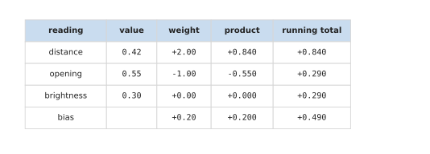
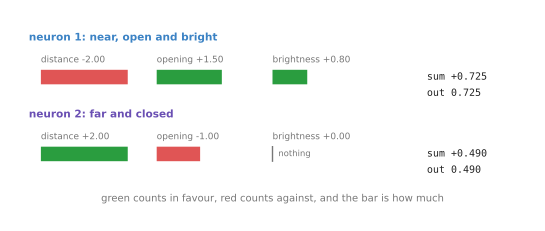

# One neuron of that network

[A network on a robot](04_a-network-on-a-robot.md) followed one moment of a grasp
through a whole network, and treated each of the four neurons in the middle as a
box with a description on it. This page opens one of those boxes. It takes a
single neuron out of that same network, works its arithmetic out line by line on
the same readings, and then puts it next to a different neuron of the same layer
to show why the two disagree.

The reason to do this on a neuron of a network you have already seen, rather than
on a neuron on its own, is that the interesting question about a neuron is not how
it works. [One neuron](03_one-neuron.md) answered that in full. The interesting
question is why one neuron in a layer ends up answering something different from
the one beside it, when both read exactly the same numbers.

When you reach the end you will have followed one neuron of a working network from
its three inputs to its one output, you will know which part of a neuron decides
what it is for, and you will know what a weight of zero means.

## Contents

1. [Which neuron, and why this one](#1-which-neuron-and-why-this-one)
2. [Its arithmetic, line by line](#2-its-arithmetic-line-by-line)
3. [Two neurons, two different questions](#3-two-neurons-two-different-questions)
4. [Where to read next](#4-where-to-read-next)

---

## 1. Which neuron, and why this one

The layer in the middle of that network holds four neurons, and all four read the
same three readings: a distance of 0.42, a gripper opening of 0.55 and a
brightness of 0.30. The one taken apart here is the second of the four, the one
labelled as answering how far and closed the arm is.

It is the second rather than the first on purpose. The first neuron of that layer
is the very neuron that [one neuron](03_one-neuron.md) works out, with the weights
-2.00, +1.50 and +0.80. Following it again would teach nothing new. The second
neuron has almost the opposite weights, so following it shows the part that
actually differs between two neurons of one layer.

Its three weights are +2.00, -1.00 and 0.00, and its bias is +0.20. Four numbers,
exactly as many as the first neuron has, and arranged in exactly the same way. The
machinery of the two neurons is identical, and only the values differ, so
[its arithmetic, line by line](#2-its-arithmetic-line-by-line) follows those
values through to see what they do.

---

## 2. Its arithmetic, line by line

This section does the arithmetic, because the point of the chapter is that nothing
here has to be taken on trust. The neuron multiplies each reading by its own
weight, adds the three results together, and adds the bias.

The picture below is that calculation as a table. Read one row at a time: the
reading, its value, its weight, the product of those two, and the total so far.

The distance of 0.42 multiplied by +2.00 gives +0.840, so the total after one row
is +0.840. The opening of 0.55 multiplied by -1.00 gives -0.550, bringing the
total down to +0.290. The brightness of 0.30 multiplied by 0.00 gives nothing at
all, so the total stays at +0.290. The bias of +0.20 brings it to +0.490.

That total is above 0, so the rule at the end passes it through unchanged, and the
neuron's output is 0.490. This is the number that appeared as the second feature
on the page before, and the output neuron multiplied it by -1.20 there.

Now read the two middle rows again as statements about the arm rather than as
arithmetic. The distance pushed the total up, because this neuron has a plus
weight on distance, so being further away makes this neuron say more. The opening
pulled the total down, because its weight is negative, so a wide gripper makes it
say less. Put together, the neuron says most when the arm is far away and the
gripper is closed, which is exactly the description it was given.

That is the whole of what a weight does. The sign says which way a reading pushes,
and the size says how hard. Since that is all there is to it,
[two neurons, two different questions](#3-two-neurons-two-different-questions)
sets these four numbers beside another neuron's four and asks what the difference
amounts to.

---

## 3. Two neurons, two different questions

This section puts the two neurons side by side, because the comparison is what
this page exists for.

The picture below shows both neurons' weights as bars. Green means the reading
pushes the total up, red means it pulls it down, and the length of the bar is how
much.

The first neuron's distance bar is red and the second neuron's is green. The first
neuron's opening bar is green and the second's is red. Those two sign flips are
the entire difference in what the two neurons are for. One says most when the arm
is near with the gripper open; the other says most when the arm is far with the
gripper closed. They are reading the same three numbers at the same instant and
reaching opposite verdicts, and both verdicts are useful, because the output
neuron weighs one against the other.

The third reading shows something else. The second neuron's weight on brightness
is 0.00, so the bar is missing. A weight of zero means that reading has no effect
on this neuron whatsoever: however bright or dark the patch is, this neuron's
answer does not move. The neuron is in effect ignoring that sensor. Nothing had to
be disconnected for that to happen, because a weight of zero is an ordinary weight
that happens to be zero, and a layer that wants to ignore a reading just sets the
weight to zero and moves on.

That last point is the one to carry into the rest of the chapter. In a real
network there is no step where somebody decides which readings each neuron should
look at. Every neuron is joined to every reading, which is what [fully
connected](07_layers-and-depth.md#2-fully-connected-and-what-joining-everything-costs)
means, and training then decides which of those joins matter by making some
weights large and leaving others near zero. The weights on this page were set by
hand so that the four neurons have descriptions you can read. In a trained network
the same four neurons would still end up with four different sets of weights, and
so four different questions, but nobody would be able to say in advance what any
of them would be, and often nobody can say afterwards either.

---

## 4. Where to read next

- [Activation functions](06_activation-functions.md) is the next page. It takes
  the rule at the end of this neuron, which passed +0.490 through unchanged, and
  shows why a network without it would collapse into one straight line.
- [One neuron](03_one-neuron.md) is the full treatment of a single neuron, with
  the dividing line it draws and what moves that line.
- [Layers, depth and width](07_layers-and-depth.md) asks what happens when a layer
  has far more than four neurons in it, and what a second layer reads.
- [Backpropagation](../03_how-training-works/03_backpropagation.md) is how the
  weights compared on this page would actually be found.
- [Inside a neural network](../../07_learned-models/01_what-models-are/03_inside-a-neural-network.md)
  is a shorter run through the same ideas in the catalogue of models.
