# Activation functions

A neuron multiplies each of its inputs by a weight, adds those results together
and adds a bias. The page before this one, [one neuron](03_one-neuron.md), worked
all of that out by hand, and it ended on a limit: whatever values a neuron's
weights and bias take, the line that divides its yes from its no stays straight.
This page is about the one small rule that removes that limit. The rule is applied
to the weighted sum before the neuron hands its answer on, and it is called an
**activation function**. The number that comes out of it is the neuron's
**activation**, which is where the rule gets its name.

This page is for a reader who has followed one neuron through its arithmetic. You
need to be able to multiply, to add, and to read a graph that has two axes. You do
not need to know how training works, although this page says in several places
what a rule does to training, because the choice between one rule and another is
mostly a choice about how well training goes. Every number in every picture was
worked out and printed by `docs/diagrams/inside_a_network_1.py`.

When you reach the end of this page you will know why a network built only from
multiplying and adding collapses into a single straight line however many layers
it has, what the rule at the end of each neuron adds, and why the models built
today mostly use a smoothed version of the simplest rule rather than the simplest
rule itself.

## Contents

1. [Why multiplying and adding is not enough](#1-why-multiplying-and-adding-is-not-enough)
2. [The rectified linear unit](#2-the-rectified-linear-unit)
3. [GELU and SiLU, and why networks use them now](#3-gelu-and-silu-and-why-networks-use-them-now)
4. [Where to read next](#4-where-to-read-next)
5. [Using it in Python](#5-using-it-in-python)

---

## 1. Why multiplying and adding is not enough

The page before this one ended on a limit. Whatever values a neuron's four
numbers take, the line between yes and no stays straight. Many jobs on a robot
need an answer that rises and then falls, and a straight line cannot give one.
This section is here because that limit is the reason a neuron has a rule at the
end. You saw the rule
in [what one neuron is made of](03_one-neuron.md#2-what-one-neuron-is-made-of), and you saw the sag model in
[from a model to a neuron](03_one-neuron.md#1-from-a-model-to-a-neuron) work without one. This section shows what the
rule is for, and [the rectified linear unit](#2-the-rectified-linear-unit) then describes the rule itself.
The answer comes in three steps. First, many jobs need an output that bends, and one
neuron without the rule can only draw a straight line. Second, putting more
neurons in a row does not fix this if nothing comes between them. Third, the rule
between them does fix it.

Start with a job that a straight line cannot do. The brightness of the patch is
one of those jobs. A patch that is nearly black shows nothing, and a patch that is
completely white shows nothing either. So brightness is good in the middle and bad
at both ends.

The picture below draws what we want from the brightness, which is a shape that
rises to the middle and falls again, and it draws the best straight line through
that shape.

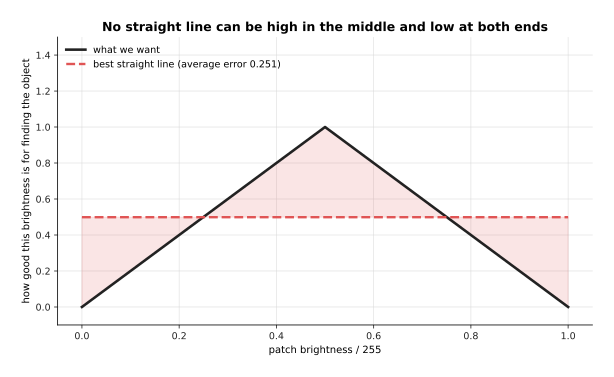

The best straight line through this target is flat at 0.499, and it is wrong by
0.251 on average. A straight line cannot be high in the middle and low at both
ends, so no choice of weight and bias fixes this.

The obvious fix is to use more than one neuron, one after the other. The rest of
this section shows that this fix does nothing on its own. Multiplying by a weight
and adding a bias can only ever make a straight line, and two of these neurons in
a row are exactly equal to one neuron with different numbers.

The picture below puts one reading through two neurons, one after the other, with
nothing applied between them.

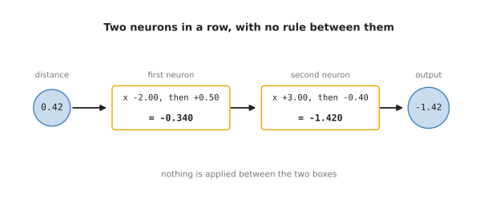

The first neuron turns 0.42 into -0.340. The second neuron turns -0.340 into
-1.420.

The picture below puts the same reading through a single neuron instead, and that
neuron gives the same answer.

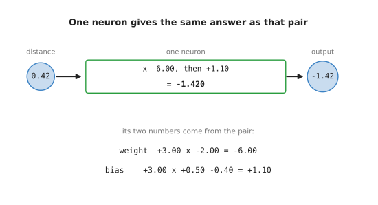

One neuron with the weight -6.00 and the bias +1.10 turns 0.42 straight into
-1.420, without the stop in the middle.

The reason is ordinary arithmetic. The second neuron multiplies what it receives
by 3.00, and what it receives is -2.00 times the distance plus 0.50. So the pair
works out 3.00 times -2.00 times the distance, which is -6.00 times the distance.
It also works out 3.00 times 0.50 and then subtracts 0.40, which gives 1.10. In
other words the two weights multiply together, and the first bias is scaled by
the second weight.

The picture below draws both of those roads across the whole sweep of distances,
and it adds a third line in which the rule is applied between the two neurons.

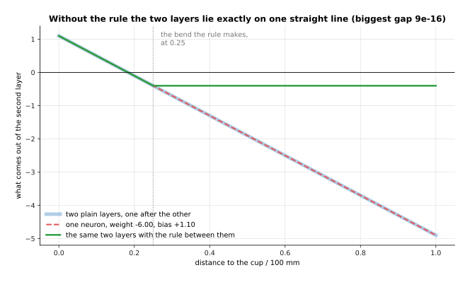

Across the whole sweep the two plain layers and the single neuron never differ by
more than 0.0000000000000009, which is as close as the computer can measure. The
third line, which has the rule between the two neurons, bends at 0.250 metres and
is a different shape altogether.

The same collapse happens however many neurons you chain together. This is worth
checking, because it is easy to believe that three in a row must be able to do
something that two cannot.

The picture below is a table with one row for each of three layers in a row, and
one last row for the single neuron that replaces all three. Read each row from
left to right, and compare the two numbers in the last column.

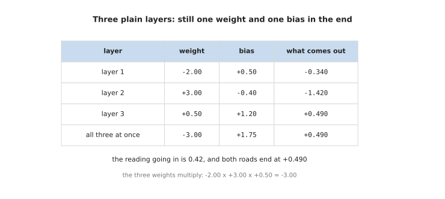

The three weights multiply to -3.00, and the three biases gather into +1.75. So
three layers in a row give exactly the same +0.490 that one layer with those two
numbers gives.

So a network made only of multiplying and adding could have a thousand layers and
would still only be able to draw one straight line. That brings back the
brightness job from the start of this section.

The picture below does the same job with two neurons that each apply the rule,
and it draws what each of those neurons gives as well as their total.

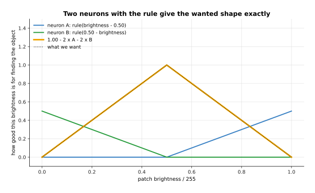

Two neurons with the rule rebuild the wanted shape exactly, and the biggest gap
anywhere between the two lines is zero.

That is what the rule at the end of each neuron is for. Without it, any number of
neurons collapses into one straight line. With it, a few neurons can bend the line
into the shape a job needs. The next section, [the rectified linear unit](#2-the-rectified-linear-unit),
looks at that rule properly, because you need to know exactly what it does before
you can see what it costs.


---

## 2. The rectified linear unit

The section before showed that a rule between neurons is what lets them bend.
This section looks at that rule itself, starting with the simplest one. It is called
the **activation function**, which means a rule that is applied to the weighted
sum to give the neuron's output. The number that comes out of it is called the
neuron's **activation**. The simplest one, and the one networks have used the
longest, is the **rectified linear unit**, which is usually shortened to ReLU.
The whole of it is this:
if the sum is below 0 give 0, and otherwise give the sum unchanged.

The picture below draws that rule on ordinary axes. The number going in is on the
bottom axis, and the number coming out is on the side axis.

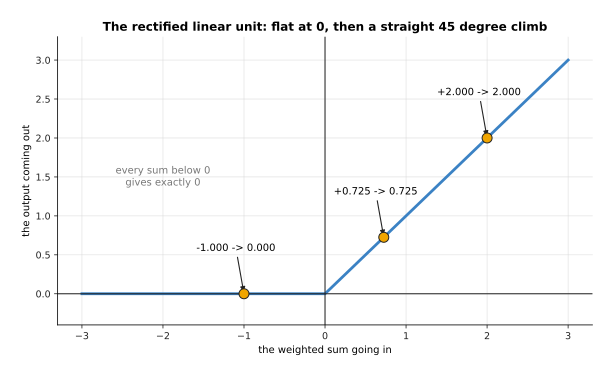

The table below gives the output of the rule for eight different sums. Read one
row at a time: the left column is the number going in, and the right column is
the number coming out.

| weighted sum going in | output of the rule |
| --- | --- |
| -2.000 | 0.000 |
| -1.000 | 0.000 |
| -0.500 | 0.000 |
| 0.000 | 0.000 |
| +0.500 | 0.500 |
| +0.725 | 0.725 |
| +1.000 | 1.000 |
| +2.000 | 2.000 |

Every number below 0 becomes 0, and every number above 0 is passed on untouched.
Our own neuron had a sum of +0.725, which is the sixth row, so its output is
0.725 as well.

This rule looks too simple to do any work. The reason it does so much work is the
corner at 0. A neuron with this rule is two different things joined at one point,
because on one side of the corner it ignores its inputs and on the other side it
follows them exactly. The place where it changes is the point that
[what changes when a weight or the bias changes](03_one-neuron.md#4-what-changes-when-a-weight-or-the-bias-changes) moved with the bias, and this page calls that point the elbow. Once several
neurons each have an elbow in a different place, the elbows can be added together
into any shape at all.

The picture below shows that. It draws a smooth curve, and then it draws two
lines made of straight pieces that follow the curve, one with six elbows and one
with twelve.

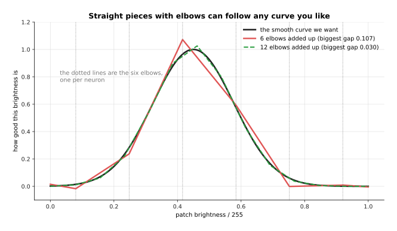

Six neurons with elbows at 0.08, 0.25, 0.42, 0.58, 0.75 and 0.92 follow the
smooth curve to within 0.107 everywhere. Twelve of them bring that largest gap
down to 0.030.

That is the answer to the question that
[why multiplying and adding is not enough](#1-why-multiplying-and-adding-is-not-enough) raised. A network can bend because
each neuron can switch itself off, and a network with more neurons can bend in
more places. What this costs is that half of every neuron's range gives nothing
at all.

The picture below shows the cost directly. It takes our own neuron, sweeps both
the distance and the gripper opening, and colours the output after the rule.


The grey part of that square is where the output is exactly 0, and it covers 26.5
per cent of the square. Inside the grey part the neuron says the same thing about
every pair of readings, so it says nothing useful about them at all.

A neuron is worse off still if its sum is below 0 for every reading it ever
meets, because then it gives 0 all of the time.

The picture below simulates 64 neurons with randomly chosen weights, gives each
of them the same 200 simulated moments to read, and draws one square for each
neuron. The number in a square is the percentage of the 200 moments on which that
neuron gave something above 0.

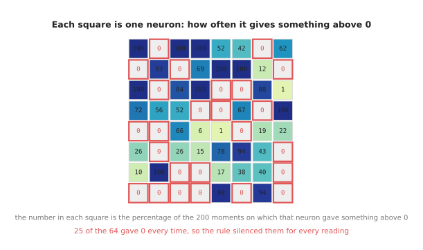

Of those 64 neurons, 25 never gave anything above 0, and the average neuron
answered on 36.6 per cent of the moments. The readings and the weights here are
simulated, and they are drawn from a fixed starting point so that the picture can
be made again.

A neuron in that state is called a dead unit, and it is dead in a strong sense.
The training methods in the next chapter move each weight a little in the
direction that would improve the answer. A neuron whose output is 0 for every
example gives no direction to move in. The reason shows up in the slope of the
rule, where the slope means how much the output moves when the number going in
moves a little.

The picture below draws that slope. The number going into the rule is on the
bottom axis, and the slope of the rule at that number is on the side axis.

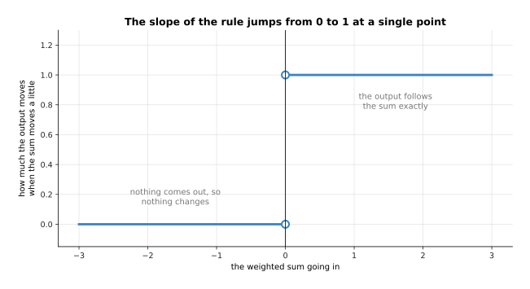

To the left of 0 the slope is 0, which means that moving the sum a little changes
nothing at all. To the right of 0 the slope is 1, which means the output follows
the sum exactly. At the point 0 itself there is no single slope, because the rule
jumps from one value to the other.

That flat left half and that jump at 0 are the two weak points of this rule. The
next section, [GELU and SiLU](#3-gelu-and-silu-and-why-networks-use-them-now), describes the newer rules that fix both, and
those are the rules you will find inside most models built today.


---

## 3. GELU and SiLU, and why networks use them now

The section before ended on two weak points of the rectified linear unit: a flat
half where training gets no direction, and a jump at 0. This section is here
because the models you will meet later in this book mostly use a rule that fixes
those two points. Two smoother rules have taken over much of the rectified linear
unit's work in the models built today. Both of them keep its shape and round off
its corner. They are the **Gaussian error linear unit**,
shortened to GELU, and the **sigmoid linear unit**, shortened to SiLU and also
called swish. The rectified linear unit switches flatly between 0 and 1: it
multiplies the sum either by 0 or by 1 and by nothing in between. GELU and SiLU
instead multiply the sum by a number between 0 and 1 that grows as the sum grows.

The picture below draws all three rules on the same axes, and the small box
inside it repeats the left half of the same picture at a larger size.

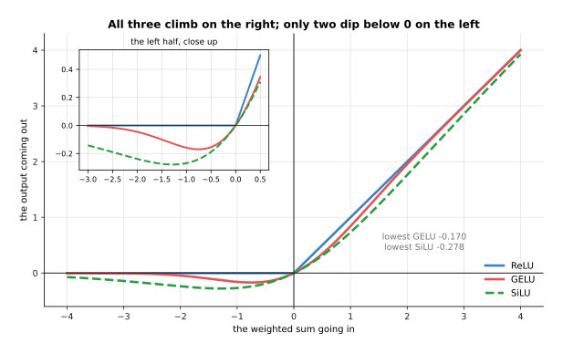

The table below gives what each rule produces for the same eight sums that
[the rectified linear unit](#2-the-rectified-linear-unit) used. Read one row at a time: the first column is the sum going in, and
the other three columns are what each rule gives for that sum.

| sum going in | ReLU | GELU | SiLU |
| --- | --- | --- | --- |
| -2.000 | 0.0000 | -0.0455 | -0.2384 |
| -1.000 | 0.0000 | -0.1587 | -0.2689 |
| -0.500 | 0.0000 | -0.1543 | -0.1888 |
| 0.000 | 0.0000 | 0.0000 | 0.0000 |
| +0.500 | 0.5000 | 0.3457 | 0.3112 |
| +0.725 | 0.7250 | 0.5552 | 0.4884 |
| +1.000 | 1.0000 | 0.8413 | 0.7311 |
| +2.000 | 2.0000 | 1.9545 | 1.7616 |

All three rules give almost the same answer for a large sum. At +2.000 the
rectified linear unit gives 2.0000, GELU gives 1.9545 and SiLU gives 1.7616. On
the left they differ more. At -1.000 the rectified linear unit gives 0.0000,
while GELU gives -0.1587 and SiLU gives -0.2689. The lowest number GELU ever
gives is -0.170, and the lowest SiLU ever gives is -0.278.

That small dip below 0 is the first difference. It means that a neuron whose sum
is a little below 0 still gives a small answer rather than nothing, so such a
neuron is never completely dead. The second difference is in the slope, and the
slope is what the training methods in the next chapter actually use.

The picture below draws the slope of each of the three rules on the same axes.

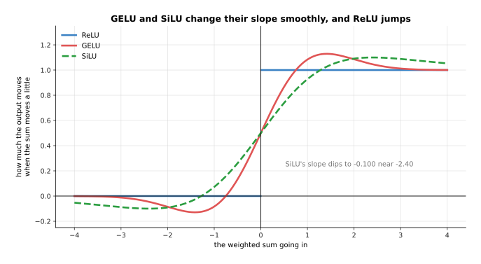

The rectified linear unit's slope is 0 at an input of -2 and 1 at +2, with a jump
between them. GELU's slope runs from -0.0852 at -2 to +1.0852 at +2, and SiLU's
runs from -0.0908 to +1.0908. Both of the smooth rules dip below 0 on the left,
GELU down to -0.129 near -1.42 and SiLU down to -0.100 near -2.40.

The picture below puts the three rules back on the neuron from
[what one neuron is made of](03_one-neuron.md#2-what-one-neuron-is-made-of). The
left half sweeps the distance from 0 to 1 metre, and the right half is the same
sweep again with the area around the elbow made larger.

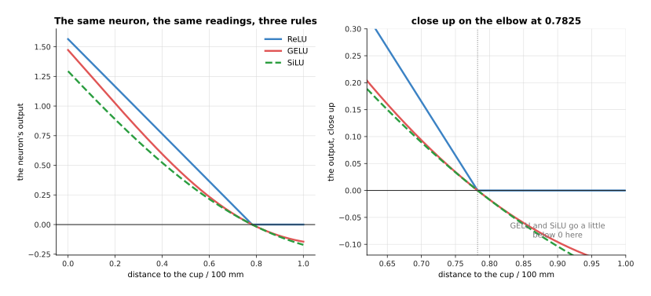

At our reading of 0.42 metres the sum of +0.725 becomes 0.7250 under the
rectified linear unit, 0.5552 under GELU and 0.4884 under SiLU. At 0.85 metres,
where the sum is -0.1350, the rectified linear unit gives exactly 0, while GELU
gives -0.0603 and SiLU gives -0.0630.

The dead units of [the rectified linear unit](#2-the-rectified-linear-unit) are the clearest case where
that difference matters.
The picture below takes the same 64 simulated neurons and the same 200 simulated
moments, replaces the rule with GELU, and writes in each square the average size
of the slope that neuron gets. The 25 neurons that the rectified linear unit had
silenced are outlined in red.

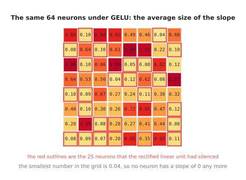

Under the rectified linear unit those 25 neurons have a slope of exactly 0 on all
200 moments, so training cannot move them. Under GELU the same 25 neurons have an
average slope size between 0.0400 and 0.3466. The smallest number anywhere in the
grid is 0.0400, so no neuron is left with a slope of 0.

So why use the smooth rules rather than the rectified linear unit, which is
simpler and older? The first reason is the one the pictures above show, which is
that the slope changes smoothly and gives the training methods something to work
with everywhere, instead of nothing on one side and a jump in the middle. The
second reason is that the large models built today train a little more steadily
with them. Most transformer models, which the chapter [the
transformer](../06_the-transformer/02_a-transformer-block.md) explains, use GELU
or SiLU inside. The rectified linear unit stays common in smaller vision models
and wherever speed matters most.

What the smooth rules cost is arithmetic. The rectified linear unit is a single
comparison against 0. GELU and SiLU both need a curve that a computer works out
from a longer calculation, and that calculation takes several times as long for
each number. That extra cost looks large until you count how often each of the
two things happens inside one layer.

The picture below counts both things for one layer that takes 1,024 numbers in
and has 1,024 neurons. The left bar is the multiply-adds, where one multiply-add
means one weight multiplied by one number and added to a running total. The right
bar is the number of times the rule is used. The side axis grows by a factor of
ten at each step, because one bar is a thousand times the other.

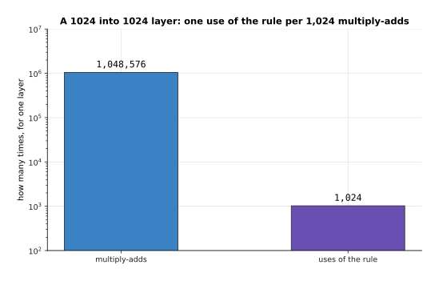

That layer does 1,048,576 multiply-adds and uses the rule only 1,024 times, which
is one use of the rule for every 1,024 multiply-adds.

The picture below turns that ratio into the extra work for the whole layer. Each
bar assumes that one use of the rule costs as much as a given number of
multiply-adds, and it gives the extra work as a percentage.

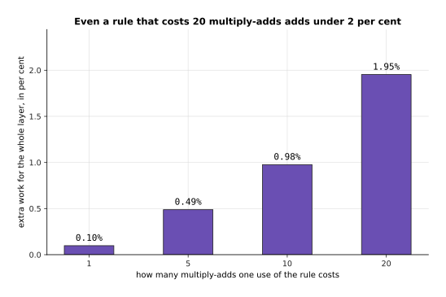

Even a rule that costs as much as 20 multiply-adds adds only 1.95 per cent to the
work of that layer. So the dearer rule is worth its price whenever it trains
better.

Those two pictures also introduce the subject of the next page,
[layers and depth](07_layers-and-depth.md), which is that a
layer of 1,024 neurons holds over a million weights, and that those weights are
arranged in a grid which a computer multiplies in one go.


---

## 4. Where to read next

- [Layers, depth and width](07_layers-and-depth.md) is the next page. It joins
  many neurons, each with the rule from this page at its end, into a layer, and
  then stacks the layers.
- [What a network can learn](10_what-a-network-can-learn.md) takes the elbows of
  [the rectified linear unit](#2-the-rectified-linear-unit) and shows that enough
  of them will follow any shape at all.
- [Backpropagation](../03_how-training-works/03_backpropagation.md) explains why
  the slopes drawn in [the rectified linear unit](#2-the-rectified-linear-unit)
  and [GELU and SiLU](#3-gelu-and-silu-and-why-networks-use-them-now) matter so
  much, because those slopes are what training reads.
- [Normalisation and stability](../04_making-training-work/02_normalisation-and-stability.md)
  deals with the other half of keeping a deep network trainable, which is holding
  the numbers that reach each rule in a sensible range.
- [A transformer block](../06_the-transformer/02_a-transformer-block.md) is where
  you meet GELU and SiLU again, inside the models most of this book is about.

---

## 5. Using it in Python

The three rules are one function call each in PyTorch, which is the library most
of this book's models are built with. The code below takes the same weighted sum
of +0.7250 that [one neuron](03_one-neuron.md) worked out, and the sum of -0.1350
that the same neuron gives at a distance of 0.85 metres, and puts both through all
three rules.

```python
import torch

above = torch.tensor([0.7250])                                 # the sum at 0.42 m
print(f"{torch.relu(above).item():.4f}")                       # 0.7250
print(f"{torch.nn.functional.gelu(above).item():.4f}")         # 0.5552
print(f"{torch.nn.functional.silu(above).item():.4f}")         # 0.4884

below = torch.tensor([-0.1350])                                # the sum at 0.85 m
print(f"{torch.relu(below).item():.4f}")                       # 0.0000
print(f"{torch.nn.functional.gelu(below).item():.4f}")         # -0.0603
print(f"{torch.nn.functional.silu(below).item():.4f}")         # -0.0630
```

The first three numbers are the three rules disagreeing mildly about a sum that is
above 0, and the last three are the same rules disagreeing about a sum that is
below it. The rectified linear unit throws the negative sum away completely, while
the two smooth rules keep a small part of it, and that small part is the whole
difference that [GELU and SiLU](#3-gelu-and-silu-and-why-networks-use-them-now)
is about.

In a real model you rarely call these functions by name on their own. You put one
after each layer, and the library applies it to every number the layer produced.
[Layers, depth and width](07_layers-and-depth.md) shows that arrangement, and
[using it in Python](07_layers-and-depth.md#7-using-it-in-python) on that page
builds a stack of layers with a rule between each pair.
