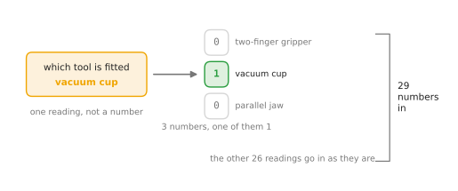
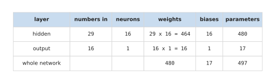
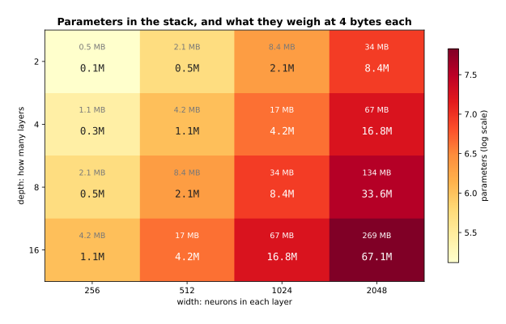
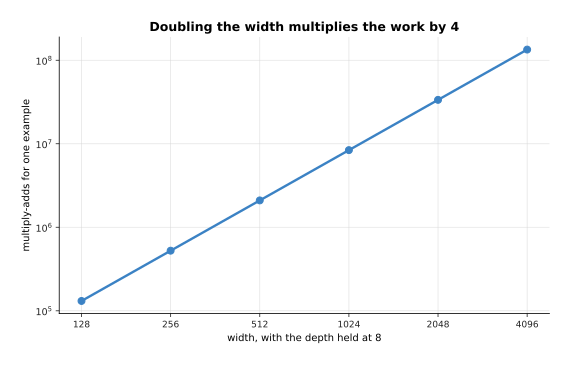
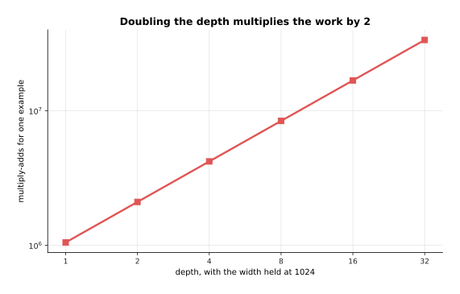
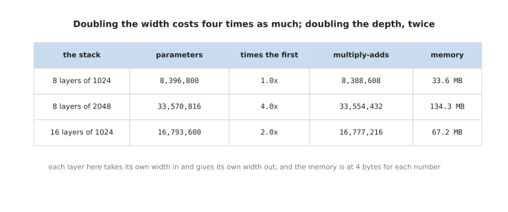
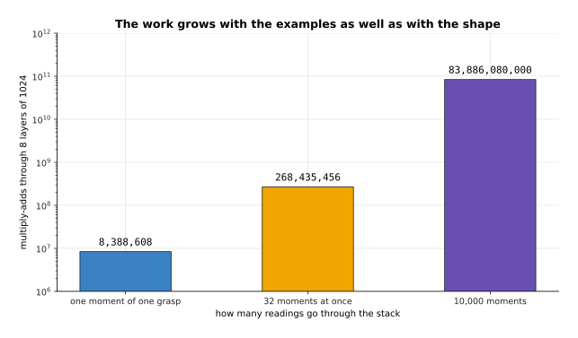

# Layers, depth and width, worked out

The page before this one, [layers, depth and width](07_layers-and-depth.md), said
what a layer is, what makes it fully connected, and what each extra layer gives
you. It left one question open on purpose, which is what all of that costs. This
page answers it with arithmetic rather than with a new idea. First it counts every
number that one whole small network owns, from the readings at one end to the
answer at the other. Then it compares a wider layer against a deeper stack by what
each of them costs in memory and in work.

Counting parameters by hand is a habit worth building early. The count is the
first thing that tells you whether a network is the right size for the job it has,
it is the number that decides whether the model fits on the machine you have, and
it is simple enough to do in your head once you have done it on paper a few times.
Everything here is multiplication and addition, so no step needs anything you have
not already used on the pages before.

This page is for a reader who has read [layers, depth and
width](07_layers-and-depth.md). Every number in every picture was worked out and
printed by `docs/diagrams/inside_a_network_1.py`, and the parameter counts were
checked a second time against PyTorch, which reports the same numbers.

When you reach the end you will be able to count the parameters of a network from
its shape alone, you will know where the number of inputs comes from when a
reading is not already a number, and you will know why doubling the width costs
four times as much while doubling the depth costs only twice as much.

## Contents

1. [Counting the numbers one network owns](#1-counting-the-numbers-one-network-owns)
2. [What depth and width cost](#2-what-depth-and-width-cost)
3. [Where to read next](#3-where-to-read-next)
4. [Using it in Python](#4-using-it-in-python)

---

## 1. Counting the numbers one network owns

This section comes first because the comparison in the section after it is a
comparison of counts, and a count means more once you have done one yourself. The
network counted here answers one question about the arm, which is whether a grasp
it is about to make will hold. The answer is one number between 0 and 1, read as
how likely the grasp is to hold.

Before any counting can start, the number of inputs has to be settled, and that is
not simply the number of things the arm reports. A layer multiplies each input by
a weight, so every input has to be a number. Most of the arm's readings already
are: a joint angle, a force, a distance and a brightness are all numbers, and
there are 26 of them here. One reading is not a number. Which tool is fitted is a
choice from a short list, and the list holds a two-finger gripper, a vacuum cup
and a parallel jaw.

A choice like that is turned into numbers by giving each option a number of its
own and setting the chosen one to 1 and the rest to 0. That is called **one-hot
encoding**, and the word hot here just means the one that is set. The picture
below shows the one reading becoming three numbers.



The three numbers are 0, 1 and 0, because the vacuum cup is the tool fitted at
this moment. Nothing is lost and nothing is invented: the one reading has simply
been written in a form a layer can multiply. Adding those three to the 26 readings
that were already numbers gives 29 numbers going in.

Why not give the three tools the numbers 1, 2 and 3 instead, and use one input
rather than three? Because that would tell the network something untrue. A single
input carries an order and a spacing, so a 3 would count for three times as much
as a 1, and the parallel jaw would sit twice as far from the two-finger gripper as
the vacuum cup does. The three tools are not in an order, and nothing about them
is three times anything. One-hot encoding costs two extra inputs and says nothing
the readings do not say.

Now the shape of the network. The rule of thumb is to start with the simplest
network that could do the job, and only make it more complicated when it is not
good enough. The simplest arrangement of all has no hidden layer at all, which
joins the inputs straight to the output. So the simplest step past that is one
hidden layer, and the width chosen for it here is 16 neurons, each with the
rectified linear unit after it. The output is one neuron, because one number is
wanted.

That is the whole shape: 29 numbers in, 16 neurons, 1 number out. The shape is all
the count needs, because a fully connected layer's parameters follow from the
number of inputs and the number of neurons and from nothing else. Each neuron has
one weight for every number reaching it, and one bias of its own.

The picture below counts both layers. Read one row at a time: the first two
columns are the shape of that layer, the next two are the two kinds of number it
owns, and the last column adds them together.



The hidden layer owns 29 times 16 weights, which is 464, and one bias for each of
its 16 neurons, so 480 numbers in all. The output layer owns 16 times 1 weights
and 1 bias, so 17 numbers. The whole network owns 497 parameters, of which 480 are
weights and 17 are biases.

Two things in that table are worth noticing, because they hold for every fully
connected network and not only for this one. The first is that the biases are
almost nothing. There are 17 of them against 480 weights, so counting the weights
alone would have been accurate to within four per cent. The second is where the
weights actually are: 464 of the 480 sit in the first layer, because that layer is
the one joining the widest pair of sides. A layer's weights are the number of
inputs multiplied by the number of neurons, so the count grows with the product of
the two sides rather than with their sum. Doubling either side doubles the layer.

That product is the reason a count is worth doing before anything is trained. This
network owns 497 numbers, which is small enough to write out. Widen the hidden
layer from 16 neurons to 1,024 and the same two layers own 31,745 parameters
instead, without a single extra layer being added. The section below follows that
growth properly, for width and for depth together.

---

## 2. What depth and width cost

[Layers, depth and width](07_layers-and-depth.md) found that depth and width
both add detail, and the section before counted one small network exactly. This
section puts the two together and compares depth against width by what each one
costs. The cost is easy to count
exactly. Take a stack in which every layer has the same width, so that each layer
takes that many numbers in and gives that many out. The parameters in one layer
are then the width multiplied by itself, plus one bias for each neuron. The
parameters in the stack are that number multiplied by the depth.

The picture below is a grid of those counts. Each row is one depth and each
column is one width. Each cell holds two numbers: the parameters in millions, and
what they weigh in memory at 4 bytes for each number.



Two layers of 256 neurons come to 131,584 parameters, which is 0.5 megabytes.
Sixteen layers of 2,048 neurons come to 67,141,632 parameters, which is 269
megabytes. So the same grid covers a model that fits anywhere and a model that
has to be thought about.

The other cost is the arithmetic done every time a reading goes through, which is
counted in multiply-adds. One multiply-add is one weight multiplied by one number
and added to a running total. There is one multiply-add for every weight, so this
count follows the parameter count closely.

The picture below holds the depth at 8 layers and changes the width. On both axes
an equal step means an equal multiplication, as in the picture of [parameters
against width](07_layers-and-depth.md#2-fully-connected-and-what-joining-everything-costs).



Eight layers of 1,024 neurons do 8,388,608 multiply-adds for one reading, and
eight layers of 2,048 do 33,554,432. So doubling the width multiplies the work by
4.

The picture below holds the width at 1,024 neurons and changes the depth instead.



Sixteen layers of 1,024 neurons do 16,777,216 multiply-adds, which is twice what
eight layers do. So doubling the depth multiplies the work by 2.

The two results are easier to compare as numbers. Width is multiplied
in twice, once because each neuron has more inputs and once because there are
more neurons. Depth is multiplied in only once.

The picture below is a table of three stacks. Read each row from left to right:
the stack, its parameters, how that compares with the first row, its
multiply-adds, and its memory.



Doubling the width from 1,024 to 2,048 takes the stack from 8,396,800 to
33,570,816 parameters, which is 4.0 times as many. Doubling the depth from 8
layers to 16 takes it to 16,793,600, which is 2.0 times as many.

Time is the last cost, and it cannot be given in seconds here, because seconds
depend on the computer and on how many readings are handled at once. What can be
given exactly is the work, and the work grows with the number of readings as well
as with the shape of the network.

The picture below counts the multiply-adds for one reading, for 32 readings and
for 10,000 readings through the same stack of 8 layers of 1,024 neurons.



One moment of one grasp costs 8,388,608 multiply-adds through this stack. 32
moments at once cost 268,435,456. 10,000 moments cost 83,886,080,000, and
training goes over the whole set of examples many times rather than once.

So the honest summary is that a wider layer costs four times as much for each
doubling, and a deeper stack twice as much, in memory and in work alike. That
would suggest adding layers, which is the cheaper of the two. For a long time
nobody could train a very deep stack at all, though, so the next section asks
what change made deep stacks trainable.


---

## 3. Where to read next

- [The shape of the numbers](09_the-shape-of-the-numbers.md) is the next page, and
  it is where the parameters counted here become real memory. It explains how the
  weights are stored, how many bits each number gets, and why the memory bill is
  not only the weights.
- [Layers, depth and width](07_layers-and-depth.md) is the page these counts
  belong to, if you want the ideas again rather than the arithmetic.
- [What a network can learn](10_what-a-network-can-learn.md) asks what all these
  parameters actually buy, and shows the shape of job that a fully connected layer
  is the wrong tool for.
- [Overfitting and generalisation](../04_making-training-work/01_overfitting-and-generalisation.md)
  explains the other side of a large parameter count, which is that a network with
  too many numbers can learn its examples instead of the job.
- [Scale, data and compute](../07_pretraining-and-adapting/02_scale-data-and-compute.md)
  takes the same counting up to the models that hold billions of parameters.

---

## 4. Using it in Python

The count above needs nothing but the shape, so PyTorch can confirm it in a few
lines. The code below builds the same network, 29 numbers in, 16 neurons and 1
number out, and asks each layer how many numbers it owns.

```python
import torch
from torch import nn

net = nn.Sequential(
    nn.Linear(29, 16), nn.ReLU(),    # the hidden layer and its rule
    nn.Linear(16, 1), nn.Sigmoid(),  # one number out, squeezed between 0 and 1
)

for name, p in net.named_parameters():
    print(f"{name:9s} {tuple(p.shape)} {p.numel()}")
# 0.weight  (16, 29) 464
# 0.bias    (16,)    16
# 2.weight  (1, 16)  16
# 2.bias    (1,)     1

print(sum(p.numel() for p in net[0].parameters()))  # 480, the hidden layer
print(sum(p.numel() for p in net[2].parameters()))  # 17,  the output layer
print(sum(p.numel() for p in net.parameters()))     # 497, the whole network
```

Two details in that output are worth reading carefully. The weight grid of the
hidden layer is printed as 16 by 29 rather than 29 by 16, because PyTorch stores
one row for each neuron and one column for each input, which is the same grid as
[the weight grid](07_layers-and-depth.md#1-a-layer-is-many-neurons-reading-the-same-numbers)
on the page before. The order of the two numbers does not change the count, since
16 times 29 and 29 times 16 are both 464.

The rule after each layer owns nothing at all. `nn.ReLU` and `nn.Sigmoid` appear
in the list of layers but never in the list of parameters, because
[activation functions](06_activation-functions.md) apply a fixed rule to each
number and have nothing to learn. So every parameter in any network of this kind
belongs to a `Linear` layer.

Counting this way is worth doing on any network you build, and it costs one line.
A count far larger than you expected usually means one layer is joining two wide
sides, which is the product this page started from.
