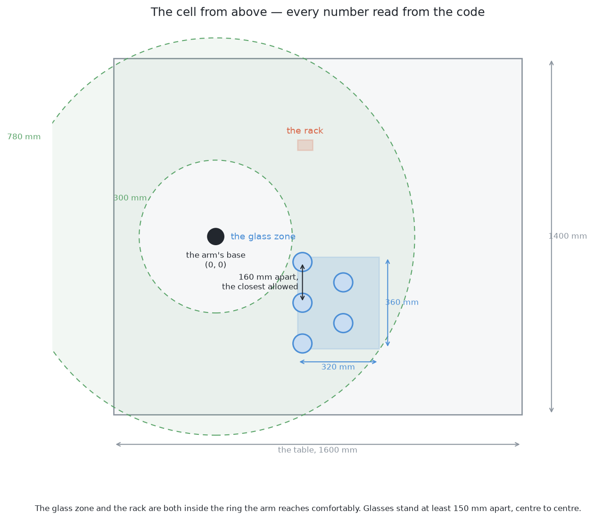
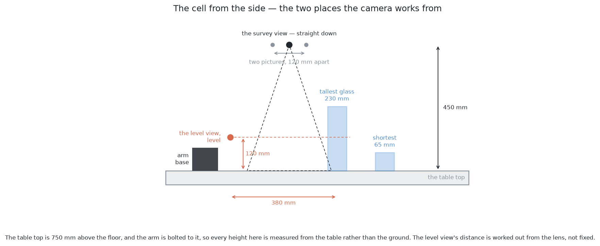
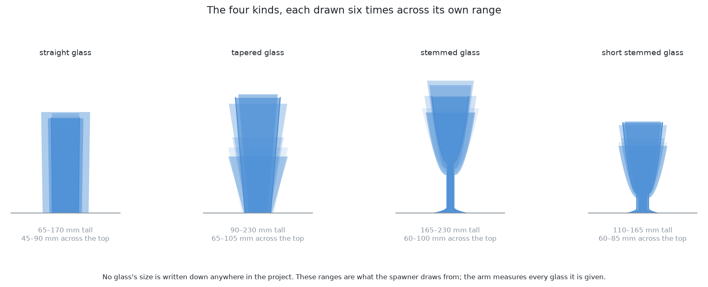
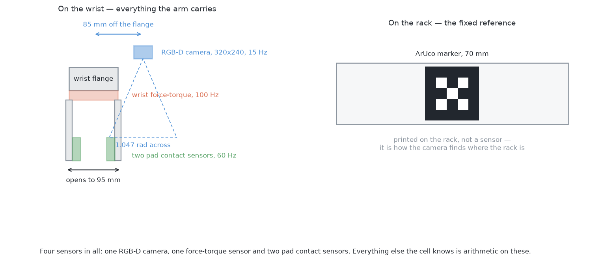
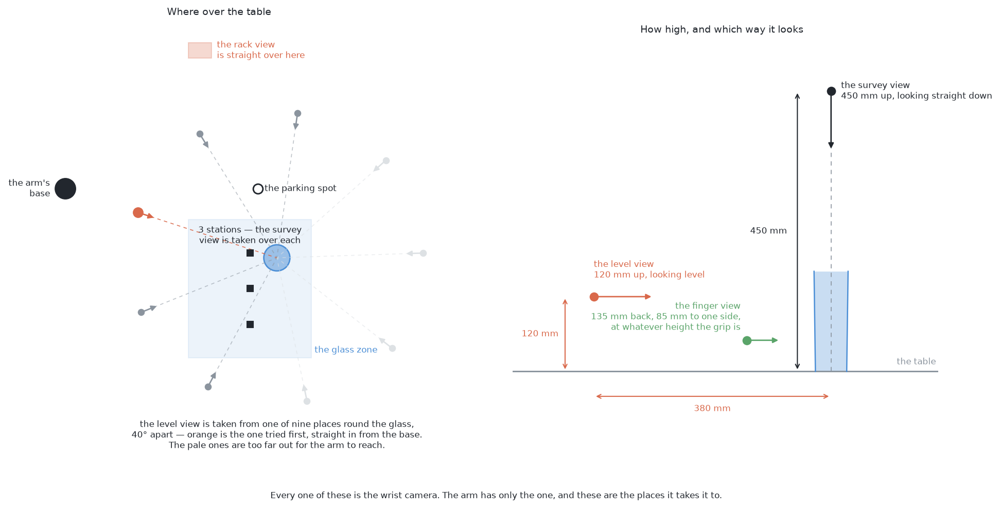
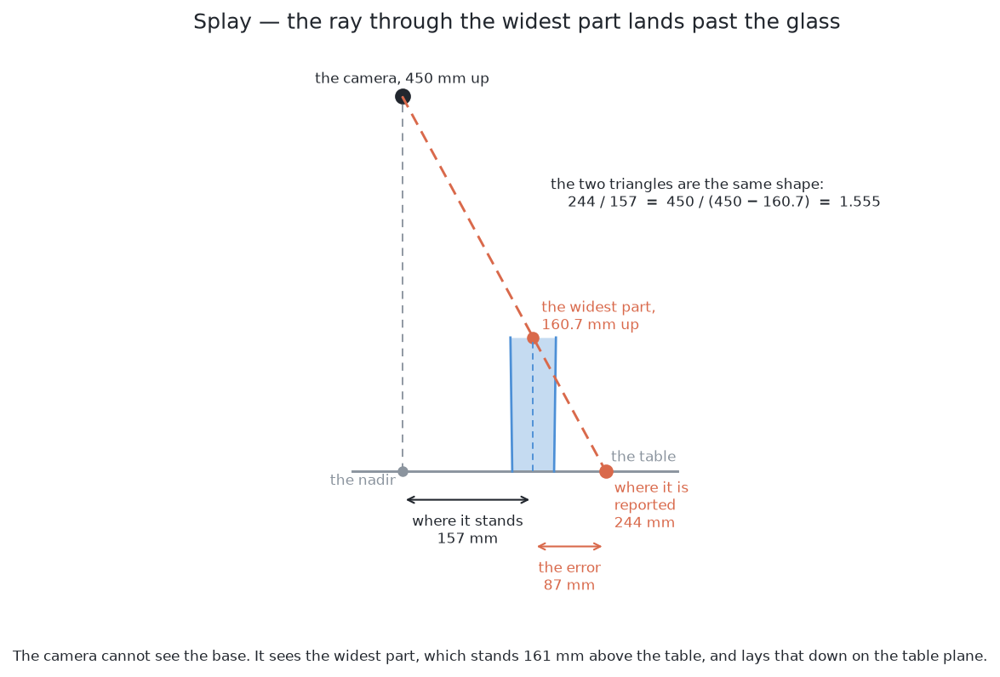
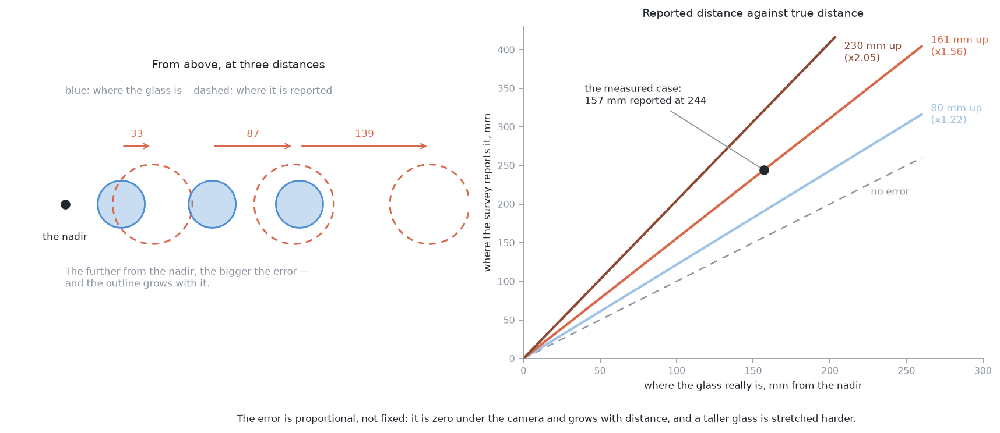

# The cell — the layout, the sensors, and the words

Every solution in this book works in the same room. It uses the same arm, the
same camera and the same table. So does every solution in [pushing the glasses
apart](../09_pushing-the-glasses-apart/01_the-problem/01_what-is-asked-for.md).
This page gives those shared numbers once, so other pages do not repeat them.
Read it first if you are starting either book. Come back to it when a later page
quotes a size and you want to know where it came from.

**The hand is different in the two books, and this page describes this book's
hand.** This book was measured with an invented gripper. It opens 95 mm, its pad
is 14 by 40 mm, and its camera is 85 mm out from the flange. The cell was later
rebuilt with three real products: a Robotiq FT 300-S force sensor, a Robotiq
2F-85 gripper and an Intel RealSense D405. [Pushing the glasses
apart](../09_pushing-the-glasses-apart/01_the-problem/01_what-is-asked-for.md#6-the-gap-that-matters-is-not-the-gap-between-the-glasses)
uses the real hand. The real gripper opens 85 mm and holds 80.4 mm. So when the
two books give different numbers for the hand, the other book has the real
product's numbers. This book has the numbers its own results were measured
with. Everything else on this page is the same in both books.

**Every size on this page comes from the cell's own code.** The script
[`make_cell_images.py`](../diagrams/seeing-the-glasses/make_cell_images.py)
imports `arm/dimensions.py`, `table/layout.py`, `rack/layout.py` and
`glasses/shapes.py`, and draws what it finds. If a number changes in the code,
the pictures change the next time the script runs. Nothing here is typed in by
hand.

## Contents

1. [The layout, from above](#1-the-layout-from-above)
2. [The layout, from the side](#2-the-layout-from-the-side)
3. [The glasses](#3-the-glasses)
4. [The sensors](#4-the-sensors)
5. [Where the camera stands, and what each place is called](#5-where-the-camera-stands-and-what-each-place-is-called)
6. [The words](#6-the-words)
7. [Every constant, and where it lives](#7-every-constant-and-where-it-lives)
8. [Where to go next](#8-where-to-go-next)

## 1. The layout, from above

We start with the table seen from above, because every later size is placed on
it.

The arm is bolted to the table at the origin. All its work happens in two
rectangles on the table:

- **The glass zone** is 320 by 360 mm. Glasses may stand here.
- **The rack** is 60 by 40 mm. Glasses end up here, upside down on pegs.

Both are inside the ring that the arm reaches easily. Closer than 300 mm, the
arm is folded over itself. Further than 780 mm, the arm is stretched straight
out and the wrist cannot move freely. This ring is a working choice, not a hard
joint limit.

The view from above shows where things are, but not how high they are. The next
section shows the heights.

## 2. The layout, from the side

The side view adds the heights that the top view cannot show.

The table top is 750 mm above the floor, and the arm stands on it. So **every
height in this cell is measured from the table top**, not from the floor. This
is true for a glass's height, the camera's height and the rack's pegs.

The camera is used in two main poses. Many mistakes in these pages come from
mixing them up. The table below compares them. Each row is one property, and
each column is one pose.

| | the survey view | the level view |
|---|---|---|
| where | 450 mm above the table | 120 mm above the table |
| looking | straight down | level |
| how far from the glass | directly overhead | about 380 mm |
| one pixel covers | 1.62 mm | 1.37 mm |
| the frame covers | 519 by 390 mm of table | 439 by 329 mm |
| what it is for | finding everything, roughly | measuring one glass, precisely |

Some pages call these two the *survey pose* and the *side-on pose*. They are
the same two places. Three more places exist, and [where the camera
stands](#5-where-the-camera-stands-and-what-each-place-is-called) names all
five.

The 380 mm is **not a stored constant**. `MEASURE_STANDOFF` only sets a lowest
value of 300 mm. Any nearer, and a glass is too big to fit in the frame. The
real distance is worked out on each run from the lens and the tallest glass. It
comes to about 380 mm. `MEASURE_VIEW_HEIGHT` is a fixed 120 mm. This is on
purpose. The view from above cannot tell how tall a glass is, so the side view
must aim at a fixed height.

Now that the room is set, the next section describes the glasses that stand in
it.

## 3. The glasses

The glasses are the objects every solution must find, so their sizes matter.

There are four kinds of glass. Each glass is drawn at random inside its kind's
range of sizes. **No glass's size is written down anywhere in the code.** The
arm measures every glass during the run. The code only holds the *range* that
the spawner picks from. The spawner is the code that places glasses on the
table. The table below gives each kind's range. Read each row as the smallest
and largest value for that kind.

| kind | height | across the top |
|---|---|---|
| straight glass | 65–170 mm | 45–90 mm |
| tapered glass | 90–230 mm | 65–105 mm |
| stemmed glass | 165–230 mm | 60–100 mm |
| short stemmed glass | 110–165 mm | 60–85 mm |
| **all four** | **65–230 mm** | **45–105 mm** |

**The tapered kind has the widest range on purpose.** Seen from above, a tall
glass's outline is drawn further out than a short one's. This is called splay,
and [the words](#6-the-words) explain it. With a wide range, a tall glass's
outline can cover a short neighbour completely. Then the short glass is in no
picture at all. [What is asked for](02_the-problem/01_what-is-asked-for.md)
explains why that matters. A narrow range of sizes could not cause this.

The range is as wide as the rest of the cell allows. Two other parts of the
cell set its short end. A shorter glass would not clear a rack peg when stood
mouth down. Also, the gripper could no longer close on it at the height this
kind is held. Neither limit is about seeing. So a limit on what the arm must see
often comes from what the arm must do.

The glasses are what the cell looks at. The next section lists what it looks
with.

## 4. The sensors

The sensors decide what the cell can know, so they come next.

There are four sensors, and that is the whole list. Everything else the cell
knows is worked out from these. The table below lists them. Each row is one
sensor.

| sensor | where | rate | what it returns |
|---|---|---|---|
| **RGB-D camera** | on the wrist, 85 mm off the flange | 15 Hz | colour and aligned depth, 320 × 240, 1.047 rad across, usable from 0.05 to 3.0 m |
| **wrist force-torque** | between the flange and the gripper | 100 Hz | three forces and three torques |
| **pad contact** × 2 | one in each fingertip pad | 60 Hz | whether that pad is touching something |

RGB-D means the camera gives a colour picture and a depth reading for each
pixel. The rack also has an **ArUco marker**, 70 mm square. This is a printed
square pattern, not a sensor. The camera reads it to find where the rack is.

**The camera is on the wrist, not above the table.** This one fact shapes most
of the solutions. The arm chooses its own viewpoints. Moving the camera costs
seconds of arm time. The camera's pose is known exactly from the joint encoders.
That exact pose makes [the second way of training a network from
scratch](06_a-network-trained-from-scratch/03_how-it-works.md#10-the-second-way--labels-from-the-arms-own-movement)
possible.

The camera can only see from where the arm puts it. The next section names
those places.

## 5. Where the camera stands, and what each place is called

The arm has one camera, on the wrist. So a camera position always means a place
where the arm carries that camera. Five places cover the whole run. The rest of
the pages use these names. The table below lists them, one place per row.

| name | where it stands | which way it looks | what it is for |
|---|---|---|---|
| **the survey view** | over a station in the glass zone, 450 mm up | straight down | what is on the table, and roughly where |
| **the rack view** | straight over the middle of the rack, 450 mm up | straight down | reading the marker, once, before anything else |
| **the level view** | 380 mm out from one glass, 120 mm up | level, at the glass | measuring that one glass |
| **the finger view** | 135 mm back from the glass and 85 mm to one side, at the height of the grip | along the fingers | is the glass between the pads, or beside them |
| **the parking spot** | 500 mm out from the base, 450 mm up | straight down | where the arm waits with nothing to do |

**The survey view.** The camera goes up to 450 mm and points straight down. It
stops at several places over the glass zone. Each place is called a
**station**. At each station the camera takes **two** pictures, 120 mm apart.
This distance is called the **baseline**. A glass shifts a little between the
two pictures, and the size of that shift gives depth. One picture covers 519 by
390 mm of table. Only the part seen in *both* pictures is useful, and that part
is 424 by 175 mm. The glass zone is 320 by 360 mm. So it takes **three
stations** in a line to cover it. Neighbouring stations overlap by 35 per cent
of a frame. So a glass cut off at the edge of one picture is well inside
another.

The 450 mm is where the *tool* is sent. The camera is 85 mm to one side of the
tool and 15 mm along its aim. So the camera is really about 435 mm up and a
little off to the side. The code does not guess this. It reads the camera's
real position from the joint angles. The pictures are measured against that
reading.

**The rack view.** This uses the same height and the same downward aim, but
over the middle of the rack. It happens once, at the start of a run. It only
reads the ArUco marker. Here the code *does* remove the 85 mm offset first. So
the camera itself ends up over the middle of the rack.

**The level view.** The camera comes down to 120 mm above the table. It points
level and stands about 380 mm back from the glass. This view measures a glass.
[Looking again at what was
hidden](02_the-problem/02_looking-again-at-what-was-hidden.md) also sends the
camera here.

The frame must reach from the table at the bottom to the rim of the tallest
glass at the top. So the 380 mm depends on the lens, as [the side
view](#2-the-layout-from-the-side) explains.

The arm can stand anywhere on a circle round the glass. It is offered **nine
places on that circle, 40° apart**. It first tries the place straight in from
its own base, because that is the shortest reach. It moves to the next place in
two cases. One case is a glass standing behind the target. That glass would join
the target in the mask, and the two would measure as one wide glass. The other
case is a place the arm cannot reach.

**The finger view.** This place is not chosen. It is wherever the camera ends up
once the fingers are round the glass. That is 135 mm back from the glass's axis,
85 mm to one side, at the height of the grip. Every earlier picture was taken
about half a metre away. This picture is taken from where the fingers are. At
this range, one millimetre on the table covers many pixels. It has one use: to
shift sideways onto the glass before the fingers close.

**The parking spot.** This is 500 mm out from the base, 450 mm up, looking down.
The arm goes here when it has finished, or when it has given up on something.
This keeps it out of the way, and the next move starts from a known place.

### Naming a place that is not one of these

Some pages talk about cameras this cell does not have. One example is a camera
fixed above the table. Another is a camera at the table edge, looking across.
Describe any such camera with three things, in this order: **the spot, the
height, the aim**.

- **The spot** is where on the table it stands, over or beside. Examples are
  *over the middle of the glass zone*, *over the rack*, *at the near edge of the
  table* and *beside the glass*.
- **The height** is in millimetres above the table top. The key heights are 0
  (table level), 120 (the level view) and 450 (the survey view). A fraction is
  fine when the exact number does not matter. For example, *half the survey
  height* is 225 mm.
- **The aim** is *looking down*, *looking level*, *looking at a slant of 30°*,
  or *looking along the fingers*.

For example, "at the near edge of the table, at table level, looking level" is
the fixed side camera some solutions discuss. "Over the middle of the glass
zone, 450 mm up, looking down" is the survey view written out in full.

The places are now named. The next section defines the other words these pages
use.

## 6. The words

This section defines words used across the book. Several of them mean something
else in other places.

**The survey.** This is the first step of a run. The arm moves the camera over
the glass zone, looking straight down from 450 mm. It takes pictures at several
stations until every part of the zone has been seen. The survey answers *what is
on the table, and roughly where*. It does not answer *how big is this glass*.

**A station.** This is one place the camera stops during the survey. [The
survey view](#5-where-the-camera-stands-and-what-each-place-is-called) gives
its two pictures, the 120 mm baseline and the overlap.

**Standoff.** This is how far the camera is from the thing it looks at. It is
used mostly for the level view.

**The nadir.** This is the point on the table directly under the camera. It only
matters in the survey view. Things directly under the camera are seen straight
on. Things off to the side are seen at an angle, and this matters a lot.

**Splay.** This is the result of that angle. Almost every distance the survey
reports is wrong because of it, so we go through it slowly.

First, think about what the camera sees. A glass off to the side is seen from
above and a little from the side. Its base is hidden under the bowl. The camera
sees the widest part of the glass, which is usually the rim.

Second, one picture from above cannot tell how tall anything is. So the survey
assumes that everything it sees lies flat on the table. It draws a straight line
from the lens through the widest part of the glass. It takes the point where
that line meets the table as the place the glass stands. But the widest part is
high above the table. So the line goes past the glass and meets the table
further out.

Similar triangles give the size of the mistake. Call the camera's height *H*.
Call the height of the widest part *h*. The sloping line makes two right-angled
triangles, one inside the other. The big one goes down to the table. The small
one stops at the height of the widest part. Both have the same angle at the
lens, so their sides have the same ratio:

> reported distance = true distance × *H* / (*H* − *h*)

Now put in the cell's numbers. *H* is 450 mm. Take a real glass from the
spawner whose widest part is 160.7 mm up. The factor is 450 / 289.3 = 1.555. An
earlier job, which moved one glass from the table to the rack, measured exactly
this. A glass standing 157 mm from the nadir was reported at 244 mm. That is
87 mm too far out.

Three facts follow from the formula, and later pages use all three:

- **The error grows with distance.** It is zero directly under the camera and
  grows further out. So you cannot fix it by subtracting one fixed amount.
- **A taller glass is pushed further.** The factor depends on *h*. So two glasses
  side by side move by different amounts. One correction for the whole picture
  cannot fix both.
- **The outline grows as well as moves.** Every point of the glass is scaled by
  the same factor. So the outline in the picture is bigger than the real glass.
  This is why a glass seen from above looks like a teardrop leaning away from the
  nadir, not a circle.

Splay is not a fault in the camera or the code. One picture from one point
cannot tell you more. This is why the survey only finds *roughly where*. It is
also why the arm moves the camera to the side before it measures anything.

**Mask, patch, blob.** A **mask** marks every pixel as glass or not glass. A
**patch** or **blob** is one group of touching marked pixels. One patch is not
always one glass. [What is asked for](02_the-problem/01_what-is-asked-for.md)
explains why.

**Silhouette.** This is the outline of one glass in one picture. It is not a
circle in either view. From above it is a teardrop leaning away from the nadir.
From the side it is the glass's profile.

**Cluster.** This is a group of 3-D points that belong together. Points are
grouped by their distance in the room, not by whether they touch in the
picture.

**Footprint.** This word is used for two different sizes, so read it carefully:

- the **contact patch** is where the glass touches the table. It is 25–95 mm
  across over the four kinds.
- the **flattened disc** is what you get when you drop every point of the glass
  straight down onto the table. It is the glass's *widest* part, 45–105 mm
  across.

Most pages mean the flattened disc. [Clustering on the
table](05_rules-on-the-table/01_what-it-is.md) groups it and fits a circle to
it. It also sets how close two glasses can stand. Where the number matters, the
pages say which one they mean.

The words are now defined. The last section lists every constant used above and
where it lives in the code.

## 7. Every constant, and where it lives

This section is a directory, so you can find any number in the code. Each
number lives in one file only. The table below lists them, one per row, with
its value and the file and name that defines it.

| what | value | where it is defined |
|---|---|---|
| table top above the floor | 750 mm | `table/layout.py` `TABLE_TOP_Z` |
| table | 1600 × 1400 × 50 mm | `table/layout.py` `TABLE_SIZE` |
| arm's base | (0, 0) on the table top | `table/layout.py` `ROBOT_BASE` |
| comfortable reach | 300–780 mm | `arm/dimensions.py` `COMFORTABLE_REACH` |
| glass zone | 320 × 360 mm | `rack/layout.py` `GLASS_ZONE` |
| rack area | 60 × 40 mm | `rack/layout.py` `RACK_AREA` |
| rack top / peg | 770 mm / 55 mm tall | `rack/layout.py` `RACK_TOP_Z`, `PEG_HEIGHT` |
| ArUco marker | 70 mm | `rack/layout.py` `MARKER_SIZE` |
| survey height | 450 mm above the table | `arm/dimensions.py` `SURVEY_HEIGHT` |
| survey baseline | 120 mm | `arm/dimensions.py` `SURVEY_BASELINE` |
| survey overlap | 35 per cent | `arm/dimensions.py` `SURVEY_OVERLAP` |
| side-on standoff, floor | 300 mm | `arm/dimensions.py` `MEASURE_STANDOFF` |
| side-on view height | 120 mm above the table | `arm/dimensions.py` `MEASURE_VIEW_HEIGHT` |
| camera offset from the flange | 85 mm out, 15 mm up | `arm/dimensions.py` `CAMERA_OFFSET` |
| gripper opening | up to 95 mm (the real 2F-85 opens 85) | `arm/dimensions.py` `GRIPPER_MAX_OPENING` |
| lowest the fingers reach | 50 mm above the table | `arm/dimensions.py` `LOWEST_GRIP` |
| pad | 14 × 40 mm (the real 2F-85's is 22 × 38) | `arm/dimensions.py` `PAD_HEIGHT`, `PAD_LENGTH` |
| camera | 320 × 240, 1.047 rad, 15 Hz | `arm/camera/wrist_camera.urdf.xacro` |
| the kinds and their ranges | see above | `glasses/shapes.py` `KIND_RANGES` |
| smallest gap between two glasses | 150 mm centre to centre | `glasses/spawn.py` `MIN_SEPARATION` |

Two useful numbers are **worked out on each run**, not stored:

- the **focal length in pixels**, `fx = (320 / 2) / tan(1.047 / 2) ≈ 277.1`.
  It turns every angle into pixels.
- the **side-on standoff**, about 380 mm, from the lens and the tallest glass.

With the room, the glasses and the words in place, the next step is the task
itself.

## 8. Where to go next

These two pages follow on from this one.

- [What is asked for](02_the-problem/01_what-is-asked-for.md) says which pixels
  belong to which glass, and where each glass stands.
- [Pushing the glasses apart](../09_pushing-the-glasses-apart/01_the-problem/01_what-is-asked-for.md)
  is the other book in this cell. There, glasses stand too close for the gripper,
  and the arm has to make room.

[What is asked for — segment the glasses](02_the-problem/01_what-is-asked-for.md) →
