# What is asked for — segment the glasses

## 1. Introduction

This page states the task that every solution in this book must solve. It is
for any reader, and you should read it before any solution.

The cell was built to pick glasses off a table and stand them on a rack. The arm
can only pick up a glass once it knows which glass is which, and where each one
stands. That is the part this book takes. **Several glasses stand on the table.
The arm photographs them from above. It must work out which pixels belong to
which glass, and where each glass stands.** To segment a picture means to split
it into these per-glass parts.

The book stops there. It picks nothing up and measures no shape. Sometimes two
glasses cannot be told apart from any place the arm can reach. Then the arm
reports this and stops. Moving glasses apart is the job of [the next
book](../../09_pushing-the-glasses-apart/01_the-problem/01_what-is-asked-for.md).

**The book answers this one question six times, with six different methods.**
This shows which method to use, and when. A comparison is only fair if every
method gets the same question. So this page fixes the input and the output
once. It also explains the two difficulties that make the task hard.

## Contents

1. [Introduction](#1-introduction)
2. [What is on the table](#2-what-is-on-the-table)
3. [What goes in](#3-what-goes-in)
4. [What must come out](#4-what-must-come-out)
5. [The two difficulties](#5-the-two-difficulties)
6. [What "done" means](#6-what-done-means)
7. [Where to go next](#7-where-to-go-next)

## 2. What is on the table

The task starts with the scene, so we describe what stands on the table first.

Four to six glasses stand upright on the table. Each one is drawn at random
sizes inside its kind's range. Nothing else in the cell changes. The table, the
camera and the drying rack stay the same.

**All the glasses in one arrangement are the same kind, and the kind is
known.** There are four kinds: straight, tapered, stemmed and short stemmed.
[The cell](../01_the-cell.md#3-the-glasses) gives their sizes. A run meets all
four kinds.

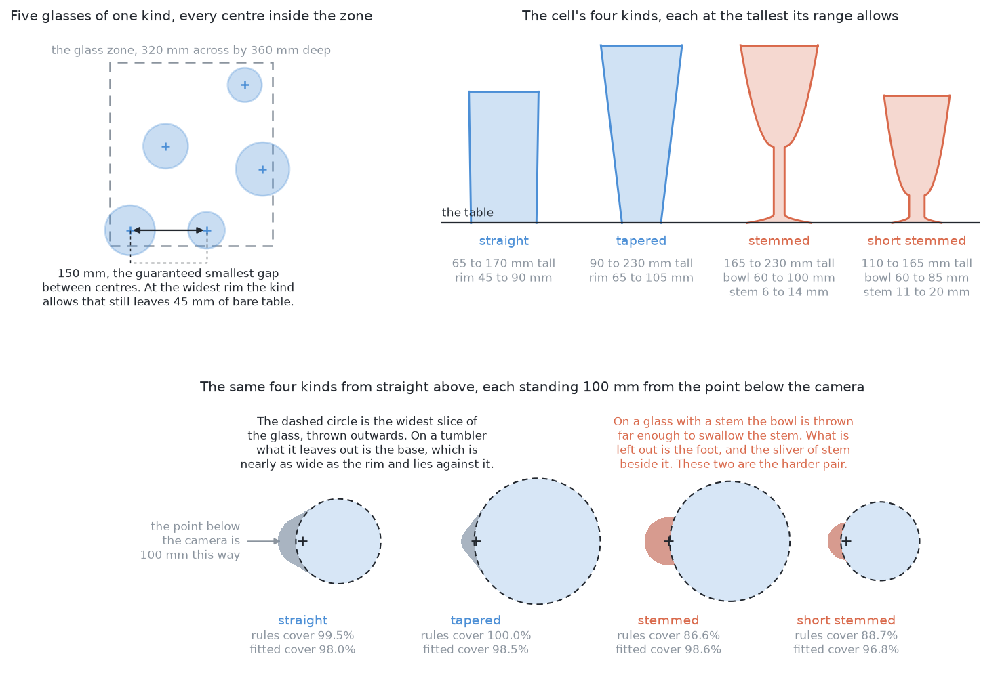

**The glasses stand apart.** The centres of any two glasses are at least 150 mm
apart. Even the two widest glasses leave bare table between their rims. So no
two glasses ever touch. Separating glasses that touch is the job of [pushing the
glasses apart](../../09_pushing-the-glasses-apart/01_the-problem/01_what-is-asked-for.md).

Because of that bare table, ordinary arrangements are fairly easy. The hard
cases come when glasses stand closer than 150 mm. So each run also has a
**crowded** set of arrangements, where glasses stand closer than the rule
allows. Crowding is where the methods fail, and where they differ most.

**The glasses are opaque in this book.** Real clear glass gives almost no depth
reading, because light passes through it. The simulator draws every glass as a
solid, opaque object. So every depth reading on a glass is clean. This is an
assumption of the whole book. A method that depends on depth would need more
work before it could handle a real table of clear glasses.

**The two difficulties below are explained with the tapered kind.** Each
difficulty is told once, with the kind that shows it most clearly. Scores still
cover all four kinds. The tapered kind has the widest range of sizes. Its
tallest glass is more than twice the height of its shortest. That wide range
causes the first difficulty below.

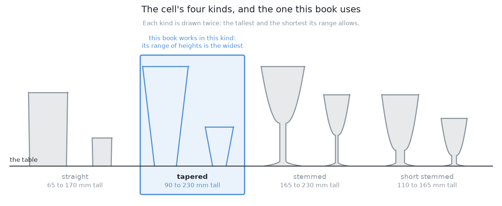

The scene is now fixed. The next section says what a solution is allowed to read
from it.

## 3. What goes in

A fair comparison needs one fixed input, so this section names it.

At each survey station the camera takes two pictures. For each picture, a
solution may read the grey picture, the depth at every pixel and the camera's
pose. It may not read the simulator's record of what it placed. That record is
kept back to mark the run. [The examiner](../03_the-examiner/01_the-examiner.md)
describes the input in full and hands the same input to every solution.

With the input fixed, the next section says what a solution must give back.

## 4. What must come out

The output is the other half of the question, and it must also be the same for
every solution.

**For each glass on the table, the solution gives one record with three
things:**

- its **mask**, which says which pixels in which picture belong to that glass
  and not another;
- its **place** on the table, measured from the arm's base;
- a **rough width** of its footprint.

The place is a position, not a full pose. A pose would also give which way the
glass is turned. A glass stands upright on a flat table, so its axis is
vertical. A glass also looks the same from every side. So the only thing to find
is where its axis meets the table.

**The run must also report two more things. Neither is a list of glasses.**

- **Which glasses could not be separated, and why.** A pair the arm cannot tell
  apart is a result, not a failure. It is the input to [pushing the glasses
  apart](../../09_pushing-the-glasses-apart/01_the-problem/01_what-is-asked-for.md).
- **Where a glass could not have been seen at all.** This follows from the first
  difficulty below. It is not the same as a list of the glasses found.

Input and output are now fixed. The next section explains why getting from one
to the other is hard.

## 5. The two difficulties

Both difficulties come from one fact. A camera looking straight down draws a
tall glass's outline further out than the glass really stands. This is called
splay, and [the cell](../01_the-cell.md#6-the-words) explains it.

The effect depends on how close two glasses stand. The first difficulty is one
that no solution answers. The second is the one the six solutions differ on.

### A glass can be missing from the picture altogether

A tall glass's outline can cover a short neighbour completely. Then the short
glass is in no picture at all. The three pictures below show one crowded
arrangement. The first shows where the glasses stand. The second shows them from
the side, with the camera above. The third shows the picture the camera takes.

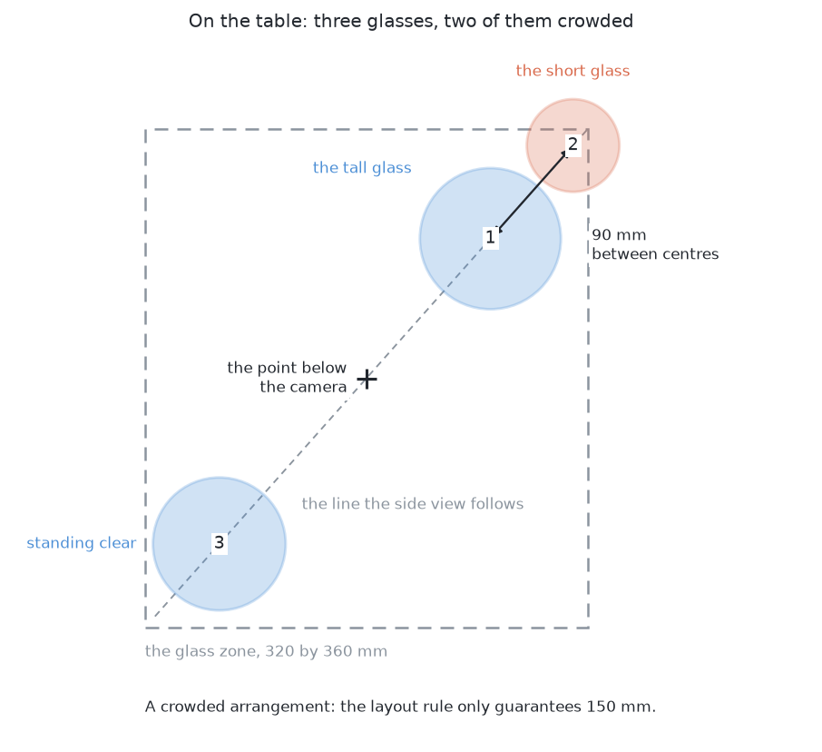

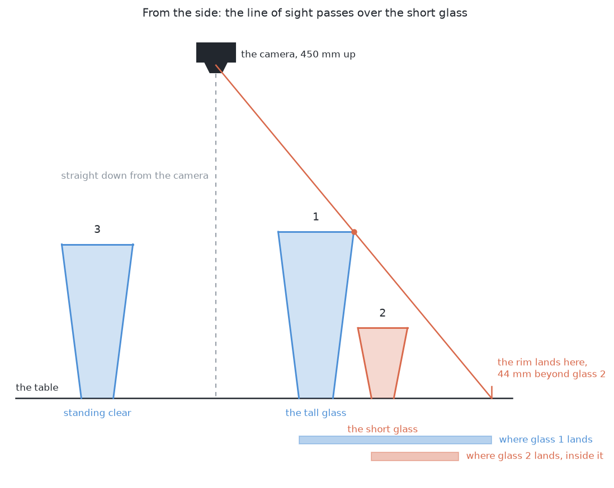

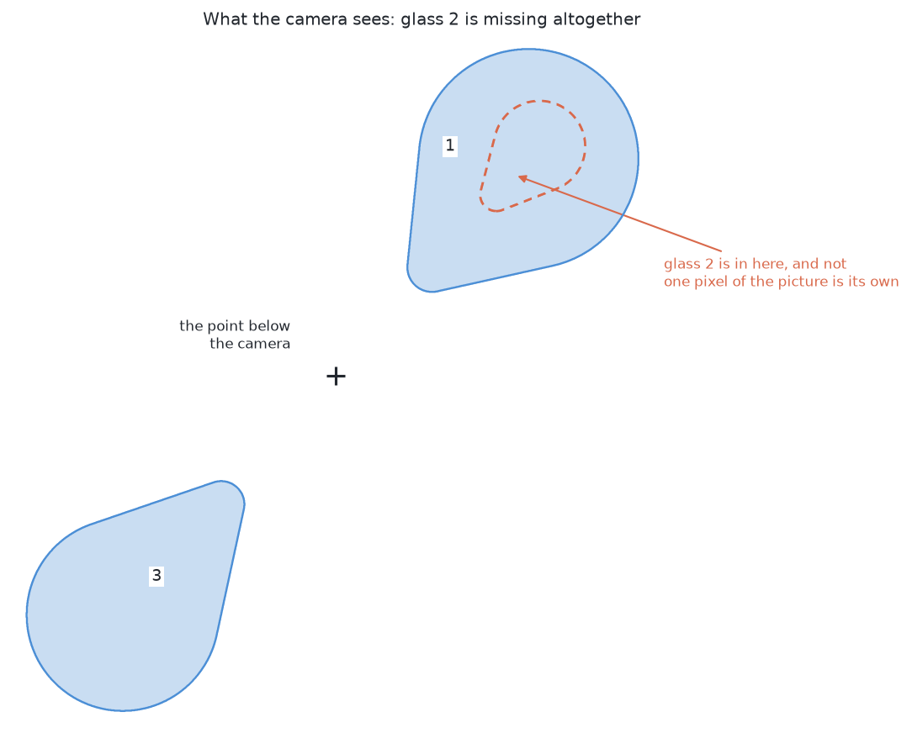

This needs an unusual arrangement. For the tapered kind, the tallest glass hides
the shortest only when their centres are about 124 mm apart or less. The layout
rule keeps them at least 150 mm apart. So **this never happens in an ordinary
arrangement**. It only happens in the crowded arrangements.

The picture below shows where the 124 mm comes from. A tall glass's rim is drawn
further out than a short glass's rim. The wider the range of heights, the further
apart the two can stand and still overlap. The straight kind has a smaller range,
so it can hide a glass only up to 92 mm away.

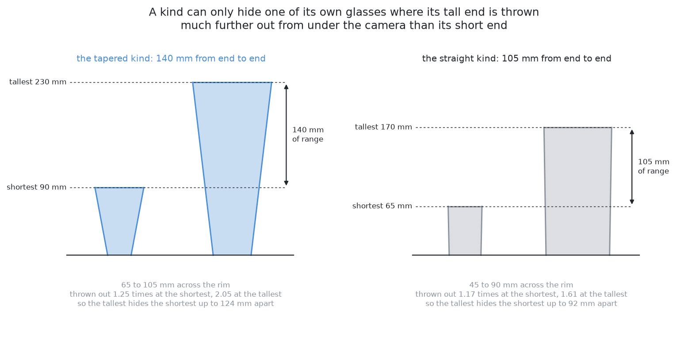

**A missed glass leaves no trace.** There is no bad number and no failed check.
So nothing in the run tells anyone that a glass is missing. No solution in this
book can find such a glass. Even perfect masks from the renderer miss 18 of the
101 crowded glasses, because a glass with no pixels cannot be drawn. [Looking
again at what was hidden](02_looking-again-at-what-was-hidden.md) explains why,
and proposes how to look again.

A glass can also be only partly hidden. Then the picture shows only a **slice**
of it, a thin strip down one side. A mask of that slice looks like a narrow
glass. It gives a width that is too small and a place that is pulled to one
side. Nothing about the slice looks wrong, so this error is also easy to miss.

### Glasses merge in the picture although they stand apart on the table

Splay also causes the second difficulty, even when no glass is hidden. Two
glasses with bare table between them can still make one joined shape in the
picture. Each outline is bigger than the glass's footprint, so the two outlines
meet. The same three kinds of picture show this, on an ordinary arrangement.

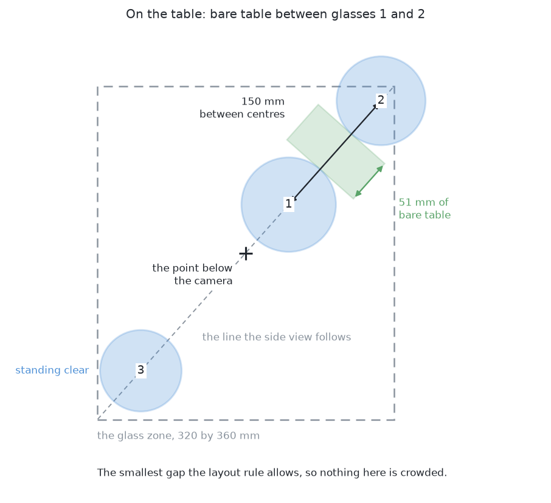

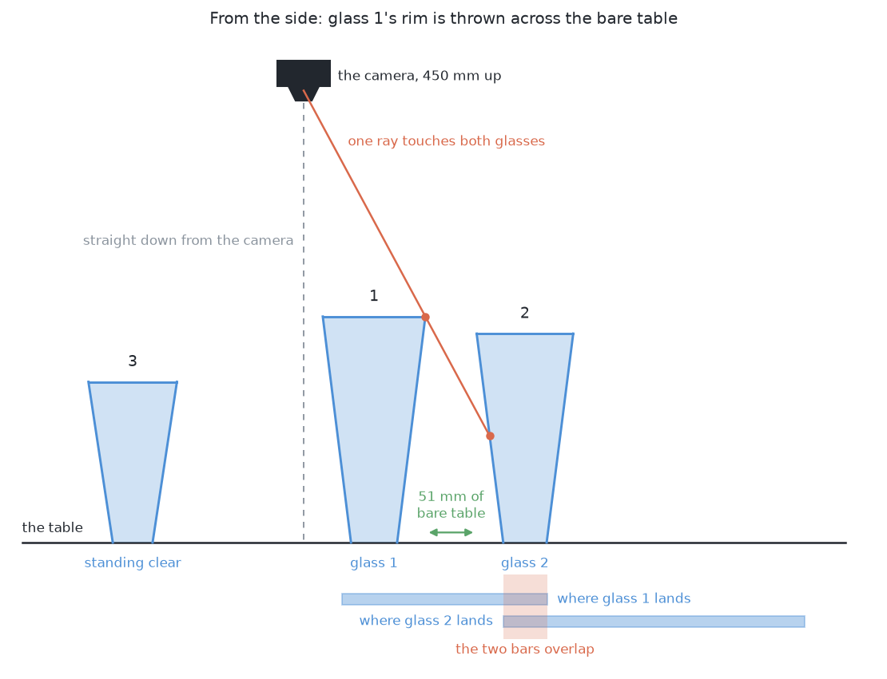

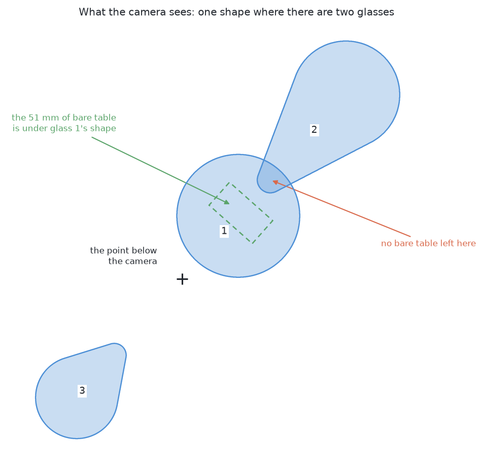

Suppose a method treats each joined shape as one object. Then it reports one
glass where two are standing. The report looks like one ordinary large glass.
Nothing about it looks wrong.

**This difficulty can be solved, and it is what this book is really about.**
The pixels alone cannot split the two glasses. But every pixel also has a depth
reading. The two glasses stand at different places on the table, whatever their
outlines do in the picture. So the input already holds what is needed to tell
them apart. The six methods are six ways of using it.

- One method writes a rule about distance on the table.
- One trains a network in which every glass pixel votes for the middle of its
  own glass.
- Four ask a model to return one outline per object, so nothing is joined in
  the first place.

The methods differ a lot, mostly on the crowded arrangements. [The
results](../11_the-results.md) compare them.

The difficulties are now clear. The last section says when a run counts as
finished.

## 6. What "done" means

A clear finish line is needed before any solution can be marked, so it comes
last. A run is **done** when three things are true:

- every glass has a mask, a place and a rough width;
- every glass that could not be separated from its neighbour is listed, with the
  reason;
- every area of table that could not have been seen is listed as unsearched. It
  is not treated as empty.

[The examiner](../03_the-examiner/01_the-examiner.md) marks each run against the
simulator's record and explains each measurement. The second picture below
shows why **missed** is the count to watch most closely.

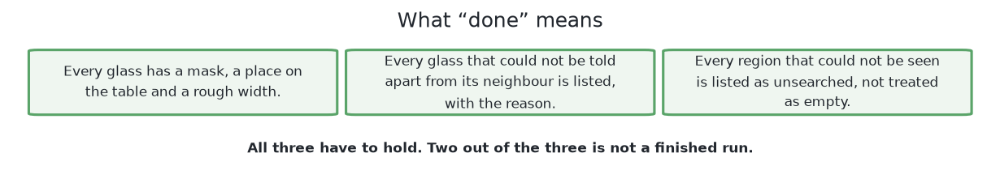

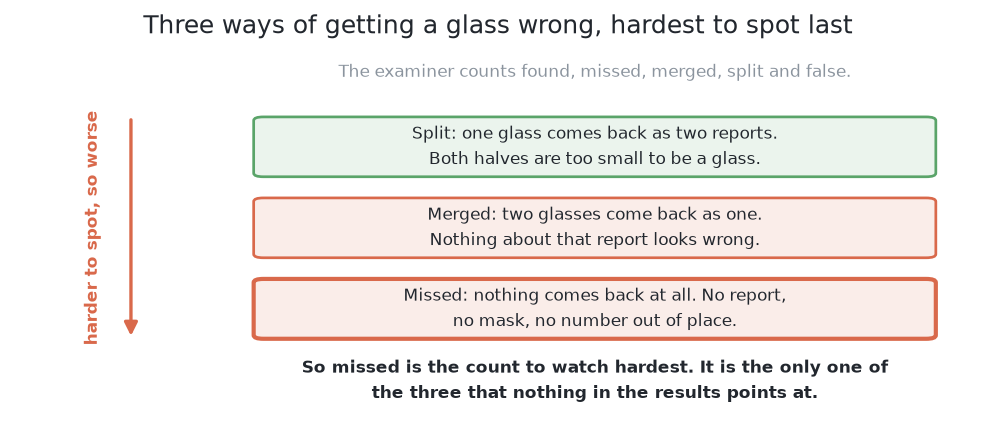

The task is now fully stated. The next page deals with the first difficulty,
which no solution answers.

## 7. Where to go next

These pages follow on from this one.

- [Looking again at what was hidden](02_looking-again-at-what-was-hidden.md)
  covers the hidden glass. Every solution shares this part.
- [The examiner](../03_the-examiner/01_the-examiner.md) covers the scenes, the
  pictures, and how a run is marked. Read it before any solution.
- [The six solutions](../04_the-six-solutions/01_how-the-six-compare.md) are the
  six answers, and what separates them.

← [The cell — the layout, the sensors, and the words](../01_the-cell.md) · [Looking again at what was hidden](02_looking-again-at-what-was-hidden.md) →
