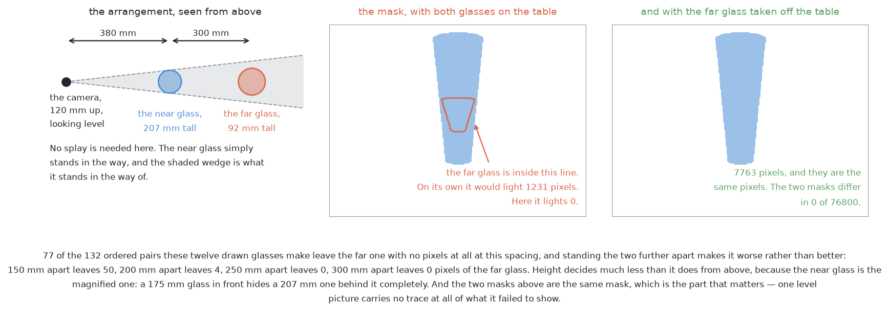
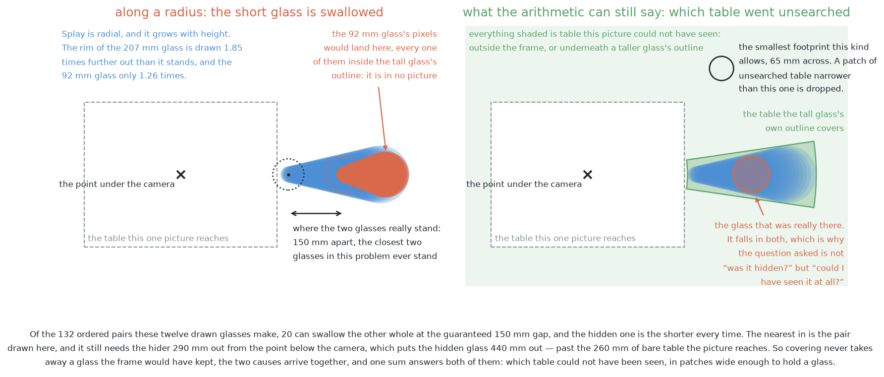
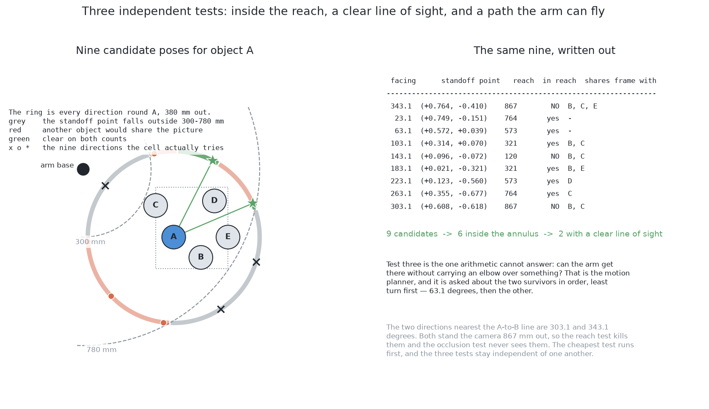
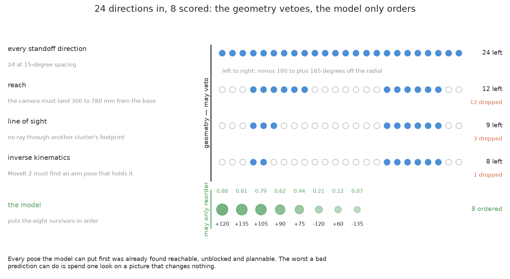
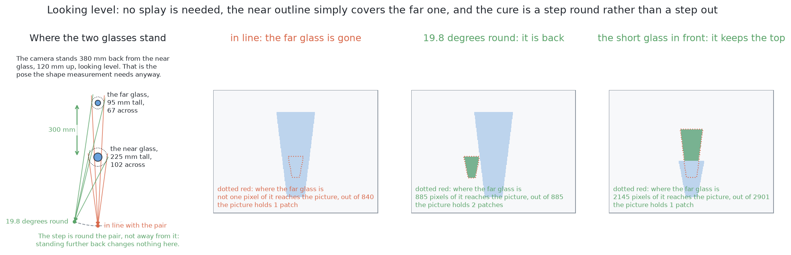

# Looking again at what was hidden

## 1. Introduction

Seen from above, a tall glass can hide a short neighbour completely. [What is
asked for](01_what-is-asked-for.md#a-glass-can-be-missing-from-the-picture-altogether)
shows how. The short glass is then in no picture at all. This page explains what
can be done about that. It is separate from the six solutions, because **every
solution needs it and none of them differs in it**.

The page answers four questions:

- Why can no work on the pixels find a glass that left no pixels?
- How can the arm work out *where* a glass could be hiding?
- How does it choose where to look next?
- Why is the one learned part placed where a mistake costs only a few seconds?

**This page is a design, and none of it is built.** The six solutions are built
and scored. This part is not. No number in this book belongs to it. No code
works out the hidden areas, chooses where to look, or sends the arm back for a
second picture. Read this page as the book's proposed answer to its hardest
difficulty, not as a result.

## Contents

1. [Introduction](#1-introduction)
2. [Why no solution can answer this on its own](#2-why-no-solution-can-answer-this-on-its-own)
3. [Step one: where could a glass have been hiding?](#3-step-one-where-could-a-glass-have-been-hiding)
4. [Step two: where should the camera stand?](#4-step-two-where-should-the-camera-stand)
5. [Step three: which look to take first](#5-step-three-which-look-to-take-first)
6. [The honest limit](#6-the-honest-limit)
7. [Where to go next](#7-where-to-go-next)

## 2. Why no solution can answer this on its own

We first show why the six solutions cannot fix this, so the reason for a
separate step is clear.

The six solutions differ in how they turn pictures into masks. That difference
does not matter here. The problem is not a hard mask to draw. The problem is
that there is nothing to draw.

A method that finds objects in a picture can only find what the picture holds.
Where a tall glass covers a short one, those pixels show only the tall glass.
So the short glass is not measured badly. It is absent. A different threshold,
a larger model or better training cannot change this. The evidence is not weak.
It is missing.

The same is true for the view from the side. Take two arrangements. In one, a
far glass stands behind a near one. In the other, the far glass is removed. Both
give the same picture, pixel for pixel. So any method that reads only the
picture must give the same answer for both.

So the answer must come from something other than the picture. That something
is **geometry**. The arm knows three things: where its camera was, how its lens
works, and where the glasses it *did* find are standing. From these it can work
out which parts of the table the camera could not see. This is a fact about the
room, not about the picture. So it still holds when a glass is invisible.

The next section uses this geometry to find the places a glass could hide.

## 3. Step one: where could a glass have been hiding?

Geometry is the only tool left, so the arm uses it first to mark the table it
could not see. It starts from the glasses it found.

**Each found glass hides a wedge of table behind it.** Picture a straight line
from the lens that just touches the glass's widest part. Follow it until it
meets the table. The table in the shadow of that line was hidden from the
camera. This shadow is a wedge that spreads away from the point below the
camera. A taller or wider glass hides a bigger wedge. This is the same
arithmetic as [splay](../01_the-cell.md#6-the-words), used the other way round.

**The edge of the picture hides more table.** A camera sees a rectangle, so
anything outside it is unseen. But the survey stations overlap on purpose. A
strip missed by one station is inside another station's picture. So the frame
edge matters less than the wedges.

**What is left is reported.** Take all the wedges and all the frame edges from
all the stations. Remove them from the glass zone. What remains is table that
nobody saw. A remaining piece is reported as an **unsearched patch** if it is
big enough to hold the smallest footprint of this kind of glass.

**An unsearched patch is not a glass, and it is not a guess that a glass is
there.** It says only that nobody looked at that place. Most unsearched patches
are empty, because most hidden table is empty. Reporting them still helps. A
failure that nobody could see becomes a task that anyone can see.

The arm now has a list of places it never saw. The next section asks where the
camera must stand to see them.

## 4. Step two: where should the camera stand?

The arm now has a list of unsearched patches. It must choose camera positions
that would see them.

Measuring one glass is different. A glass has a position, so the arm can stand
somewhere around it, at the right distance, and look at it. An unsearched patch
has no glass in it. There is nothing to look *at*. Also, a patch is an area,
not a point. So one camera position may see all of it, part of it, or none of
it.

So the test is: **"does this patch fall inside what this camera position can
see?"** This uses the wedge arithmetic from step one again. For a candidate
position, work out the wedges the known glasses would hide. Also work out which
parts of the zone would fall outside the frame. What is left is the area that
position can see. Then check whether the patch is inside that area.

### Three tests, and why their order matters

Not every position can be used. Three tests remove the bad ones before any
ranking. They run cheapest first.

**Can the arm reach it?** This is simple arithmetic on the arm's sizes. It
costs almost nothing.

**Would something else get in the way?** A position is refused if a known glass
would stand in the line of sight. It is also refused if the camera would have to
be where a glass is standing. This is also cheap arithmetic.

**Can the arm actually move there?** This asks the motion planner. The motion
planner is the program that finds a safe path for the arm. It is by far the
slowest test. So it runs last, and only on positions that passed the other two.

The order matters. Each planner call takes seconds. A call on a position that
fails a cheap test is wasted time, and the run has a time budget.

### Which makes it a covering problem

Each position that passes sees some of the unsearched patches. The run wants
every patch seen. Each position costs seconds. So the question is: **what is the
smallest set of positions that, together, see every patch?**

This is a well-known problem called **set cover**. You have a collection of sets
and a target. You must choose as few sets as possible that together cover the
target. Solving it exactly is known to be hard. But a simple method gets close
to the best answer, and this is proved. Pick the position that covers the most
patches not yet covered. Repeat until every patch is covered. This is the
**greedy method**. For set cover, no simple method does much better.

The covering step says which positions are needed. The next section decides
which one to visit first.

## 5. Step three: which look to take first

Set cover gives a list of positions but no order. The order matters, because
the run has a time budget and may not visit them all.

Here is the one learned part of this shared step. It is a small model that puts
the positions in order. For each position it gets a few plain numbers:

- how many unsearched patches it would see;
- how big those patches are;
- how many glasses are still missing, compared with the number expected.

It returns a score. The score is used only for sorting.

**The model is safe because of where it sits.** The geometry makes every
candidate and removes the unsafe ones. The model only orders what is left. So a
bad order costs one wasted look and nothing worse. It cannot make the run miss a
glass. Every patch stays on the list until something has looked at it. It cannot
cause a collision either, because the safety tests do not ask the model. A
better model wastes fewer looks. Only the arrangement of glasses limits how bad
things can get.

**The run still works without the model.** With no model, the arm visits the
patches in the order the geometry gives. The run is slower, but not wrong.

### One number the model needs that is not in any picture

One input does not come from a sensor. It comes from [the
task](01_what-is-asked-for.md#2-what-is-on-the-table): **how many glasses are on
the table**. The task says four to six. The run knows how many it has found.

This one number changes how much the patches matter. Say six glasses were
expected and six were found. Then the patches are almost surely empty, and the
looks can be skipped. Say six were expected and four were found. Then two
glasses are somewhere, and the patches are the only places left. An empty look
then teaches something too. The count is still four, and fewer places are left.
So the remaining patches become *more* likely to hold a glass, not less.

This design works well from above. The next section says where it stops
working.

## 6. The honest limit

Every design has limits, and this section states this one plainly.

This design can recover a glass hidden in the view from above. The wedges can be
worked out, and a new position can see into them. It does much less for a glass
hidden in the view from the side.

In the level view, a near glass hides the table behind it along one line.
Looking along that line, from any distance, never shows the far glass. Only a
position off that line can see it. The overlapping survey stations already give
such positions. So in practice the survey settles this case before the side
views begin. One general rule still has no answer. Two arrangements that give
the same pictures cannot be told apart by anything that reads only those
pictures.

This ends the shared part of the problem. The next page shows how every
solution is tested.

## 7. Where to go next

These pages follow on from this one.

- [The problem](01_what-is-asked-for.md) says what is asked for, and the two
  difficulties.
- [The examiner](../03_the-examiner/01_the-examiner.md) gives the shared input,
  output and marking.
- [The six solutions](../04_the-six-solutions/01_how-the-six-compare.md) say
  what each one does between the pictures and the masks.

← [What is asked for — segment the glasses](01_what-is-asked-for.md) · [The examiner — the same question for every answer](../03_the-examiner/01_the-examiner.md) →
