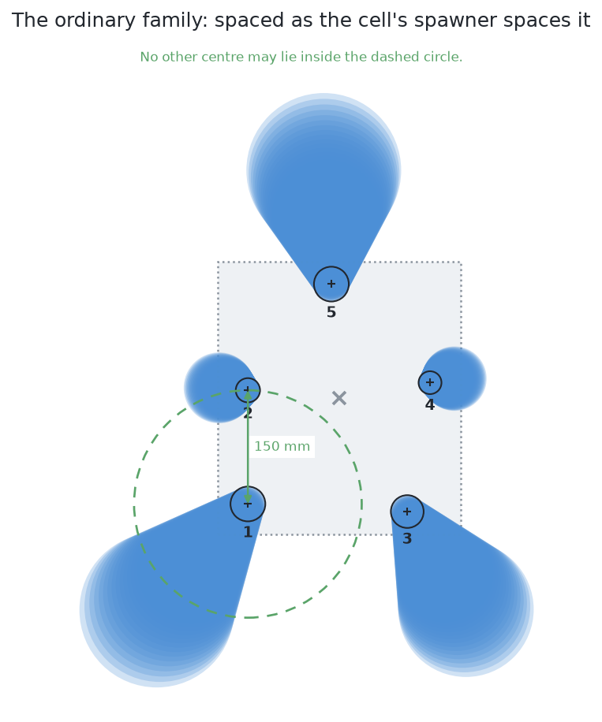
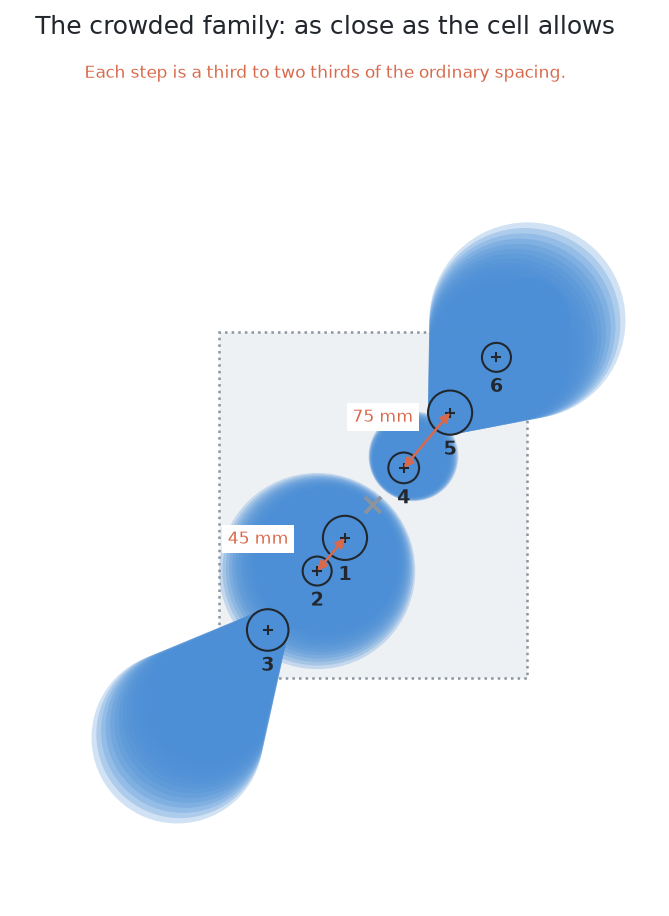
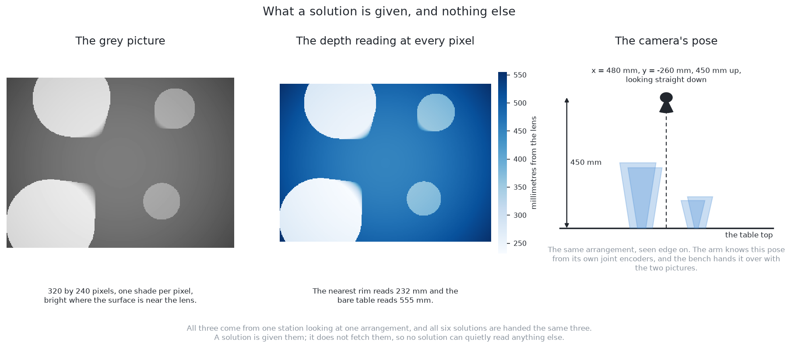

# The examiner — the same question for every answer

## 1. Introduction

This book solves one problem in six ways. Six answers can only be compared if
each one gets the same question and is marked the same way. The examiner is the
program that does both. It works in four steps. It **arranges** glasses on the
table and takes pictures from three camera stations. It **hands** those pictures
to the solution. It **takes back** what the solution returns. Then it **marks**
that answer against the glasses it put out.

Every solution goes through these four steps twice. One run uses the normal
spacing of the cell. The other run puts the glasses closer together. So each
solution gets two scorecards.

This page explains each step in general terms. Read it before any solution
chapter, because they all assume it. The next three pages follow one real
arrangement through the same steps:
[an example of the input](02_an-example-of-the-input.md) shows the pictures that
go in, [an example of the output](03_an-example-of-the-output.md) shows the masks
that come back, and [comparing the outputs](04_comparing-the-outputs.md) shows
the marking.

## Contents

1. [Introduction](#1-introduction)
2. [Why there is an examiner at all](#2-why-there-is-an-examiner-at-all)
3. [What the examiner draws](#3-what-the-examiner-draws)
4. [What a solution is given](#4-what-a-solution-is-given)
5. [What the examiner keeps to itself](#5-what-the-examiner-keeps-to-itself)
6. [What must come back](#6-what-must-come-back)
7. [Where to go next](#7-where-to-go-next)

## 2. Why there is an examiner at all

We start with the reason for the examiner, because every later step follows
from it. Without an examiner, each method would bring its own test scenes and
its own idea of a good answer. Then their results could not be compared.

The examiner keeps three things the same for every solution. The **input** is
the same pictures of the same arrangements, in the same order. The **output** is
the same record per glass, made by the same final step. The **marking** is the
same set of measurements. A solution can only change what happens between the
input and the output. That middle part is what we want to compare.

This makes some comparisons very exact. For example, solutions 3 and 4 use the
same model, and only solution 4 is trained on this cell. So the gap between
them shows what the training added.
[What it is](../08_the-same-model-fine-tuned/01_what-it-is.md) for solution 4
explains this pair.

The next section describes the first thing the examiner does: it draws the
arrangements.

## 3. What the examiner draws

The examiner first needs glasses on a table, so this section says how it makes
them. **It draws the arrangements itself, not Gazebo.** Gazebo would be slower,
and a few hundred arrangements are needed. The examiner uses the cell's own
glass shapes, table layout and camera lens, so nothing about the geometry is
made up.

**Each arrangement holds four to six glasses of one kind.** The kind changes
from one arrangement to the next, so a run meets all four kinds. A run of 20
arrangements has about five of each kind.

This is why **a score is an average over all four kinds**. The four kinds are
not equally hard to outline. So the examiner also reports every measurement for
each kind on its own. [The results](../11_the-results.md) shows this breakdown
where it matters. The problem page uses only the tapered kind to explain the
difficulties, but nothing is ever scored on that kind alone.

**There are two families of arrangement.** They differ only in how far apart
the glasses stand. Both pictures below are drawn from straight above, at the
same scale. Each shaded patch is what the overhead camera sees of a glass. The
small circle and cross mark where that glass really stands.

The **ordinary family** is what the cell's own spawner makes. It keeps 150 mm
between any two centres, shown by the dashed circle. So the five glasses below
make five separate patches, and nothing is hidden.

The **crowded family** puts the glasses as close as the cell allows. That is a
third to two thirds of the ordinary spacing. In the picture below, glasses 4, 5
and 6 join into one patch. Glass 2 is fully hidden behind glass 1. So six
glasses make only two patches. [What is asked for](../02_the-problem/01_what-is-asked-for.md#5-the-two-difficulties)
explains why crowding causes these two failures.

**Arrangements are split into a training half and a test half**, by the number
used to draw them. A method is trained only on arrangements below the dividing
line. It is marked only on arrangements above it. So no method is tested on an
arrangement it learned from.

### Every solution is tested twice, once on each family

A solution is not run once. **It is run twice, once on each family, and it gets
two scorecards.** Each run uses 20 test arrangements of its family. Both runs
are marked the same way. So the only difference between the two scorecards is
how close the glasses stood.

The table below has one row per run. Read across for its size and the question
it asks.

| run | arrangements | glasses | what it asks |
|---|---|---|---|
| the ordinary run | 20 | 100 | can the method do the job the cell actually sets it? |
| the crowded run | 20 | 101 | where does the method begin to break? |

So [the results](../11_the-results.md) show two columns of six scores. Read a
solution by its pair. The ordinary score says whether it does the cell's real
job. The gap to the crowded score says how much it needed the glasses to stand
apart.

A trained solution is still trained only once. Its training set mixes both
families, so no method meets crowding for the first time in its test.

Once the glasses are on the table, the examiner takes pictures, and the next
section says what a solution may read from them.

## 4. What a solution is given

This section lists the input, which is the same for all six solutions. For each
arrangement, the camera stops at three overlapping stations above the glass
zone. It looks straight down. [The cell](../01_the-cell.md#5-where-the-camera-stands-and-what-each-place-is-called)
explains the stations and why they overlap.

From each picture a solution may read three things:

- the **grey picture**, where the shade of each pixel shows how far away the
  surface is;
- the **depth reading**, which is the distance at every pixel;
- the **camera's pose**, which is where the camera is and which way it points.
  The arm knows this from its own joint sensors.

That is the whole input. The examiner hands it over. The solution does not
fetch it. So no solution can read anything else.

The examiner also makes one more picture that it does not hand over. The next
section is about that picture.

## 5. What the examiner keeps to itself

The examiner needs the true answer in order to mark, and this section says
where it comes from. Every picture also has an **id image**. At each pixel, the
id image says which glass that pixel shows, or that it shows no glass. The
examiner makes it together with the depth reading. It never gives it to a
solution while the solution is answering.

The id image has two separate jobs.

**It is the answer key.** The examiner knows which glass owns each pixel. So it
can tell which glass a returned mask really shows.

**It is a training label.** A trained method learns from id images, but only
from the training half. These labels cost nothing and are exact, because the
examiner draws them itself. A method may be *trained* on id images. It is never
*run* on them. A method that read one while answering would not be solving this
problem.

Now we know what goes in and what stays hidden. The next section says what a
solution must hand back.

## 6. What must come back

This section says what a solution returns, and so what the examiner can mark. A
solution returns one record per glass. A record holds the glass's mask, its
place on the table, a rough width, and **whether the picture held the whole
glass**. The last item matters because a glass at the edge of the frame shows
only part of itself. A width read from it is too small. The solution has to
know this if it wants to reject a report because of its width.

Beside the records come the two honest statements that
[the problem](../02_the-problem/01_what-is-asked-for.md#4-what-must-come-out)
asks for. These say which glasses could not be separated, and which parts of the
table could not be seen. The examiner counts both. It does not treat a stated
doubt as a missing answer.

**The solution picks the pixels, and the examiner does the measuring.** A mask
is a set of pixels. The examiner turns it into a place and a width. It uses the
depth reading at each pixel and the camera's pose. These are the same things it
handed over in [what a solution is given](#4-what-a-solution-is-given). It does
this step the same way for every solution.

So the final answer depends only on which pixels the solution chose. No
solution can win or lose by measuring better or worse. **The best solution is
the one whose masks best match the real glasses.** This means a difference in
scores is a difference in masks.
[How a mask becomes a record](../12_how-a-mask-becomes-a-record.md) gives the
arithmetic of this step. You do not need it to follow the comparison.

One more fact follows, and it holds for all six solutions. **No model in this
book gives a pose.** Models give masks. The place comes later, from the depth
readings and the camera's pose. A glass that stands upright on a flat table has
no turn to find anyway.

That is the whole test in general terms. The next page runs it once, on one
real arrangement of four glasses.

## 7. Where to go next

- [An example of the input](02_an-example-of-the-input.md) — one real
  arrangement, and the three pictures the examiner hands over for it.
- [An example of the output](03_an-example-of-the-output.md) — the masks that
  came back for that arrangement, and the record each one becomes.
- [Comparing the outputs](04_comparing-the-outputs.md) — how the examiner marks
  what came back.
- [The problem](../02_the-problem/01_what-is-asked-for.md) — what is asked for, and the two difficulties.
- [Looking again at what was hidden](../02_the-problem/02_looking-again-at-what-was-hidden.md) — the shared part that
  recovers a glass no picture held.
- [The six solutions](../04_the-six-solutions/01_how-the-six-compare.md) — what each method puts between the
  input and the output.

← [Looking again at what was hidden](../02_the-problem/02_looking-again-at-what-was-hidden.md) · [An example of the input](02_an-example-of-the-input.md) →
