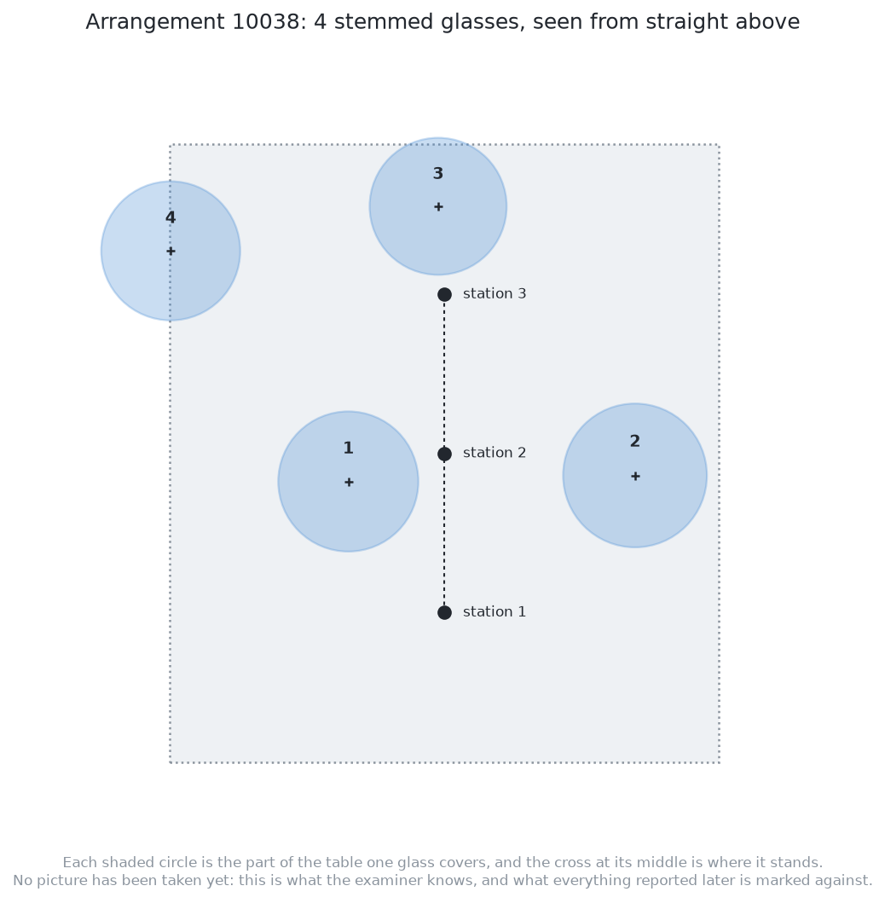
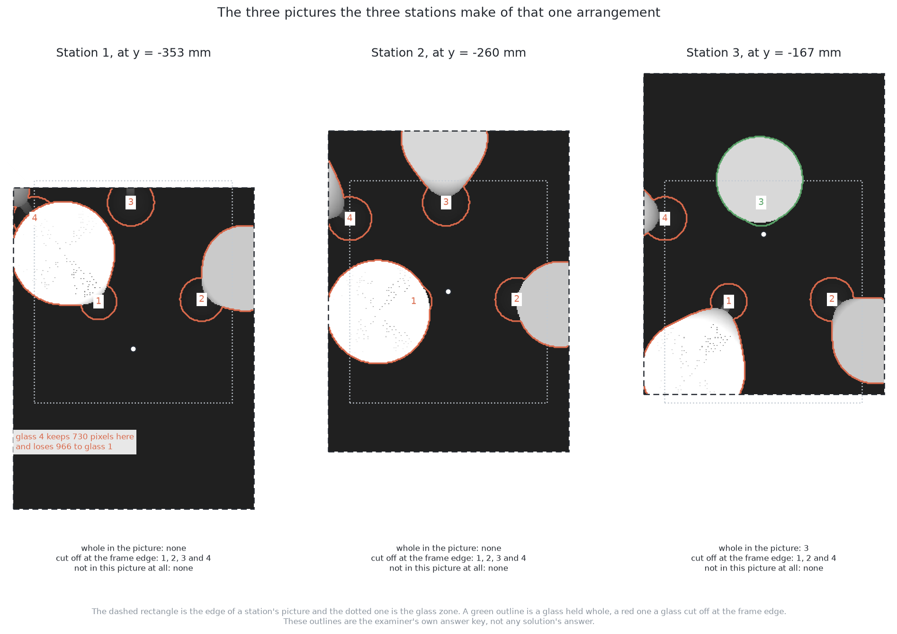
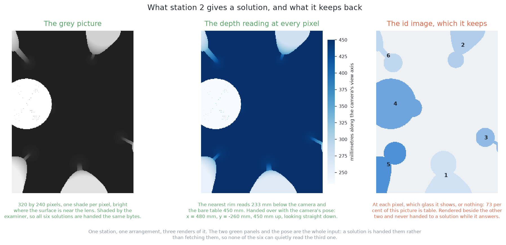

# An example of the input

## 1. Introduction

The previous page, [the examiner](01_the-examiner.md), described the input in
general terms. This page shows it once, on one real arrangement.

The arrangement is the examiner's number 10038. It comes from the test half, so
it is what the cell's spawner really makes. It was not built for a diagram. It
holds four glasses, which is the smallest number the spawner draws. Every
picture on this page was made by the examiner's own code. Every number was
measured.

This page shows three things in order. First come the glasses on the table.
Then come the three pictures the camera takes. Last, one picture is split into
the parts a solution is given. What comes back is on the next page,
[an example of the output](03_an-example-of-the-output.md).

## Contents

1. [Introduction](#1-introduction)
2. [The glasses on the table](#2-the-glasses-on-the-table)
3. [The three pictures](#3-the-three-pictures)
4. [What one station hands over](#4-what-one-station-hands-over)
5. [Where to go next](#5-where-to-go-next)

## 2. The glasses on the table

We start with what is really on the table, because everything is marked against
it. The picture below shows the arrangement from straight above, before any
picture is taken. Each shaded circle is the part of the table one glass covers.
The cross in its middle is where that glass stands. The dotted rectangle is the
glass zone, the 320 mm by 360 mm part of the table where glasses are placed.
Only the examiner knows this layout.

All four glasses are **stemmed glasses**, because each arrangement holds one
kind. A stemmed glass in this cell is 165 to 230 mm tall, with a bowl 60 to
100 mm across. The table below gives each glass the number the answer key uses.
Every later picture uses the same numbers. Read across a row for the glass's
height, bowl width and place on the table.

| glass | height | bowl across | stands at |
|---|---|---|---|
| 1 | 228 mm | 82 mm | x = 424 mm, y = −276 mm |
| 2 | 174 mm | 84 mm | x = 591 mm, y = −273 mm |
| 3 | 189 mm | 80 mm | x = 477 mm, y = −116 mm |
| 4 | 172 mm | 81 mm | x = 321 mm, y = −142 mm |

The closest pair stands 158 mm apart. The spawner keeps at least 150 mm, so no
glass touches another. Glass 1 is the tallest, and this matters later. Seen from
above, a tall glass's rim is drawn further outwards, so it can cover more of a
neighbour. [The cell](../01_the-cell.md#3-the-glasses) explains this.

The three black dots on the middle line are the three camera stations. They are
93 mm apart and 450 mm above the table, and the camera looks straight down from
each.

The next section shows what the camera sees from those three stations.

## 3. The three pictures

Now the camera takes one picture from each station. These three pictures are all
the examiner hands over for this arrangement. Each one shows something the
others do not.

Read the picture by the colour of each outline. A green outline is a glass the
picture holds whole. A red outline is a glass cut off at the edge of the frame.
**Only station 3 holds any glass whole**, and that glass is glass 3. Every other
glass in every other picture touches a frame edge.

This is not a problem, because the stations overlap. A glass cut off in one
picture is further inside the next one. The examiner keeps one report per glass,
from the nearest station.
[Comparing the outputs](04_comparing-the-outputs.md#3-which-report-the-examiner-keeps)
explains this rule.

Station 1 also shows the main difficulty of the book. **Glass 4 keeps only 730
pixels in that picture and loses 966 to glass 1**, because glass 1's bowl covers
it. No method can get back a pixel the camera never saw.
[Looking again at what was hidden](../02_the-problem/02_looking-again-at-what-was-hidden.md)
explains this limit.

The next section takes one of these pictures apart.

## 4. What one station hands over

Each picture is really three arrays, and this section shows them for station 2.
The examiner makes all three and hands over two.

The **grey picture** is 320 by 240 pixels, with one shade per pixel. A pixel is
bright where the surface is near the lens. The examiner makes this shading, so
all six solutions get exactly the same picture.

The **depth reading** gives the distance to what each pixel shows. Here the
nearest rim is 222 mm below the camera. The bare table is 450 mm below, which
is the survey height. This array turns a pixel into a point in the room, so all
the places come from it.

These two arrays go to the solution with the **camera's pose**. For station 2
the pose is x = 480 mm, y = −260 mm, 450 mm up, looking straight down.

The **id image** is the third array, and the examiner keeps it. In this picture,
74 per cent of the pixels show the table. [The examiner](01_the-examiner.md#5-what-the-examiner-keeps-to-itself)
explains why a solution never sees this array.

The next page shows what a solution hands back for these pictures.

## 5. Where to go next

- [An example of the output](03_an-example-of-the-output.md) — what the written
  rule hands back when it is given the three pictures above.
- [The examiner](01_the-examiner.md) — the same arrangement in general terms,
  for every arrangement rather than this one.
- [Comparing the outputs](04_comparing-the-outputs.md) — how what comes back is
  marked.

← [The examiner — the same question for every answer](01_the-examiner.md) · [An example of the output](03_an-example-of-the-output.md) →
