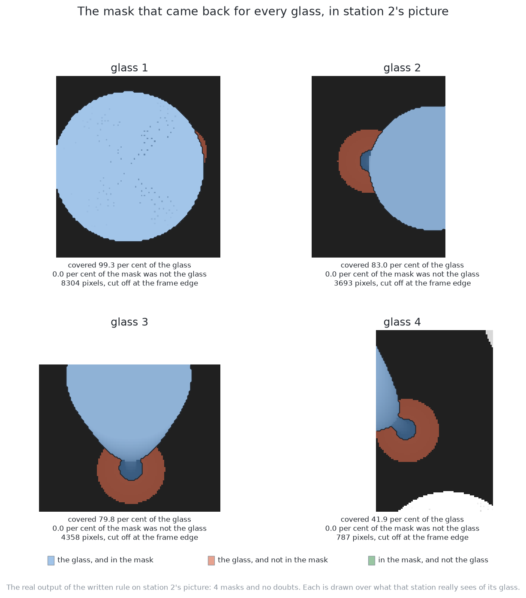
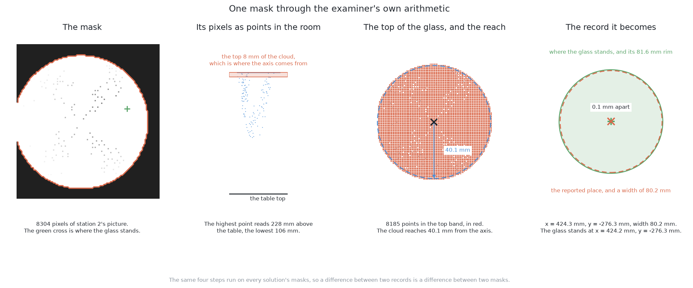

# An example of the output

## 1. Introduction

The previous page, [an example of the input](02_an-example-of-the-input.md),
handed over the three pictures of arrangement 10038. This page shows what comes
back.

The solution here is the written rule, the
[first of the six](../04_the-six-solutions/02_rules-on-the-table.md). It was
given station 2's grey picture and depth reading. It was told only that the
glasses are stemmed glasses. The masks below are its real output. This page
shows what the rule handed back, how good each mask is, and what the examiner
turns each mask into before marking.

## Contents

1. [Introduction](#1-introduction)
2. [The four masks](#2-the-four-masks)
3. [What the two mask numbers say here](#3-what-the-two-mask-numbers-say-here)
4. [From one mask to one record](#4-from-one-mask-to-one-record)
5. [Where to go next](#5-where-to-go-next)

## 2. The four masks

We start with the masks, because a mask is the only part of the answer a
solution chooses. A mask is the set of pixels the solution thinks are one
glass. The written rule returned four masks for station 2 and stated no doubts.
So there is one panel per glass below.

Read each panel by its three colours. **Blue** is glass the mask got. **Red** is
glass the mask missed. **Green** is pixels the mask claimed that are not that
glass. There is no green anywhere here.

The red is in the same place in every panel. It is a band at the base of the
glass, with the foot under it. The rule keeps a pixel only when the depth shows
it is clearly above the table. At the base of a glass this is not clear, so all
four masks lost that band.

The next section puts numbers on what the panels show.

## 3. What the two mask numbers say here

The examiner measures every mask with two numbers. The first is **how much of
the glass the mask covered**. The second is **how much of the mask was not that
glass**. [Comparing the outputs](04_comparing-the-outputs.md#6-how-good-was-the-mask)
explains both. The table below gives them for the four masks. Read across a row
for one glass.

| glass | mask covered | mask not the glass | pixels |
|---|---|---|---|
| 1 | 99.3 per cent | 0.0 per cent | 8304 |
| 2 | 83.0 per cent | 0.0 per cent | 3693 |
| 3 | 79.8 per cent | 0.0 per cent | 4358 |
| 4 | 41.9 per cent | 0.0 per cent | 787 |

**The first number depends on how much of the glass the station saw.** Glass 1
stands almost under the camera. Station 2 sees 8359 pixels of it, and the mask
keeps 99.3 per cent. Glass 4 is at the far edge of the picture. Station 2 sees
only 1880 pixels of it, and the mask keeps 41.9 per cent. The rule was the
same. Only the view changed.

**The second number is zero for all four**, because the written rule only takes
a pixel it is sure about. So it claims too little and never too much.

A mask is not yet a place on the table. The next section shows how the examiner
turns one into a place.

## 4. From one mask to one record

The problem asks where each glass stands, so each mask must become a place. The
examiner does this step itself, the same way for every solution. The picture
below follows glass 1's mask through it.

Read it from left to right. The **mask** has 8304 pixels. Each pixel has a
depth reading, so each becomes a **point in the room**. The highest point is
228 mm above the table, and the lowest is 106 mm. The **axis** of the glass
comes from the top 8 mm of these points. The **width** is how far the points
reach from that axis, which here is 40.1 mm.
[How a mask becomes a record](../12_how-a-mask-becomes-a-record.md) explains
why each step is done this way.

The result is the record: x = 424.3 mm, y = −276.3 mm, and a width of 80.2 mm.
Glass 1 really stands at x = 424.2 mm, y = −276.3 mm, with a bowl 81.6 mm
across. So the place is 0.1 mm out, and the width is 1.4 mm too small.

This step is the same for all six solutions. So a difference between two
solutions' records comes only from their masks. The next page shows how those
records are marked.

## 5. Where to go next

- [Comparing the outputs](04_comparing-the-outputs.md) — how the examiner marks
  what came back, finished on this same arrangement.
- [An example of the input](02_an-example-of-the-input.md) — the three pictures
  these masks were made from.
- [Rules on the table](../04_the-six-solutions/02_rules-on-the-table.md) — the
  solution whose masks these are.
- [How a mask becomes a record](../12_how-a-mask-becomes-a-record.md) — the
  full arithmetic that turns a mask into a record.

← [An example of the input](02_an-example-of-the-input.md) · [Comparing the outputs](04_comparing-the-outputs.md) →
