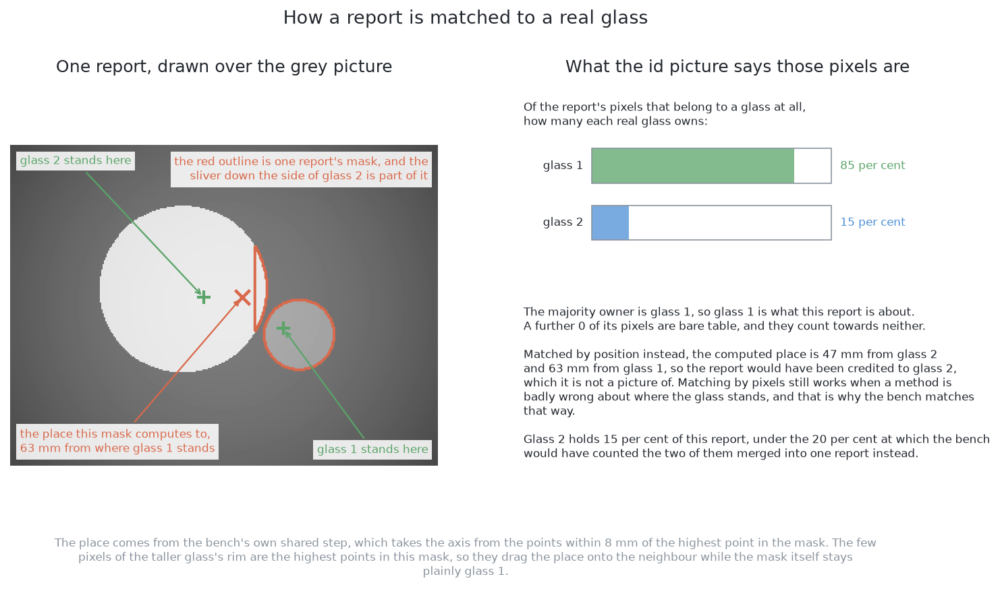
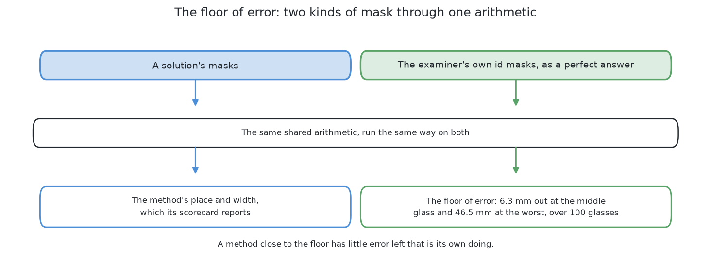
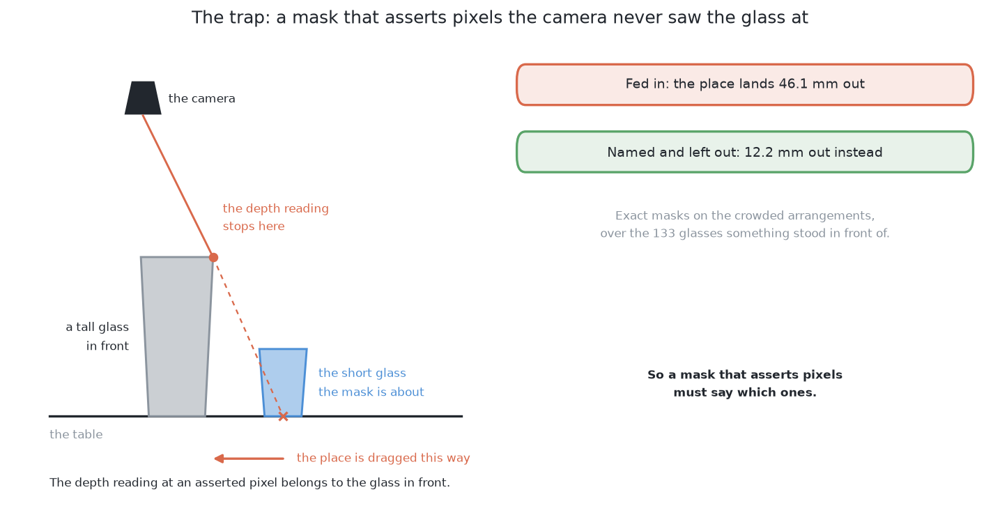
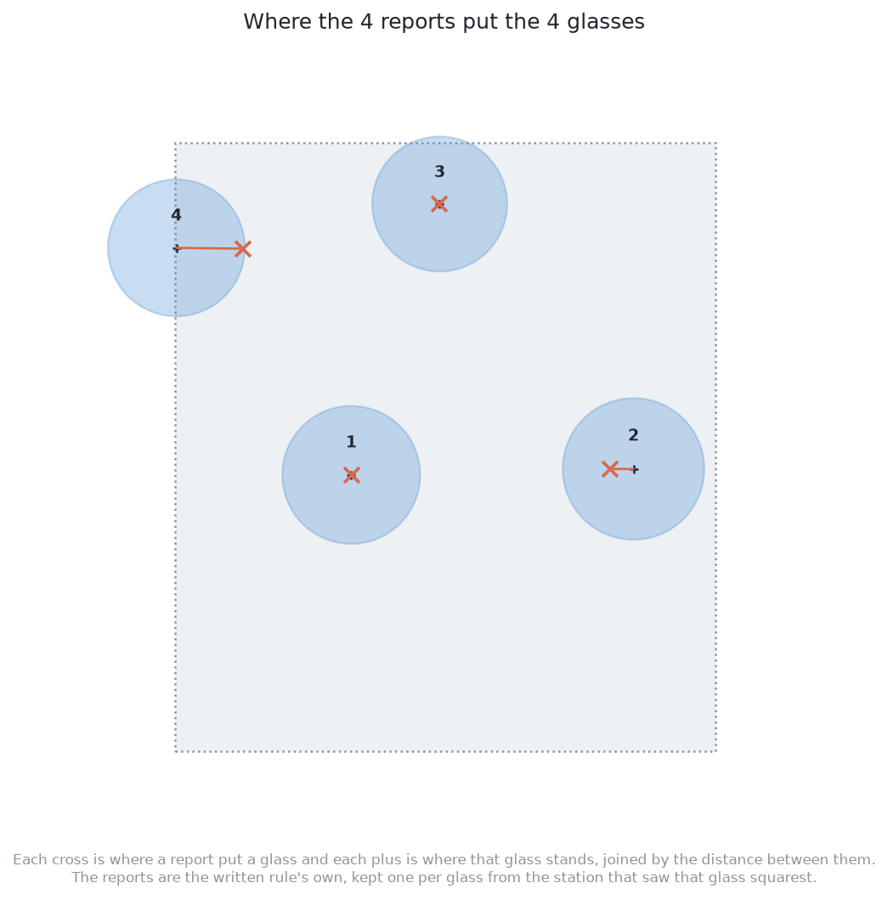

# Comparing the outputs

## 1. Introduction

The previous page, [an example of the output](03_an-example-of-the-output.md),
ended with four masks and one record. A record is not yet a score. This page is
the last part of the examiner's job. It marks what came back.

The marking has four steps, and this page follows them in order. First the
examiner works out **which real glass each report is about**. Then it decides
**which of a glass's three reports to keep**. Then it asks three questions. Did
the method **separate** the glasses? How far out was the **place**? How good was
the **mask**? Last, it compares all this with the best answer a perfect mask
could give. That tells you whether an error is the method's fault at all.

Arrangement 10038 is used to the end. So every number here was measured on
glasses you have already seen.

## Contents

1. [Introduction](#1-introduction)
2. [Which real glass is this report about?](#2-which-real-glass-is-this-report-about)
3. [Which report the examiner keeps](#3-which-report-the-examiner-keeps)
4. [Did it separate the glasses?](#4-did-it-separate-the-glasses)
5. [How far out was the place?](#5-how-far-out-was-the-place)
6. [How good was the mask?](#6-how-good-was-the-mask)
7. [The best possible answer, and the trap below it](#7-the-best-possible-answer-and-the-trap-below-it)
8. [What one arrangement adds to the scorecard](#8-what-one-arrangement-adds-to-the-scorecard)
9. [Where to go next](#9-where-to-go-next)

## 2. Which real glass is this report about?

Nothing can be counted until each report is tied to a real glass. A solution
hands back pixels, but it never names the glass. So the examiner decides, and it
decides **by pixels, not by position**. It asks the id image which real glass
owns most of the report's pixels. That glass is the one the report is about.

This still works when a method gets the place badly wrong. For example, a mask
that clearly shows glass 3 is credited to glass 3, even if its place is far off.
Matching by position would credit it to whichever glass stood near the wrong
place. The method would then be marked for a mistake it did not make.

Each arrangement has three pictures, so one glass can now have up to three
reports. The next section says which one counts.

## 3. Which report the examiner keeps

Now that each report has a glass, the examiner must pick one report per glass.
**It keeps the report from the station nearest that glass.** It decides this
from the camera's position alone, before any marking.

This order matters. The examiner cannot help a solution by keeping its best
report. Every solution is also scored from the same station for the same glass.
In arrangement 10038 this costs a little. Glass 4's mask at station 2 covered
41.9 per cent of what that station saw. But the kept report comes from station 3
and covers 38.7 per cent. The rule is not changed after the fact.

The examiner then turns each kept report into a place and a width, in the
[shared step](03_an-example-of-the-output.md#4-from-one-mask-to-one-record).
Every solution goes through the same step. So a difference between two
scorecards comes from the masks, and the three questions below are fair.

## 4. Did it separate the glasses?

The first question is the simplest: did the method find each glass once? It is
answered by counts that come from the matching above. The table below has one
row per count. Read across for what the count means.

| Count | What it means |
|---|---|
| **put out** | how many glasses were really on the table |
| **found** | how many distinct real glasses got a report |
| **missed** | real glasses that got no report at all |
| **merged** | one report that two real glasses each own more than a fifth of |
| **split** | one real glass that collected two reports |
| **false** | a report whose pixels belong to no glass at all |

**Missed is the most important count**, because a missed glass leaves no trace
in the run. [Looking again at what was hidden](../02_the-problem/02_looking-again-at-what-was-hidden.md)
explains how the cell looks for such a glass.

Finding a glass is only the start. The next section asks how close the reported
place was.

## 5. How far out was the place?

After finding a glass, the next question is how accurate its place is. For each
found glass, the examiner measures how far the reported place is from the true
one. It reports the middle value and the worst.

**This number soon stops telling methods apart.** The step that turns a mask
into a place is forgiving. So two quite different masks can give almost the
same place. Both end up close to the
[floor of error](#7-the-best-possible-answer-and-the-trap-below-it), and the
difference between them is lost.

So the place cannot rank the six solutions. The next section describes the
measurement that can.

## 6. How good was the mask?

The mask measurement separates methods when the place cannot. So the examiner
looks at the mask itself, not only at the place made from it.

There are two numbers per glass. The first is **how much of the real glass the
mask covered**. It catches an outline that lost the foot of a stemmed glass, or
stopped at the edge of a glass in front. The second is **how much of the mask
was not that glass**. It catches an outline that spread onto the table or took
in a neighbour. Both numbers are also **given for each kind of glass**, because
the four kinds are not equally hard.

The breakdown shows something the shapes alone do not. Seen from straight above,
the bowl covers most of the stem. So a mask of only the bowl loses the foot and
a thin strip of stem. The written rule loses exactly that. At the median it
covers the two kinds without a stem at 99.5 and 100.0 per cent. It covers the
two stemmed kinds at only 86.6 and 88.7 per cent. A solution trained on this
cell's pictures covers all four kinds at 96.8 to 98.6 per cent. So the foot is
hard for a written rule, but not for every method.

The two solutions also differ on the second number, in opposite ways. The
written rule almost never claims a pixel that is not the glass. It only takes
pixels it is sure about, so it claims too little. The trained model always
claims a few extra pixels. Its outline follows the shape roughly and is a little
too big. So it covers the whole glass and a thin edge of table. The places the
two methods report cannot show either habit. That is why this measurement
exists.

To read these numbers well, we need to know the best result possible. The next
section measures it.

## 7. The best possible answer, and the trap below it

This last measurement is not about any method. It tells us how good a score can
be. The examiner sends its own id images through the same shared step, as if a
method had returned perfect masks. The result is the **floor of error**. It is
the best place and width the step can give when the mask is exactly right.

On the ordinary arrangements the floor is 6.8 mm at the median, averaged over
five blocks of 20 arrangements. A method close to that floor is not wrong in
its masks. Its remaining error comes from the shared step. This tells you not
to waste effort on the wrong part of the work. The run also checks the examiner
itself. A perfect mask must score as perfect, and it does for all four kinds.

The same run shows one trap. Some methods claim pixels where a glass is hidden
behind another. The depth reading at such a pixel belongs to the glass in front.
So a mask must name these "asserted" pixels, and the examiner leaves their depth
out. [How a mask becomes a record](../12_how-a-mask-becomes-a-record.md#4-why-a-mask-that-asserts-pixels-must-say-which-ones)
gives the measured cost of getting this wrong.

Now every part of the marking is in place. The next section runs all of it on
arrangement 10038.

## 8. What one arrangement adds to the scorecard

This section puts the whole marking together on one arrangement. The counts are
the easy part. **All four glasses were found, and none was missed, merged, split
or falsely reported.** The merge count was not close. No second glass owned any
pixels of any report, and 20 per cent is needed to count as merged.

The other measurements are below. The table has one row per glass. Read across
for the station the report was kept from, how far out the place was, how much of
the glass the mask covered, and how many pixels the mask held.

| glass | kept from | place out by | mask covered | pixels |
|---|---|---|---|---|
| 1 | station 2 | 0.1 mm | 99.3 per cent | 8304 |
| 2 | station 2 | 13.6 mm | 83.0 per cent | 3693 |
| 3 | station 3 | 0.0 mm | 98.8 per cent | 5793 |
| 4 | station 3 | 39.6 mm | 38.7 per cent | 622 |

The picture below draws the place errors on the table. Each cross is where a
report put a glass. Each plus is where that glass really stands. The line
between them is the error.

Glass 4 is the worst on both place and coverage. Its place is 39.6 mm out, and
its mask covers 38.7 per cent. Its kept mask held only 622 pixels, because
station 3 cut the glass off at the frame edge. Across all four glasses, the
middle place error is 6.9 mm. The middle coverage is 90.9 per cent. No mask
claimed a pixel that was not its glass.

The examiner also ran its own exact masks through the shared step. They put
these four glasses in the same places to within 0.1 mm. So almost none of the
place error comes from the masks. This is the floor of error, measured on one
arrangement.

Two lessons come from this. First, **a glass is scored from one station, not
from an average of three**. So losing a glass at one station costs nothing if
another station holds it. Second, **place error and mask error are different
measurements**. Glasses 1 and 3 are within 0.1 mm of the truth. But glass 4's
mask misses about three fifths of its glass. The mask numbers exist to show this
gap.

## 9. Where to go next

- [The six solutions](../04_the-six-solutions/01_how-the-six-compare.md) — what each method puts between the
  input and the output.
- [The results](../11_the-results.md) — every measurement on this page, for all
  six solutions at once.
- [How a mask becomes a record](../12_how-a-mask-becomes-a-record.md) — the
  shared arithmetic in full, for a reader who wants it. Nothing in the
  comparison depends on it.

← [An example of the output](03_an-example-of-the-output.md) · [The six solutions — one question, six ways to see](../04_the-six-solutions/01_how-the-six-compare.md) →
