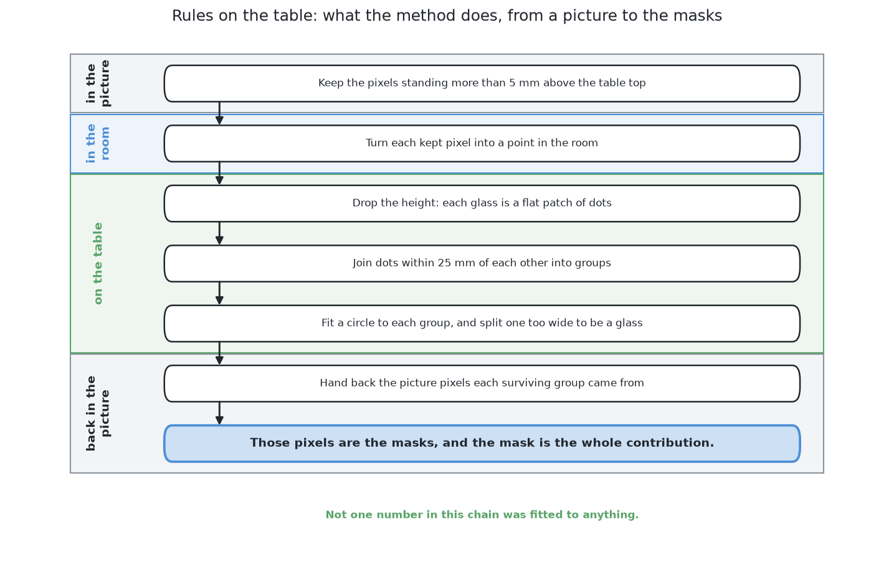
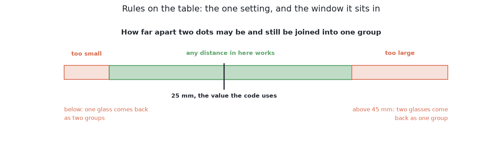

# Rules on the table

This page is a short summary of the first of the six solutions. It is the only
solution with no fitted numbers. There is no model, no training set and no
weights file. It states a rule in words and applies it. The page covers its
main idea, its steps, what it needs, its score, and where it breaks. [The
chapter on this solution](../05_rules-on-the-table/01_what-it-is.md) explains
it in full.

## Contents

1. [What it is](#1-what-it-is)
2. [How it works](#2-how-it-works)
3. [What it needs](#3-what-it-needs)
4. [What it scored](#4-what-it-scored)
5. [Where it is strong and where it breaks](#5-where-it-is-strong-and-where-it-breaks)
6. [When to choose it](#6-when-to-choose-it)

## 1. What it is

The book's problem is that a picture from above can join two glasses that stand
apart. [What is asked for](../02_the-problem/01_what-is-asked-for.md#glasses-merge-in-the-picture-although-they-stand-apart-on-the-table)
explains why.

This solution does not work in the picture. It works in the room. Each pixel
comes with a depth reading. The pixel gives a direction, the depth gives a
distance, and the camera's pose gives the start point. Together they give a
point in the room. On the table, the bare strip between two glasses is easy to
measure.

The rule is one sentence. Dots that lie close to each other on the table belong
to the same glass. This works only because the cell promises that glasses stand
at least a known distance apart.

The next section lists the steps that apply this rule.

## 2. How it works

This section turns the idea above into steps. The method takes five steps, in
this order.

1. It keeps the pixels that stand above the table. The table height is known,
   so this is a simple comparison.
2. It turns each kept pixel into a point in the room.
3. It drops the height. Each glass becomes a flat patch of dots on the table.
4. It groups dots that are close to each other. Each group is one glass.
5. It fits a circle to each group and checks its width. A group too wide for
   the kind is two joined glasses, so it is split.

The pixels behind each final group are that glass's mask.

The one setting is the grouping distance. It is worked out from known limits,
not tuned by trial. The code uses 25 mm. It must stay below 45 mm, which is the
narrowest bare strip two glasses can leave.

[How it works](../05_rules-on-the-table/03_how-it-works.md#5-the-one-setting-and-where-it-comes-from)
explains each step and the setting. The next section lists what these steps
need.

## 3. What it needs

The steps above use very little, and that is the main point of this solution.
It needs no labelled data, no training run, no weights file and no graphics
processor. It uses NumPy and OpenCV, which are already in the cell and have no
licence condition. It needs three facts from the problem: the table height, the
smallest distance between two glasses, and the range of widths for the kind.

It also needs depth readings. This is the one need that is not free.
[What it needs](../05_rules-on-the-table/05_what-it-needs.md) gives the full
list. The next section shows how well it did.

## 4. What it scored

This section gives the solution's score on the shared
[examiner](../03_the-examiner/01_the-examiner.md). The table has one row for
the spawned run and one for the crowded run. Each column is an average over five
blocks, with the lowest and highest block in brackets for "found".

| | found per 100 | missed | merged | place | mask covered | mask not the glass |
|---|---|---|---|---|---|---|
| spawned | 100.0 (100.0–100.0) | 0.0 | 0.0 | 8.3 mm | 99.1% | 0.0% |
| crowded | 73.0 (70.3–75.5) | 27.0 | 10.7 | 8.7 mm | 91.9% | 0.0% |

On the spawned run it found every glass in every block. No other solution did
this. On the crowded run the bare strip between glasses is sometimes gone, so
it misses some glasses and merges some pairs. Its masks never claim table or a
neighbour. [The results](../11_the-results.md#4-what-the-comparison-says)
compares it with the other five. The next section says what these numbers mean
for its use.

## 5. Where it is strong and where it breaks

The score shows where it works. This section says why. Its strength is that the
rule is simple. Anyone can read it and check it. It gives the same answer every
time. When it fails, one printed number usually shows why.

It has two limits. First, someone must be able to write the rule. Two glasses
that touch leave no bare strip, so the rule cannot split them. [The worked
example](../05_rules-on-the-table/04_a-worked-example.md#the-case-the-rule-cannot-answer)
shows this case. Second, real clear glass gives no depth readings. This cell
works only because the simulator draws the glasses as solid.
[How it compares](../05_rules-on-the-table/06_how-it-compares.md#1-where-it-is-strong-and-where-it-breaks)
explains both limits. The next section turns them into advice.

## 6. When to choose it

These limits tell you when to use it. Choose it when depth readings are
reliable and the objects keep a known spacing. Do not choose it when objects
may touch, when several kinds share a table, or when surfaces are clear or
shiny.

It is also the baseline for the other five. It needs no labels, no training
and no special hardware. So a fitted model that only matches it has gained
nothing.

The code is in
[`src/08_seeing-the-glasses/01-rules-on-the-table/`](../../../code/src/08_seeing-the-glasses/01-rules-on-the-table).
It writes its own `results.json`. The full treatment starts at [what it
is](../05_rules-on-the-table/01_what-it-is.md).

← [The six solutions — one question, six ways to see](01_how-the-six-compare.md) · [A network trained from scratch](03_a-network-trained-from-scratch.md) →
