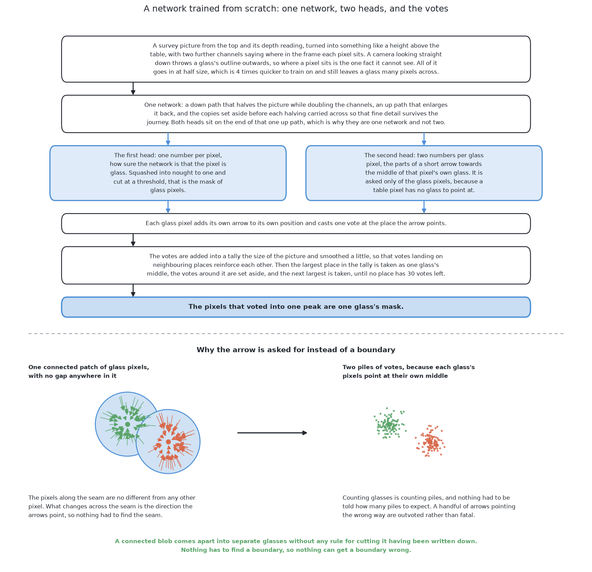
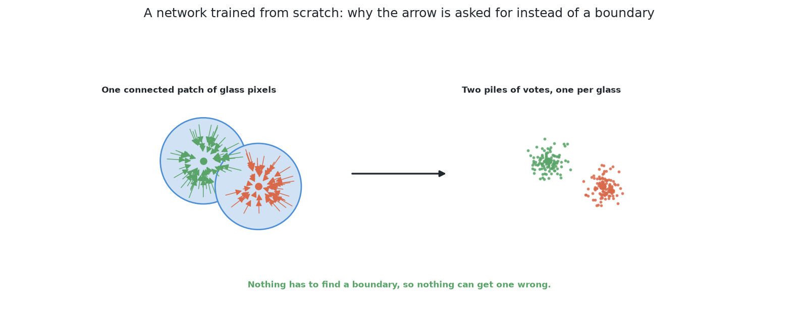

# A network trained from scratch

This page is a short summary of the second of the six solutions. It trains a
small network on this cell's own pictures and borrows nothing. The page covers
what the network predicts, what it needs, its score, and where it breaks.
[The chapter on this solution](../06_a-network-trained-from-scratch/01_what-it-is.md)
explains it in full.

## Contents

1. [What it is](#1-what-it-is)
2. [How it works](#2-how-it-works)
3. [What it needs](#3-what-it-needs)
4. [What it scored](#4-what-it-scored)
5. [Where it is strong and where it breaks](#5-where-it-is-strong-and-where-it-breaks)
6. [When to choose it](#6-when-to-choose-it)

## 1. What it is

A **neural network** is a large set of numbers, called weights. A picture goes
in and an answer comes out. **Training** changes the weights step by step until
the answers match known examples. **Training from scratch** means the weights
start as random numbers, not as weights someone else fitted.

This solution trains one small network from scratch on this cell's pictures.
Nothing is downloaded. So it has no **domain gap**, which is the difference
between the pictures a model learned from and the pictures it is shown. That
makes it the control for the four borrowed models. [What it
is](../06_a-network-trained-from-scratch/01_what-it-is.md) explains this role.

The next section says what the network is asked to predict.

## 2. How it works

The key choice is what the network predicts. A label "glass or not" at each
pixel is not enough. Two glasses whose outlines touch give one joined region,
and the label cannot say where to cut it.

So the network has two outputs, called heads. The first says whether each pixel
is glass. The second gives each glass pixel an arrow towards the middle of its
own glass. Each glass pixel then votes for the place its arrow points to. One
glass makes one pile of votes. Two glasses make two piles, even when their
pixels touch.

The network is a **U-Net**, a standard small design that labels every pixel of a picture. The
training labels come from the examiner's answer key, which says which glass owns
each pixel. A second way, using the arm's own movement, is described but is not
the source of the numbers below. [How it
works](../06_a-network-trained-from-scratch/03_how-it-works.md#7-from-votes-to-glasses)
explains the votes and both ways of making labels. The next section lists what
this design needs.

## 3. What it needs

Training a network has costs that the written rule does not have. It needs
PyTorch, a training set and a training run before it can answer anything. It
runs on this Mac's built-in graphics, and it has no licence condition. Its
weights file must be kept in step with the cell. [What it
needs](../06_a-network-trained-from-scratch/05_what-it-needs.md) gives the full
list. The next section shows how well it did.

## 4. What it scored

This section gives the solution's score on the shared
[examiner](../03_the-examiner/01_the-examiner.md). The table has one row for
the spawned run and one for the crowded run. Each column is an average over five
blocks, with the lowest and highest block in brackets for "found".

| | found per 100 | missed | merged | place | mask covered | mask not the glass |
|---|---|---|---|---|---|---|
| spawned | 64.1 (62.4–66.7) | 35.9 | 0.0 | 0.6 mm | 98.3% | 1.6% |
| crowded | 74.6 (71.3–79.8) | 25.4 | 0.6 | 0.9 mm | 97.1% | 1.4% |

When it reports a glass, the report is very good. Its places are within about
one millimetre, and it merges almost nothing. But it misses many glasses. It
also does better on the crowded run than on the spawned run. The cause is the
voting. A glass whose middle falls outside the picture casts votes that are
dropped. [How it
compares](../06_a-network-trained-from-scratch/06_how-it-compares.md#1-where-it-is-strong-and-where-it-breaks)
gives the counts. [The results](../11_the-results.md#4-what-the-comparison-says)
compares it with the other five. The next section says what these numbers mean.

## 5. Where it is strong and where it breaks

The score shows a method that is precise but misses glasses. This section lists
its other strengths and limits.

Its strengths are these. It has no domain gap. It splits touching glasses
without looking for a boundary. A partly hidden glass still votes for the right
middle. The size of a pile of votes tells you how sure it is.

Its limits are these. It cannot see a glass that is fully hidden, because no
pixels means no votes. [Looking again at what was
hidden](../02_the-problem/02_looking-again-at-what-was-hidden.md) deals with
that case. It must be trained before it can answer. It cannot explain a wrong
answer. Its weights must be kept in step with the cell. The next section turns
these into advice.

## 6. When to choose it

These strengths and limits tell you when to use it. Choose it when labels are
free and the pictures look nothing like photographs. Both are true in this cell.
In most real work labels are costly, so fine-tuning a larger model is usually
the better choice.

Its main use here is as a measuring line. If a borrowed model does no better
than this small network, its size and its licence gave nothing in this cell.

The code is in
[`src/08_seeing-the-glasses/02-train-from-scratch/`](../../../code/src/08_seeing-the-glasses/02-train-from-scratch).
It writes its own `results.json`. The full treatment starts at [what it
is](../06_a-network-trained-from-scratch/01_what-it-is.md).

← [Rules on the table](02_rules-on-the-table.md) · [A borrowed model, as it downloads](04_a-borrowed-model-as-it-downloads.md) →
