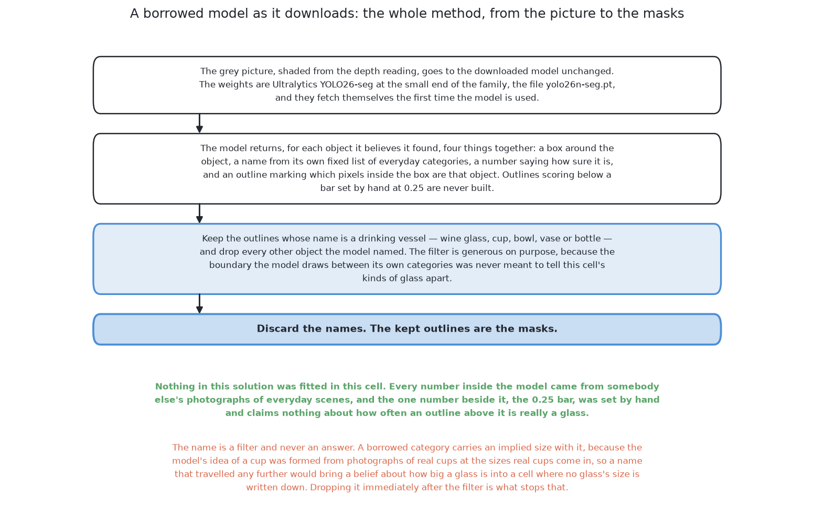

# A borrowed model, as it downloads

This page is a short summary of the third of the six solutions. This solution
downloads a model that somebody else trained on photographs. It then uses that
model on this cell's pictures with no change at all. The page says what the
model is, how it is used, what it needs, what it scored and when to choose it.
The full story is in [the chapter on this
solution](../07_a-borrowed-model-as-it-downloads/01_what-it-is.md).

## Contents

1. [What it is](#1-what-it-is)
2. [How it works](#2-how-it-works)
3. [What it needs](#3-what-it-needs)
4. [What it scored](#4-what-it-scored)
5. [Where it is strong and where it breaks](#5-where-it-is-strong-and-where-it-breaks)
6. [When to choose it](#6-when-to-choose-it)

## 1. What it is

The model is Ultralytics YOLO26-seg. It does **instance segmentation**. This
means it gives one outline for each separate object it finds. It also gives each
object a name from a fixed list, such as "cup", and a confidence number.

Nothing is trained in this cell. The only setting is a bar on the confidence
number, set by hand at 0.25. So this is the cheapest solution to try. It is also
one half of a matched pair with [the same model,
fine-tuned](05_the-same-model-fine-tuned.md). The next section shows how few
steps the method has.

## 2. How it works

The method has only three steps, and this section lists them.

1. The grey picture goes into the model unchanged.
2. The model returns a list of objects, each with a name and an outline.
3. The solution keeps the outlines named as a drinking vessel, such as "cup" or
   "wine glass". It drops the rest, and then it throws the names away.

The kept outlines are the masks. [The
examiner](../03_the-examiner/01_the-examiner.md) turns each mask into a place
and a width, as it does for all six solutions. The next section shows how
little this needs.

## 3. What it needs

This solution needs very little, and that is its main point. It needs the
Ultralytics package, which downloads the weights by itself. It needs no labels,
no training run and no graphics card of its own.

Its one real cost is the licence. The model is under the AGPL-3.0 (GNU Affero
General Public License, version 3). This licence also covers software that only
serves answers over a network. [The licence
section](../07_a-borrowed-model-as-it-downloads/03_results-and-comparison.md#6-what-it-costs-to-run-and-the-licence)
explains this in full. The next section shows what the model found.

## 4. What it scored

Every solution is run on two sets of arrangements. The spawned set uses the
cell's own spacing. The crowded set puts the glasses closer than that. Each row
below gives the count per 100 glasses, with the lowest and highest block in
brackets.

| | found per 100 | missed | merged | place | mask covered | mask not the glass |
|---|---|---|---|---|---|---|
| spawned | 6.4 (2.0–11.9) | 93.6 | 0.0 | 23.7 mm | 95.2% | 3.3% |
| crowded | 2.1 (0.0–4.2) | 97.9 | 0.0 | 39.1 mm | 96.0% | 4.9% |

It finds about six glasses in a hundred. This is the worst score in the book.
The reason is the **domain gap**. This means the pictures here are very
different from the photographs the model learned from. [Why it
failed](../07_a-borrowed-model-as-it-downloads/03_results-and-comparison.md#2-why-it-failed-the-names-it-reached-for)
explains it in full. [The results](../11_the-results.md) compare all six. The
next section says what this result teaches.

## 5. Where it is strong and where it breaks

This section lists what the method does well and badly, given the score above.
It is strong because nothing is fitted. It can be tried in an afternoon. It
gives one outline per object, so two touching glasses are not joined into one
shape.

It breaks because of the domain gap. Its masks also mark only the part of a
glass the camera saw. So a glass partly behind another one looks smaller and in
the wrong place. A glass hidden completely is not in the picture at all, so no
model can find it. The next section says when these points make it worth using.

## 6. When to choose it

This section turns the strengths and weaknesses above into advice. Run this
first, because it is the cheapest test of whether you need a trained model at
all. On pictures like ordinary photographs, it may be good enough on its own.

Do not keep it when the pictures are unlike photographs, as here. Then use [the
same model, fine-tuned](05_the-same-model-fine-tuned.md) or [a foundation model
with a keeper](06_a-foundation-model-with-a-keeper.md). Its real value is the
comparison with solution 4, not its own score.

The code is in
[`src/08_seeing-the-glasses/03-yolo-zero-shot/`](../../../code/src/08_seeing-the-glasses/03-yolo-zero-shot).
It writes its own `results.json` beside itself. The full treatment starts at
[what it is](../07_a-borrowed-model-as-it-downloads/01_what-it-is.md).

← [A network trained from scratch](03_a-network-trained-from-scratch.md) · [The same model, fine-tuned](05_the-same-model-fine-tuned.md) →
