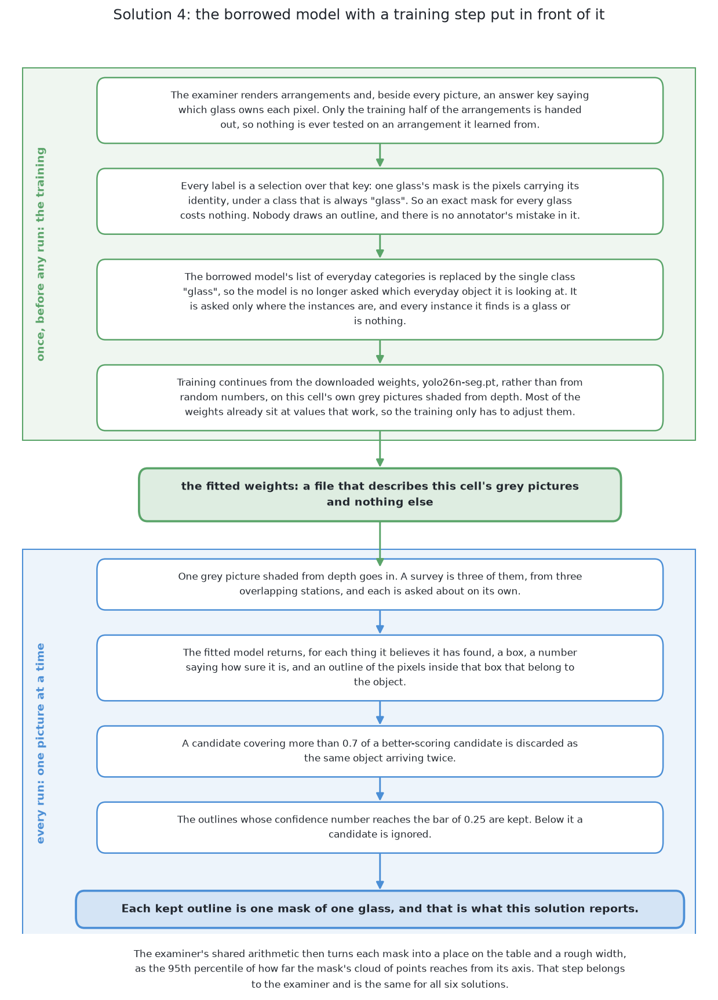

# The same model, fine-tuned

This page is a short summary of the fourth of the six solutions. It uses the
same model and the same downloaded weights as [a borrowed model, as it
downloads](04_a-borrowed-model-as-it-downloads.md). The one change is that the
model is trained further on this cell's own pictures. The page says what that
means, what it needs, what it scored and when to choose it. The full story is in
[the chapter on this
solution](../08_the-same-model-fine-tuned/01_what-it-is.md).

## Contents

1. [What it is](#1-what-it-is)
2. [How it works](#2-how-it-works)
3. [What it needs](#3-what-it-needs)
4. [What it scored](#4-what-it-scored)
5. [Where it is strong and where it breaks](#5-where-it-is-strong-and-where-it-breaks)
6. [When to choose it](#6-when-to-choose-it)

## 1. What it is

**Fine-tuning** means taking a model that is already trained and training it a
little more on your own pictures. The model keeps what it learned in general. It
learns the look of your pictures on top.

Solutions 3 and 4 are a matched pair. Only the training differs between them. So
the difference in their scores shows what training is worth. The next section
shows the training step that this solution adds.

## 2. How it works

This solution is solution 3 with a training step in front. The training labels
are free, because the examiner knows which glass owns each pixel. The list of
names is cut to one class, "glass". After training, the run is the same as
solution 3. [The examiner](../03_the-examiner/01_the-examiner.md) turns each
mask into a place and a width.

Training cannot change the shape of the output. The mask still marks only what
the camera saw. [How the model is
trained](../08_the-same-model-fine-tuned/03_how-the-model-is-trained.md#1-what-fine-tuning-is)
explains this in full. The next section lists what this training costs.

## 3. What it needs

This section lists what the training step above needs. It needs the Ultralytics
package, PyTorch and the downloaded weights. It trains on this laptop's built-in
graphics. It needs a training set, which the examiner labels for free, and time
on the machine for the training run. After training, the weights file must be kept in step
with the cell.

The licence is the expensive part. The AGPL-3.0 covers the library, and it also
covers the new weights file that training makes. [The licence
section](../07_a-borrowed-model-as-it-downloads/03_results-and-comparison.md#6-what-it-costs-to-run-and-the-licence)
explains the AGPL in full. The next section shows what the training bought.

## 4. What it scored

Every solution is run on a spawned set at the cell's own spacing and a crowded
set that is closer. Each row gives the count per 100 glasses, with the lowest
and highest block in brackets.

| | found per 100 | missed | merged | place | mask covered | mask not the glass |
|---|---|---|---|---|---|---|
| spawned | 99.4 (99.0–100.0) | 0.6 | 0.0 | 6.6 mm | 99.7% | 4.6% |
| crowded | 72.0 (70.8–72.9) | 28.0 | 0.8 | 0.6 mm | 99.2% | 3.7% |

Solution 3 found 6.4 glasses per 100 on the spawned set. This solution finds
99.4. Only the training changed, so training bought that difference. Its masks
cover more of each glass than any other solution's. They also reach a little
past the glass. [The results](../11_the-results.md) compare all six. The next
section sums up what this means.

## 5. Where it is strong and where it breaks

This section turns the scores above into strengths and weaknesses. It is strong
because it is trained on the pictures it will see. Its labels cost nothing. It
has only two settings, a confidence bar and an overlap limit.

It has three weaknesses. First, its masks mark only what the camera saw, so a
partly hidden glass looks smaller. Second, its weights are good for this cell
and worse elsewhere. Third, the AGPL licence covers its weights too. The next
section says when to choose it anyway.

## 6. When to choose it

This section turns the points above into advice. Choose it when a borrowed model
nearly works and labels are cheap. This is true for most factory vision work.

Do not choose it if the licence matters. Then [a transformer segmenter,
fine-tuned](07_a-transformer-segmenter-fine-tuned.md) does the same job under
Apache 2.0. If labels must be drawn by hand, [a foundation model with a
keeper](06_a-foundation-model-with-a-keeper.md) needs far fewer of them.

The code is in
[`src/08_seeing-the-glasses/04-yolo-fine-tuned/`](../../../code/src/08_seeing-the-glasses/04-yolo-fine-tuned).
It writes its own `results.json` beside itself. The full treatment starts at
[what it is](../08_the-same-model-fine-tuned/01_what-it-is.md).

← [A borrowed model, as it downloads](04_a-borrowed-model-as-it-downloads.md) · [A foundation model with a keeper](06_a-foundation-model-with-a-keeper.md) →
