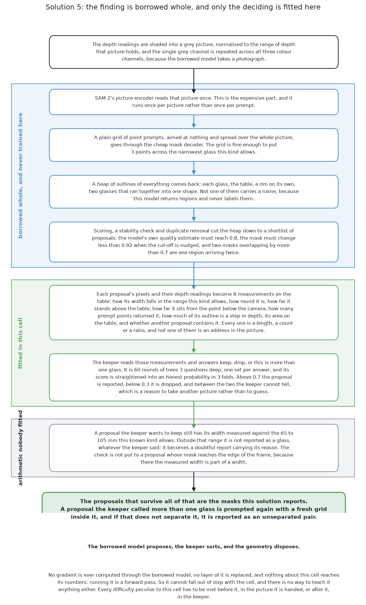

# A foundation model with a keeper

This page is a short summary of the fifth of the six solutions. This solution
splits the job in two. A large borrowed model draws outlines but does not name
them. A small model trained here decides which outlines are glasses. The page
says what it is, what it needs, what it scored and when to choose it. The full
story is in [the chapter on this
solution](../09_a-foundation-model-with-a-keeper/01_what-it-is.md).

## Contents

1. [What it is](#1-what-it-is)
2. [How it works](#2-how-it-works)
3. [What it needs](#3-what-it-needs)
4. [What it scored](#4-what-it-scored)
5. [Where it is strong and where it breaks](#5-where-it-is-strong-and-where-it-breaks)
6. [When to choose it](#6-when-to-choose-it)

## 1. What it is

A **foundation model** is a large model trained once on very broad data and
then used for many jobs. The one here is **SAM 2** (Segment Anything Model 2).
It outlines whatever is at a point in a picture. It does not say what the thing
is.

Finding shapes works on new kinds of pictures. Naming them does not, as
[solution 3](04_a-borrowed-model-as-it-downloads.md) showed with 6.4 glasses
per 100. So this solution borrows the finding and replaces the naming. A small
model trained here does the naming. This book calls it the **keeper**, because
it decides which outlines to keep. The next section shows the steps of a run.

## 2. How it works

A run has four steps.

1. SAM 2 is pointed at a grid of points across the grey picture. It outlines
   everything it finds.
2. Duplicates and weak outlines are removed. Each one left is a **proposal**.
3. The keeper reads a few measurements of each proposal, such as its width and
   height. It answers keep, drop, or more than one glass.
4. A kept proposal must still pass a width check for the known kind of glass.

SAM 2 is never trained here. [How it
works](../09_a-foundation-model-with-a-keeper/03_how-it-works.md#5-the-keeper)
explains the keeper in full. The next section lists what these steps need.

## 3. What it needs

This section lists what the steps above need. It needs a deep learning framework
and a SAM 2 weights file that this project cannot make. It needs a set of
labelled proposals for the keeper. The examiner makes these labels for free. It
needs far fewer of them than a network trained from scratch. Fitting the keeper
takes seconds. Running SAM 2 over the pictures takes most of the time.

Its licence is permissive, unlike the two solutions built on YOLO. [What it
needs](../09_a-foundation-model-with-a-keeper/05_what-it-needs.md) gives the
details. The next section shows what it scored.

## 4. What it scored

Every solution is run on a spawned set at the cell's own spacing and a crowded
set that is closer. Each row gives the count per 100 glasses, with the lowest
and highest block in brackets.

| | found per 100 | missed | merged | place | mask covered | mask not the glass |
|---|---|---|---|---|---|---|
| spawned | 83.0 (78.0–86.1) | 17.0 | 0.0 | 5.6 mm | 97.2% | 0.0% |
| crowded | 73.6 (71.9–76.6) | 26.4 | 0.0 | 0.8 mm | 98.3% | 0.0% |

The last column is the result to notice. None of its masks spread onto a
neighbour or the table, and it merged no glasses. The keeper and the width check
drop a doubtful proposal instead of making a wrong report. The cost is in the
first column. About one glass in six is missed on the spawned set. [The
results](../11_the-results.md) compare all six. The next section sums up what
this means.

## 5. Where it is strong and where it breaks

This section turns the scores above into strengths and weaknesses. It is strong
because almost nothing is trained here. The keeper is small, fast and easy to
check. It needs the least data of the solutions that train anything. It also
sees objects that are not glasses, such as a spoon, and says "not a glass".

It has four weaknesses. First, the domain gap cannot be closed, because SAM 2 is
never trained here. Second, it cannot be taught this cell's hard cases, such as
glasses that touch. Third, it needs depth twice, for the picture and for the
keeper's measurements. Real clear glass gives no depth, so it would have no
input. Fourth, a glass hidden completely is not in the picture, as [looking
again at what was
hidden](../02_the-problem/02_looking-again-at-what-was-hidden.md) explains. The
next section says when to choose it anyway.

## 6. When to choose it

This section turns the points above into advice. Choose it when labelled
examples are scarce. Choose it also when a wrong answer costs more than a
missing one.

Do not choose it when accuracy matters more than setup cost. Then use [the same
model, fine-tuned](05_the-same-model-fine-tuned.md) or [a transformer segmenter,
fine-tuned](07_a-transformer-segmenter-fine-tuned.md). Do not choose it when the
sensor gives no depth.

The code is in
[`src/08_seeing-the-glasses/05-sam2-with-a-keeper/`](../../../code/src/08_seeing-the-glasses/05-sam2-with-a-keeper).
It writes its own `results.json` beside itself. The full treatment starts at
[what it is](../09_a-foundation-model-with-a-keeper/01_what-it-is.md).

← [The same model, fine-tuned](05_the-same-model-fine-tuned.md) · [A transformer segmenter, fine-tuned](07_a-transformer-segmenter-fine-tuned.md) →
