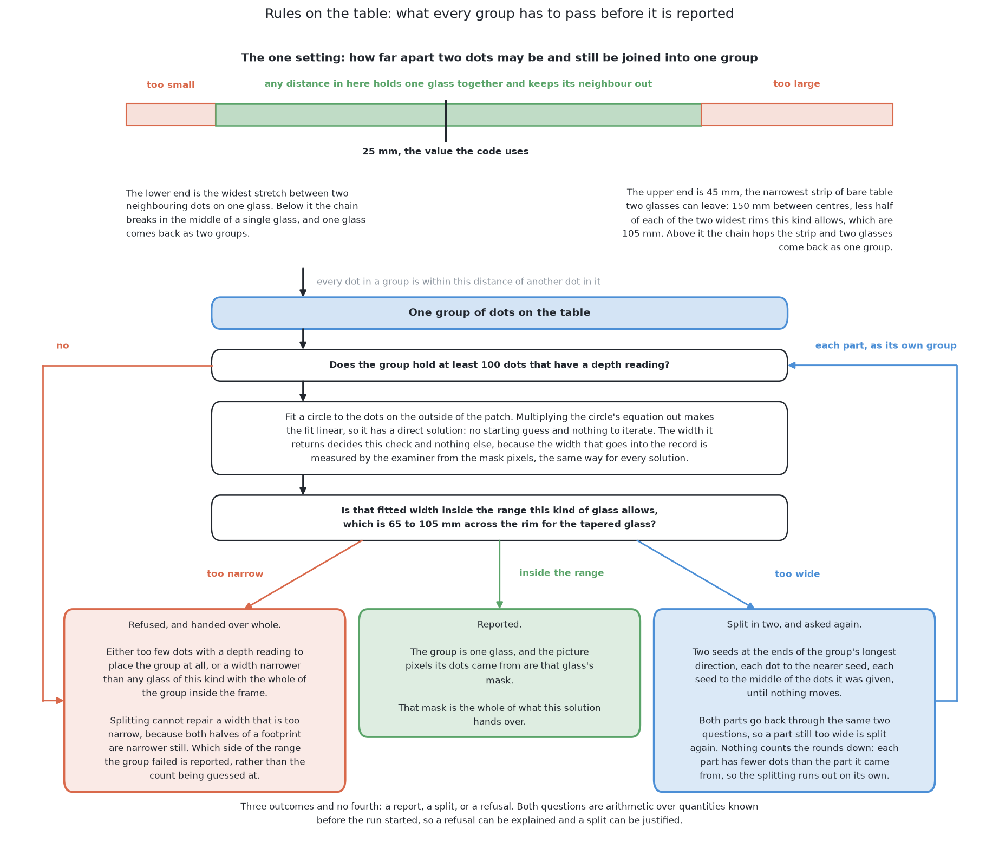

# What it is

> **What it uses.** It uses NumPy for the arithmetic on the depth readings. It
> uses OpenCV for the picture work the cell already does. There is no model, no
> weights file and no training data. No number in it was fitted to anything.
> **What it does.** Each pixel comes with a depth reading. With that reading,
> the pixel becomes a point in the room. The solution drops every point down onto
> the table. Then it groups the dots by how far apart they are on the table. Two
> glasses whose outlines run together in the picture still stand apart on the
> table, so the rule can separate them.
> **How the output is made.** It keeps the pixels that stand above the table. It
> turns each one into a point in the room and drops its height. It joins dots
> that lie close together into groups. It checks each group's width against the
> widths this kind of glass can have, and it splits a group that is too wide.
> For each group that is left, it hands back the pixels its dots came from.
> Those pixels are the mask.
> **What it costs.** It needs no labels, no training, no graphics processor and
> no licence. The only cost is the thinking needed to state the rule and its one
> setting.

> **The cell is described once, in [the cell](../01_the-cell.md).** That page
> covers the layout, the camera's places, the sensors and the words. This chapter
> covers only what belongs to this solution.

## Contents

1. [Introduction](#1-introduction)
2. [The problem this solves](#2-the-problem-this-solves)
3. [The main idea](#3-the-main-idea)

## 1. Introduction

This chapter is about the one answer to [the problem this book
sets](../02_the-problem/01_what-is-asked-for.md) that uses no model. It fits
nothing. It states a rule that a person can read, and it applies that rule. It
is for a reader who has read the shared setup pages and wants to see the
simplest solution first.

The rule works because of one fact about the input. Every pixel has a depth
reading. A pixel with a depth reading can be turned into a point in the room.
After that, "which glass is this?" is a question about distance on the table,
not about the picture. Everything else in this chapter follows from that.

**The method is built, and the numbers in this chapter come from running it.**
The code is in
[`src/08_seeing-the-glasses/01-rules-on-the-table/`](../../../code/src/08_seeing-the-glasses/01-rules-on-the-table).
It writes its own `results.json` next to itself. Four parts of the design are
not yet code, and each is named where it appears:

- The grouping distance is a fixed number. It is not yet worked out from its two limits.
- The circle fit returns a width but no residual.
- A group that only one station found is not marked as doubtful.
- The search for places where a glass could hide is arithmetic on paper, not running code.

**No glass's size is written down anywhere.** That is the cell's own rule. So
this chapter says "wider than any glass of this kind" instead of naming a size.
The numbers it does give are limits on the kind or settings of the method.

Before the method itself, the next section names the problem it has to solve.

## 2. The problem this solves

This section recalls the problem in a few lines, so that the main idea has
something to answer. Four to six glasses of one known kind stand upright in the
glass zone. The camera looks down at them. The job is to say which pixels belong
to which glass.

Two words are used all through this chapter. A **mask** is a yes-or-no picture
the same size as the camera's picture. A yes pixel is believed to show a glass.
A **patch** is one group of yes pixels that touch each other. **One patch is not
always one glass**, and that is the first difficulty.

The problem also makes a promise. The centres of any two glasses are always at
least a fixed distance apart. That distance is large enough to leave a strip of
bare table between any two rims. Everything in this method depends on that strip.

### Why a picture from the top joins two glasses that stand apart

A camera looking down draws a glass's outline further out than the glass really
stands. Taller glasses are pushed out more. This effect is called **splay**, and
[the cell](../01_the-cell.md#6-the-words) explains it. [What is asked
for](../02_the-problem/01_what-is-asked-for.md#5-the-two-difficulties) shows the
two failures it causes:

- **The merge.** A tall glass's outline reaches a short neighbour, and the two
  come back as one patch. That patch is too wide for one glass, so it can be noticed.
- **The complete cover.** A tall glass's outline covers a short neighbour
  completely. The short glass leaves no pixels, and nothing looks wrong.

The next section shows how working on the table answers the first failure.

## 3. The main idea

This section gives the one idea that answers the merge from the last section.
The picture has lost how far apart the glasses stand on the table. The depth
reading gives it back. Each pixel becomes a point in the room, and glasses are
then told apart by distance on the table. The strip of bare table between two
glasses is there to be measured. [How it
works](03_how-it-works.md#1-turning-a-pixel-into-a-point-in-the-room) shows the
steps.

The complete cover cannot be answered this way, because the hidden glass has no
pixels. It needs arithmetic that never looks at the picture. [When the glasses
are completely hidden](04_a-worked-example.md#1-when-the-glasses-are-completely-hidden)
says what this solution adds to that.

← [A transformer segmenter, fine-tuned](../04_the-six-solutions/07_a-transformer-segmenter-fine-tuned.md) · [The code](02_the-code.md) →
