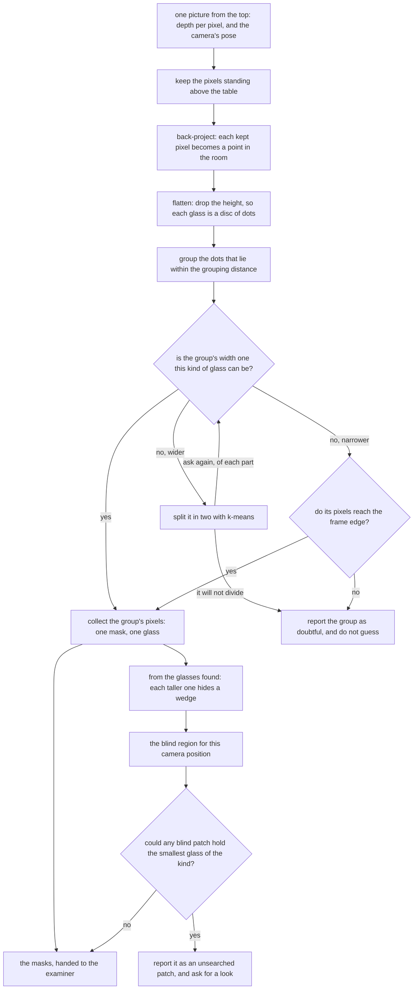

# The code

This page shows the core of this solution's code. It also says what the
solution hands back to the rest of the cell. [How it works](03_how-it-works.md)
then explains each part of this code in plain words.

## Contents

1. [The rule, in the code](#1-the-rule-in-the-code)
2. [The masks are what this contributes](#2-the-masks-are-what-this-contributes)
3. [How the concepts fit together](#3-how-the-concepts-fit-together)

## 1. The rule, in the code

It helps to see the method before reading why it is built this way. The rule is
in `src/08_seeing-the-glasses/01-rules-on-the-table/`. Two short pieces carry
the whole method. One fits a circle to a group of dots. The other asks the width
question again of every part a split makes. The rest of the folder turns pixels
into dots and hands masks to the examiner.

Both pieces are in `01-rules-on-the-table/find.py`, and they run in five steps.
The comments in the code use the same step numbers, so you can search for them.

1. Write each dot as one row of an equation, and solve all the rows at once.
   The circle equation, multiplied out, is linear in three unknowns, so NumPy's
   `lstsq` needs no starting guess.
2. Read the circle off the solution. Half of two unknowns gives the centre. The
   third unknown and the centre give the width.
3. Give the solve only the outline of the patch, found with OpenCV's
   `convexHull`. A solve given every dot reads too narrow.
4. Judge the width against the kind of glass. A width the kind allows is one
   glass. A wider patch is sent to be split. A narrower one is accepted only when
   the frame edge cut it short.
5. Split a patch that is too wide into two halves with k-means. Hand each half to
   the examiner, then ask step 4 again of each half.

Steps 1 and 2 are the solve. Step 3 is the one line that chooses which dots the
solve gets.

```python
def circle_width(dots: np.ndarray) -> float:
    """How wide the circle through a ring of dots is, in one solve and with no starting guess.
    ...
    """
    # Step 1: one row per dot, holding its x, its y and a 1 -- the circle equation written out flat
    terms = np.column_stack([dots, np.ones(len(dots))])
    # Step 1: solve every row at once for D, E and F -- least squares, so no starting guess is used
    solved = np.linalg.lstsq(terms, (dots**2).sum(1), rcond=None)[0]
    # Step 2: halve D and E to get the centre -- that is where the multiplied-out equation puts it
    x, y = solved[0] / 2.0, solved[1] / 2.0
    # Step 2: turn F and the centre back into a width -- held at zero so a bad fit cannot go under
    return 2.0 * float(np.sqrt(max(solved[2] + x * x + y * y, 0.0)))

def footprint(dots: np.ndarray) -> float:
    """How wide the circle round the patch of table a group of dots marks is.
    ...
    """
    # Step 3: fit the circle to the outline of the patch only -- all the dots would read too narrow
    return circle_width(cv2.convexHull(dots.astype(np.float32)).reshape(-1, 2).astype(float))
```

Steps 4 and 5 are the check, from the same file. Step 4 has one line for each
of the three possible widths. Step 5 is the split. Its last line asks step 4
again of each half, so a patch holding three glasses is cut more than once.

```python
def as_glasses(picture: Picture, one: Found, widths: tuple[float, float]) -> list[Found] | None:
    """The glasses one patch of dots holds, or None if the fitted circles cannot say.
    ...
    """
    # Step 4: measure the patch of table this group's own pixels stand on
    width = footprint(dots_of(picture, one.pixels))
    # Step 4: a width the kind allows means one glass, and this patch is finished
    if widths[0] <= width <= widths[1]:
        return [one]
    # Step 4: wider than the kind allows means more than one glass, so split the patch
    if width > widths[1]:
        return come_apart(picture, one, widths)
    # Step 4: narrower is forgiven only when the frame cut the patch short, else refuse to guess
    return [one] if one.cut_off else None

def come_apart(picture: Picture, one: Found, widths: tuple[float, float]) -> list[Found] | None:
    ...
    # Step 5: cut the patch's dots in two with k-means -- which of the two halves each dot went to
    mine = halve(dots_of(picture, one.pixels))
    # Step 5: a cut that leaves one half empty is no cut, so hand the whole group over as doubtful
    if mine.all() or not mine.any():
        return None
    parts: list[Found] = []
    for half in (~mine, mine):
        # Step 5: turn this half's dots back into a mask of the picture's own pixels
        side = np.zeros(picture.depth.shape, dtype=bool)
        side[one.pixels[half, 0], one.pixels[half, 1]] = True
        # Step 5: let the examiner place and measure the half, as it does any other mask
        measured = masks_to_glasses.one_glass(picture, side)
        if measured is None:
            return None
        # Step 5: ask Step 4 again of the half -- a part still too wide is split again
        got = as_glasses(picture, measured, widths)
        if got is None:
            return None
        parts.extend(got)
    return parts
```

The borrowed work is just two library calls, one solve and one hull. The rest
is this project's own code. The fitted width never leaves these functions. It
only decides whether a patch is split. The width in the final record is
measured by the examiner, from the pixels these functions hand back.

The next section says what those pixels are worth.

## 2. The masks are what this contributes

The code above ends by handing pixels to the examiner, so this section says what
those masks are like. Every solution hands back only masks, and the examiner
does the measuring for all six. [What must come
back](../03_the-examiner/01_the-examiner.md#6-what-must-come-back) explains
this. So a difference in this solution's score is a difference in its masks.

This solution's masks have one property that no other solution's masks have.
**The mask is a side effect of the grouping.** The other five run a model that
is built to draw an outline. Here, no step ever asks where a glass ends. One
step keeps the pixels that stand above the table. Another step decides which of
those pixels belong together. The mask is just the pixels that fed one group.
Nobody chose its edge.

This has one good effect and one bad effect. They show up in the two mask
numbers that [the examiner](../03_the-examiner/04_comparing-the-outputs.md#6-how-good-was-the-mask)
uses.

**The mask almost never claims too much.** A pixel joins the wrong glass only if
its dot chains into the wrong group. The two groups are a whole strip of bare
table apart, so that needs a line of stray dots across the strip. The method
also never claims a pixel it did not see.

**The mask always claims a little too little.** The edge of each mask is set by
the test that keeps pixels above the table, not by the grouping. So every mask
loses two things. It loses a thin band at the bottom of the glass, where the
wall is too close to the table to tell apart. It also loses every pixel with no
depth reading. Those pixels are gone before the grouping starts, so no better
grouping can bring them back.

The results show both effects. Over the five blocks of spaced arrangements, the
masks cover 99.1 per cent of the glass at the median. At the median, 0.0 per
cent of a mask is not the glass. The lost band is the missing one per cent. On the
crowded arrangements, coverage falls to 91.9 per cent. That loss has a
different cause. A mask cut out of a run-together group holds only part of a
glass. That is the cost of splitting, not of the depth test.

This tells you how to read the scores. A model can learn an outline that goes
right down to the table, so a model can beat this solution on coverage. A model
can also learn an outline that spills onto the table or a neighbour, and this
solution almost never does that. **So the two mask numbers can disagree about
which method is better, and that disagreement is useful.** A model may look good
because it learned where the table is, not because it learned glasses.

The next section puts all the parts of the method into one picture.

## 3. How the concepts fit together

This section joins the steps from the code and the masks it makes into one flow.
The flow has two branches that share only their inputs. The left branch groups
what was seen. The right branch works out what could not have been seen. They
meet only in the report.



The right-hand branch starts from the **glasses found**, not from the pixels.
It needs only their places, widths and heights. That is why it can say
something about a glass that left no pixels. It is also the only branch that is
not yet code. [A worked example](04_a-worked-example.md) works it through.

← [What it is](01_what-it-is.md) · [How it works](03_how-it-works.md) →
