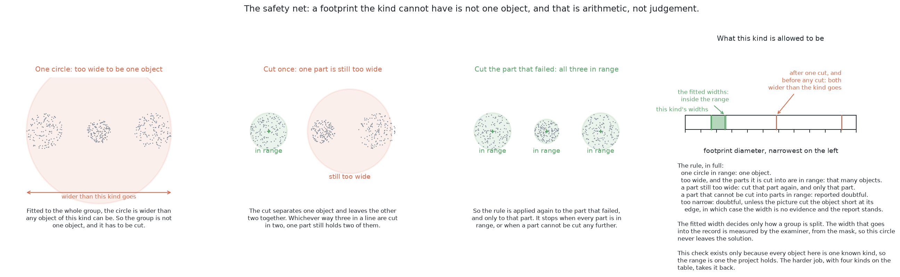
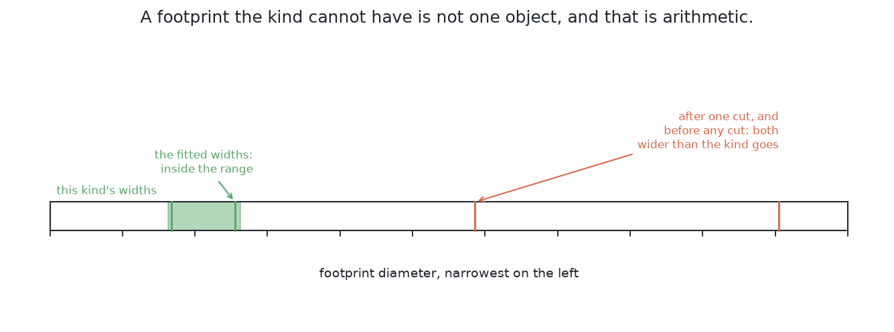

# How it works

This page explains each part of this solution in plain words. It follows [the
code](02_the-code.md), and it says what each part of that code does and why.

## Contents

1. [Turning a pixel into a point in the room](#1-turning-a-pixel-into-a-point-in-the-room)
2. [Keeping only what stands above the table](#2-keeping-only-what-stands-above-the-table)
3. [Throwing the height away](#3-throwing-the-height-away)
4. [Grouping the dots by how close they are](#4-grouping-the-dots-by-how-close-they-are)
5. [The one setting, and where it comes from](#5-the-one-setting-and-where-it-comes-from)
6. [Checking a group against the widths the kind allows](#6-checking-a-group-against-the-widths-the-kind-allows)

## 1. Turning a pixel into a point in the room

Everything else is built on this first step, so it comes first. Its name is
**back-projection**. A camera turns a place in the room into a place in a
picture. That is called projection. Back-projection runs the same step
backwards.

It needs three inputs and no guessing:

- The pixel's column and row, measured from the middle of the picture, give the
  direction the camera was looking.
- The depth reading at that pixel says how far to go along that direction.
- The camera's pose says where the ray starts and which way it points. The arm
  knows this pose exactly from its joint encoders.

The code scales the sideways offsets by the depth. Then it moves the result into
the arm's frame. The result is one point in the room.

So **a pixel is a direction with a distance written on it.** Two details about
that distance matter here.

First, the depth is measured straight out along the lens axis. It is not the
slanted distance from the lens to that pixel. So a pixel near a corner is
further from the lens than its depth says. This is why the sideways offsets are
needed.

Second, some pixels have no depth reading at all. These are dropped, because a
pixel with no distance cannot be placed in the room. Real clear glass gives many
such pixels, and [where it is strong and where it
breaks](06_how-it-compares.md#1-where-it-is-strong-and-where-it-breaks) explains
what that costs.

The camera also gives a **focal length**. Despite its name, it is not a length.
It converts between directions and pixels. So how much of the table one pixel
covers depends only on how far away the table is. From the survey height, one
pixel covers about 1.6 mm of table. The narrowest glass in the cell is still 28
pixels across. That is why counting pixels into groups can work at all.

Doing this for every kept pixel gives a **point cloud**. A point cloud is just a
list of positions in the room, with no grid and no order. Losing the grid is the
point. Being neighbours in the picture is the misleading idea this method wants
to escape.

Turning every pixel into a point would include the table too. The next section
removes it.

## 2. Keeping only what stands above the table

Now that each pixel can become a point, this step decides which pixels are worth
keeping. It is the cheapest step, because the cell knows the table's height.

The table is bolted to the same frame as the arm, so its height is a fixed
number. So the code does not have to search for the table. It just compares each
point's height with the table's height. A pixel is kept when its point is more
than a small clearance above the table. That clearance is larger than the noise
on a depth reading. It is much smaller than the shortest glass.

Two more tests remove the rest:

- A point higher than the tallest glass is dropped. This is mostly the arm's own fingers.
- A pixel with no depth reading is dropped, as the last section said.

What is left is a mask of pixels that show something standing on the table.

**This test, not the grouping, sets the outer edge of every mask.** The grouping
never adds back a pixel this test threw away. [The masks are what this
contributes](02_the-code.md#2-the-masks-are-what-this-contributes) says what
that costs.

The kept points still have their heights. The next section explains why the
method throws those heights away.

## 3. Throwing the height away

The kept points are in three dimensions, and this step flattens them. Every
point is dropped straight down onto the table. A point in three dimensions
becomes a dot in two, and its height is gone. This throws away information on
purpose, so it needs a reason.

First look at the shape of the point cloud. A camera looking down sees the side
wall of a glass almost edge-on. An edge-on wall catches very few pixels. So there
are many points on the top of a glass, a few near its base, and almost nothing
between them.

That shape breaks grouping in three dimensions. The top and the base of the
**same** glass are a whole glass height apart, with a gap between them. The
nearest points of two **different** glasses are only a strip of bare table
apart. That strip is narrower than a glass is tall. So the gap *inside* one
glass is larger than the gap *between* two glasses.

When that is true, no grouping distance can work. A distance small enough to
keep two glasses apart also cuts each glass into a top and a bottom. A distance
large enough to hold one glass together also reaches its neighbour.

Flattening fixes this. Each glass becomes a small solid disc of dots. The strip
between two discs stays exactly as wide as before, because dropping a point
straight down does not move it sideways. Now the gap inside one glass is zero.
The gap between two glasses is the whole strip. So a wide range of grouping
distances works. In short, **height varies the most and tells you the least**.

One warning about the disc. The disc is not the glass's base. It is the outline
of the glass's widest slice, because that slice hides everything below it from
above. For a glass with no stem, the widest slice and the base are almost the
same. For a stemmed glass, the disc is the bowl. The problem asks only for a
rough width, so the widest slice is good enough. An exact shape needs a look
**from the side**, which is a different job.

The dots now lie flat on the table. The next section groups them.

## 4. Grouping the dots by how close they are

With the dots flat on the table, the grouping rule is simple enough to state in
a few short sentences.

> Start from a dot that nobody has visited. Take every dot within a chosen
> distance of it. Then take every dot within that distance of those. Keep going
> until nothing new joins, and call that group one glass. Then start again from
> a dot that has not been used.

This rule has a published name, **Euclidean cluster extraction**. Its key
property is how little it is told. Its only setting is the one distance. Nobody
tells it how many groups to find, how large they are, or what shape they have.
This matters, because a method told to find five groups can never report four or
six. Reporting the count honestly is part of this problem.

The rule also **chains**. If A joins B and B joins C, then all three are one
group, even when A and C are far apart. Chaining lets the rule hold an uneven
scatter of dots together. It is also the rule's one weakness. One stray dot in
the strip between two glasses can link them into one group.

Comparing every dot with every other dot is slow. The number of comparisons
grows with the square of the number of dots. The usual fix is a k-d tree, which
finds near points without looking at far ones. The code does something simpler.
It marks a grid of 5 mm squares. It grows every marked square outwards by the
grouping distance. Then it joins the squares that touch. That is two OpenCV
calls over a small grid.

The rule has one setting, the grouping distance. The next section says where its
value comes from.

## 5. The one setting, and where it comes from

The grouping rule from the last section has only one setting, so its value needs
care. It does not come from trial and error. It sits between two limits that are
both known before a run starts. This is like choosing a measuring tolerance: it
must be larger than the noise and smaller than the smallest real difference.

The **lower limit** is the spacing of the dots on one glass. Neighbouring pixels
land on neighbouring pieces of table, so the dots form a mesh. Its spacing is
about what one pixel covers. The top of a glass is nearer the lens, so the mesh
is tighter there. A slanted surface, such as the curve of a bowl, spreads the
dots out. If the distance is smaller than the widest gap in that mesh, the chain
breaks inside one glass. Then one glass comes back as two or three groups.

The **upper limit** is the narrowest strip of bare table between two glasses.
There is a trap here. The problem promises a smallest distance between glass
**centres**. The grouping rule measures **edge to edge**. So the worst case is
the two widest glasses of the kind at that smallest centre distance. Take half
of each glass off the centre distance. What is left is the narrowest strip. If
the grouping distance is larger than that strip, the chain crosses it and two
glasses come back as one.

The narrowest strip is much wider than the widest gap in the dot mesh. So the
window between the limits is wide, and almost any sensible value works. Even so,
the value should be computed, not typed in. The two numbers that set the window
belong to other parts of the project. One is the widest rim this kind allows.
The other is the smallest distance between centres. So the design says the
grouping distance should be **computed** from those two, and the run should
print both ends of the window. The code does not do this yet. It uses a fixed
25 mm. A computed value stays right when someone widens a kind or moves the
glasses closer. A typed-in value becomes wrong on that day, and nobody notices.

Inside the window, the design puts the value near the **low** end. This is
because the two mistakes are not equally bad. A glass split into two groups is
usually caught. Half a footprint is far too narrow for a glass of this kind, so
both halves fail the width check in the next section. There is one exception. A
glass at the edge of the frame is already short of its footprint. The check
must accept a narrow width when the group reaches the frame edge. Half of such a
glass also reaches that edge, so that split is not caught. Two glasses merged
into one group are harder to catch everywhere. So the setting leans towards
splitting, because that mistake is usually caught.

The grouping can still join two glasses into one group. The next section
describes the check that catches that.

## 6. Checking a group against the widths the kind allows

The grouping from the last sections can still be wrong, so every group is
checked. This check is what makes the method safe to use with a moving arm.

A glass seen from above flattens to a disc. So each group of dots should be a
filled circle. The code fits a circle to the group and reads off its width. It
fits only the dots on the outside of the patch. A circle fitted to all the dots
of a filled disc comes back too narrow. The fit could also give a **residual**,
which is how far the dots are from the circle on average. None of the outcomes
below uses it, so the code does not compute it.

The fit has a useful property. The usual circle equation is not linear in its
centre and radius. That would normally need a step-by-step search from a
starting guess. But if you multiply the equation out and treat certain
combinations as the unknowns, it becomes linear. So the fit has a direct
answer, with no search and no starting guess.

**This fitted width is only for the check.** The examiner measures the width in
the record, from the mask pixels. The fitted width matters because of what it
changes. When it says a group is too wide, the group is split, and that changes
which pixels go into which mask.

The range the width is checked against is narrow. Across all four kinds, glass
widths vary a lot. Within *one* kind the range is much narrower, and the problem
says which kind is on the table. So this check is much tighter than a general
test of whether something is "glass-sized".

The check **repeats**, and it has four outcomes:

- If the width is inside the kind's range, the group is one glass. Its pixels
  become one mask.
- If the width is **wider** than any glass of this kind, the group is more than
  one glass. It is split in two, and the same question is asked of each part. A
  part that is still too wide is split again.
- If the width is **narrower** than any glass of this kind, splitting cannot
  help. The part is accepted if its pixels reach the frame edge, because the
  picture did not hold the whole glass. Otherwise it is refused.
- If any part cannot be settled, the whole group is reported as doubtful. The
  report says which side of the range it failed on. The method does not guess.

The picture below shows the range those three steps are checked against. It is a
line of widths from narrow to wide. The band this kind allows is marked on it.
The two widths that passed are inside the band. The two that failed, before any
cut and after the first cut, are far to the right.

The split uses **k-means with two centres**, a simple and well-known method. Put
one seed at each end of the group's longest direction. Give each dot to the
nearer seed. Move each seed to the middle of its dots. Repeat until nothing
moves. Then fit a circle to each half.

This check is **arithmetic, not judgement**. "This group is too wide to be one
glass" uses two numbers. Both were known before the run, and both can be
printed. Nobody tuned a threshold until the tests passed. That is why a written
rule can be trusted here.

### Why one split is not enough

A single split handles two glasses run together, and the crowded arrangements
often hold more than two. The examiner's crowded family puts **three** glasses
in a line, and two lines in each arrangement. They stand closer than the cell's
layout rule allows. So a chain of three or more glasses in one group is common
there. This was counted over the five blocks of 20 held-out crowded
arrangements. 365 groups held more than one glass, and **247 of those held three
or more**. One split of such a group leaves at least one part with two glasses.
That part is still too wide. A rule that stops after one split can only hand the
whole group over.

Both rules were measured on those same five blocks, which hold 485 glasses. The
table below gives one row per rule. Read across to compare them.

| | glasses found | groups handed over | masks covering two glasses | median place error |
| --- | --- | --- | --- | --- |
| stop after one split | 92 | 240 | 4 | 3.3 mm |
| split again while too wide | **354** | 9 | 52 | 8.7 mm |

Repeating the split finds far more glasses. The cost is more merged masks and
less exact places. On the spawned arrangements, the two rules give the same
result. Both find all 499 glasses at the same places. So repeating costs nothing
where it is not needed.

This is not a new rule. "A group too wide for one glass is not one glass" is
true of any group, including a part made by a split.

### Where the repetition stops

The repetition needs no counter, because it always stops on its own. Each split
gives both parts fewer dots than before, so the splitting must end. It ends in
one of three ways:

- Every part has a width the kind allows. This is the answer.
- A part is narrower than the kind allows. Splitting cannot fix that.
- A part cannot be divided. Either k-means puts every dot on one side, or a half
  has too few depth readings for the examiner to measure.

A group with any part left over is handed over **whole**, not in pieces.
Reporting the parts that fit and dropping the rest would claim to know how many
glasses the group holds. The check has just said it cannot tell.

**An older test is no longer used.** It asked whether two circles together
covered all the dots. It was meant to catch two circles fitted to three glasses,
with the middle glass in neither. Repeating the split now handles that case
directly. Keeping the old test as well was measured on one block of 20 crowded
arrangements, and it made things worse. Without it, the rule finds 71 of the 101
glasses and hands over 3 groups. With it, the rule finds 53 and hands over 37.
On the spawned block, it also refuses 20 good glasses. The reason is geometry. A
part cut from a filled patch by a straight line is not a disc. So a circle
fitted to it misses the corners the cut left. The more cuts, the less round the
parts are.

← [The code](02_the-code.md) · [A worked example](04_a-worked-example.md) →
