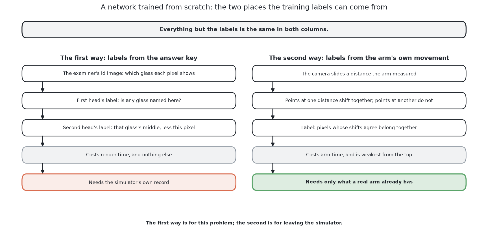
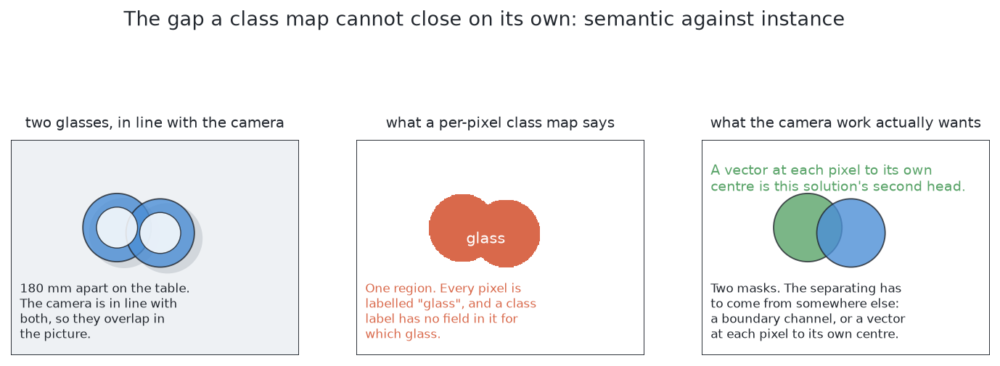
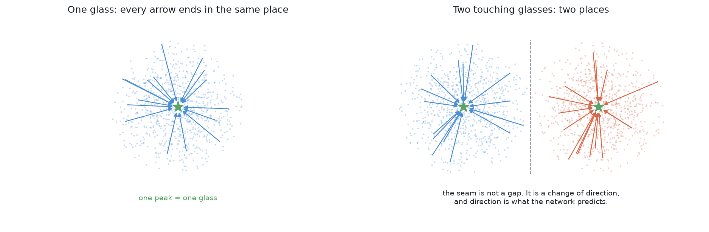

# What it is

> **What it uses.** It uses PyTorch on this machine's built-in graphics. It
> has one small network, written for this cell and trained only inside it. No
> weights are downloaded, so there is no licence to meet.
>
> **What it does.** The network looks at a survey picture. At each pixel it
> answers two questions. Is this pixel glass? If so, which way is the middle of
> its own glass? Each glass pixel then votes for that middle. One glass makes
> one pile of votes, and two glasses make two piles.
>
> **What it costs.** It needs labelled pictures of this cell, a training run,
> and a file of weights that must match the cell.

This chapter is for a reader who has read [the cell](../01_the-cell.md) and
[the problem](../02_the-problem/01_what-is-asked-for.md). The cell is described
there, so these pages cover only this solution.

## Contents

1. [Introduction](#1-introduction)
2. [The problem this solves](#2-the-problem-this-solves)
3. [The main idea](#3-the-main-idea)

## 1. Introduction

This page explains a solution that uses a network built and trained only
inside this cell. It borrows nothing. The other four learned solutions start
from weights that someone else trained on real photographs. This one starts
from random numbers. It learns only from pictures this project rendered.

That makes it the **control** for the book. A control is the one case in a
test where the thing being studied is left out. Here, the thing left out is
borrowing.

Every other learned solution has a **domain gap**. A domain gap is the
difference between the pictures a model learned from and the pictures it is
asked about. A model trained on photos of kitchens and streets has never seen
this table, this lens or these glasses. Nobody can say in advance how much of
what it learned still helps. This solution has no domain gap, because all it
knows came from this cell. So the difference between its score and the scores
of the borrowed models measures what borrowing was worth.

The next section says which part of the problem this network is built for.

## 2. The problem this solves

The introduction said what this solution is. This section names the one
difficulty it is aimed at.

Finding glass pixels is easy. Telling one glass from another is hard. Two
glasses can stand apart on the table but touch in the picture. [What is asked
for](../02_the-problem/01_what-is-asked-for.md#glasses-merge-in-the-picture-although-they-stand-apart-on-the-table)
explains why. A **flood fill** groups all touching glass pixels into one
object. So it reports one glass where two are standing.

More training does not fix this. A **class map** gives each pixel one label,
such as "glass" or "table". This is called **semantic segmentation**. The
problem asks for **instance segmentation**, which also says *which* glass each
pixel belongs to. A perfect class map still puts "glass" on both joined
glasses. The same label everywhere cannot mark a boundary. So the fix is a
different output, not a better network.

The next section describes that different output.

## 3. The main idea

The last section showed that a class map cannot split joined glasses. This
section gives the output that can.

**The network can be small, because this cell is narrow.** There is one class
to find. There is one kind of glass at a time, one camera and one light setup.
The glasses are always upright and opaque. So a small network is enough. A
small network with endless labelled pictures can be trained from nothing on an
ordinary computer.

**Each glass pixel gives an arrow, not just a label.** The arrow points to the
middle of that pixel's own glass. Add the arrow to the pixel's position, and
you get a **vote** for where that middle is. All pixels of one glass point at
the same middle, so they make one pile of votes. Two glasses make two piles.
Counting glasses becomes counting piles.

This design has two good points. First, nothing has to find a boundary. Where
two glasses meet, only the arrow direction changes. Second, a few wrong votes
do no harm. A glass casts many votes, so a few strays are outvoted.

The next page, [the code](02_the-code.md), shows the code that does this.
[How it works](03_how-it-works.md) then explains it step by step.

← [Rules on the table — how it compares](../05_rules-on-the-table/06_how-it-compares.md) · [How it works](03_how-it-works.md) →
