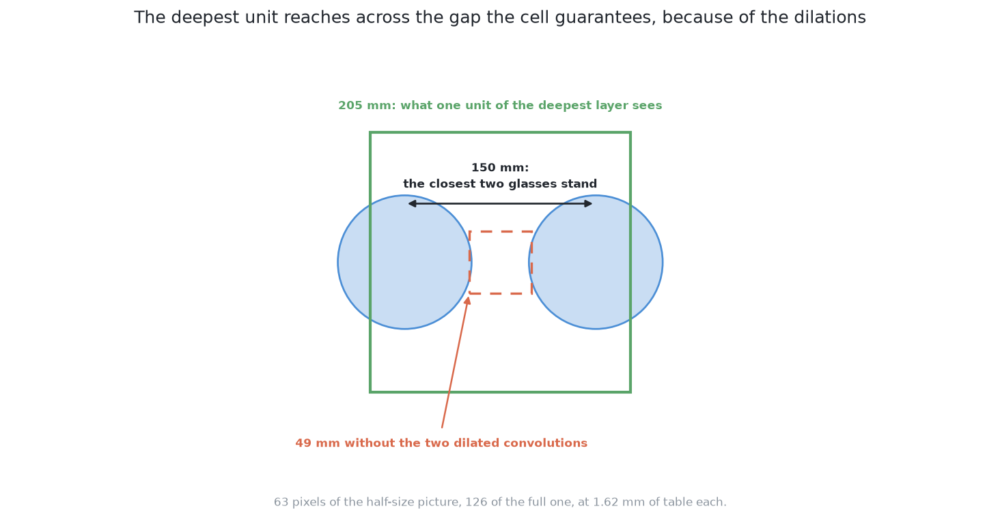
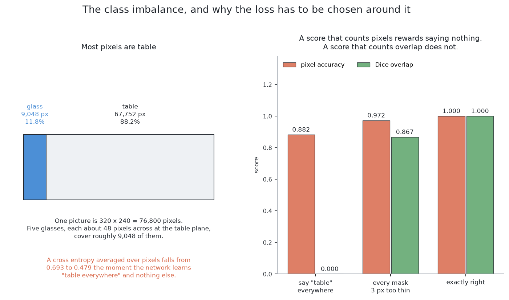
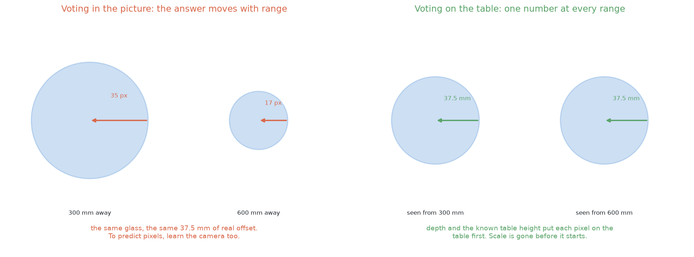
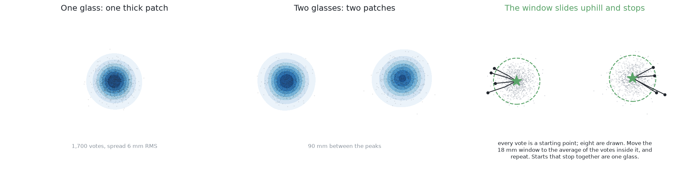
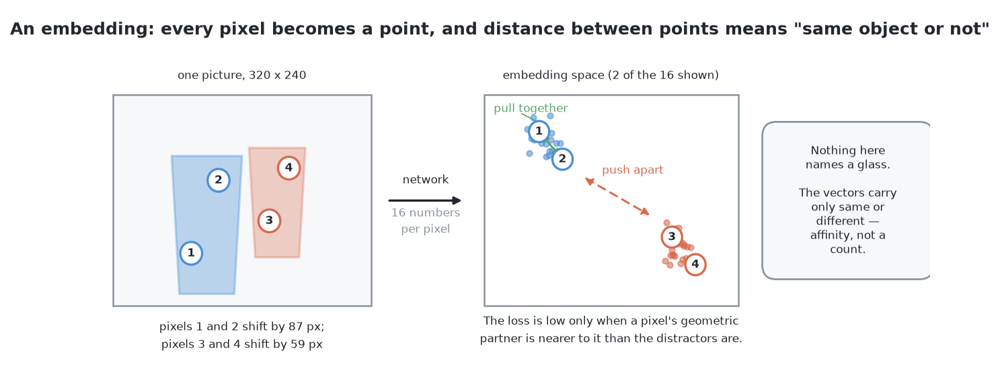
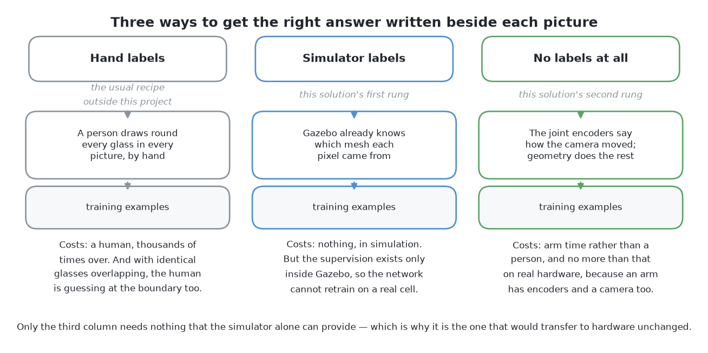

# How it works

This page explains what happens inside this solution, part by part. It
explains the parts of [the code](02_the-code.md) and the ideas behind them.

## Contents

1. [What exists in code, and what is a design](#1-what-exists-in-code-and-what-is-a-design)
2. [What a network is, and what training from scratch means](#2-what-a-network-is-and-what-training-from-scratch-means)
3. [Why nothing is borrowed, and what that buys](#3-why-nothing-is-borrowed-and-what-that-buys)
4. [The shape of the network](#4-the-shape-of-the-network)
5. [The first head: which pixels are glass](#5-the-first-head-which-pixels-are-glass)
6. [The second head: which way is the middle of my own glass](#6-the-second-head-which-way-is-the-middle-of-my-own-glass)
7. [From votes to glasses](#7-from-votes-to-glasses)
8. [The two ways: where the labels come from](#8-the-two-ways-where-the-labels-come-from)
9. [The first way — labels from the answer key](#9-the-first-way--labels-from-the-answer-key)
10. [The second way — labels from the arm's own movement](#10-the-second-way--labels-from-the-arms-own-movement)
11. [The training set](#11-the-training-set)

## 1. What exists in code, and what is a design

Some parts of this page are built and some are only planned. This section says
which is which, so you can tell them apart as you read.

**What is built.** The network and its two heads are written in PyTorch. Its
training labels come from the simulator's record of which glass each pixel
shows. Its votes are counted, and the biggest piles are taken first. It is
trained and scored by the shared [examiner](../03_the-examiner/01_the-examiner.md).

**What is only a design.** Four things are written down but not built:

- the two fixes for the rare class in the loss;
- the width check on a pile;
- the alarm on how spread out a pile is;
- the whole of the second way.

Each one is marked where it appears.

The next section defines the words the rest of the page uses.

## 2. What a network is, and what training from scratch means

Before the network's parts can be explained, three words need a meaning.

A **neural network** is a program whose behaviour comes from numbers, not from
written rules. Those numbers are called **weights**. **Training** shows the
network an example and compares its answer with the right one. Then it changes
every weight a little, in the direction that would have helped. After training,
nobody can read the rule back out of the weights.

**Training from scratch** means the weights start as random numbers. The usual
choice is **fine-tuning** instead. Fine-tuning starts from weights someone else
trained on many photographs. [The same model,
fine-tuned](../08_the-same-model-fine-tuned/03_how-the-model-is-trained.md)
explains it. Fine-tuning needs far fewer labels, so it is normally the better
choice. The next section says why this solution trains from scratch anyway.

## 3. Why nothing is borrowed, and what that buys

The last section said fine-tuning is normally better. Here it is not, for two
reasons.

First, labels in this cell are free and exact. The simulator knows which glass
each pixel shows. [The
examiner](../03_the-examiner/01_the-examiner.md#5-what-the-examiner-keeps-to-itself)
explains this. So the usual reason for fine-tuning, few labels, does not apply.

Second, borrowing brings a domain gap. [What it is](01_what-it-is.md#1-introduction)
explains why this solution is the one learned solution without one.

The costs are in [what it needs](05_what-it-needs.md#1-what-it-needs). The next
section describes the network those costs pay for.

## 4. The shape of the network

Now that the choice to train from scratch is made, this section shows the
network being trained. Its shape is the standard one for labelling every pixel
of a picture. It has a **down path** and an **up path**.

The down path uses **convolutions**. A convolution slides a small square window
over the picture. At each place, it multiplies the values in the window by a
set of weights and adds them up. Each set of weights gives one output
**channel**, which is one layer of numbers the size of the picture. Between
groups of convolutions, the picture is **halved** in width and height. At the
same time, the number of channels is doubled. This network uses three by three
windows. It has 16 channels at full size, 32 at half size and 64 at quarter
size.

Each halving loses some detail about *where* things are. But each halving also
lets the next window cover four times as much of the picture. So deep units
know less about exact position and more about what is around them. This is the
reason for going down. A pixel cannot predict the way to its glass's middle if
it sees only itself.

The up path enlarges the picture back to its first size, step by step. A last
convolution with a window one pixel wide turns the channels into the few
numbers wanted at each pixel.

Enlarging cannot bring back detail that halving threw away. So before each
halving, a copy is kept. On the way up, the copy is added back as extra
channels. These copies are called **skip connections**. A network built this
way is a **U-Net**, from Ronneberger, Fischer and Brox, 2015
([arXiv:1505.04597](https://arxiv.org/abs/1505.04597)).

### What goes in

The network gets three inputs. The first is the depth reading, turned into a
height above the table. The other two say where in the picture each pixel is.
All three are at half size, 160 by 120 pixels. This is four times quicker to
train on. A glass is still more than a dozen pixels across.

The position inputs are needed because of **splay**. From above, the camera
draws each rim pushed outwards from the point below the lens. [The
cell](../01_the-cell.md#3-the-glasses) explains splay. So the arrow from a
pixel to its glass's middle depends on where the pixel is in the picture. The
network cannot see that position, so it is given it.

### The arithmetic worth doing before training

The down path trades position for context. This subsection checks that the
trade gives enough context.

The part of the picture one deep unit can see is its **receptive field**. Turn
that into a distance on the table. Compare it with the closest two glasses can
stand. If the field is smaller, no unit can see two glasses at once. Then the
network can never learn to separate them, however long it trains.

Two halvings alone are not enough here. They reach 15 pixels of the half-size
picture. That is 49 mm of table, less than one glass. So the two deepest
convolutions use **dilation**. Dilation spreads a window's inputs apart. Here
it uses every second input, then every fourth. This widens the field without
another halving and without many more weights. With dilation, the deepest unit
sees 63 pixels of the half-size picture. That is 205 mm of table. The cell
keeps glass centres at least 150 mm apart.

The margin is enough, but not large. Do this sum again if the camera height,
the lens or the layout rule changes. The next section describes the first of
the network's two outputs.

## 5. The first head: which pixels are glass

The network's shape is now known. A **head** is the last layer that gives one
kind of answer. This section describes the first head.

The first head gives one number per pixel. It says how sure the network is
that the pixel is glass. A squashing function turns it into a chance between
zero and one. A threshold on that chance gives the mask.

Training needs a **loss**. A loss is one number that says how wrong an answer
was. Training tries to make it smaller. The usual loss for a yes-or-no answer
is **binary cross entropy**. Being sure and right costs almost nothing. Being
sure and wrong costs a lot. The cost is averaged over every pixel.

**The average causes trouble.** Most pixels in a picture from above are table.
So glass is the rare class. A network can lower the average a lot by saying
"not glass" everywhere. It is then rewarded for an empty picture.

There are two standard fixes. **Both are designs here, not built code.**

The first fix gives glass pixels more weight in the loss. Each glass pixel
counts more, by the ratio of table pixels to glass pixels. Then saying "not
glass" everywhere no longer helps.

The second fix adds a loss that measures overlap. It uses the **Dice coefficient**.
Count the pixels that both the answer and the truth call glass, and double it.
Then divide by all the pixels that either one calls glass. It is one for a perfect match and zero for no
overlap. It ignores the table. The usual recipe adds one minus Dice to the
weighted cross entropy (Milletari and colleagues, 2016,
[arXiv:1606.04797](https://arxiv.org/abs/1606.04797)).

The lesson is general. **A score that rewards saying nothing will teach a
network to say nothing.** The first head finds glass, but it cannot say which
glass. The next section adds the head that can.

## 6. The second head: which way is the middle of my own glass

The first head stops where the real problem starts, at telling glasses apart.
The second head adds two output channels. They hold the two parts of an arrow.
The network shape and the training stay the same. So the two heads are one
network, not two.

### Why the arrow is an easier question than it looks

The arrow runs from a pixel to the middle of its own glass's rim, as the
picture shows it. So the longest arrow is about half the widest rim, plus some
splay. Every arrow is a pair of numbers inside a small, known box. A target
with known limits is much easier to learn. The code divides each arrow by 25
pixels, so the numbers are near one.

The arrow loss counts only glass pixels. A table pixel has no glass to point
at, so it has no right arrow. The loss uses the plain distance of the miss, not
the distance squared. Some edge pixels could belong to either of two glasses.
Squaring would let these few pixels outweigh the many good ones.

### Which frame the arrow is measured in

An arrow can be measured in two places. Each gives the network a different
job.

**The arrow can be measured in the picture.** Then it is so many pixels across
and so many down. This is what the built network does. The same glass needs a
different arrow near the middle of the picture and near the edge. The position
inputs let the network tell these cases apart.

**Or the arrow can be measured on the table.** Depth and the camera pose turn a
pixel into a place on the table. An arrow on the table would be the same
wherever the camera stood. But it would need depth at run time. Real clear
glass gives almost no depth, so this choice matters.

Each glass pixel now has a vote. The next section turns votes into glasses.

## 7. From votes to glasses

The second head gives every glass pixel a vote. One glass's votes should land
in one tight pile. This section finds the piles.

**The built code counts them.** Each vote is added to a tally the size of the
picture. The tally is smoothed a little, so nearby votes add up. Then the code
takes the biggest place in the tally as a middle. It removes the votes near
it. It takes the next biggest place, and so on. It stops when no place has
enough votes left. The pixels whose votes landed near one middle are that
glass.

**The published method for this job is mean shift** (Comaniciu and Meer,
2002). Put a round window on one vote. Move the window to the average position
of the votes inside it. Repeat until it stops moving. Votes whose windows stop
in the same place form one pile. Mean shift does not need to know how many
piles to expect. That matters here, because the count is the answer.

Both methods need one number. It is how close two votes must be to count as
one pile. It has a lower limit and an upper limit. The lower limit is the
spread of one glass's own votes. A smaller window splits one glass into
several piles. The upper limit is about half the closest gap between two
middles. A bigger window joins two glasses into one pile. A joined pile still
looks tight, so this mistake is easy to miss. The code uses 8 pixels of the
half-size picture. It removes twice that around each middle it takes.

Two checks go with the counting. The first is built. The second is a design.

**A pile needs enough votes.** A glass covers many pixels, so it casts many
votes. A pile with only a few votes is doubtful. For example, a glass seen only
as a thin crescent votes only from that crescent. Those votes agree with each
other but are all wrong in the same way. So the vote count is a measurement of
how sure to be. It is not the network's own opinion.

**A pile needs a believable width.** A circle is fitted on the table to the
pixels of one pile. If its width is outside the range for this kind of glass,
the pile is not reported. So the network proposes, and a written width check
decides.

### The vote has to land inside the picture

Counting votes in a tally the size of the picture has one cost. A vote that
lands outside the picture is dropped. Splay can push a tall glass's middle past
the edge of the picture. Then all its votes are dropped, and no pile forms.
This is this solution's biggest loss. [Where it is strong and where it
breaks](06_how-it-compares.md#1-where-it-is-strong-and-where-it-breaks)
measures it.

The network, heads and votes are now explained. The next section asks where
the training labels come from.

## 8. The two ways: where the labels come from

Everything so far needs training labels. This section says there are two
sources for them.

The network, the heads, the votes and the checks are the same in both. Only
the source of the labels changes. So they are two ways of one solution, not
two solutions. The first way takes labels from the examiner's answer key. They
are free and exact. The second way takes labels from the arm's own movement.
They are weaker and cost arm time, but a real arm could make them too. The
next section describes the first way.

## 9. The first way — labels from the answer key

The first way is the simpler one, and it is the one that is built.

The simulator gives an **id image** with each picture. At each pixel, it says
which glass is there, or none. A solution may train on id images from the
training arrangements. It never sees one while answering. [The
examiner](../03_the-examiner/01_the-examiner.md#5-what-the-examiner-keeps-to-itself)
gives this rule.

Both heads' labels come from the id image by arithmetic. **The first head's
label** is "glass" wherever the id image names any glass. **The second head's
label** is a subtraction. Take where that glass's rim middle is in the
picture, and subtract the pixel's own position. The simulator knows both
exactly.

This way has one weakness. A real camera on a real table has no id image. So
on real glasses, someone would have to draw round every glass by hand. The
next section describes the second way, which removes this need.

## 10. The second way — labels from the arm's own movement

The first way needs an answer key that real cameras do not have. The second
way trains the same network with no answer key at all.

It uses one fact about this cell. **The camera is on the wrist, so the arm
knows exactly how it moved the camera between two pictures.** The joint
encoders report that movement. An **encoder** is a sensor that measures how far
a joint has turned. For two pictures of a still scene, geometry then says where
each surface point must move to. Points on one glass move together. Points on
a glass at a different distance move by a different amount. **That agreement
is the label.**

### Parallax: the shift goes as one divided by the depth

The label depends on how much each point moves. This subsection says how much.

The effect is called **parallax**. When the camera slides sideways, a surface
moves across the picture by the slide divided by its distance. Near things move
a lot. Far things move a little.

This has two results. First, the effect is strong close up and weak far away.
Second, the gap between two surfaces' shifts grows with the slide. A longer
slide gives more separation. So the arm can choose how far to move to settle a
doubt.

### Why the slide has to be sideways, and why the top view is the weak case

Parallax separates two surfaces by their difference in depth. This subsection
checks when that difference is big enough.

Parallax works only when the depth gap between two glasses is much bigger than
the depth range of each glass alone.

**From above, the signal is weak.** Two glasses of one kind have rims at about
the same height. So there is almost no depth gap between them. Also, each glass
runs from its rim down to the table. So both glasses cover the same wide range
of depths. Their shifts overlap, however far the camera slides.

**From the side, the signal is strong.** A glass behind another is much further
back than either glass is wide. So the depth gap is large, and each glass's own
range is small. The arm already slides the camera sideways at every survey
station. A slide for this purpose is the same movement, only longer.

So this way's labels come mostly from side pictures. But the hardest case is
the merge in a picture from above. **This way is worst at labelling exactly the
hardest case.** That is the price of not reading the answer key.

### What an embedding is

Movement gives a weaker kind of label than the answer key. This subsection
describes the output that such a label can train.

The answer key says which glass a pixel belongs to. So it says where the arrow
should point. Movement says only whether two pixels belong together. It says
nothing about which glass, or how many. So the output must change.

The new output is an **embedding**. An embedding is a short list of numbers at
each pixel. Two lists that are close mean the two pixels belong together. The
numbers mean nothing alone. Only the distances between lists matter. Think of
a map with no place names. You can only ask how far apart two pixels are.

### What contrastive training does

The embedding needs a loss. This subsection describes it.

Two pixels whose shifts agree are a **positive pair**. They are on the same
surface. Two pixels whose shifts clearly differ are a **negative pair**.
Movement gives these two answers, and nothing more.

**Contrastive training** turns these pairs into a loss. Pick a pixel, its
positive partner and a few negatives. The loss is low only when the partner is
closer than every negative. So training pulls positive pairs together and
pushes negative pairs apart. In the end, the pixels of one surface sit together
on the map. Nobody ever said what a glass is.

The embedding splits where the **depth jumps**, not where the brightness
changes. So two identical glasses are no harder than two different ones. A
method that uses how things look fails in exactly that case.

But **an embedding does not name or count glasses.** So the lists are grouped
into regions. Each region goes through the same checks as the first way's
piles. The checks matter even more here. A joined pair comes out of an
embedding as one tidy region, with no warning.

### What this way buys and what it costs

The second way is now described. This subsection weighs it.

It gives one benefit. **It is the only way whose labels a real arm can also
make.** A real arm has joint encoders and a wrist camera, and that is all this
way needs. Every other trained solution here uses labels that exist only
because the pictures were rendered. On a real arm, they would all need new
labels. This one would not.

It has three costs. The labels are weaker, and weakest where the problem is
hardest. The labels cost arm time, because the arm must move to make them. And
the way needs something to match between two pictures, so plain pictures are
hard for it.

So the first way is the one to build for this problem. The second way is for
when the cell leaves the simulator. The next section covers what both ways
need from the training set.

## 11. The training set

Both ways need a training set. Two choices about it decide whether the network
works at all.

**Include the hard case.** The cell's layout rule keeps glasses well apart.
Pairs that far apart are easy to separate with plain arithmetic. So the
network must also train on pairs much closer than the rule allows. The
examiner's crowded arrangements give these. Keep the easy case too, so the
network does not learn that there is always a close pair. In general, the
limit of what the cell allows should be in the middle of the training set.

**Vary everything that is not shape.** A simulator draws the same table under
the same light every time. A network will use any constant as a clue. For
example, if the table is always one shade, the network can learn "glass is
whatever is not that shade". This scores well on rendered tests and then fails
when a light changes. **Domain randomisation** fixes this. Vary the lighting,
the table colour and texture, the glass tint, the exposure, the noise, the
camera pose and the glasses' number and places. Vary them more than will ever
happen. Then shape is the only reliable clue left (Tobin and colleagues, 2017,
[arXiv:1703.06907](https://arxiv.org/abs/1703.06907)).

One thing is **not** varied, which is the lens. The focal length and picture
size belong to this cell's camera. Training for other lenses would waste the
network's small capacity.

The examiner splits its arrangements into a training half and a test half. The
network is trained on the first and scored on the second. The next page
follows this network through one arrangement with real numbers.

← [The code](02_the-code.md) · [A worked example](04_a-worked-example.md) →
