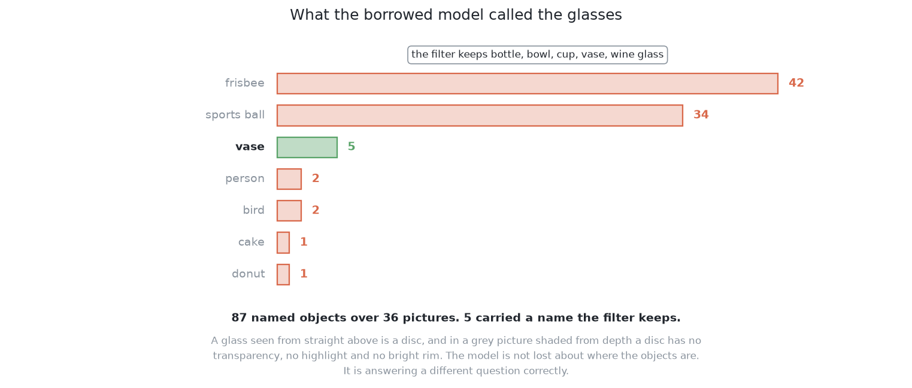

# Results and comparison

This page gives the results of this solution and the judgement on them. It
reports what the solution scored in the two kinds of arrangement the examiner
uses, says why it failed, and then places it beside the other five. It follows
[the code](02_the-code.md), and every number on it was marked by [the
examiner](../03_the-examiner/01_the-examiner.md).

## Contents

1. [The results in the two kinds of arrangement](#1-the-results-in-the-two-kinds-of-arrangement)
2. [Why it failed: the names it reached for](#2-why-it-failed-the-names-it-reached-for)
3. [Where it is strong and where it breaks](#3-where-it-is-strong-and-where-it-breaks)
4. [The general ideas behind this](#4-the-general-ideas-behind-this)
5. [Where it sits among the other five](#5-where-it-sits-among-the-other-five)
6. [What it costs to run, and the licence](#6-what-it-costs-to-run-and-the-licence)

---

## 1. The results in the two kinds of arrangement

The examiner marks every solution in two kinds of arrangement. In the first, the
glasses are **spaced**: they stand at least as far apart as the cell's own rule
asks. In the second, they are **crowded** closer than that rule allows, so one
glass can hide part of another. Each kind is marked over five blocks of 20
held-out arrangements, which are arrangements no solution saw while it was being
built.

**This solution reports 6.4 glasses in every 100 when they are spaced, and 2.1
when they are crowded.** Both are the worst in the book by a wide margin. They are
also the least settled numbers in it. The five spaced blocks run from 2.0 to 11.9
per 100, and the five crowded blocks run from 0.0 to 4.2, where one whole block
of 20 arrangements produced **no glass at all**. The spread does not change the
conclusion, because the best block is still far below the worst block of any
other solution. [The results](../11_the-results.md) sets these two rows beside the
other five.

The usual outcome for a single picture is nothing. Each block is 20 arrangements
seen from three survey stations, which is 60 pictures. **The model named no
drinking vessel at all in 49 to 58 of the 60 when the glasses were spaced, and in
56 to 60 of the 60 when they were crowded.** For such a picture `Finder.find`
returns an empty list with the doubt "the model named nothing in this picture a
drinking vessel", and the examiner marks every glass on the table as missed.

What it did report was right. **Nothing was merged, split or falsely reported, in
any block.** A merge is two glasses reported as one, and a split is one glass
reported as two. Every glass this solution reported was a real glass, so it fails
by silence rather than by inventing anything. That kind of failure is the harder
one to notice. A method that reports a wrong glass announces itself. A method that
reports no glass looks, from downstream, exactly like an empty table.

The masks it kept were mostly good. This solution found 12 glasses of the two
kinds with a stem and 20 of the two kinds without one. On the kinds without a
stem, the block medians cover 99.8 to 100.0 per cent of the glass. On the kinds
with a stem they cover 44 to 79 per cent, because a stem is narrow and the model
builds its outline from a few coarse patterns that cannot hold a narrow detail.
At the median, 3.3 per cent of a kept mask was not the glass, against 0.0 for the
rule written by hand, because the outline is enlarged to the size of the picture
and errs on the generous side.

So the model outlines well when it offers an outline at all. The next section
asks why it so rarely offered one, because that is what decided the score.

---

## 2. Why it failed: the names it reached for

The results above show a model that is almost always silent, and this section
uses one more measurement to find the cause.
[`what_it_named.py`](https://github.com/RobinNagpal/robot-arm-projects/blob/main/v5-pick-glasses/02-segment-glasses/03-yolo-zero-shot/what_it_named.py)
runs the model over 36 held-out pictures with no filter in front of it and prints
every name it offers. **Across those 36 pictures the model returned 87 named
objects, and 5 of them carried a name the filter accepts.**

The model is not blind. It finds things and calls them sports balls and frisbees.
A glass seen from straight above is a disc, and the nearest round shapes on the
model's list are a ball and a frisbee.

The reason is a **domain gap**, which is the difference between the data a model
was fitted on and the data it is used on. The gap here runs in two directions.

- **The picture is not a photograph.** The cell gives a solution a grey picture
  shaded from how far away each surface is. A borrowed model's strength on
  photographs comes largely from real light: shading as a surface curves,
  shadows, and colour differences between one object and the next. Very little of
  that is here.
- **The glasses are not photographed glasses either.** In a photograph, a model
  knows it is looking at a glass from the transparency, the highlight along one
  side and the bright line on the rim. This cell renders its glasses as solid
  shaded shapes, so only the silhouette is left.

One repair is available and is refused. Adding "sports ball" and "frisbee" to the
accepted list would lift the score at once. It would also mean choosing the
filter after looking at the answers, which is the one thing this solution exists
not to do. The measurement is allowed, and acting on it is not.

The bar on confidence played no part in this failure. The outlines that were lost
were lost to their names and never reached the bar.

With the cause known, the next section weighs what the solution does well against
where it breaks.

---

## 3. Where it is strong and where it breaks

The cause of the failure is now known, so this section sets it beside the
solution's strengths, which all come from the same source: nothing is fitted.

There is nothing to collect, nothing to train and nothing to keep in step with
the cell, so this solution was tried in an afternoon and gave this chapter a
reading on what a borrowed model is worth before anybody invested in labels. It
attacks the merge directly, because a model that finds objects returns one
outline per object rather than one per connected shape. It needs no graphics card
of its own. And it is a genuine upper bound on convenience: no other solution
here can be cheaper, so if this one had been good enough, several of the others
would not need to exist.

The weaknesses divide into what the borrowing costs and what it cannot be asked
to do.

**What the borrowing costs is the naming, and the naming is what decided this**,
as [the names it reached for](#2-why-it-failed-the-names-it-reached-for) shows.
Beside that, the other two costs are small. The outline is built coarsely and
then enlarged, so a width carries an error that does not average away. The
confidence number is uncalibrated on these pictures, so the bar on it is a
setting chosen by hand, as [what it is](01_what-it-is.md#2-the-main-idea)
explains.

What it cannot be asked to do is anything that needs fitting. The outlines mark
only pixels where the camera actually saw the object, so a glass standing partly
behind another is read as a smaller glass in the wrong place. The repair for that
is to train a model to return the whole silhouette, which this solution cannot do
because it trains nothing. A completely hidden glass leaves no pixel in any
picture, so no model can find it, and [looking again at what was
hidden](../02_the-problem/02_looking-again-at-what-was-hidden.md) is the shared
answer: report the doubt rather than the guess, and send the arm to look again.

The honest position is therefore that this is the first thing to run and not the
thing carried into a finished product. Its value is the comparison it makes
possible rather than the accuracy it delivers. The next section names the general
ideas behind that judgement, because each of them applies well beyond this cell.

## 4. The general ideas behind this

The strengths and weaknesses above each come from a named idea, and this section
gives four of them, including where each is normally the wrong tool.

### Zero-shot transfer — using a model on a task it was never fitted for

A model is used **zero-shot** when it is applied to a task with no examples of
that task at all, relying entirely on what it learned elsewhere. It works when
the new task is genuinely a special case of the old one. That sounded true here,
because finding drinking vessels standing on a table is something the borrowed
model's training set contained, and it was not true, because the pictures are
not photographs and a glass in them is not a photographed glass. The lesson is
that "the same objects" is not enough; the inputs have to be the same kind of
input as well.

It is normally the right first move whenever a general model exists and labels
are expensive, because it costs an afternoon and tells you how hard your problem
really is. It is normally wrong as a final answer when the input differs visibly
from what the model was fitted on, which is the case here, and wrong whenever
the categories you need are finer than the categories the model knows, which is
also the case here.

### Closed-vocabulary detection — a fixed list of things that can be named

A model of this kind can only ever return names from a list fixed when it was
fitted. That is called a **closed vocabulary**, and it is the structural reason
the names here can be a filter and nothing more: the list cannot contain this
cell's four kinds, because it was written without this cell in view. It is also
why the failure took the form it did. The model had no way to say "a round thing
I have not met", so it said sports ball.

A closed vocabulary is right when your categories really are on the list, and
then it is efficient, predictable and easy to reason about. It is wrong when
they are not, and the two usual repairs are to continue the model's training on
your own categories, which is [solution 4](../08_the-same-model-fine-tuned/01_what-it-is.md), or to use a
model that accepts a description in words instead of a fixed list, which removes
the restriction at the cost of being markedly less reliable about outlines.

### One-stage detect-and-segment, against propose-then-classify

This solution's model does the finding and the naming together in a single pass.
The alternative arrangement, used by [solution 5](../09_a-foundation-model-with-a-keeper/01_what-it-is.md),
proposes regions first with one model and decides afterwards with a second which
of them to keep.

Doing both at once is faster and simpler, and it is the right choice when the
categories you want are the ones the model names. Separating the two is the
right choice when they are not, because the proposing half survives a domain gap
much better than the naming half does: a shape is a shape everywhere, while what
counts as a cup is a judgement that was fitted to somebody else's data. This
cell is the clearest possible demonstration of that split. The finding half of
this model works; the naming half is what failed.

### Calibration under changed input

A model's confidence is **calibrated** when its claims come true about as often
as it says they will. That calibration is fitted, without anybody intending it,
on the data the model was trained and checked on, so moving the model to
different data breaks the calibration while often leaving the ranking usable.
Knowing which of those two properties you depend on is the practical point.

Trusting the ranking is usually safe, and it is what this solution does.
Trusting the numbers requires a repair, which is a small correction fitted on
data where the answer is known. That repair is cheap and almost always worth
doing before a bar on a confidence number is allowed to decide anything that
matters. It is kept out of this solution because the solution's whole value is
that it fits nothing.

These four ideas place this solution at one end of a range of choices, and the
next section lays out that range across the six solutions.

## 5. Where it sits among the other five

The general ideas above describe how much each solution fits in the cell, and
this section uses that to line the six up.

At this end, nothing is fitted in the cell and the borrowed model's own
vocabulary picks the glasses out. One step along, [solution
5](../09_a-foundation-model-with-a-keeper/01_what-it-is.md) borrows a model that outlines without naming and
fits a small keeper here to pick the glasses, so a little is fitted and the part
that transfers worst is the part replaced. Another step along, [solution
4](../08_the-same-model-fine-tuned/01_what-it-is.md) continues this very model's training on this cell's
own pictures, so the finding is borrowed and then adjusted, and [solution
6](../10_a-transformer-segmenter-fine-tuned/01_what-it-is.md) does the same for a different architecture. At the
far end, [solution 2](../06_a-network-trained-from-scratch/01_what-it-is.md) fits everything here and borrows
nothing, and [solution 1](../05_rules-on-the-table/01_what-it-is.md) sits outside the line
altogether, with no model and no fitting of any kind.

Read in that order, [the six solutions](../04_the-six-solutions/01_how-the-six-compare.md) measure what each increment
of fitting buys, and this one is the baseline the others are read against.

One of those comparisons is sharper than the rest, and it is the reason this
chapter and the next one should be read together. **Solution 4 is this same
model, from this same library, starting from these same downloaded weights, with
its training continued on this cell's own pictures.** The examiner holds the input,
the output and the marking still for both. One further thing changes with the
training, and it is honest to name it: solution 4 replaces the borrowed list of
category names with the single class "glass", because a model cannot be trained
towards this cell's own labels while still being asked which everyday object it
is looking at. That change comes with the training rather than beside it, so
nothing varies between the pair that the training did not bring.

The picture below shows how far apart the two are. Each mark is one block of 20
held-out arrangements, so the spread of a solution's marks is how much its score
varies from block to block, and the distance between the two groups is what the
training bought.

The gap between their scores on spaced arrangements is 6.4 per 100 against 99.4,
and it is a measurement of what the training bought and of nothing else. No other
pair in this chapter is that clean, and that is the reason this solution was
worth building even though its own score is the worst in the book.

That comparison is free to make only because this solution costs almost nothing
to run, and the last section sets out what it does cost.

## 6. What it costs to run, and the licence

The comparison above depends on this solution being cheap, and this section gives
its bill, including the one condition that comes with the weights.

It needs the Ultralytics package and the model's weights, which the package
downloads by itself the first time the model is used. The download is 6.4 MB and
is not committed. It runs on this machine's integrated graphics through PyTorch's
MPS backend, which is PyTorch's way of using the graphics on an Apple machine.
One picture takes 0.02 seconds with the model already loaded, so a whole block of
60 pictures takes about six seconds including the rendering. It needs no labelled
pictures, no training run and no weights file to keep in step with the cell.

The real cost is the licence. Ultralytics YOLO26-seg is licensed under the AGPL-3.0
(GNU Affero General Public License, version 3). The AGPL requires that anybody who
distributes the software, **or offers its functionality over a network**, makes the
complete corresponding source available under the same terms. That network clause
reaches a product that never ships a copy of the model and only serves answers
from it. Everything else this project depends on is permissively licensed, so this
one component would change the terms of the whole perception step if it were
carried into a product.

For these six solutions the licence costs nothing, because nothing is shipped and
nothing is served. Nothing in this solution's design depends on the borrowed model
being this particular one either. [Solution
6](../10_a-transformer-segmenter-fine-tuned/01_what-it-is.md) already uses a
permissively licensed segmenter, so the replacement would be straightforward if the
work were headed somewhere commercial.

The next chapter is solution 4, which keeps this model and its licence and adds
the training this solution refused, so it is where the gap measured here gets
closed.

← [The code](02_the-code.md) · [The same model, fine-tuned here — what it is](../08_the-same-model-fine-tuned/01_what-it-is.md) →
