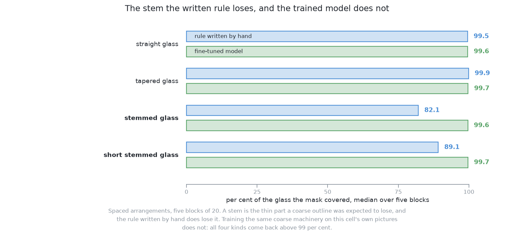

# Results and comparison

This page gives the results of this solution. It says what the trained model
scored, which of solution 3's failures training removed, and which it left. It
then places the solution beside the other five and lists its costs. It follows
[how the model is trained](03_how-the-model-is-trained.md). [The
examiner](../03_the-examiner/01_the-examiner.md) marked every number on it.

## Contents

1. [The results in the two kinds of arrangement](#1-the-results-in-the-two-kinds-of-arrangement)
2. [What training closed, and what it left](#2-what-training-closed-and-what-it-left)
3. [Where it sits among the other five](#3-where-it-sits-among-the-other-five)
4. [What it costs](#4-what-it-costs)

## 1. The results in the two kinds of arrangement

The last page ended with a trained model. This section gives the score that
counts, on arrangements the model never saw. The examiner marks two kinds of
arrangement. In **spaced** ones, the glasses stand as far apart as the cell's
rule asks. In **crowded** ones, they stand closer. Each kind is marked over five
blocks of 20 arrangements.

**This solution finds 99.4 glasses in every 100 when they are spaced, and 72.0
when they are crowded.** The five spaced blocks run from 99.0 to 100.0. The five
crowded blocks run from 70.8 to 72.9. So the numbers are stable. On the spaced
arrangements it misses 3 glasses out of 499. It splits one, which means it
reports one glass as two. The median place error, which is the middle value, is 6.6 mm on spaced
arrangements and 0.6 mm on crowded ones. Solution 3, the same model without
training, finds 6.4 and 2.1.

In the picture below, each mark is one block of 20 arrangements. The spread of
one solution's marks shows how much its score changes from block to block. The
distance between the two groups is what training gave.

The crowded score of 72.0 is not as low as it looks. Even perfect masks find
only 86.4 crowded glasses in 100, because the rest are fully hidden. [The
results](../11_the-results.md) explains this best possible score. In each
crowded block, the width check also rejects between 25 and 47 candidates. The
scorecard does not say which missing glasses these were. So this page does not
say either.

**The masks cover the whole glass and a little more.** For all four kinds of
glass, the middle mask covers 99.6 to 99.7 per cent of the glass. The two kinds
with a stem are not worse than the others. The single worst glass in all ten
blocks was a stemmed one, at 46.1 per cent. The rule written by hand, [solution
1](../05_rules-on-the-table/01_what-it-is.md), loses the stem. Its masks cover
82.1 per cent of a stemmed glass and 89.1 per cent of a short stemmed one. But
this solution pays for its coverage. In the middle mask, 4.6 per cent of the
pixels are not the glass. For the written rule this is 0.0.

These numbers show that training fixed some of solution 3's problems but not
all. The next section separates the two.

## 2. What training closed, and what it left

The score above is solution 3's score with training added. So this section reads
it against [why solution 3
failed](../07_a-borrowed-model-as-it-downloads/03_results-and-comparison.md#2-why-it-failed-the-names-it-reached-for).

**The domain gap closed.** Solution 3 learned on photographs but is shown grey
pictures shaded from depth. This model trained on the grey pictures themselves.
So that gap is gone.

**The naming failure closed.** Solution 3 called most glasses a sports ball or a
frisbee, and its name filter threw them away. With one class, there is no name
to get wrong. This one change explains most of the jump from 6.4 to 99.4.

**The rough edge stayed.** This kind of model builds each outline from a few
coarse pattern images. It mixes them, cuts the result at a threshold, and
enlarges it to the size of the picture. Training changes how the patterns are
mixed. It does not make the patterns finer. So the edge stays a little too
wide. This is the 4.6 per cent margin above. The examiner reads a glass's width
from that edge. The error goes the same way every time, so it does not average
out over many glasses.

**The partly hidden glass stayed.** The outline marks only the pixels the camera
saw. So for a glass partly behind another, the mask is a slice, and the examiner
reports a narrower glass. Training cannot fix this, because the labels have the
same limit. [What is asked for](../02_the-problem/01_what-is-asked-for.md)
describes this slice.

**The fully hidden glass stayed.** A glass that is fully covered leaves no pixel
to find. [Looking again at what was
hidden](../02_the-problem/02_looking-again-at-what-was-hidden.md) gives the
shared answer.

**The confidence number does not check the mask.** It comes from the same
weights as the outline. It says how sure the model is that a glass is there. It
does not say whether the outline is right. So a glass cut short by a neighbour
can still get a high score.

So training fixed the finding. It left the limits of the outline as they were.
The next section asks how this compares with the other ways of finding glasses.

## 3. Where it sits among the other five

The last section compared this solution with its untrained partner. This section
places it beside the other four. [The results](../11_the-results.md) puts all six
side by side, and it owns the full comparison.

**Against solution 3, only the training differs.** [What it
is](01_what-it-is.md#1-introduction) explains why the pair is a clean
measurement. So 6.4 against 99.4 on spaced arrangements is what fine-tuning
gave.

**Against [solution 1](../05_rules-on-the-table/01_what-it-is.md),** the rule
written by hand is as good or better almost everywhere. Its weak point is
separating glasses that touch. On crowded arrangements it finds about the same
number. But it merges many more glasses to get there. The rule also needs no
training set, no weights file and no licence.

**Against [solution 2](../06_a-network-trained-from-scratch/01_what-it-is.md),**
the question is borrowing against building. Solution 2 trains a small network
from random numbers, so the project owns every number in it. This solution
borrows a model and adjusts it. That needs less training. The price is a
downloaded file the project cannot rebuild, and its licence.

**Against [solution 5](../09_a-foundation-model-with-a-keeper/01_what-it-is.md),**
the question is how much to train. Solution 5 uses a larger model unchanged. It
trains only a small keeper that picks which outlines are glasses. This solution
trains the whole model.

**Against [solution
6](../10_a-transformer-segmenter-fine-tuned/01_what-it-is.md),** the question is
the model's design. Both are fine-tuned on this cell's pictures with one class.
So only the model differs.

Each of those comparisons weighs accuracy against cost. The last section lists
this solution's costs.

## 4. What it costs

The comparison above keeps coming back to cost. So this section lists it.

**At run time, very little.** One picture takes 0.089 seconds once the model is
loaded. One movement of the arm takes much longer than that.

**To build, one training run.** The marked run took 39 minutes on this machine's
built-in graphics. It used 225 pictures that the examiner labelled for free.
[How the model is trained](03_how-the-model-is-trained.md#6-what-the-run-did-and-what-it-produced)
gives the details. It also explains why a short run gives a model that finds
nothing.

**To keep, a weights file that matches the cell.** The file must be trained
again if the camera, the grey shading or the shape of the glasses changes. No
test of the code would notice an old file.

**The licence.** The model is AGPL-3.0, and so is the trained weights file made
from it. [How the model is
trained](03_how-the-model-is-trained.md#3-the-library-ultralytics) says why.
Nothing here is shipped or served, so this costs nothing in this book. Solution
6 uses a model under the Apache 2.0 licence, if a product needs one.

The next chapter is solution 5. It makes the opposite choice on how much to
train. It keeps a large borrowed model unchanged and trains only a small keeper
beside it.

← [How the model is trained](03_how-the-model-is-trained.md) · [SAM 2 with a keeper — what it is](../09_a-foundation-model-with-a-keeper/01_what-it-is.md) →
