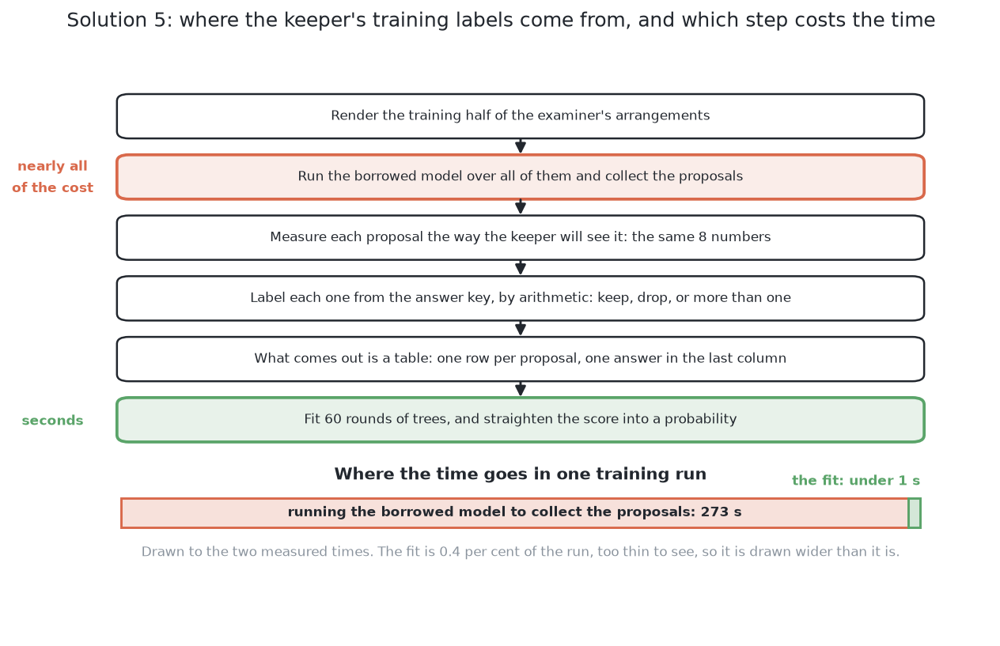

# What it is

> **What it uses.** It uses SAM 2, the second version of the Segment Anything
> model, at the `facebook/sam2.1-hiera-base-plus` size. It loads SAM 2 through
> Hugging Face `transformers` and never trains it here. It uses scikit-learn
> for one small model that is trained here. PyTorch runs underneath.
> **What it does.** SAM 2 draws an outline around whatever is at a point you
> give it. It does not name what it outlines. This solution gives it a grid of
> points over the whole picture. So it outlines everything: glasses, the table,
> a rim, and two glasses joined into one shape. A small model trained in this cell,
> called the **keeper**, then looks at each outline and decides if it is one
> glass.
> **What it costs.** No one labels anything by hand. Training the keeper takes
> under a second. Most of the time goes into running SAM 2. The [needs
> page](05_what-it-needs.md) gives the full bill.

> **The cell is described once, in [the cell](../01_the-cell.md).** This page
> covers only what is special to this solution.

## Contents

1. [Introduction](#1-introduction)
2. [The problem this solves](#2-the-problem-this-solves)
3. [The main idea](#3-the-main-idea)

## 1. Introduction

This chapter is for a reader who has read the shared pages on the cell, the
problem and the examiner. It describes solution 5. This solution does [the job
this book sets out](../02_the-problem/01_what-is-asked-for.md) with almost
nothing trained in this cell.

A very large model finds the shapes. Somebody else trained it on photographs of
the real world. Here it is used exactly as it downloads. Only the keeper is
trained here. The keeper looks at each shape and decides which shapes are
glasses.

The chapter answers these questions. What is a foundation model? How does a
grid of points make it outline everything? Why is it never trained here? What
does the keeper read, and why is it trained and not written by hand? Why does
it give three answers and not two?

The chapter also weighs a newer version of the same model. That version takes
a **word** instead of a point. You ask it for "drinking glass" and it returns
every glass. That would remove the keeper completely. [The second
way](03_how-it-works.md#6-a-second-way--a-word-instead-of-a-grid) explains why
this is not simply better.

The pictures show the whole run. The next section says which problem this
design is meant to solve.

## 2. The problem this solves

This section says why this design exists. The hard part of the task is to say
**how many glasses** there are. Two glasses can stand apart and still make one
joined shape in the picture. [What is asked
for](../02_the-problem/01_what-is-asked-for.md) explains this.

The other solutions pay for the answer in one of two ways. Solution 1 pays with
rules. A person must work out each rule and write it in code. Solutions 2, 4
and 6 pay with training. Each one makes a weights file that copies this cell.
That copy goes out of date when the cell changes, and no test of the code will
notice.

This solution tries to avoid both costs. It borrows weights that were never
trained on this cell, so they cannot go out of date. It also trains the one
decision that is left, so few rules are written by hand.

There is a catch. **A model that was never trained on this cell never saw this
cell.** It does not know about splay. It does not know that every glass is the
same kind. It does not know the gap between glasses. There is no way to tell
it.

The next section shows how the design deals with that catch.

## 3. The main idea

This section gives the one idea the rest of the chapter builds on. The idea is
to ask for everything first, and then throw away what is not a glass.

Asking for everything means a grid of points over the whole picture. The model
answers each point with the outline of the thing at that point. So a grid of
points gives an outline of everything.

Throwing away what is not a glass is the keeper's job. The keeper reads eight
measurements of one outline. It answers whether that outline is one glass. It
trains in under a second. Its examples cost nothing, because the examiner
already knows which pixels belong to which glass.

**The job is split along the line that transfers best.** A shape is a shape
everywhere. A jump in distance between a near surface and a far one looks the
same in a kitchen photo and in a grey depth picture. So the half that finds
shapes can be borrowed. Naming is different. Another team decided what counts
as a "cup" for their own photos. That has no reason to match what counts as a
glass here. So the naming half is replaced.

**This is the opposite of solution 3.** Solution 3 borrows both halves. It
takes the borrowed model's names as the answer.

[The code](02_the-code.md) shows the place where the two halves meet.

← [The same model, fine-tuned here — results and comparison](../08_the-same-model-fine-tuned/04_results-and-comparison.md) · [How it works](03_how-it-works.md) →
