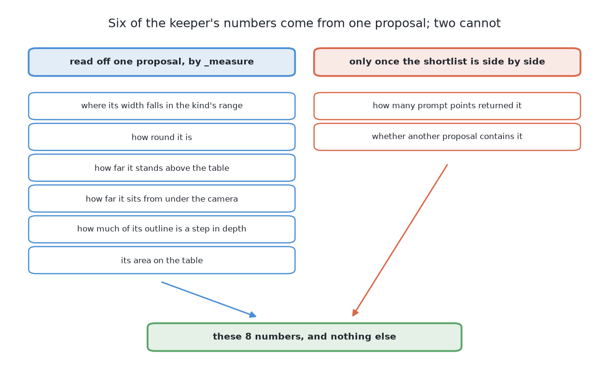

# The code

This page shows the code at the heart of this solution. It also says what the
solution hands back. It follows [what it is](01_what-it-is.md). [How it
works](03_how-it-works.md) explains each part of this code in more detail.

## Contents

1. [The code at the heart of it](#1-the-code-at-the-heart-of-it)
2. [The masks are what this contributes](#2-the-masks-are-what-this-contributes)
3. [Three things to hold on to](#3-three-things-to-hold-on-to)

## 1. The code at the heart of it

This solution is two models that meet at one place, so this section shows that
place. A grid of points goes into the borrowed model. A short row of
measurements comes out. That row is the only thing the keeper reads.

Going in, four steps in `05-sam2-with-a-keeper/sam_keeper.py` turn the kind of
glass into masks.

1. Measure the narrowest glass of that kind, in pixels. Divide that width so
   three points land across it. The result is the spacing of the grid.
2. Pick the rows and columns of the grid. Start half a step in from the edge.
   Pair every row with every column to get the list of points.
3. Wrap each point in its own prompt, so each point asks its own question.
   Scale the points to the size the encoder used. Move them onto the processor
   the model runs on.
4. Send the prompts into the borrowed model, 64 at a time. The model answers
   each point with three masks.

```python
def prompt_spacing(kind: str) -> int:
    ...
    # Step 1: how wide the narrowest glass is, in pixels -- the grid must catch the smallest one
    narrowest = data.widths(kind)[0] / _metres_per_pixel()
    # Step 1: divide it so three points land across that glass -- that is the grid's spacing
    return max(1, int(narrowest / POINTS_ACROSS_SMALLEST))

def _grid(spacing: int, inside: np.ndarray | None = None) -> list[list[float]]:
    """Prompt points (column, row) on a regular grid, optionally only where ``inside`` is true."""
    # Step 2: pick the rows and columns of the grid -- it starts half a step in from the edge
    rows = np.arange(spacing // 2, render.HEIGHT, spacing)
    columns = np.arange(spacing // 2, render.WIDTH, spacing)
    # Step 2: pair every row with every column -- this is the list of points to prompt with
    points = [[float(column), float(row)] for row in rows for column in columns]
    ...

    def at(self, points: list[list[float]]) -> tuple[np.ndarray, np.ndarray, np.ndarray]:
        ...
        # Step 3: wrap each point in a prompt of its own -- not one prompt holding every point
        asked = [[[point] for point in points]]
        # Step 3: scale the points to the size the encoder saw -- the pixels are not read again
        prepared = self.processor(original_sizes=self.sizes, input_points=asked, return_tensors="pt")
        # Step 3: move the points onto the model's processor -- and into a type it will take
        all_points = _onto(prepared["input_points"], self.where)
        ...
            # Step 4: send the prompts 64 at a time -- all their masks at once need too much memory
            for start in range(0, all_points.shape[1], PROMPTS_AT_ONCE):
                chunk = all_points[:, start : start + PROMPTS_AT_ONCE]
                # Step 4: ask the borrowed model for masks -- three per point, encoder already run
                out = self.model(image_embeddings=self.embeddings, input_points=chunk, multimask_output=True)
```

Coming out, one more step in the same file turns a cleaned-up region into
numbers measured on the table.

5. Take the pixels the region covers and turn them into real points on the
   table. Find the one-pixel ring just inside the mask, which is its outline.
   Return six numbers.

```python
def _measure(picture, mask, found, jumps, step, camera, widths) -> list[float]:
    ...
    # Step 5: take the rows and columns of the footprint's pixels -- places in the picture
    rows, columns = found.pixels[:, 0], found.pixels[:, 1]
    # Step 5: turn those pixels into real points on the table -- not pixels in a picture
    points = render.to_world(picture, rows, columns)

    low, high = widths
    # Step 5: find the one-pixel ring just inside the mask -- where a depth step would show
    edge = mask & ~cv2.erode(mask.astype(np.uint8), np.ones((3, 3), np.uint8)).astype(bool)
    # Step 5: hand back the six numbers -- six of the eight the keeper reads; two come later
    return [
        (found.width - low) / (high - low),  # where its width falls in the kind's range
        _roundness(mask),
        float(np.median(points[:, 2]) - TABLE_TOP_Z),  # how far its surface stands off the table
        float(math.dist((found.x, found.y), camera)),  # how far it sits from under the camera
        float(np.mean(jumps[edge] > step)) if edge.any() else 0.0,  # how much of its edge is a step
        _table_area(points),
    ]
```

This function returns six numbers, but the keeper reads eight. The other two
need the whole shortlist, not one region. One is how many grid points returned
the same mask. The duplicate removal counts this. The other is whether one
region contains another, which is a fact about a pair. The function
`_proposals` adds both, because it holds the whole shortlist.



Two things show in this code. The borrowed half is one call, `self.model(...)`,
on a `Sam2Model` from Hugging Face `transformers`. Every line around it belongs
to this project. The trained half never sees a pixel. It is a scikit-learn
`HistGradientBoostingClassifier` inside a `CalibratedClassifierCV`, and it
reads only the list of numbers.

The next section says what all this code hands back.

## 2. The masks are what this contributes

The code above gives masks, so this section says what happens to them next. The
examiner turns every solution's masks into places and widths in the same way.
So any difference in score comes from the mask. No model here gives a pose.
[What must come back](../03_the-examiner/01_the-examiner.md#6-what-must-come-back)
explains both points.

The last section picks out three points to remember from this page.

## 3. Three things to hold on to

This section sums up the page in three points, before the next page explains
each part.

**The keeper is the only trained part.** It reads numbers, not pictures. The
part that finds shapes is borrowed and knows nothing about this cell.

**The shading is the riskiest step.** It turns depth into a grey picture. It is
the one choice that changes what every later step sees, and no check can catch
a bad choice.

**The width check comes after the keeper.** So a wrong "keep" must still pass a
rule that nobody trained. A wrong keep becomes a doubtful report, not a wrong
glass.

← [What it is](01_what-it-is.md) · [How it works](03_how-it-works.md) →
