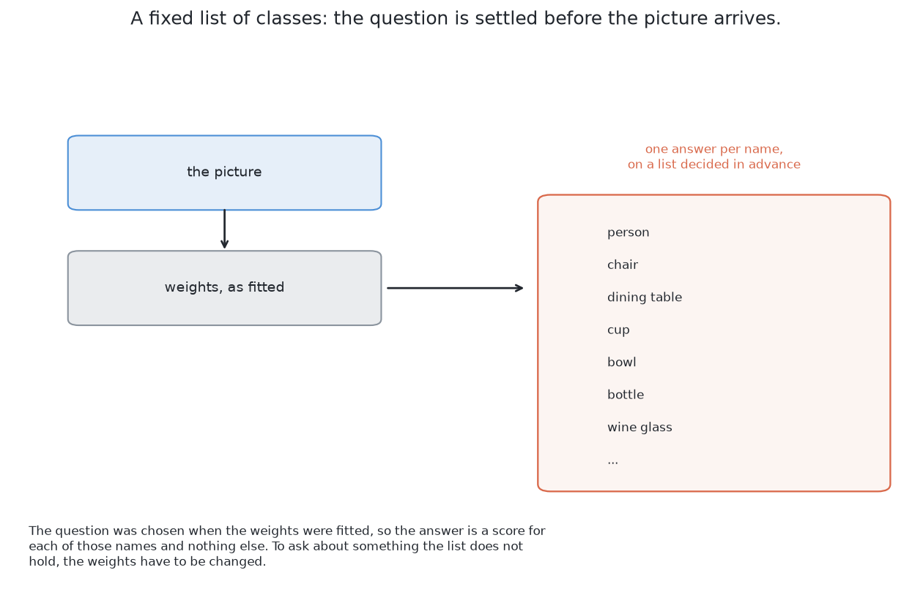
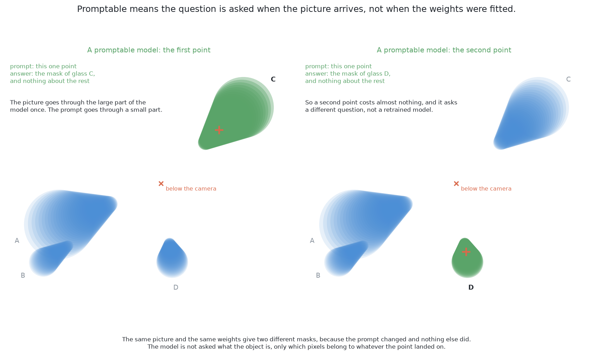
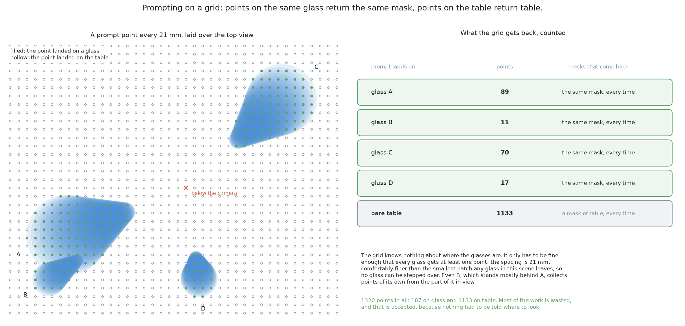
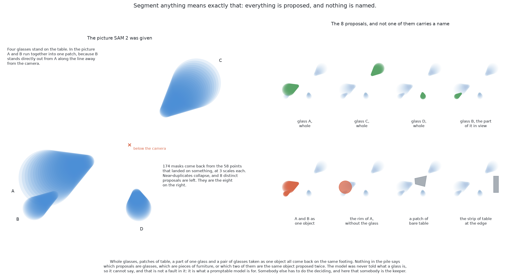
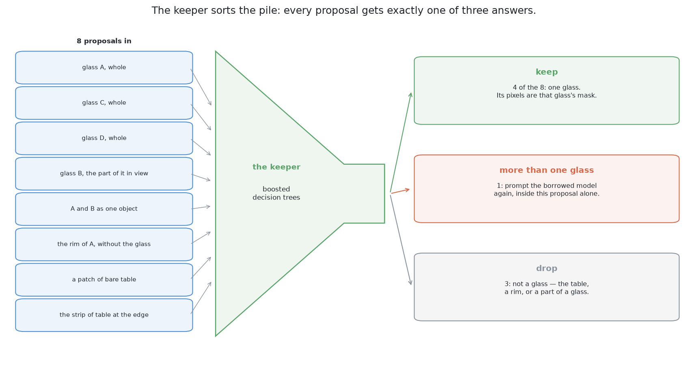
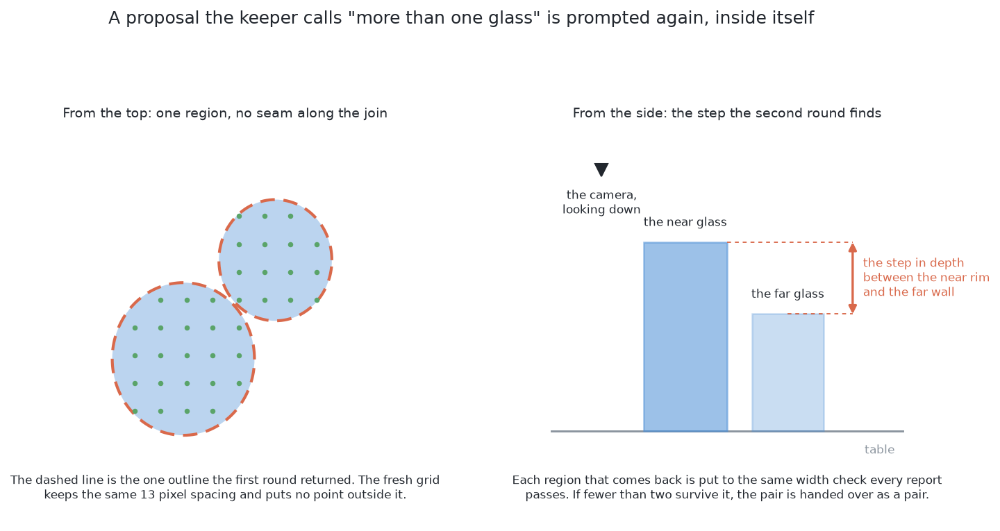
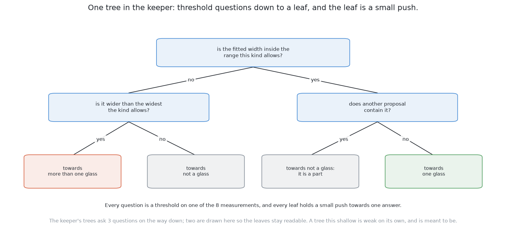
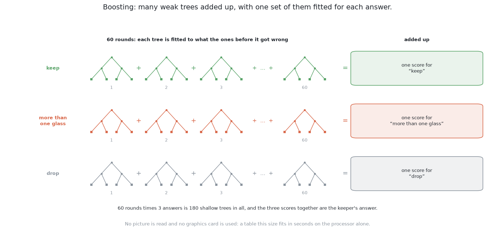
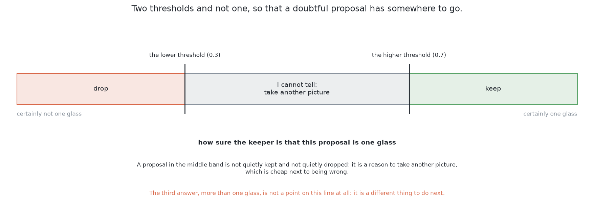

# How it works

This page explains each part of this solution in turn. It follows [the
code](02_the-code.md) and says what each part of that code does.

## Contents

1. [What a foundation model is](#1-what-a-foundation-model-is)
2. [Turning a promptable model into a proposer of everything](#2-turning-a-promptable-model-into-a-proposer-of-everything)
3. [Why the borrowed model is never trained here](#3-why-the-borrowed-model-is-never-trained-here)
4. [The picture the borrowed model is handed](#4-the-picture-the-borrowed-model-is-handed)
5. [The keeper](#5-the-keeper)
6. [A second way — a word instead of a grid](#6-a-second-way--a-word-instead-of-a-grid)

## 1. What a foundation model is

Everything this solution gains and risks comes from the borrowed model, so this
section defines it first.

A **foundation model** is a model trained once, on a huge and general set of
data. The training costs so much that nobody expects to repeat it. People then
use the model for many tasks it was not trained for. A big company does the
training. Everybody else just downloads the result.

One fact about SAM 2 makes it usable here. **It is class-agnostic.** This means
it returns regions with no names attached. It has no list of object types, so
it never needs the word "glass". It was trained on everyday photos, not on this
cell, but that alone does not rule it out.

SAM 2 has three parts. A **picture encoder** turns the whole picture into a
block of numbers. This part is slow, but it runs only once per picture. A
**prompt encoder** turns one prompt into a small block of numbers. A **mask
decoder** joins the two and gives a mask. This part is fast, and it runs once
per prompt.

### What promptable means

SAM 2 is called *promptable*. This is not the same as an ordinary network that
takes a picture and returns an answer.

An ordinary network has a **fixed list of classes**. That is a list of names
chosen before training. The network answers one question only: how strongly
does this picture show each name on the list? To ask about anything else, you
must train it again.

A **prompt** is a small extra input. It says *which* thing in the picture you
mean. For SAM 2 it can be a point ("the thing here"), a box ("the thing inside
this rectangle") or a rough mask. The picture and the prompt go in together,
and one mask comes out. Change the prompt and you get a different mask from the
same weights. In programming terms, the model is a function of two arguments.

A prompt can also be unclear, and the model does not guess. A point on the wall
of a glass could mean that patch of wall, the whole glass, or the glass and
whatever stands behind it. So for one point the model returns three masks: about
a part, a whole and something larger. Each mask comes with a score for how good
it is. This is why the shortlist later holds a rim without its glass. It also
gives the keeper choices to pick from.

**A prompt selects. It does not add information.** A point says which part of
the picture you mean. It cannot tell the model about something the picture does
not show.

The next section uses prompts to make SAM 2 find objects by itself.

## 2. Turning a promptable model into a proposer of everything

The last section showed that one prompt gives one thing. So many prompts give
many things. This section uses that to make SAM 2 find objects without help.

The design lays a regular grid of points over the picture from the top. It
prompts once at every point. The grid aims at nothing on purpose. Nothing has to
know where the glasses are before they are found. Each point returns whatever is
under it. Bare table returns the table. A glass wall returns the wall, the glass
and something larger.

The only number to choose is how fine the grid is. It comes from the kind, not
from tuning. The code puts three points across the narrowest glass of the kind.
On a 320 by 240 picture, that is a point every 9 pixels for the straight glass.
That gives 972 prompts. For the tapered glass it is every 13 pixels, which gives
450 prompts. A glass cannot fall between the points of a grid this fine. The
picture below shows the tapered kind's grid.

The grid is cheap because of the three parts named above. The slow picture
encoder runs **once**. Each prompt after that is one pass through the fast mask
decoder.

### What comes back, and the cleanup that is not fitted

What comes back is a heap of masks, not a list of objects. The heap has three
problems. Many points land on the same glass, so the same region comes back many
times. One point returns a part, a whole and something larger. Some masks are
unstable, which means the model is unsure where the edge is.

The cleanup uses standard steps, and none of them is trained.

- **Drop low-scoring masks.** The model gives each mask a quality score. Here it
  must reach 0.8.
- **Drop unstable masks.** The code moves the yes-or-no cut-off up a little and
  then down a little. It keeps a mask only if the small version is at least
  0.92 of the large one.
- **Remove duplicates.** This step is called **non-maximum suppression**. Sort
  the masks by score. Keep each mask in turn. Throw away any later mask whose
  overlap with a kept mask is more than 0.7. The **overlap** of two masks is the
  area they share divided by the area either one covers. It is one for the same
  mask and zero when they share nothing.

The quality score and the stability are used only here. The keeper never sees
them. The keeper must decide what a region *is*, not how sure SAM 2 was.

After the cleanup there is a shortlist of regions. **None of them has a name.**
Nothing says which ones are glasses or which one is the table. Nothing says that
a wide joined shape is two glasses.

So SAM 2 says *where the regions are*. The task asks *which regions are
glasses, and how many*. The next section explains why training SAM 2 is not
used to close that gap.

## 3. Why the borrowed model is never trained here

The last section left a gap between regions and glasses. The obvious fix is to
train SAM 2. This solution does not. **Never trained** means the weights are
used exactly as they download. No layer is changed, and nothing about this cell
reaches the weights.

Four things follow from this.

- **No picture training set is needed.** The keeper still needs some
  arrangements, but it learns from a short table of numbers, not from pictures.
- **Nothing can go out of date.** SAM 2 never saw this cell. Solutions 2, 4 and
  6 are the opposite. Their weights record the cell as it was on the day they
  were trained.
- **It cannot learn the renderer's habits**, so it does not need the random
  changes a model trained here needs.
- **Setting it up is a download**, not a training run.

There is one big cost. **There is no way to teach it anything.** It does not
know about splay or the single kind. It does not know the gap between glasses
or the range of sizes. So every problem special to this cell must be handled before SAM 2 or
after it. Before it, we choose the picture it gets. After it, the keeper
decides. The next two sections cover those two places.

Freezing a big model and training something small behind it is common practice.
[The general ideas behind this](06_how-it-compares.md#3-the-general-ideas-behind-this)
gives the papers.

## 4. The picture the borrowed model is handed

The last section said the picture is one of only two places we can act. This
section covers that picture, which is the riskiest choice in the design.

The examiner gives a depth reading at every pixel, and no colour. SAM 2 was
trained on colour photos. So the shared shading in `bench/pictures.py` turns
each distance into a grey value. It copies that grey into all three colour
channels. SAM 2 sees a picture of distances made to look like a photo.

This difference between the photos a model was trained on and the pictures it
gets is called a **domain gap**. Solution 3's chapter explains it in full, in
[why it failed](../07_a-borrowed-model-as-it-downloads/03_results-and-comparison.md#2-why-it-failed-the-names-it-reached-for).
Four things differ here.

- **Brightness means distance.** In a photo, a change in brightness is usually
  a change of material, a shadow or a shine. Here it is only a change in
  distance. The two agree at a glass's outline and almost nowhere else.
- **There is no texture**, so a model that relies on texture finds none.
- **Glass does not look like glass.** In a photo it is clear. Here it is drawn
  as an opaque solid with a clean outline. That helps, because the glasses here
  are opaque anyway, but this help is luck, not design.
- **A ray that hit nothing has no distance**, so the shading must make up a
  brightness for it.

The shading handles the first point and leaves the rest. It stretches each
picture's greys over the depths that picture holds. So the nearest rim and the
farthest table get the two end values, and a glass outline is the strongest edge
in the picture. It gives rays that hit nothing their own value, darker than any
real surface. Two fixes were not tried. One is to shade by the slope of a
surface as well as its distance, so a curved wall looks curved. The other is to
fill holes in the table from their neighbours.

The shading does not close the gap. It only makes the picture more like a
photo. The results show where it falls short, and this depends on the kind of
glass. Over the five blocks of spaced arrangements, the masks cover these shares
of each glass:

- tapered: 99.1 per cent
- straight: 97.6 per cent
- short stemmed: 89.0 per cent
- stemmed: 85.9 per cent

A stem is thin, so it makes almost no outline in a depth picture. The mask loses
the foot and the thin stem beside it. [The written rule loses the same
part](../11_the-results.md#3-what-the-numbers-mean) for the same reason. This
solution cannot fix that, because nothing here is trained. Solutions 4 and 6
can, because their weights learn from this cell's own pictures.

The next section turns to the other place we can act, after SAM 2.

## 5. The keeper

The last two sections showed that SAM 2 cannot be taught and its input can only
be improved a little. So the keeper must do the deciding. It runs once for each
region left after cleanup. It reads eight numbers about that region. It returns
how likely the region is to be exactly one glass.

### What the keeper is shown

The keeper is not shown pixels. The useful facts are not in the pixels. They are
in what the pixels mean on the table. Each pixel has a depth reading, because
the glasses here are opaque. So each region becomes a set of points in the room.
Those points give a middle, a width and a height above the table.

The table below lists the eight numbers in the order the code uses. The right
column says why each one helps decide "is this one glass?".

| What the measurement says | Why it bears on the question |
| --- | --- |
| where the measured width falls in the range this kind allows | the kind's range of widths is known, so a width outside it is not one glass of this kind |
| how round it is, its own area against the area its outline could enclose | a glass seen from the top is a filled disc whatever the splay, while a rim is a ring and a joined pair has a waist |
| how far its surface stands above the table | a proposal lying at the table's own height is the table |
| how far it sits from the point directly below the camera | splay grows with that distance, so the same glass gives a different proposal near the camera and far from it |
| how many prompt points returned this same mask | a region the grid agreed on many times is firmer than one a single prompt found, and the duplicate removal has already counted it |
| how much of its outline is a step in depth rather than a smooth run | a thing standing on the table ends where the depth jumps to the table behind it, while an outline running smoothly across one surface is a boundary the cut-off drew |
| its area on the table, in square millimetres | the table stands over far more of itself than any glass of this kind can cover |
| whether another proposal contains it, or it contains one | a proposal inside a legal glass is a part of that glass, and the glass is the proposal that holds it |

The last number is the **containment** count. A hand-written rule usually
forgets it. It is how a part shows itself. A rim lies fully inside a larger
region whose width is fine for the kind. So this one count tells a part from
the whole glass.

All eight numbers are **lengths, counts or ratios. None is a place in the
picture.** This is required. The camera is on the wrist and visits three
stations. The same glass appears at a different pixel place in each picture.
But its width, roundness and height are the same from every station. If the
keeper read pixel places, it would learn where the camera stood during training.
It must not learn that. Only one number is about the camera: the distance from
the point below it. That is on purpose, because this distance tells how much
splay to expect.

One worry comes up here. From the top, the **mouth** of a glass is a filled
disc the same size as the glass. It has a legal width, it is round, and it
stands above the table. So the keeper may keep it as one glass. This does not
add a glass to the count. The mouth sits at the same place as its glass, and
[the rule of one report per place](#the-arithmetic-still-decides) joins the two.

### Why the keeper is fitted rather than written

Each of the eight numbers could have a written threshold instead. So this
section gives three reasons to train the keeper.

**First, the evidence is weak in many small pieces.** No single number decides.
A region about one glass wide, fairly round and above the table may be one
glass. It may also be the near part of two glasses, or a mouth. A written
threshold cuts on one number at a time. A trained model can combine them. For
example, it can learn that a width near the top of the range matters only when
roundness is low. Writing a cut for every such mix by hand would grow too large
to maintain.

**Second, this solution's purpose is to write as little as possible.** A page
of thresholds would be a programmed solution, and [solution
1](../05_rules-on-the-table/01_what-it-is.md) already is one.

**Third, the labels are free.** The examiner's answer key says which glass owns
each pixel. So labelling a region is simple arithmetic. A region *holds* a glass
when more than half of that glass is inside it. A region counts at all only when
more than half of it is covered by the glasses it holds. This stops the whole
table from being called "more than one glass". Then:

- holding one glass means "one glass";
- holding none means "not a glass";
- holding two or more means "more than one glass".

No person labels anything, so there are no labelling mistakes. Labels are made
only on the training arrangements.

### Three answers, not two

The labels above have three values, and the third one matters. In this cell, a
region that covers two glasses is the usual way to be wrong. So the keeper gives
three answers.

**Keep** means the region is one glass. Its pixels become that glass's mask.

**Drop** means the region is not a glass. The table, a rim and an unstable
region are all dropped.

**More than one glass** is handled, not thrown away. SAM 2 is prompted again,
with a new grid only inside that region. This can work where the first grid
failed. When one glass stands in front of another, the near rim is much closer
to the camera than the far wall. SAM 2 can find that jump in depth. The new
regions go through the same checks as every other report. If at least two pass,
they are reported as two glasses.

If fewer than two pass, the region is **reported as an unseparated pair**, with
its reason. It goes to [the job of pushing the glasses
apart](../../09_pushing-the-glasses-apart/01_the-problem/01_what-is-asked-for.md).
That is not a failure. This project reports anything doubtful and never
guesses. Over the five blocks, this happened twice on the crowded set and never
on the spaced set.

### What kind of model the keeper is

The keeper reads a short table of mixed numbers and picks one of three answers.
**Gradient-boosted decision trees** were made for this kind of task (Friedman,
*Greedy Function Approximation: A Gradient Boosting Machine*, Annals of
Statistics, 2001). scikit-learn provides them as
`HistGradientBoostingClassifier`.

A tree asks a series of threshold questions, one per step. Each question is a
cut on one of the eight numbers. The last step is a leaf. Each leaf gives a
small push towards one of the three answers.

Boosting trains one weak tree. Then it trains the next tree on the mistakes of
the first. Then it adds them up. Here there are 60 rounds of trees, each three
questions deep. There is one set per answer, so there are 180 small trees in
all.

Trees suit this table for three reasons. They do not care that a length and a
ratio are on different scales. They find combinations of conditions by
themselves. And a table this size trains in well under a second on an ordinary
processor.

**This is the only one of the six solutions where a simple, classical model
does the deciding.** So its decisions can be explained. Its inputs are eight
named numbers. You can print them next to its answer, and a person can read
them and argue with them.

### Calibration, and why the probability needs it

The keeper gives a probability. A threshold will be put on it, so first the
probability must mean what it says.

A probability is **calibrated** when its claims come true about as often as it
says. Among regions it scores very high, nearly all should be one glass. Among
regions it scores in the middle, only some should be. Boosted trees push their
scores towards 0 and 1. So a raw score of 0.9 does not mean nine in ten such
regions are glasses.

A threshold on a score that means nothing is just a knob somebody turned. So a
small correction from raw score to honest probability is trained with the
keeper. It is trained in **folds**. The table of regions is cut into three
parts. Each part in turn is held back. The trees train on the other two parts,
and the correction trains on the part held back. So the correction never sees
rows the trees were trained on. Otherwise it would learn the keeper's
over-confidence instead of fixing it.

The shape of the correction depends on the amount of data. A free-form
staircase is used only when the rarest answer has 200 rows. Below that, a curve
with two parameters is used. The scored run had far fewer rows, so it used the
curve.

**This has one weakness that the results will not show.** The folds cut the
table row by row. One arrangement gives many rows. So rows from the same glasses
can fall on both sides of a fold. Those rows are not independent. The
correction therefore sees an easier test than a new arrangement, and the
probability comes out a little too kind. The fix is to cut folds by arrangement,
not by row. It is cheap, but the code does not do it yet.

With a calibrated probability, the keeper uses **two thresholds**. Above 0.7,
the region is kept. Below 0.3, it is dropped. In between, the answer is "I
cannot tell". Such a region is neither kept nor dropped. It is a reason to take
another picture from another place. That costs arm time, but it is cheaper than
being wrong. A glass half hidden behind another should fall in this band. Its
mask is a sliver, so it is too narrow or not round enough. The band is wide in
practice. Over the five blocks of spaced arrangements, 634 regions fell in it.
Only 85 glasses were missed altogether.

### The arithmetic still decides

The keeper's answer is not the last word. One rule from solution 1 stays, and it
keeps this solution as safe as the others.

A region the keeper wants to keep still has its width checked against the kind.
If the width is outside the kind's range, the region is **not reported as a
glass**. It becomes a doubtful report with its reason.

**There is one exception, about the picture rather than the region.** One
picture does not hold the whole glass zone. So a glass at the edge of the frame
shows only part of itself. Its measured width is only part of its width. This
was tested with the examiner's own exact masks, one station at a time, over 20
held-out arrangements. The width check refused 66 of 297 glass sightings, and
**every one of those 66 touched the frame edge**. So the check is not applied
to a region that touches the edge. The survey handles those instead. The cell
looks from three overlapping stations, and [the examiner keeps the report from
the nearest station](../03_the-examiner/04_comparing-the-outputs.md#3-which-report-the-examiner-keeps).
With this exception, the width check refuses almost nothing. Over the five
blocks it refused 4 reports on the spaced set and 8 on the crowded set.

A second rule settles what the width check cannot. **Two reports at one place
are one glass reported twice.** Two glasses of one kind standing side by side
have centres at least the narrowest width apart. So if two reports are closer
than that, only the surer one is kept. This comes from the cell's geometry, not
from tuning. It is what stops a mouth and its glass from counting as two.

So SAM 2 proposes, the keeper sorts, and the geometry has the final say. A
trained part chooses among regions. A rule that nobody trained decides if the
choice is believable. This is what makes such a foreign model safe to use here.

The last section looks at a newer model that would remove the keeper.

## 6. A second way — a word instead of a grid

The keeper exists because SAM 2 cannot name things. This section looks at a
newer model that can, and asks if it should replace the keeper.

SAM 3 takes an **open-vocabulary text prompt**. This means the prompt is a
phrase, not a point, and the phrase can be anything. The model returns every
instance of what the phrase names. So one request for "drinking glass" could
replace the grid, the shortlist and the keeper. Nothing would be trained in
this cell. The code for it is in `sam3_words.py`, written against the library's
documented interface.

This loses the main strength of this solution. The keeper's decisions can be
explained by printing its inputs. A text prompt moves the decision inside
borrowed weights that nobody here can inspect. When it misses a glass, there is
nothing to print. The only thing left to do is to try another phrase. It also
makes this solution more like solution 3, because both would then rely on
somebody else's idea of a glass.

**It has not been run.** SAM 3's weights are gated, and this machine's account
has not been given access. So this way has no scores, and none has been made
up. [What it needs](05_what-it-needs.md) says how the licences of the two
versions differ.

← [The code](02_the-code.md) · [A worked example](04_a-worked-example.md) →
