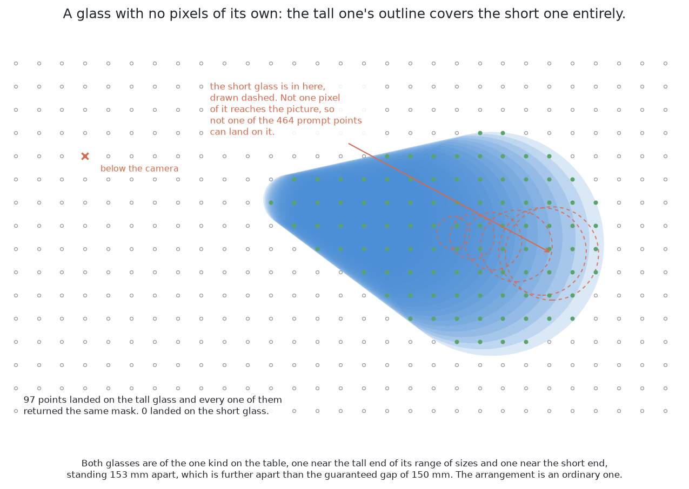
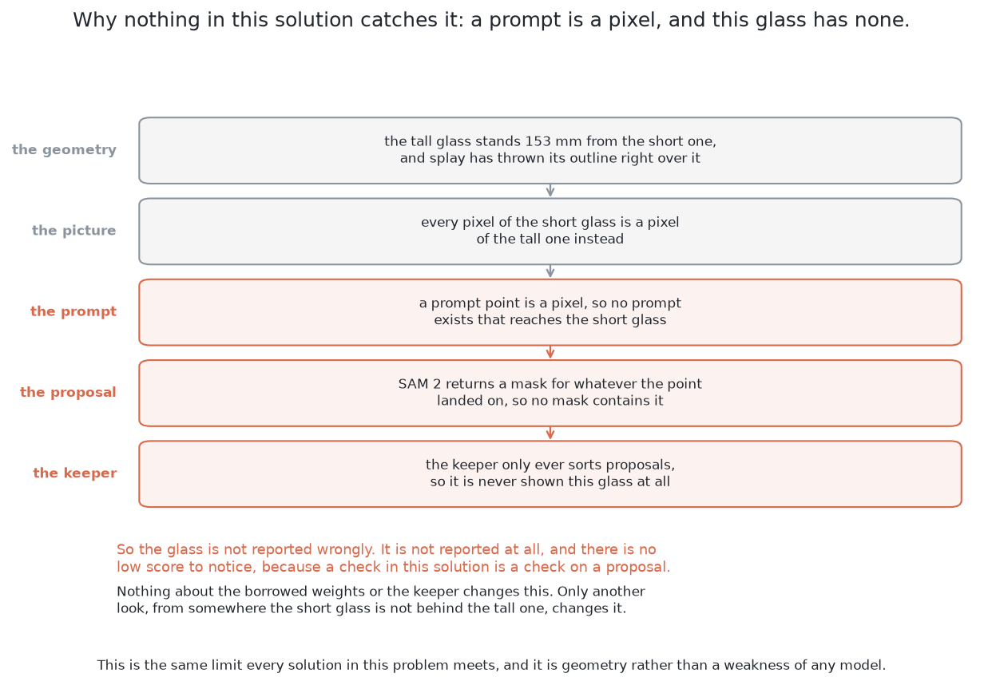

# A worked example

This page follows this solution through one real picture, with the numbers the
code prints. First it looks at a glass that is completely hidden. An example
that shows only the easy case would teach the wrong lesson.

## Contents

1. [When the glasses are completely hidden](#1-when-the-glasses-are-completely-hidden)
2. [What the keeper was shown, and what it answered](#2-what-the-keeper-was-shown-and-what-it-answered)

## 1. When the glasses are completely hidden

This section starts with the case no picture method can solve, so you know the
limit before the success. A fully hidden glass adds no pixel to any picture.
[Looking again at what was
hidden](../02_the-problem/02_looking-again-at-what-was-hidden.md) explains why,
and how the cell goes back to look. Here we only follow this solution.

**The keeper is never asked.** Any prompt over the hidden glass lands on the
glass that covers it. SAM 2 returns the covering glass, and that answer is
correct. More prompts do not help, because [a prompt selects and does not add
information](03_how-it-works.md#1-what-a-foundation-model-is). With no region
for the hidden glass, the keeper has nothing to judge.

The first picture shows the arrangement from above. The short glass stands
fully inside the tall glass's outline. So none of the 464 prompt points can land
on it.



The second picture follows this step by step. It shows that no step could have
noticed the hidden glass.



You might hope that a foundation model can handle this. It is good with objects
it never saw before. But here the object is not new. It is **absent**. There is
no evidence of any kind to work with.

The next section looks at a picture where the evidence is there, and at what
the keeper does with it.

## 2. What the keeper was shown, and what it answered

The last section showed where the keeper is never asked. This section shows the
keeper at work. `show_keeper.py` prints, for each region in one picture:

- the eight numbers the keeper read;
- the three calibrated chances it gave;
- what the width check did next;
- what the simulator says the region really was.

Below is its output on held-out arrangement 10000, from the first of the three
stations. Five straight glasses stand on the table. The grid has 972 points, and
six regions are left after cleanup. Here are the first two.

```
proposal 1: 63070 pixels at (0.434, -0.347) m, 585 mm wide
          12.002  how wide the circle fitted to it is, against the range this kind allows
           0.357  how round it is: its area against the area its outline could enclose
           0.000  how far its surface stands above the table, from the depth reading
           0.047  how far it sits from the point directly below the camera
         813.000  how many prompt points returned this same mask
           0.245  how much of its outline is a step in depth rather than a smooth run
      165557.845  its area on the table, in square millimetres
           0.000  whether another proposal contains it, or it contains one
              ->  not a glass, from not a glass 0.73, one glass 0.16, more than one glass 0.11
              so  dropped
       the truth  not a glass

proposal 2: 4270 pixels at (0.574, -0.396) m, 67 mm wide
           0.484  how wide the circle fitted to it is, against the range this kind allows
           0.886  how round it is: its area against the area its outline could enclose
           0.164  how far its surface stands above the table, from the depth reading
           0.103  how far it sits from the point directly below the camera
          59.000  how many prompt points returned this same mask
           1.000  how much of its outline is a step in depth rather than a smooth run
        3708.171  its area on the table, in square millimetres
           0.000  whether another proposal contains it, or it contains one
              ->  keep, from not a glass 0.01, one glass 0.85, more than one glass 0.14
              so  reported as a glass
       the truth  one glass
```

**The first region is the table**, and all eight numbers agree.

- A straight glass is 45 to 90 mm across. The first number places the width in
  that range: 0 is the narrowest glass and 1 is the widest. So 12.002 means
  585 mm, about twelve glasses wide.
- It lies at the table's height, to the nearest millimetre.
- It is not very round, because the glasses cut bites out of it.
- It covers 165,557 square millimetres, which is four fifths of the picture.
- 813 of the 972 points returned it, because most points land on bare table.

The keeper gave it 0.73 for *not a glass*. Its chance of *one glass* was 0.16,
below the lower threshold of 0.3, so it was dropped.

**The second region is one glass**, and the numbers show the contrast.

- Its width is 67 mm, just under half way up the range.
- It is 0.886 round, which is close to a filled disc.
- Its surface stands 164 mm above the table.
- Its whole outline is a step in depth, as for a thing standing on a table.
- It covers 3,708 square millimetres.

The keeper gave it 0.85 for *one glass*, above the upper threshold. It then
passed the width check and was reported.

The last line of each block shows the truth from the simulator. Here the keeper
agreed with it both times. The line is there so that a disagreement would be
printed, not hidden. The whole decision is eight named numbers, three chances
and an answer. A person who disagrees can point at the wrong number.

One station's printout does not show the rest of the chain. A region answered
"more than one glass" is prompted again inside itself. A region between the two
thresholds becomes a reason to take another picture, and that is common. When
two reports fall at one place, only the surer one stays. [The
keeper](03_how-it-works.md#5-the-keeper) explains all three.

One picture took about eight seconds on this machine. [What it
needs](05_what-it-needs.md) gives the full cost, and it is the next page.

← [How it works](03_how-it-works.md) · [What it needs](05_what-it-needs.md) →
