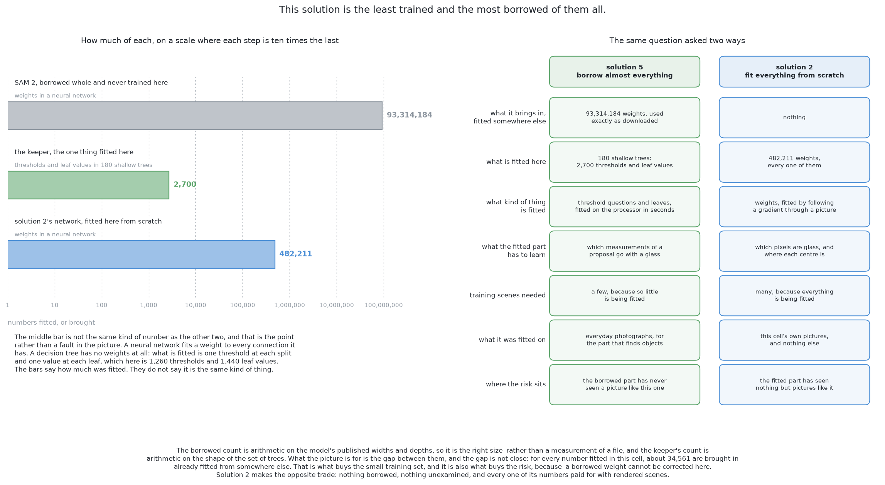

# How it compares

This page judges this solution. It gives its scores, its strengths and its
weak points. It names the general ideas behind it and places it beside the
other five.

## Contents

1. [What it scored](#1-what-it-scored)
2. [Where it is strong and where it breaks](#2-where-it-is-strong-and-where-it-breaks)
3. [The general ideas behind this](#3-the-general-ideas-behind-this)
4. [Where it sits among the other five](#4-where-it-sits-among-the-other-five)

## 1. What it scored

A judgement starts with the numbers, so this section gives them first. The
examiner ran each solution over five blocks of 20 held-out arrangements. It did
this once with the cell's normal spacing and once with crowded layouts. The
table gives counts per 100 glasses, averaged over the five blocks. The numbers
in brackets are the lowest and highest block. [The
results](../11_the-results.md) give the table for all six.

| | found per 100 | missed | merged | split | place | mask covered | mask not the glass |
|---|---|---|---|---|---|---|---|
| spaced | 83.0 (78.0–86.1) | 17.0 | 0.0 | 0.2 | 5.6 mm | 97.2% | 0.0% |
| crowded | 73.6 (71.9–76.6) | 26.4 | 0.0 | 0.0 | 0.8 mm | 98.3% | 0.0% |

**The last three columns matter most.** Over 200 arrangements it merged nothing
and invented nothing. The median mask held no pixel of a neighbour or of the
table, on either set. The keeper's three answers, its "cannot tell" band and the
width check did this. A doubtful case became a dropped region or a handed-over
report, not a wrong glass. The price is in the first column. About one glass in
six on the spaced set was not found.

**Look at the brackets too.** The spaced blocks ran from 78.0 to 86.1. So one
block alone could have given any score in a range eight glasses wide. The
brackets do show one thing. The crowded set is really harder for this solution.
Its best crowded block, 76.6, is below its worst spaced block, 78.0.

The scores show what happened. The next section says why.

## 2. Where it is strong and where it breaks

This section explains the scores above by the design's strengths and weak
points.

Its strengths are these.

- **Almost nothing is trained here, and the keeper can be read.** The borrowed
  part cannot go out of date. The keeper trains in under a second, and its
  inputs are eight named numbers. [The
  keeper](03_how-it-works.md#what-kind-of-model-the-keeper-is) explains why this
  makes its decisions easy to explain.
- **It needs the least data of the four that train anything.** Twelve
  arrangements gave 208 rows. Solution 2 trains on 200 arrangements, and
  solution 6 on 120.
- **It splits the job along the line that transfers.** [The main
  idea](01_what-it-is.md#3-the-main-idea) explains this.
- **It notices things nobody described.** The grid proposes every region. So a
  spoon left on the table becomes a region, and the keeper answers "not a
  glass". The other solutions know only one class, so they do not see the spoon
  at all.
- **Its doubt is cheap and open.** Three answers, two thresholds, a width check
  and one report per place all turn a wrong answer into a doubtful report. The
  zeros in the last three columns come from this.

Its weak points are not small.

- **The domain gap is the largest risk, and it cannot be closed from inside.**
  The masks cover stemmed glasses worst. [The picture the borrowed model is
  handed](03_how-it-works.md#4-the-picture-the-borrowed-model-is-handed) gives
  the numbers by kind. Only the shading and the grid can be changed, because
  nothing is trained.
- **It cannot be taught this cell's hard cases.** Examples are glasses
  closer than the rule allows, glasses that touch, and a half-hidden glass.
  Solutions 2, 4 and 6 can train on these. SAM 2 cannot be told about them.
- **It finds only boundaries.** Two glasses joined with no visible seam come
  back as one region. A rule that follows joined pixels would join them for the
  same reason.
- **It needs depth twice.** The keeper's best numbers come from depth. The
  picture itself is shaded depth. With real clear glass the depth camera sees
  nothing, so this solution would have no input at all.
- **It cannot see a glass that is completely hidden.** [The worked
  example](04_a-worked-example.md#1-when-the-glasses-are-completely-hidden)
  shows why. This is a fact about the input, not the model.

The next section names the known ideas this design is built from.

## 3. The general ideas behind this

The strengths and weak points above come from known ideas, so this section names
them. Nothing here is new. Each idea has its own papers and its own cases where
it is the right tool.

### Foundation models — one very expensive fit, reused many times

A very large model is trained once on broad data. It is then used for many
tasks it was not trained for. Bommasani and colleagues, 2021, set out the term
([arXiv:2108.07258](https://arxiv.org/abs/2108.07258)). The general method is
[transfer learning](https://en.wikipedia.org/wiki/Transfer_learning).

It is the right tool when training is too costly to repeat and your own labels
are few. It is the wrong tool when the task is narrow, labels are free and the
model's world differs from yours. That is solution 2's argument for training a
small network from nothing.

### Promptable segmentation — Segment Anything

The model takes a picture and a prompt and returns an unnamed mask. Kirillov and
colleagues, 2023, introduced it
([arXiv:2304.02643](https://arxiv.org/abs/2304.02643)). The second version adds
a memory for video (Ravi and colleagues, 2024,
[arXiv:2408.00714](https://arxiv.org/abs/2408.00714)). Video is not used here.
The second version is used for its stronger picture encoder.

It is the right tool when you need an outline of something you cannot name in
advance. It is the wrong tool when you need a decision, or when the input is not
a photo.

### Open-vocabulary segmentation — a phrase instead of a point

The model takes a phrase and returns every instance of what it names. The idea
of matching a phrase and a picture became common with CLIP (Radford and
colleagues, 2021, [arXiv:2103.00020](https://arxiv.org/abs/2103.00020)). The
[second way](03_how-it-works.md#6-a-second-way--a-word-instead-of-a-grid) of
this solution uses it.

It is the right tool when the thing is easy to name but hard to write a rule
for. It is the wrong tool when the decision must be explained.

### Propose, then classify

A cheap general method proposes many regions. Then a second step decides about
each one. R-CNN worked this way (Girshick and colleagues, 2013,
[arXiv:1311.2524](https://arxiv.org/abs/1311.2524)), with selective search
(Uijlings and colleagues, *International Journal of Computer Vision*, 2013) as
the proposer. This solution has a much better proposer and a much smaller
decider.

It is the right tool when missing an object is worse than proposing too many.
It is the wrong tool when the two steps disagree about what one object is. Here
that is the "more than one glass" case.

### Zero-shot transfer — using a model on a task it was never fitted for

This means using a model on a task it was not trained for, with no more
training. Solution 3's chapter covers it in [zero-shot
transfer](../07_a-borrowed-model-as-it-downloads/03_results-and-comparison.md#zero-shot-transfer--using-a-model-on-a-task-it-was-never-fitted-for).

### A small head on frozen features

Freeze a large borrowed model and train something small on its output. This
worked early and well (Donahue and colleagues, 2013,
[arXiv:1310.1531](https://arxiv.org/abs/1310.1531); Razavian and colleagues,
2014, [arXiv:1403.6382](https://arxiv.org/abs/1403.6382)). The keeper differs in
one way. It reads measurements on the table, not the model's internal numbers.
Measurements mean the same from every station, and a person can read them.

It is the right tool when data is small and the borrowed features already hold
what the task needs. It is the wrong tool when they do not.

### Gradient-boosted decision trees

The keeper is this kind of model. [What kind of model the keeper
is](03_how-it-works.md#what-kind-of-model-the-keeper-is) explains it. It suits
a short table of mixed numbers. It is the wrong tool for raw pixels, sound or
text.

### Calibration — making a score mean what it says

A small correction turns a score into an honest probability. It is either a
two-parameter curve (Platt, 1999) or a staircase ([isotonic
regression](https://en.wikipedia.org/wiki/Isotonic_regression), Zadrozny and
Elkan, 2002). [Calibration](03_how-it-works.md#calibration-and-why-the-probability-needs-it)
explains why the keeper needs it. It is needed whenever a threshold is put on a
score. It does not fix a model that is simply wrong.

### The domain gap, and sim-to-real

A model keeps the habits of the data it was trained on (Torralba and Efros,
*Unbiased Look at Dataset Bias*, CVPR 2011). The general problem is [domain
adaptation](https://en.wikipedia.org/wiki/Domain_adaptation). There are three usual
repairs. One is to make synthetic pictures look real. Another is to vary
everything during training (domain randomisation, Tobin and colleagues, 2017,
[arXiv:1703.06907](https://arxiv.org/abs/1703.06907)). The third is to
translate one look into the other (Zhu and colleagues, 2017,
[arXiv:1703.10593](https://arxiv.org/abs/1703.10593)).

The gap here is unusual in two ways. It runs **the opposite way**: the weights
come from photos, and the pictures come from a renderer. And randomisation is
**not available**, because it happens during training and nothing here is
trained. The only lever is the input.

With these ideas named, the last section places this solution beside the
others.

## 4. Where it sits among the other five

This section compares this solution with each of the others in a few sentences.
[What the comparison says](../11_the-results.md#4-what-the-comparison-says)
gives the full cross-solution view.

**Solution 3** is the closest match. Neither trains the part that finds objects.
Solution 3 borrows the names too and found 6.4 glasses per 100 on the spaced
set. This solution replaces the names and found 83.0. So the naming half is the
half that does not transfer. The [second
way](03_how-it-works.md#6-a-second-way--a-word-instead-of-a-grid) would give
that gain back.

**Solution 4** trains the borrowed weights on this cell's pictures. That is the
real fix for the domain gap, and this solution cannot use it. It shows on the
spaced set: 99.4 against 83.0. The price is a training run each time the cell
changes. On the crowded set the two are not separated.

**Solutions 2 and 6** are at the other end. They borrow nothing and train
everything. Their weights copy this cell and must be kept in step with it. They
can learn this cell's hard cases, and this solution cannot. The picture and
table below show how much each approach trains.

Read the table one row at a time. The left column is the question. The other two
columns give each solution's answer.

| the question | solution 5: borrow almost everything | solution 2: fit everything from scratch |
| --- | --- | --- |
| what it brings in, fitted somewhere else | 93,314,184 weights, used exactly as downloaded | nothing |
| what is fitted here | 180 shallow trees: 2,700 thresholds and leaf values | 482,211 weights, every one of them |
| what kind of thing is fitted | threshold questions and leaves, fitted on the processor in seconds | weights, fitted by following a gradient through a picture |
| what the fitted part has to learn | which measurements of a proposal go with a glass | which pixels are glass, and where each centre is |
| training scenes needed | a few, because so little is being fitted | many, because everything is being fitted |
| what it was fitted on | everyday photographs, for the part that finds objects | this cell's own pictures, and nothing else |
| where the risk sits | the borrowed part has never seen a picture like this one | the fitted part has seen nothing but pictures like it |

The last row is the trade. Borrowing needs few training scenes. But a borrowed
weight cannot be corrected here.

**Solution 1** is simpler. It is a page of arithmetic with no training and no
weights. It found every glass on the spaced set. On the crowded set the two find
about the same number, but solution 1 merges some glasses and this one merges
none. Both need depth. So this is not the solution for real clear glass. It is
the solution for having almost no training data.

This solution set out to answer two questions. How far do borrowed weights get
with almost nothing trained behind them? The examiner's answer is five sixths
of the way, with nothing wrong reported. When is an explainable decision worth
more than a shorter program? That is a judgement, not a measurement, and the
two ways of this solution put it to each other.

← [What it needs](05_what-it-needs.md) · [RF-DETR-Seg, fine-tuned here — what it is](../10_a-transformer-segmenter-fine-tuned/01_what-it-is.md) →
