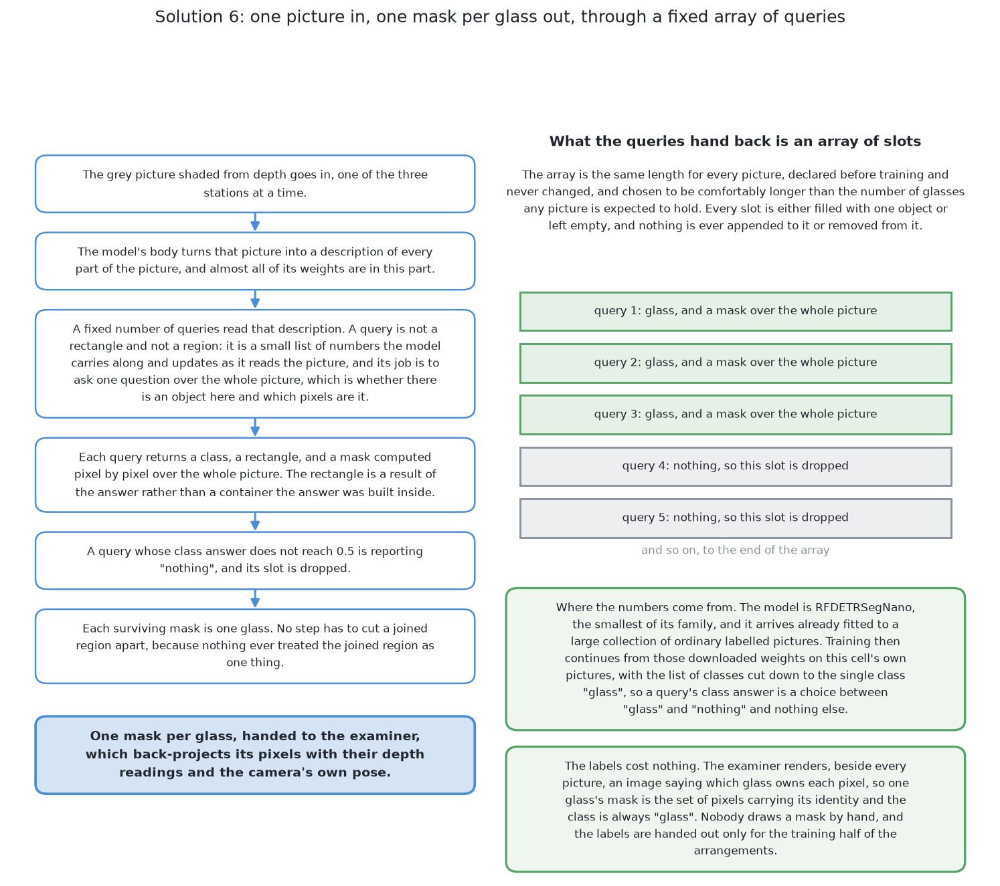

# What it is

> **What it uses.** It uses the RF-DETR package, with PyTorch under it. The model
> is **RF-DETR-Seg**. It is a transformer that finds and outlines objects in one
> pass. It comes in several sizes, and its licence is Apache 2.0.
> **What it does.** It takes one picture from the top and returns one mask per
> glass. The model starts with weights fitted to ordinary photos. Training then
> continues on this cell's pictures, with one class, "glass".
> **How the output is produced.** The grey picture goes in. A fixed number of
> **queries** each return either one glass or nothing. Each query's mask covers
> the whole picture, not just a rectangle. The examiner turns each mask into a
> place and a rough width.
> **What it costs.** The labels are free. The fine-tune is the largest cost. It
> runs on one laptop. [What it needs](05_what-it-needs.md) lists every cost.

> **The cell is described once, in [the cell](../01_the-cell.md).** This chapter
> covers only what is special to this solution.

## Contents

1. [Introduction](#1-introduction)
2. [The problem this solves](#2-the-problem-this-solves)
3. [The main idea](#3-the-main-idea)

## 1. Introduction

This is the sixth of the six solutions in this book. It uses the newest design
of the six. It takes a transformer segmenter, RF-DETR-Seg, and trains it further
on this cell's pictures.

Two things make it different. First, older segmenters draw a rectangle round an
object and paint the mask inside it. So the mask can never reach past that
rectangle. This model has no such rectangle. Second, because of that, it is the
only one of the six that can be asked to mark the hidden part of a glass. This
book calls that the **second way** of this solution.

The first way is built and scored. The second way is not. Its training was
stopped before it finished, so no number is given for it, here or beside its
code in
[`06-rf-detr-fine-tuned/`](../../../code/src/08_seeing-the-glasses/06-rf-detr-fine-tuned).
When this chapter says what the second way would do, that is the design and not
a test. The score of the first way is in [how it compares](06_how-it-compares.md).

After this chapter you will know what a query is, what set prediction is, and
what one class changes. You will also know why this design suits a mask of the
whole glass, and which mistake does the most damage.

The next section says which parts of the problem this solution is aimed at.

## 2. The problem this solves

Before the idea itself, it helps to name the two failures it is built to avoid.
The task is set out in [what is asked for](../02_the-problem/01_what-is-asked-for.md).

The first failure is the merge. Two glasses can stand apart on the table but
their outlines can still meet in the picture. A simple method then reports one
glass where there are two. [Glasses merge in the
picture](../02_the-problem/01_what-is-asked-for.md#glasses-merge-in-the-picture-although-they-stand-apart-on-the-table)
explains why.

The second failure is the slice. A glass can be partly covered by the glass in
front of it. Its mask then holds only one side of the glass. [The second
way](03_how-it-works.md#6-a-second-way--training-against-the-whole-silhouette)
is about this case.

A glass that is covered completely is a third case. No picture method can find
it. [When the glasses are completely
hidden](04_a-worked-example.md#1-when-the-glasses-are-completely-hidden) says
what this solution can and cannot do about it.

The next section gives the idea that answers the first two failures.

## 3. The main idea

The two failures above point to two needs, and the idea meets both.

First, use a model whose output is already one mask per glass. Then no step has
to cut a joined region apart. Other solutions in this book share this part.

Second, use a model whose masks are not shut inside rectangles. Only this
solution has this part. A mask that must cover more than the camera saw needs
room to grow.

The weights come from somewhere else. A model this large has too many weights
to fit from this cell's pictures alone. So it starts from weights already fitted
to ordinary photos, and training continues on this cell's pictures. This is
called **fine-tuning**. [What fine-tuning
is](../08_the-same-model-fine-tuned/03_how-the-model-is-trained.md#1-what-fine-tuning-is)
explains it in full. [The code](02_the-code.md) shows how this solution does it.

← [SAM 2 with a keeper — how it compares](../09_a-foundation-model-with-a-keeper/06_how-it-compares.md) · [How it works](03_how-it-works.md) →
