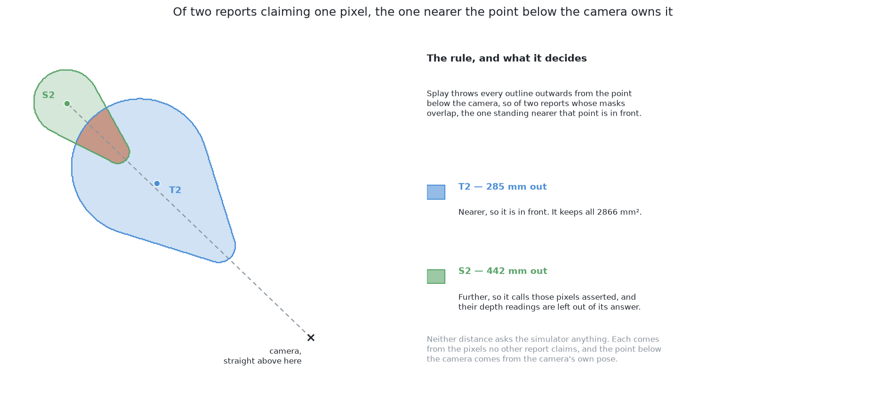

# The code

This page shows the main code of this solution. It also says what the solution
hands back to the rest of the cell. [How it works](03_how-it-works.md) then
explains what the code is doing.

## Contents

1. [The code at the heart of it](#1-the-code-at-the-heart-of-it)
2. [The masks are what this contributes](#2-the-masks-are-what-this-contributes)
3. [How the concepts fit together](#3-how-the-concepts-fit-together)

## 1. The code at the heart of it

Two pieces of code carry this solution. The first is the **fine-tune**. It turns
a model fitted on ordinary photos into a finder of glasses in this cell. The
second is the **split**. It separates the pixels the camera really saw from the
pixels the model only claims. Neither way could be used near the arm without
the split.

The fine-tune is in `06-rf-detr-fine-tuned/rf_detr_seg.py`. It has four steps.

1. Point the package's weight cache at a folder beside the code. Then build the
   model Roboflow publishes. The borrowed weights download at this point.
2. Pick a working folder for this target, so the two targets never share data.
   Split the scenes into ones to train on and ones kept back to check the
   training. Write both sets as pictures and labels. This is the only step where
   the choice of target matters.
3. Build the borrowed model, which runs step 1. Hand the folder to the
   package's own training loop, with one class.
4. Take the checkpoint the run calls its best. Copy it to the file name the
   finder reads later.

```python
def fresh():
    ...
    # Step 1: point the package's weight cache at this folder -- it reads that when it is imported
    weights.borrowed()
    import rfdetr

    # Step 1: build the model Roboflow publishes -- the borrowed weights download here on first use
    return getattr(rfdetr, SIZE)(device=str(device.pick()))


def fit(examples, *, amodal: bool, save: Path, epochs: int = EPOCHS, batch: int = BATCH) -> Mapping:
    ...
    # Step 2: pick a working folder for this target -- the two targets keep their datasets apart
    folder = weights.workings("amodal" if amodal else "modal")
    # Step 2: split the scenes into the ones to fit on and the ones held back to watch the fit
    fitting, validating = _split(examples, VALIDATION_SHARE)
    # Step 2: write both splits as pictures and labels -- amodal decides what each mask is drawn to
    written = _dataset(fitting, validating, amodal, folder / "dataset")

    # Step 3: build the borrowed model -- Step 1 above, now that the folder is written
    model = fresh()
    # Step 3: run the package's own training loop over that folder -- with one class name, "glass"
    model.train(
        dataset_dir=str(folder / "dataset"),
        output_dir=str(folder / "run"),
        epochs=epochs,
        batch_size=batch,
        lr=LEARNING_RATE,
        class_names=[labels.CLASS],
        tensorboard=False,
    )
    # Step 4: find the checkpoint the run calls its best -- the averaged weights where there are any
    best = _best(folder / "run")
    ...
    # Step 4: copy that checkpoint to where load() will look for it -- the fit's one lasting output
    shutil.copyfile(best, save)
```

The split is this project's own arithmetic, in the same file. It does not ask
the simulator anything. Here is the rule it uses. When two masks overlap, the
glass nearer the point below the camera is the one in front. So every pixel both
masks claim belongs to that nearer glass. For each report, the split returns the
pixels that a nearer report covers.

It takes two more steps.

5. Drop every mask pixel that has no depth reading. Mark the pixels that more
   than one report claims. These are the contested pixels.
6. Place each report using only the pixels it holds alone. Measure how far that
   place is from the point below the camera. For each report, collect the masks
   of all reports nearer that point. A pixel that is contested and also covered
   by a nearer report is a pixel this report only claims.

```python
def hidden_by_others(picture, masks: list[np.ndarray], nadir: tuple[float, float]) -> list[np.ndarray]:
    ...
    # Step 5: keep only the pixels of each mask that came back with a depth reading
    usable = [mask & np.isfinite(picture.depth) for mask in masks]
    ...
    # Step 5: mark every pixel more than one report claims -- those are the ones to settle
    contested = np.sum(np.stack(usable), axis=0) > 1
    away = []
    for mine in usable:
        # Step 6: place each report from the pixels it holds alone -- nothing can hide it there
        alone = masks_to_glasses.one_glass(picture, mine & ~contested)
        # Step 6: measure how far it is from the point below the camera -- the nearer is in front
        away.append(np.inf if alone is None else float(np.hypot(alone.x - nadir[0], alone.y - nadir[1])))

    behind = []
    for index, mine in enumerate(usable):
        theirs = np.zeros_like(mine)
        for other, nearer in enumerate(usable):
            # Step 6: collect the masks of the reports standing nearer the camera than this one
            if other != index and away[other] < away[index]:
                theirs |= nearer
        # Step 6: the asserted pixels are the contested ones a nearer report also claims
        behind.append(mine & contested & theirs)
    return behind
```



The first block is borrowed work. One `train` call from the `rfdetr` package
does all the fine-tuning. The second block is the part nobody can borrow. Its
output goes to `masks_to_glasses.one_glass` as pixels whose depth readings must
be left out. A second, smaller set of claimed pixels comes from a check
described in [how the concepts fit
together](#3-how-the-concepts-fit-together). It is left out the same way.

The split is not only for the second way. On the crowded arrangements, the model
is trained on the pixels the camera can see. Even so, 876 of 1313 reports across
the five scored blocks had a claimed part that was named and left out. The least
visible of them was 11% seen. A predicted mask spreads over the glass in front
of it either way. The depth reading under that spread belongs to the other
glass.

The next section says where this solution's job ends.

## 2. The masks are what this contributes

The code above produces masks, and this section says what happens to them next.

This solution gives only masks. The examiner's shared arithmetic turns each mask
into a place and a width, the same way for all six solutions. [What must come
back](../03_the-examiner/01_the-examiner.md#6-what-must-come-back) explains why,
and [how a mask becomes a record](../12_how-a-mask-becomes-a-record.md) shows
the arithmetic.

This solution owes that arithmetic one more thing. When a mask claims pixels the
camera never saw the glass at, it must name them. [Why a mask that asserts
pixels must say which
ones](../12_how-a-mask-becomes-a-record.md#4-why-a-mask-that-asserts-pixels-must-say-which-ones)
measures what happens if it does not.

The next section puts the parts of this page in order, from picture to record.

## 3. How the concepts fit together

The two sections above showed the parts one at a time. Here they are as one
chain.

1. A **grey picture**, shaded from depth, goes in.
2. The body of the model reads it. Its weights came from ordinary photos and
   were then adjusted on this cell's pictures.
3. A fixed number of **queries** read the result. Each returns "nothing" or one
   glass, with a rectangle and a **mask** over the whole picture.
4. Training matched queries to glasses **one to one**. So two queries do not
   report the same glass, and no cleanup step is needed.
5. Each mask is split into its **observed part** and its **asserted part**. The
   asserted part is the pixels a nearer report also claims.
6. The observed pixels go to the shared arithmetic. They give a **place** and a
   **rough width**. The asserted pixels are left out, because their depth
   readings belong to the glass in front.
7. Each report also carries its **visible fraction**. This is the share of its
   mask that was observed. Later steps use it to decide how much to trust the
   report.
8. Two checks follow, and each can only refuse. The width must be one the kind
   allows, unless the mask reaches the edge of the picture. And no asserted
   pixel may lie where the camera clearly saw something else. A report that
   fails a check is marked as doubtful.
9. If two reports give the same place, only the surer one keeps it. Every
   solution in this book ends with this rule.

The shape of the output and the missing rectangle are what make this solution
work. The split between observed and asserted pixels is what keeps it honest.
[How it works](03_how-it-works.md) explains each of these in turn.

← [What it is](01_what-it-is.md) · [How it works](03_how-it-works.md) →
