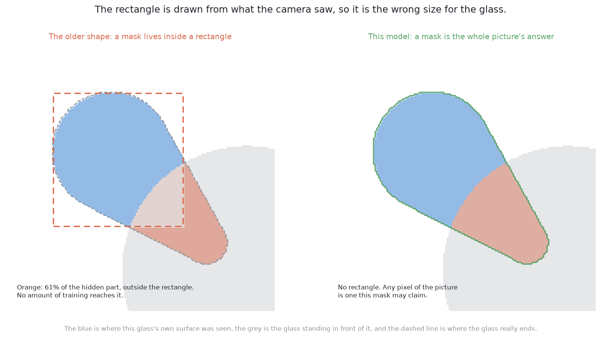
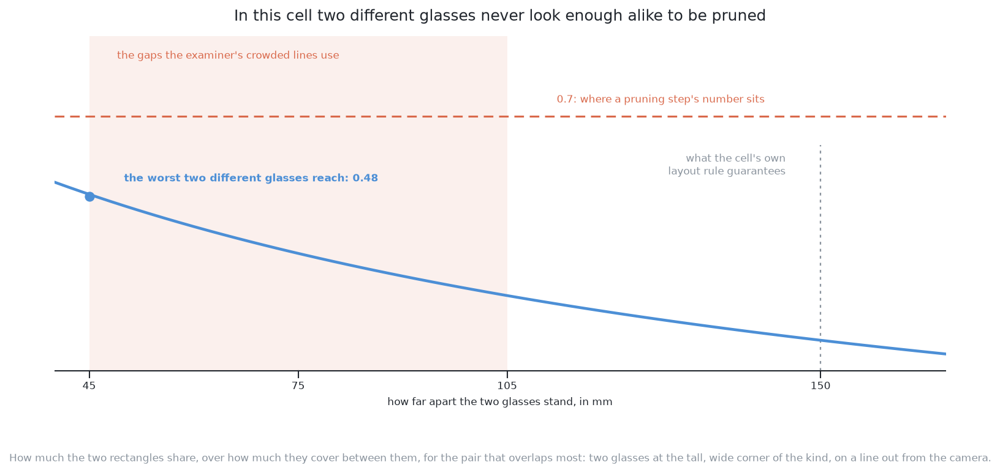
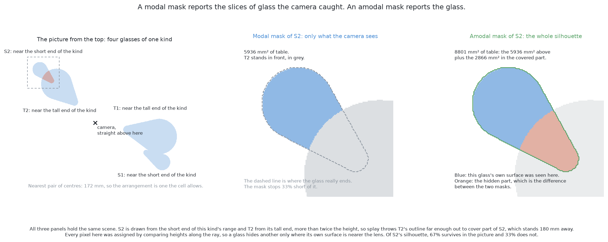

# How it works

This page explains what happens inside this solution, one part at a time. It
follows [the code](02_the-code.md) and says what each part of that code does.

## Contents

1. [What a transformer segmenter does differently](#1-what-a-transformer-segmenter-does-differently)
2. [Why that matters for this problem](#2-why-that-matters-for-this-problem)
3. [One class](#3-one-class)
4. [Set prediction](#4-set-prediction)
5. [Fine-tuning this model here](#5-fine-tuning-this-model-here)
6. [A second way — training against the whole silhouette](#6-a-second-way--training-against-the-whole-silhouette)

## 1. What a transformer segmenter does differently

Everything else on this page depends on one difference in the model's shape. So
this section explains that difference first.

**The older shape is "propose, then refine".** The model first proposes
rectangles that might hold an object. Then it takes each rectangle on its own.
It decides what is inside, tightens the rectangle, and paints a mask **inside
that rectangle only**. The mask is drawn on a small grid and stretched to the
rectangle's size. So it cannot reach past the rectangle's edge. The list of
proposals starts long and is then cut down in a separate step.

**This model's shape is a fixed set of slots.** It has a fixed number of
**queries**. A query is a short list of numbers. The model updates it while it
reads the picture. Each query asks one question about the whole picture: is
there an object, and which pixels are it? The number of queries is set before
training. It is larger than the number of objects any picture should hold.

A programmer can think of it like this. The older shape is a list that grows and
is then pruned. This shape is a **fixed-size array of optional values**. Each
slot holds one object or is empty. The array has the same length for every
picture. A picture with two glasses and a picture with six glasses give arrays
of the same length. Only the number of filled slots differs.

The masks follow from that. Each filled query is turned into a short
description of its object. Separately, the model describes every pixel. The mask
is the set of pixels whose description matches the query. This is worked out
over the whole picture. So **there is no rectangle for a mask to escape**. The
model does also report a rectangle for each object. But that rectangle is
worked out from the answer. It does not limit the mask.

The next section says why this difference matters for glasses.

## 2. Why that matters for this problem

The slot shape from the section above helps in two ways here. The first helps
now, and the second is what the second way depends on.

First, two glasses whose outlines join are two different slots from the start.
The queries look at the whole picture at once. So nothing ever treats the joined
region as one thing, and nothing has to cut it. Two masks come out. They may
overlap, because each mask is about a different glass.

Second, a mask has room to grow. Take a glass partly covered by the glass in
front of it. The camera sees only one side of it. So the smallest rectangle
round the visible pixels is smaller than the glass. In the older shape, the mask
is painted inside that rectangle, so it is cut off at its edge. The picture
below measures this on one glass of this cell. Of the hidden part of the glass,
61% falls outside that rectangle. So a mask painted in the rectangle could cover
at most the other 39%, however it was trained.

This model has no such edge. A mask may claim any pixel in the picture. So the
model can be asked for the whole shape of a glass without any change to its
design. That request is [the second
way](#6-a-second-way--training-against-the-whole-silhouette). It is the reason
this model was chosen for this place in the set.

Before training can be described, one small change to the model must be stated.
The next section gives it.

## 3. One class

Training needs a list of classes, so this section says what the list is here.
[The same YOLO fine-tuned here](../08_the-same-model-fine-tuned/01_what-it-is.md)
makes the same change.

A borrowed detector knows a long list of everyday objects. Here that list is
replaced by one entry, "glass". So each query only chooses between "glass" and
"nothing". The model is no longer asked what kind of object it found. It is
asked only whether it found one, and which pixels it is.

This has one gain and one loss. The gain is that the model cannot call a glass a
vase. The loss is that a high score now means only "something is here". It does
not say which kind of glass. That does not matter here, because the kind on the
table is known. It would matter if several kinds stood on the table together.

One class does not make the model much smaller or faster to train. Almost all
the weights are in the part that reads the picture. That part does not know
about the class list.

With slots and one class in place, the next question is how training gets one
answer per glass. The next section answers it.

## 4. Set prediction

The slots from the first section need a way to avoid two slots reporting the
same glass. This section explains how training does that.

**Set prediction** means the model's whole output is one set of answers. It is
compared with the set of real glasses. At each training step, the filled slots
are matched to the real glasses **one to one**. Each real glass gets exactly one
query. Each query gets at most one glass. The pairing chosen is the one that
fits best overall. Every query left over is told its answer should have been
"nothing".

This has one important result. Suppose a query reports a glass that another
query was already matched to. It gets no credit for being nearly right. It is
told it should have said "nothing". So training removes duplicate answers from
the model itself. A picture with four glasses comes back with four filled slots,
because that is what training rewarded.

The older shape works differently. Several proposals land on one object, because
several nearby rectangles all hold most of it. All of them score well. So a
separate step must reduce them to one answer. It sorts the claims by score,
keeps the best, and drops every claim that overlaps it by more than a set
amount. Then it repeats. This step is called **non-maximum suppression**. It has
one setting, which is how much overlap counts as a duplicate. It also assumes
that heavy overlap means a duplicate.

In this cell that assumption causes less trouble than you might expect. Splay
makes one glass's outline spread across another's, so different glasses do
overlap. But they do not overlap enough to be dropped. Take the pair that
overlaps most. These are two glasses of the tall, wide end of the kind, on a line
out from the camera. Stand them as close as the examiner's crowded arrangements
ever do. Their two rectangles then share 0.48 of the area they cover together.
The fine-tuned YOLO's pruning step uses 0.7.

So the setting does not drop glasses today. But somebody had to choose it with
this geometry in mind. They would have to choose it again if the camera moved,
the survey height changed, or a taller kind came to the table. Set prediction
removes both the setting and the assumption. There is no overlap amount to
choose. Two overlapping glasses never compete, because each has its own slot.

Set prediction has a cost too. Training must match slots to glasses before it
can score anything. Early in training, the glass a query is matched to can
change from step to step. So models of this family need patient training. Much
of the published work on them is about making the matching settle faster.

The design is now complete. The next section is about where its weights come
from.

## 5. Fine-tuning this model here

The sections above described the model's shape. This section says how its
weights are set for this cell.

The model starts from weights fitted to a large set of ordinary photos. Training
then continues on this cell's pictures. This is **fine-tuning**. Most of the
borrowed weights already work, so they need only small changes. That is why a
few hundred pictures are enough for a model this size. [What fine-tuning
is](../08_the-same-model-fine-tuned/03_how-the-model-is-trained.md#1-what-fine-tuning-is)
explains this in full.

The labels cost nothing. The examiner already knows which glass owns each pixel,
so every mask comes from that. [What the examiner draws](../03_the-examiner/01_the-examiner.md#3-what-the-examiner-draws)
explains this. The model is never tested on an arrangement it trained on.

The pictures are grey depth pictures, not photos. The borrowed weights were
fitted to colour photos. This difference is called the **domain gap**. [Why it
failed](../07_a-borrowed-model-as-it-downloads/03_results-and-comparison.md#2-why-it-failed-the-names-it-reached-for)
explains it. Fine-tuning does not remove the gap. But the model is trained on
the same grey pictures it will see later. So the gap should cost accuracy and
training time, not correctness. This is a reasoned expectation, not a measured
result.

The training arrangements need one deliberate choice. The cell's own layout rule
keeps glasses well apart. A model trained only on those would never see a hard
pair. So half of every training set uses crowded arrangements. These stand
glasses closer than the rule allows, on lines out from under the camera. The
lesson is general. **Train the model on cases harder than any it must handle.**

The first way is now fully described. The next section describes the second
way, which only this solution can offer.

## 6. A second way — training against the whole silhouette

The missing rectangle from the second section makes a second way of training
possible. This section explains it.

The idea fits in one sentence. **Train each mask against the glass's whole
silhouette, instead of only the pixels the camera can see.** The silhouette is
the shape the glass would have if nothing stood in front of it. A mask of the
visible part is called a **modal** mask. A mask of the whole silhouette is called
an **amodal** mask. The amodal mask always contains the modal one. The difference
between them is the **hidden part**.

It matters because the failure it answers gives no warning. Put one glass partly
behind another. A mask of visible pixels loses everything behind the near glass.
What is left is a slice along one side. The shared arithmetic reads that slice
as a narrower glass. Nothing objects, because the kind's footprints run from 65
to 105 mm. So a short width still looks allowed. A slice does not look like an
error. It looks like a smaller glass.

Compare that with two glasses that come back as one region. Then the width is
too large for the kind. The check fires, and the region is marked as doubtful.
So a merge is caught, but a slice is not. [The worked
example](04_a-worked-example.md#2-a-worked-example) measures how much room the
slice has.

The model's design suits this request. Asking for the whole silhouette changes
only what the mask is scored against. The model's shape does not change. This is
a general lesson: **one network can answer a different question by changing its
target, not its shape.** The task is still hard. The model must learn the shape
of the kind. It must also tell which glass is in front.

One rule has no exceptions. A mask that claims pixels the camera never saw the
glass at must name those pixels. The depth reading there belongs to the glass in
front. [How a mask becomes a
record](../12_how-a-mask-becomes-a-record.md#4-why-a-mask-that-asserts-pixels-must-say-which-ones)
measures what goes wrong otherwise.

The simulator gives two checks on such a model for free. First, on a glass with
nothing in front of it, the amodal mask must equal the modal one. So you can
measure what the model adds to uncovered glasses. A model that adds a little
everywhere will show up. Second, during training, watch the **overlap over the
hidden part alone**. The examiner can supply it by taking one of its masks away
from the other. Do not use overlap against the visible truth. Every correct
pixel of a completion lies outside that truth, so that score punishes the model
for working. **A score that rewards doing nothing will be won by a model that
does nothing.**

**This way was never fully trained, so it claims no number.** Its training
reached four epochs of ten, and its check score was still rising. Other training
runs filled the machine, and it was stopped. So this section is a design, not a
result. This solution's row in the results is the first way.

[A worked example](04_a-worked-example.md) now follows both ways through one
arrangement.

← [The code](02_the-code.md) · [A worked example](04_a-worked-example.md) →
