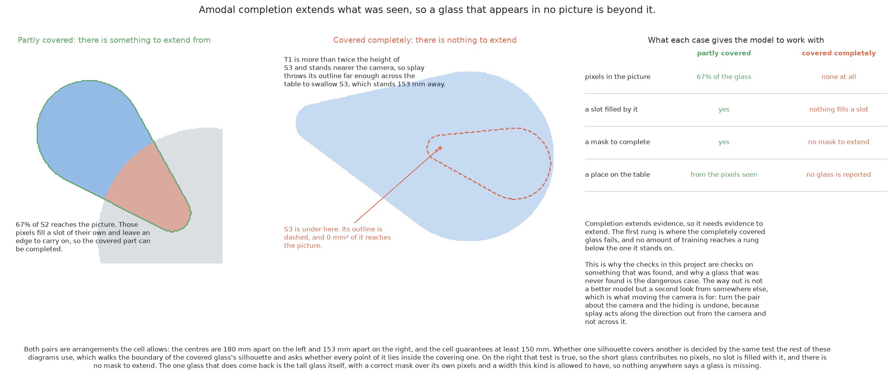
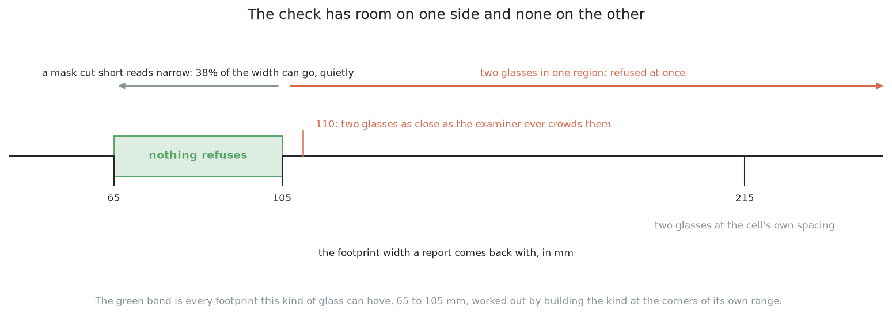

# A worked example

This page follows this solution through one arrangement of glasses. It first
covers a glass that is completely hidden. Then it walks through an arrangement
with a partly hidden glass. An example that shows only the easy case would teach
the wrong lesson.

## Contents

1. [When the glasses are completely hidden](#1-when-the-glasses-are-completely-hidden)
2. [A worked example](#2-a-worked-example)

## 1. When the glasses are completely hidden

The hardest case comes first, because it sets the limit for everything after it.

A glass can be covered completely, so that no picture holds any pixel of it. No
picture method can find such a glass. [Looking again at what was
hidden](../02_the-problem/02_looking-again-at-what-was-hidden.md) explains why,
and gives the shared answer. What follows is only what this solution adds.

**This solution moves the limit, but does not remove it.** The second way
extends what the model sees. The model sees an outline that stops at a nearer
glass, and it continues that outline behind it. But this needs a piece of the
glass in the picture. With no piece, there is nothing to extend. What the
second way does give is this: it needs less of a glass than any other method
here. So a glass must be hidden more before this solution loses it.

The table below compares the two cases in the picture. Each row is one thing the
model needs before it can answer. The two columns say whether each case has it.

| what the model needs | partly covered | covered completely |
| --- | --- | --- |
| pixels in the picture | 67 per cent of the glass | none at all |
| a slot filled by it | yes | nothing fills a slot |
| a mask to complete | yes | no mask to extend |
| a place on the table | from the pixels seen | no glass is reported |

The completely covered glass fails in the first row. No training can help with
the rows below it. The tall glass in front still comes back with a correct mask
and an allowed width. So nothing says that a glass is missing.

The answer is a second look from another place, not a better model. Turn the
pair about the camera and the glass is no longer hidden. This works because
splay acts along the line out from the camera, not across it.

A model **could** be trained to mark a glass that might be behind another one.
But it would only report where glasses tend to stand. It would be **guessing a
scene, not reading a picture**. It would also mark a glass behind every tall
glass, even when nothing is there.

The next section turns to the partly hidden glass, where this solution can do
something.

## 2. A worked example

The section above showed where this solution stops. This section shows what it
does before that point. The arrangement is a walk through the design, not a
record of a run. Each number is either a limit of the kind or a measurement the
examiner made with its own exact masks. The text says which.

**The arrangement.** Five glasses of one kind stand on the table. The camera
looks down from the top. Three glasses stand well apart. The other two stand
much closer than the cell's rule allows. They lie on a line out from the point
below the camera, and the taller one is nearer that point. So splay spreads the
taller one's outline over part of the shorter one. In the picture, their two
outlines join into one region.

**What the first way returns.** The two close glasses fill two different slots.
So the joined region is never treated as one thing. Five slots come back filled.
Training matched slots to glasses one to one, so no sixth slot repeats either
glass. The two masks overlap where the taller glass covers the shorter one. That
is allowed, because each mask is about a different glass. Nothing had to divide
a joined region.

**What the first way still gets wrong.** The shorter glass's mask stops where
the taller one begins. So it is a slice on one side. The shared arithmetic gives
it a width that is too small. It also gives a place pulled towards the visible
side. The examiner measured this with exact masks. Over its crowded blocks, a
partly hidden glass is 12.2 mm from the truth at the median. A whole crowded run
of exact masks has a median of 0.4 mm, because most glasses there have nothing
in front. So five glasses are reported. One of them is too narrow and a little
off to one side.

The width check cannot catch this. The kind's footprints run from 65 to 105 mm.
So a glass at the top of that range can lose 38% of its width and still be
allowed. A merge of two glasses is too wide at once, even at the closest spacing
the examiner uses.

**What the second way would change, and what it would not.** The shorter glass's
mask would also cover the part behind the taller one. The split then divides the
mask. The observed part is the slice. The asserted part is the rest. The
asserted pixels carry the taller glass's depth readings, so they are left out.
So the place and the width come from the slice alone, just as in the first way.
The measurements do not change. This was measured, not just argued. With the
examiner's exact masks, visible masks and whole masks give the same scorecard,
column for column. What the second way adds is the **visible fraction**. It says
that only part of this glass was seen.

**What that one number then gives.** The visible fraction is low. So the width
is used to plan, not to grip. The arm moves to the side and looks level at the
glass. From there nothing stands in front of the shorter glass. So its footprint
is measured, not guessed. The second way decides **where to look**. The look
from the side decides **what is true**.

**Now the case neither way answers.** Push the shorter glass directly behind the
taller one, close enough that the taller outline covers it completely. The
picture holds no pixel of it. So no slot is filled and there is nothing to
extend. Four glasses are reported where five stand. Every report is correct and
every width is allowed, so no check fires. This is the case for [looking again
at what was hidden](../02_the-problem/02_looking-again-at-what-was-hidden.md).

[What it needs](05_what-it-needs.md) next lists what this solution costs to
build and run.

← [How it works](03_how-it-works.md) · [What it needs](05_what-it-needs.md) →
