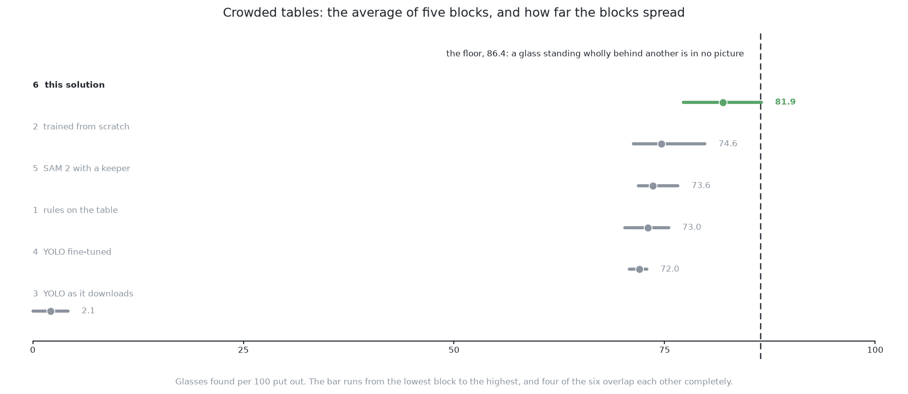

# How it compares

This page judges this solution. It gives its scores and says where it is strong
and where it breaks. It then names the ideas behind it and places it beside the
other five.

## Contents

1. [Where it is strong and where it breaks](#1-where-it-is-strong-and-where-it-breaks)
2. [The general ideas behind this](#2-the-general-ideas-behind-this)
3. [Where it sits among the other five](#3-where-it-sits-among-the-other-five)

## 1. Where it is strong and where it breaks

The earlier pages described the design. This section says how well it did.

[The examiner](../03_the-examiner/01_the-examiner.md) scored it on five blocks
of 20 held-out arrangements. The table below gives its row. Each count is per
100 glasses. The brackets give the lowest and highest block.

| layouts | found per 100 | missed | merged | place | mask covered | mask not the glass |
|---|---|---|---|---|---|---|
| spawned | 96.4 (94.9–98.0) | 3.6 | 0.0 | 6.0 mm | 96.6% | 0.0% |
| crowded | 81.9 (77.2–86.5) | 18.1 | 1.4 | 0.5 mm | 97.2% | 0.0% |

On crowded layouts it is the best of the six. Even its worst block, 77.2, is
above the average of every other solution. The best possible crowded score is
86.4, so it is about four and a half glasses short of that. On spawned layouts
the fine-tuned YOLO does better, with 99.4. [The results](../11_the-results.md)
set all six side by side and say which gaps are real.

The strengths come first. Each one is explained in full in [how it
works](03_how-it-works.md).

- **It answers the question asked.** The problem asks which pixels belong to
  which glass. The output is one mask per glass, with nothing to convert.
- **It separates glasses whose outlines join.** Two such glasses fill two slots,
  so nothing has to decide where to cut.
- **It has one fewer number to choose.** There is no overlap setting for
  duplicates, because of [set prediction](03_how-it-works.md#4-set-prediction).
  A score cut-off remains, but its meaning is plain.
- **It is the only one of the six that can be asked for the hidden part of a
  glass.** This comes from its shape. The second way changes only the target.
- **Its licence is permissive.** Apache 2.0 matters when the model must ship
  inside something else.

The weaknesses come next.

- **Its second way is the easiest thing in this set to get wrong.** If the
  asserted pixels are fed into the arithmetic, the answer gets worse. Nothing
  complains, and the width still looks allowed.
- **It needs patient training.** The one-to-one matching takes time to settle.
  The fine-tune must also close the domain gap. Both cost time, not correctness.
- **It cannot see a glass that is hidden completely.** Neither way can. No pixels
  means no slot and nothing to check.
- **It cannot explain its answers.** When arithmetic is wrong, you can print a
  number and see why. When this model is wrong, you can only study examples. The
  two checks have to catch its mistakes.
- **Its weights are a second copy of the cell.** They record what the cell
  looked like when they were fitted. They must be kept in step with the cell.
  The borrowed part cannot be made again here.

The next section names the published ideas this solution is built from.

## 2. The general ideas behind this

The strengths above come from standard parts of modern object detection. Only a
few choices are special to this cell: one class, free labels, grey depth
pictures, and the request for whole silhouettes.

### Detection as set prediction

A detector outputs a fixed-size set of answers. Training matches that set to the
real objects one to one. So duplicates are trained away, not pruned away.
**DETR** (Carion and colleagues,
[arXiv:2005.12872](https://arxiv.org/abs/2005.12872)) did this first. It finds
the matching with the **Hungarian algorithm** (Kuhn, *Naval Research Logistics
Quarterly*, 1955). That algorithm finds the cheapest complete pairing between
two sets. It is a general tool, not a vision method.

It suits crowded scenes, because two overlapping objects do not compete. It is a
poor choice when a picture can hold more objects than there are slots. It is
also a poor choice when training time is short. For more, see [object
detection](https://en.wikipedia.org/wiki/Object_detection).

### Attending to a few places rather than everywhere

If every query looks at every position, reading a picture is slow. So each
query looks at a few positions it chooses. **Deformable DETR** (Zhu and
colleagues, [arXiv:2010.04159](https://arxiv.org/abs/2010.04159)) brought this
in. It also works at several scales at once. This made the family practical and
sped up training. Later work, such as **DINO** (Zhang and colleagues,
[arXiv:2203.03605](https://arxiv.org/abs/2203.03605)), makes the matching settle
faster and the model run in a fixed short time.

Nearly every current transformer detector uses it. It is not needed when every
object is about the same size in every picture. That is not true here. The same
glass fills a small patch from the top and much of the picture from the side.

### A mask per query, over the whole picture

Stop painting masks inside boxes. Give each query a short description of its
object. Describe every pixel. The mask is the pixels whose description matches
the query. **MaskFormer** and **Mask2Former** (Cheng and colleagues,
[arXiv:2107.06278](https://arxiv.org/abs/2107.06278) and
[arXiv:2112.01527](https://arxiv.org/abs/2112.01527)) set this out. They showed
that one model of this shape can do several kinds of segmentation. Only the
training target changes.

It is the right shape when objects of one class touch and must be reported
apart. It is also right when a mask may need to reach past the visible object.
That is why it was chosen here. It is not worth it when one map of classes is
enough.

### Transfer learning and fine-tuning

Take a model fitted on a large general task. Keep its weights, change its last
part, and keep training on the new data. [What fine-tuning
is](../08_the-same-model-fine-tuned/03_how-the-model-is-trained.md#1-what-fine-tuning-is)
explains why this works. Yosinski and colleagues
([arXiv:1411.1792](https://arxiv.org/abs/1411.1792)) measured how much
transfers. Such weights are often fitted on COCO (Lin and colleagues,
[arXiv:1405.0312](https://arxiv.org/abs/1405.0312)). Some are fitted without
labels at all, as in **DINOv2** (Oquab and colleagues,
[arXiv:2304.07193](https://arxiv.org/abs/2304.07193)). Recent detectors in this
family prefer that route.

It is used when labelled data is scarce, which is almost always. It is a weaker
choice when labels are free and the new pictures look nothing like the old ones.
[A network trained from
scratch](../06_a-network-trained-from-scratch/01_what-it-is.md) makes that
argument. This solution takes the other side on purpose. For more, see [transfer
learning](https://en.wikipedia.org/wiki/Transfer_learning).

### Amodal segmentation

Amodal segmentation marks the whole object, including the part another object
covers. Li and Malik posed it as a task
([arXiv:1604.08202](https://arxiv.org/abs/1604.08202)). Zhu and colleagues gave
an earlier version over whole scenes
([arXiv:1509.01329](https://arxiv.org/abs/1509.01329)). Later work predicts the
visible mask and the whole mask side by side (Follmann and colleagues,
[arXiv:1804.08864](https://arxiv.org/abs/1804.08864)).

It is used in robot picking, in driving, and wherever a partly covered object
must be treated as whole. On real photos it is hard. A person must draw a
boundary nobody can see, and two people will draw it differently. **A simulator
has no such problem.** The examiner can draw the scene again without the other
glasses. The mask it gets is the exact whole silhouette. For more, see [image
segmentation](https://en.wikipedia.org/wiki/Image_segmentation).

With the ideas named, the last section places this solution among the other
five.

## 3. Where it sits among the other five

The ideas above explain what this solution is. This section says what it trades
against each of the others. The full scores and which gaps are real are in [what
the comparison says](../11_the-results.md#4-what-the-comparison-says).

- **[The same YOLO fine-tuned here](../08_the-same-model-fine-tuned/01_what-it-is.md).**
  Both are trained the same way, so only the model design changes. That
  solution wins on spawned layouts and this one wins on crowded ones. This
  solution also has no rectangle round each mask, and its licence is Apache 2.0
  rather than the AGPL.
- **[YOLO as it downloads](../07_a-borrowed-model-as-it-downloads/01_what-it-is.md).**
  Two things change at once, training and design. So this pair is a rough
  comparison.
- **[SAM 2 with a keeper](../09_a-foundation-model-with-a-keeper/01_what-it-is.md).**
  That solution borrows more and trains less. Its segmenter never sees this
  cell's pictures. This solution trains the whole model on them, and scores
  higher on both layouts.
- **[A network trained from scratch](../06_a-network-trained-from-scratch/01_what-it-is.md).**
  That solution owns every weight and keeps a small file. It separates glasses
  by counting votes after the network. This solution gets separate glasses
  straight from the model, but needs a large borrowed file.
- **[Rules on the table](../05_rules-on-the-table/01_what-it-is.md).** On
  spawned layouts, that solution is better. It finds every glass, needs no
  training, and can explain its failures. On crowded layouts this solution is
  ahead and merges far fewer glasses. Both need depth.

No solution of the six can find a glass missing from every picture. [Looking
again at what was
hidden](../02_the-problem/02_looking-again-at-what-was-hidden.md) answers that
with geometry. This solution only moves that limit a little further out. [The
overview](../04_the-six-solutions/01_how-the-six-compare.md) shows all six side
by side.

← [What it needs](05_what-it-needs.md) · [The six solutions side by side](../11_the-results.md) →
