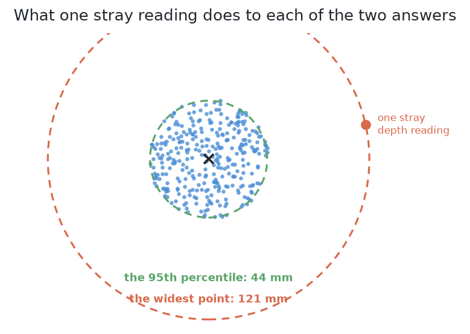

# How a mask becomes a record

Every solution in this book returns masks. A mask is the set of pixels that
belong to one glass. But every scorecard reports places and widths. This page
explains the step in between. It is the arithmetic the examiner uses to turn a
mask into the record the problem asks for.

This page comes at the end, because **nothing in the comparison depends on it**.
The step is the same for all six solutions. So no solution can win or lose by
how it measures. A reader who follows the comparison can take this step on
trust.

Read it if you want to know three things. Why can a place be right while an
outline is poor? Why must a mask that claims unseen pixels say which ones? Why
does the place error stop telling the six apart before the masks do?

## Contents

1. [A pixel and a depth reading are a point in the room](#1-a-pixel-and-a-depth-reading-are-a-point-in-the-room)
2. [Why the axis comes from the top of the glass](#2-why-the-axis-comes-from-the-top-of-the-glass)
3. [Why the width is a percentile and not the widest point](#3-why-the-width-is-a-percentile-and-not-the-widest-point)
4. [Why a mask that asserts pixels must say which ones](#4-why-a-mask-that-asserts-pixels-must-say-which-ones)
5. [What it costs: the place stops telling methods apart](#5-what-it-costs-the-place-stops-telling-methods-apart)

## 1. A pixel and a depth reading are a point in the room

The first step is to turn each pixel of the mask into a point in the room.

A pixel on its own gives only a direction. It says which way the camera was
looking. The depth reading at that pixel says how far along that direction the
surface was. The camera's pose says where the direction starts. Together, these
three give a point in the room. This is called **back-projection**, because it
runs the camera's projection backwards.

So a mask becomes a cloud of points in the room. Everything below works on that
cloud. A mask with fewer than 100 usable pixels is too small to measure. The
examiner then says so, rather than return a number nobody should trust.

The next section uses this cloud to find where the glass stands.

## 2. Why the axis comes from the top of the glass

With the cloud of points ready, the examiner needs the glass's axis. This is the
vertical line through the middle of the glass.

The obvious choice is the middle of the whole cloud. That is wrong here. The
reason is the splay described in [the cell](01_the-cell.md). The camera draws
each rim pushed outwards. Below the rim, it sees the wall of the glass on one
side only, because the glass hides the other side. So the cloud has more points
on one side. Its middle is pulled away from where the glass really stands. The
pull is different for every glass.

The rim does not have this problem. The camera sees the rim all the way round.
So the rim's points really do ring the glass's axis. The examiner takes the
points within 8 mm of the highest point in the mask. Their middle is the axis.
This band is narrow enough to hold only rim. It is wide enough to hold enough
points. It works from any camera position.

Nothing in that picture is distorted. Back-projection puts every point where it
really is. The problem is **which points exist at all**. The camera sees the rim
all the way round, but the wall on one side only. That one-sided wall pulls the
middle of the whole cloud off the glass.

With the axis found, the next section measures how wide the glass is.

## 3. Why the width is a percentile and not the widest point

The width is how far the cloud reaches from the axis. The examiner does not take
the largest distance. That would depend on a single point, and one bad depth
reading can give a single point far away. So the examiner takes the 95th
percentile of the distances. This is the distance that 95 of every 100 points
fall inside.

This choice makes the width hard to disturb on purpose. A ragged mask edge moves
the largest distance a lot. It moves the 95th percentile very little. So a width
from a tight outline and a width from a rough outline can be compared fairly.

The steps so far assume every pixel in the mask was seen by the camera. The next
section deals with a mask that breaks this.

## 4. Why a mask that asserts pixels must say which ones

The arithmetic above trusts the depth at every pixel. This section shows when
that trust is wrong.

One solution in this book can return a glass's whole outline. This includes the
part behind another glass, which the camera never saw. Such a pixel is
**asserted**: the method claims it, but the camera did not see the glass there.
This is useful, but it breaks the arithmetic above. **The depth reading at an
asserted pixel does not belong to that glass.** It belongs to whatever stood in
front. Back-project it, and you get a point on the wrong object. That point
pulls the axis towards it.

So a mask that asserts pixels must name them. The examiner then leaves out their
depth readings. It does not guess a value. This was measured over the 681 partly
hidden glasses in five blocks of crowded arrangements. When the asserted pixels
are named, the middle place error is **12.2 mm**. When they are fed in, it is
**42.7 mm**.

Across a whole run, the damage is even larger. The run below gives the
renderer's perfect masks to the arithmetic twice. Both runs use **exactly the
same pixels**. The only difference is whether the asserted pixels were named.
Each row is one run, and each column is a number per 100 glasses.

| exact masks, crowded arrangements, per 100 glasses | found | missed | merged | mask covered | mask not the glass |
|---|---|---|---|---|---|
| asserted pixels named and left out | 86.4 | 13.6 | 0.6 | 100.0% | 0.0% |
| asserted pixels fed in | **72.4** | **27.6** | **10.7** | 100.0% | 0.0% |

Both rows score perfectly on the two mask numbers, because the masks are the
same and both are perfect. Yet 14 glasses in every 100 are lost. So the examiner
measures what the arithmetic made of a mask, not only the mask itself. A
comparison of pixels alone cannot see this.

This arithmetic is forgiving on purpose. The last section says what that costs.

## 5. What it costs: the place stops telling methods apart

The axis comes from a band of rim, and the width from a percentile. So two quite
different masks can give almost the same place.

The examiner measures this with perfect masks, which gives the **floor of
error**. On spaced arrangements, the floor is 6.8 mm at the median and 45.4 mm at
worst, each averaged over five blocks. A solution close to that floor cannot do
better through its masks. So the place error does not rank the six. [Comparing
the
outputs](03_the-examiner/04_comparing-the-outputs.md#7-the-best-possible-answer-and-the-trap-below-it)
explains the floor, and [how good was the
mask](03_the-examiner/04_comparing-the-outputs.md#6-how-good-was-the-mask)
gives the numbers that do rank them.

← [The six solutions side by side](11_the-results.md)
