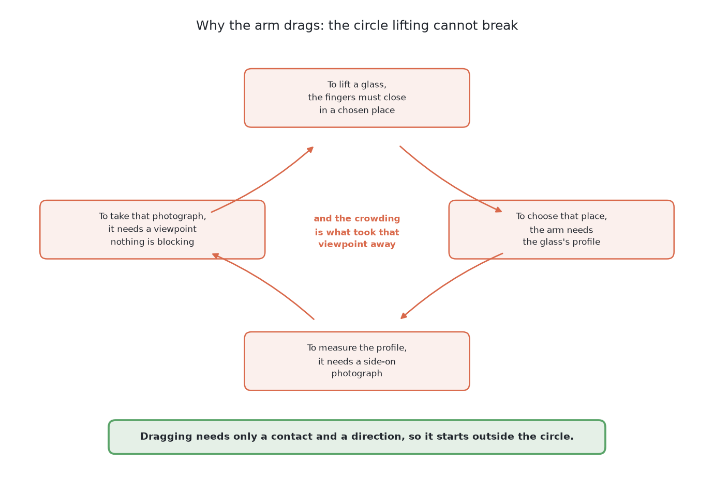
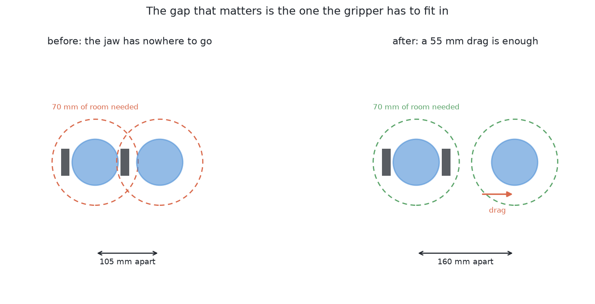
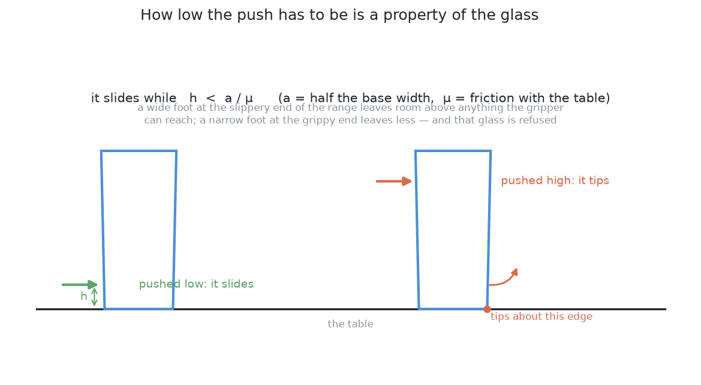
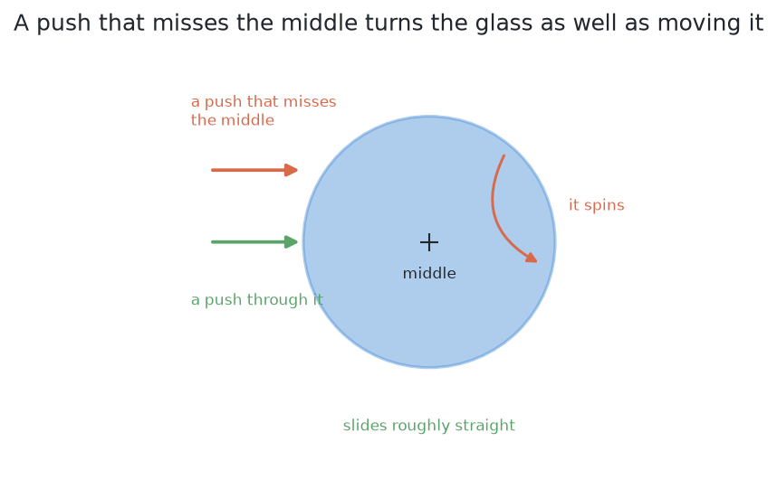
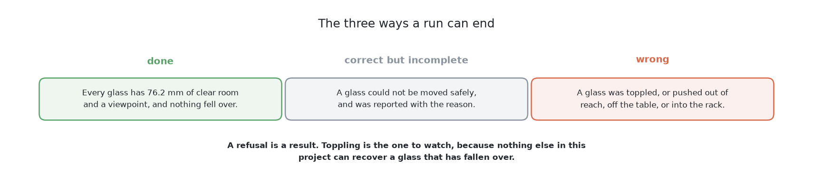

# Push the glasses apart — what is asked for

## 1. Introduction

The camera work has ended. [Telling the glasses apart in a
picture](../../08_seeing-the-glasses/02_the-problem/01_what-is-asked-for.md) has
left the arm knowing which pixels are which glass and where each one stands.
Some of them are standing too close together for the gripper to get round one
without fouling its neighbour.

The arm has to **move them apart by dragging them across the table**. Not by
lifting them. Dragging is the whole point of the problem.

This document states the question that every answer in this book is given, so
that six quite different methods can be compared on it. By the end of it you
will understand why the arm drags rather than lifts, what each answer is handed
and what it has to hand back, the three distances that are easy to confuse and
which of them decides whether the gripper fits, why the height a glass may be
pushed at is a property of that glass rather than a setting chosen once, and
what counts as done, as correct but incomplete, and as wrong.

## Contents

1. [Introduction](#1-introduction)
2. [A film of the job](#2-a-film-of-the-job)
3. [Why dragging and not lifting](#3-why-dragging-and-not-lifting)
4. [What is on the table](#4-what-is-on-the-table)
5. [What goes in and what comes out](#5-what-goes-in-and-what-comes-out)
6. [The gap that matters is not the gap between the glasses](#6-the-gap-that-matters-is-not-the-gap-between-the-glasses)
7. [How low the push has to be, and why it is a property of the glass](#7-how-low-the-push-has-to-be-and-why-it-is-a-property-of-the-glass)
8. [What else makes this hard](#8-what-else-makes-this-hard)
9. [What is deliberately not in this problem](#9-what-is-deliberately-not-in-this-problem)
10. [What "done" means](#10-what-done-means)
11. [Where to go next](#11-where-to-go-next)

## 2. A film of the job

The sections below describe the job in words and in numbers, and a sight of it
first makes those words easier to follow. So the film here shows one of the six
solutions in this book clearing one crowded table in the simulator, played at
one and a half times real speed.

[The job done once: a learned world model clears one table, 44 seconds and no sound](https://docs.dodao.io/videos/pushing-the-glasses-apart/04-a-world-model.mp4 "video")

Three things in the film are worth watching for, because the rest of this
document is about them. First, every glass is **dragged across the table and
never lifted**, which is the restriction the next section explains. Second, the
arm **pushes, looks again and pushes again** rather than working out the whole
job in advance, because a push does not land where it was aimed. Third, a glass
is carried away only once it has room around it, and the table counts as
finished only when every glass has been taken, which is what [this page means
by done](#10-what-done-means) further down.

Two things in the film are not what a first viewing suggests, and both of them
are about the hand. The first is that **the hand never opens while it is
pushing.** The gripper is held shut for the whole of this problem and the closed
hand is used as the pusher, so nothing is gripped and nothing is lifted during a
push. The second is that **the pick-up at the end of a take is drawn rather than
simulated.** The examiner takes a glass away by moving it off the table in one
instant, so instead of showing a glass disappear the film draws a stand-in for a
pick-up: the wrist rolls back level, the fingers open to the width the glass was
measured to be, the hand reaches in so that the pads pass either side of the
glass, the fingers close, and the glass is carried off. A line on the screen
says so while it happens, in the words "problem 1 does the real pick". Problem 1
is what the project that wrote this code calls the job of picking one glass up,
which is a job this library has not yet made a book of, and its rule for where
to hold a glass lives in the code the camera work shares. The drawing is not
evidence that this cell can lift a glass, which is [why the arm drags instead of
lifting](#3-why-dragging-and-not-lifting) in the first place.

That stand-in is worth one more sentence, because it stands in for something
this cell often could not do. The examiner takes a glass away as soon as it has
room, without asking whether the cell's grip rule could have found anywhere to
hold it, and asked about all 251 glasses that rule finds a hold for only 97.
[What the examiner measures](03_the-examiner.md#5-what-the-examiner-measures)
gives the breakdown and says why no score in this book turns on it.

The hand is also drawn twice over, and both drawings are worth looking at. The
solid pieces are the hand's real mouldings, which are two fingertips, two
fingers behind them and the gripper's body behind those. Around those pieces,
as a faint shell, is the larger shape the simulator actually collides with.
That shell fills in the 82 mm gap between the two fingers, because a glass
standing in that gap would be swept along by the hand just the same, so the
shell is the shape every solution has to plan its pushes around even though no
metal is there. That same shape is measured in [how low the push has to
be](#7-how-low-the-push-has-to-be-and-why-it-is-a-property-of-the-glass) below,
where its width and its height turn out to decide whether a glass can be pushed
at all.

One thing about the choice of film is worth saying straight away, because it is
also the book's main finding. Every one of the six solutions is filmed on this
same table, and this is the only one of the six films in which the table is
actually finished. The other five leave glasses standing, and one of them
leaves a glass lying on its side. So this film is what success looks like
rather than what the average attempt looks like, and it was chosen for that
reason. [The six solutions side by side](../10_the-results.md) collects all six
films in one place, and reading them together is the fastest way to see how
hard this job turns out to be.

So the arm drags rather than lifts, and the next section says why lifting is
not available to it at all.

## 3. Why dragging and not lifting

Because lifting is the thing that is not available yet, and the reason is
circular:

- To lift a glass, the fingers have to close on it in a chosen place.
- To choose that place, the arm needs the glass's profile.
- To measure the profile, it needs a side-on photograph from 300 mm away.
- To take that photograph, it needs a viewpoint that is not blocked — which is
  exactly what the crowding has taken away.

Dragging breaks the circle because it needs almost nothing. A push needs a
contact and a direction. It does not need to know the glass's height, its shape,
its weight, or where its stem is. All it needs is where the glass stands and
how wide its base is, and both of those are already in [what the camera work
hands over](../../08_seeing-the-glasses/02_the-problem/01_what-is-asked-for.md#4-what-must-come-out).

## 4. What is on the table

The same glasses as [the camera work
had](../../08_seeing-the-glasses/02_the-problem/01_what-is-asked-for.md#2-what-is-on-the-table)
— four to six, one known kind, upright and opaque — except that some of them are
close together. Close enough that the numbers in the next section bite.

## 5. What goes in and what comes out

The table above is what an answer works on, and this section says in brief what
an answer is handed and what it hands back. [What goes in and what comes
out](02_what-goes-in-and-what-comes-out.md) gives the full detail.

**What goes in** is a reading for each standing glass, saying where it stands,
how tall it is and how wide it is at its widest and at its foot, each with the
camera work's measured error. Answers that read pictures also get a view of the
table from above. And after each push, the answer gets what the jaw felt,
measured by the force sensor at the arm's wrist. Nothing else goes in: no
answer may read the simulator's record of what it placed, or the friction it is
using.

**What comes out** is a jaw trajectory, and then another, until the table is
done or the budget is spent. An answer may describe a push by a few numbers,
which the examiner expands into a trajectory, or give the waypoints directly.
And a glass that cannot be moved safely is refused, with the reason.

This matters more here than in the simpler jobs this cell was built for,
because six quite different methods are compared on this question, and a
comparison only means something when the question was identical. [The
examiner](03_the-examiner.md) hands exactly this to every one of them.

What goes in includes each glass's width, and the next section explains why the
gap that decides gripping is not the plain gap between two glasses.

## 6. The gap that matters is not the gap between the glasses

Two glasses with a centimetre of daylight between them are not touching. A
person would call them separate. The gripper cannot pick up either of them, and
the reason is that the gripper is not a point.

Before the numbers, one fact about the hand, because every number in this
document follows from it. The gripper on this arm is a **Robotiq 2F-85**, which
is a real product rather than a shape invented to suit this task, and the cell
loads the description its maker publishes. That matters for reading what
follows: where one of these numbers is awkward, it is awkward in the way the
real cell would be, and not because anybody here chose it.

To close on a glass, the open hand has to be **around** it: a finger either
side, with the hand opened wider than the glass before it closes. How much room
that needs is **not half the opening**, which is the easy mistake to make. It is
how far the widest part of the open hand reaches from its own middle, and on a
2F-85 the fingers stand further out than the pads that do the gripping.
Measured that way it comes to **76 mm of clear room in every direction**.

That room is measured to the **neighbour's edge**, not to its middle, and the
consequence is easy to miss: the test is **not symmetric**. A narrow glass
standing beside a wide one is crowded before the wide one is, because the wide
one's rim reaches further into the gap. So a method that compares distances
between middles will call a pair fine when one of them cannot be gripped.

So there are three different distances in play and they are easy to confuse:

| | What it is | Roughly |
| --- | --- | --- |
| glasses touching | the failure the [camera work never faces](../../08_seeing-the-glasses/02_the-problem/01_what-is-asked-for.md#2-what-is-on-the-table) | the two rims meet |
| glasses grippable | the hand fits round one of them | 76 mm clear of the neighbour's **edge** |
| glasses measurable | a clear line of sight from 300 mm back | depends on the angle |

This book's job is to get every glass over the second line. The third line
belongs to [looking again at what was
hidden](../../08_seeing-the-glasses/02_the-problem/02_looking-again-at-what-was-hidden.md),
and moving a glass changes it too.

## 7. How low the push has to be, and why it is a property of the glass

A pushed object either slides or tips over, and which one happens is decided by
where it is pushed. Push near the base and it slides. Push near the rim and it
tips.

The dividing line is not a matter of taste. Pushing at height `h` on an object
whose base is `2a` across, standing on a table it rubs against with friction
`μ`, the object slides while

    h  <  a / μ

and tips above it. Both ends of that fraction matter. A wide foot at the
slippery end of the plausible friction range leaves room to push well above
anything the gripper could reach, so such a glass is easy. A narrow foot at the
grippy end leaves less room than the gripper can reach without fouling the
table — and a glass like that cannot be pushed safely at all, so the only
correct answer for it is to refuse.

**The height to compare against is the top edge of the jaw, not the bottom.**
The middle of the jaw rides at 75 mm, and the jaw is 63 mm tall, so its top edge
is at 107 mm. A glass that is wider higher up meets that top edge before
anything else touches it, and the tapered kind is wider higher up by
definition. So `h` in the rule above is 107 mm for these glasses, not 75.

The difference is large, and it is large for **every** kind of glass rather
than only the flaring one. Read the table below a row at a time: each row is
one kind of glass, and the two columns are the share of that kind that could be
pushed at all if the push landed at the jaw's middle, and the share that can
really be pushed because it lands at the top edge. Both are measured at the
friction this cell's examiner actually uses.

| kind | checking at the jaw's middle | checking at its top edge |
|---|---|---|
| straight | 57% | 7% |
| tapered | 10% | none |
| stemmed | 86% | 22% |
| short stemmed | 55% | none |

Every one of those mistakes is in the direction that topples a glass, so
checking at the middle is not a harmless simplification. It would declare most
of these glasses safe to shove when they are not.

It is worth knowing **why** the gap between the two columns is so wide, because
the answer is the gripper rather than the rule. A 2F-85 held the way the cell
grips, with its fingers side by side, is 139 mm across, and the glasses on
these tables stand 150 mm apart at the closest, so held that way it has almost
nowhere to go. The cell therefore turns it a quarter turn onto its side, which
makes it 27 mm across and the task possible again. **Turning it costs height**,
and that is the trade. On its side the hand reaches 69 mm below its own middle,
so it cannot ride lower than 75 mm without its fingers striking the table, and
its leading stretch is 63 mm tall, so the top edge stands 32 mm above the
middle. Both of those raise `h`, and `h` is the quantity this rule is most
sensitive to.

Rolling the hand has a second cost as well, and [the film of the
job](#2-a-film-of-the-job) is where it can be seen. A glass can only be gripped
with one finger on each side of it, so the fingers have to open sideways across
the glass, which they cannot do while the hand is lying on its side. The roll
therefore has to be undone before the hand can take anything at all. Pushing and
gripping are two different poses of the same hand, and the wrist has to travel
between them once for every glass that is taken, which is why the drawn pick-up
at the end of each film begins by rolling the wrist back level.

Three things follow, and they are the shape of the problem:

**The push height has to be worked out per glass**, from its measured base
width, not chosen once. This is the same pattern as everywhere else in the
project: compute what the measurement allows rather than assuming a tolerance.

**Some glasses cannot be pushed.** A tall glass on a narrow foot tips before it
slides. That has to be a refusal, not an attempt.

**μ is not known.** It is a property of the glass, the table and whatever is on
both, and nothing in the cell measures it. So the arithmetic above gives a
limit that is only as good as a guessed number. That is an argument for always
pushing as low as the gripper can reach, and for watching what actually happens
rather than trusting the prediction.

## 8. What else makes this hard

**Where to push it *to*.** The destination has to be clear of every other
glass, clear of the rack, inside the arm's reach, and inside the part of the
table the glasses are allowed to be on. Moving one glass out of a crowd can
easily push it into a different crowd.

**A push does not go where you aimed it.** Friction under a glass is not
uniform, the contact is not a point, and the glass rotates as well as slides.
Planar pushing is a well-studied problem and the honest summary is that
predicting the outcome precisely needs numbers nobody here has. So the arm has
to look again after each push rather than assume.

**Which glass to move.** Moving the wrong one of a pair can make the situation
worse — into a third glass, or out of reach. The choice needs the whole
arrangement, not just the crowded pair.

**Pushing is contact, and contact is where things break.** The arm is touching
a glass with no idea how heavy it is. Too fast is a knock, and a knock on a
tall glass is the thing this problem exists to avoid.

## 9. What is deliberately not in this problem

**Lifting anything.** No grasp, no weighing, no rack.

**Measuring a profile.** This book works from a footprint and a position.

**Deciding the kind.** Still one known kind.

**Tidying.** The glasses do not have to end up anywhere in particular. They have
to end up far enough apart.

## 10. What "done" means

A run is **done** when every glass on the table has at least 76 mm of clear
room around it, at least one usable viewpoint for a side-on photograph, and
nothing has been knocked over.

A run is **correct but incomplete** when a glass could not be moved safely and
is reported with the reason — most often that it tips before it slides, or that
there is nowhere clear to push it to.

A run is **wrong** if a glass is toppled, pushed out of reach, pushed off the
table, or pushed into the rack. Toppling is the failure to watch, because a
toppled glass cannot be recovered by anything else in this project.

Scored against the simulator's record, the numbers worth watching are: how many
glasses ended up grippable, how many pushes it took, how far each glass ended
up from where the push aimed it, and how many were refused.

## 11. Where to go next

Four documents describe what every answer shares, and they are worth reading
before any of the six.

- [What goes in and what comes out](02_what-goes-in-and-what-comes-out.md) —
  the three calls, what a push reports and how its force is measured, and what
  an answer hands back.
- [The examiner](03_the-examiner.md) — the crowded tables, the physics, and how
  a run is marked.
- [The target layout](04_the-target-layout.md) — where the glasses should end up,
  which is computed rather than learned, and the least movement the task needs.
- [Pushing without toppling](05_pushing-without-toppling.md) — the height limit
  that decides whether a glass slides or tips, and the loop of plan, feel and
  look again.

Then the six answers themselves:

→ [The six solutions](../03_the-six-solutions/01_how-the-six-compare.md)

[What goes in and what comes out](02_what-goes-in-and-what-comes-out.md) →
