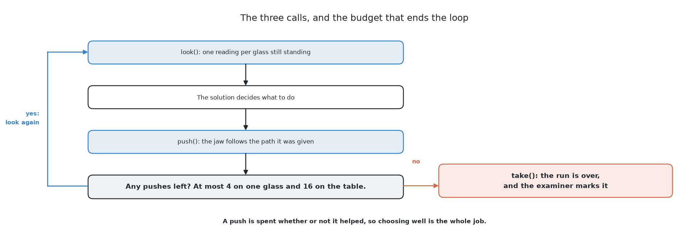
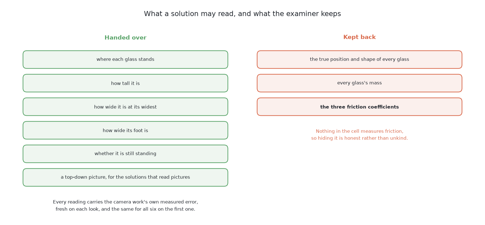

# What goes in and what comes out

## 1. Introduction

Every solution in this book is handed the same things and has to hand back the
same kind of thing. This page says exactly what those are: what a solution may
read, what it is never told, what a push does and reports, and what a solution
returns. It follows [what is asked for](01_what-is-asked-for.md), which says why
the arm drags the glasses rather than lifting them, and it comes before [the
examiner](03_the-examiner.md), which draws the tables these calls are made on
and marks the result.

Everything here is carried out by the examiner's code, in
`code/src/09_pushing-the-glasses-apart/bench/`, so it is the same for all six
solutions.

## Contents

1. [Introduction](#1-introduction)
2. [Three calls, in a loop](#2-three-calls-in-a-loop)
3. [What `look()` hands over](#3-what-look-hands-over)
4. [What a solution is never told](#4-what-a-solution-is-never-told)
5. [What `push()` does, and what it reports back](#5-what-push-does-and-what-it-reports-back)
6. [What must come out](#6-what-must-come-out)
7. [Where to go next](#7-where-to-go-next)

## 2. Three calls, in a loop

A solution touches the table only through the examiner, so the first thing to
know is the shape of that contact.

The examiner offers exactly three calls and nothing else: `look()`, `push()` and
`take()`. They form a loop. A solution looks, decides, pushes, and looks again.
What ends the loop is the budget of pushes rather than the solution's own
judgement.

The loop starts with a look, so the next section says what a look returns.

## 3. What `look()` hands over

The loop above begins by reading the table, and this section says what that
reading contains.

**`look()` returns one reading per glass still on the table.** For each glass:
where it stands, how tall it is, how wide it is at its widest, how wide it is
at its foot, and whether it is still standing. It is the same list of facts the
camera work for [telling the glasses
apart](../../08_seeing-the-glasses/02_the-problem/01_what-is-asked-for.md)
produces, which is why this problem can begin where that one ended.

**Each reading carries that camera work's measured error.** The numbers are
not the true ones. The examiner adds a small random error to the position, to
both widths and to the height, with sizes taken from what the programmed
solution there actually scored, which [its own
results](../../08_seeing-the-glasses/11_the-results.md) record. The width error
is the largest of the three, and the position error the smallest. The error is
fresh on every look, so looking twice is worth something. It is drawn from the
table's number and the number of the look, which means the first look at a
given table is identical for all six solutions. Nobody gets an easier first
measurement than anybody else.

**Solutions that read pictures also get a top-down view of the same table.**
Three of the six read pictures rather than numbers: an imitation policy trained
on images, and the two vision-language models. A list of numbers is not an
input they can use. So the examiner renders a picture of the same table at the
same moment, which keeps the input the same information in a different form.
It is built in `bench/top_view.py`: a camera fixed 750 mm above the middle of
the glass zone, looking straight down, returning a 384 by 384 colour picture
that frames the whole zone. It is separate from the camera `film.py` uses,
which looks steeply down from the arm's side and exists only for watching a run
by eye.

What a look leaves out matters as much as what it includes, and the next
section lists it.

## 4. What a solution is never told

The readings above are all a solution sees of the table, and this section says
what the examiner knows and keeps back.

**A solution is never given the simulator's record.** The examiner knows each
glass's true position, its true shape and its mass, and it keeps all of it.
Only the scoring code reads those, and only after a run has finished. A learned
solution may use them as training labels on the training tables, but nothing
reads them while answering, because a solution that read the truth would not be
answering this problem.

**It is also never given the friction.** The examiner holds three coefficients
privately: glass on the table, glass on glass, and the jaw's own aluminium and
silicone on glass. Every table uses the same three. They are hidden because
hiding them is honest: **nothing in the cell measures friction**. There is no
sensor for it, and there is no way to find it out. This single omission is
what makes the problem hard.

Since friction cannot be read, the only evidence of it comes from pushing, and
the next section describes what a push reports.

## 5. What `push()` does, and what it reports back

`look()` tells a solution where things are, and `push()` is the only way it can
change them. It is also the only call that brings back anything about friction.

One push runs as a fixed sequence. The closed jaw is held level, pointing the
way it will travel. It comes down at the start point the solution chose, to the
lowest height the gripper can reach. It then feels forward very slowly until
the force it feels passes a small threshold, which means it has touched
something. From there it pushes the asked-for distance at a steady speed, backs
off a couple of centimetres, and lifts clear to a travel height above the
tallest glass. Three things can interrupt this. The jaw can touch something on
the way down, in which case it goes straight back up without pushing at all. It
can reach the end of its forward feel without ever touching anything. Or the
force can pass a much higher threshold during the push, which means something
is wedged, and the push stops where it is.

**The push then reports what it felt**, and this report is the only thing that
comes back. It says whether the jaw was blocked on the way down, how far
forward it travelled before touching or that it never touched, whether it
jammed, the most force it felt at any moment, and how far it actually moved
after touching.

### How the jaw's force is measured

Of everything a solution is handed, the force reading is the only part that
comes from touch rather than from the camera, so it is worth saying which
sensor makes it and how.

**The sensor is a six-axis force-torque sensor between the arm and the
gripper.** The arm ends in a flat plate called the flange, and the gripper is
not bolted straight to it. A force sensor sits between the two, so the gripper
hangs from the arm only through that sensor. Anything that pushes on the jaw
therefore pushes, through the gripper's body, on the sensor. "Six-axis" means it
reports six numbers: the force along each of three directions, and the twist
about each of them. The cell declares this sensor in
[`arm/gripper.urdf.xacro`](https://github.com/RobinNagpal/robot-arm-projects/blob/main/v5-pick-glasses/src/work_cell/work_cell/arm/gripper.urdf.xacro),
under the name `wrist_force`. In the Gazebo cell it reports 100 times a second,
in the gripper's own directions. The camera cannot measure a force at all, and
the cell's two other sensors, the contact sensors in the pads, are read only as
whether a pad is touching something.

**A real sensor of this kind measures how much a piece of metal bends.** Inside
it is a stiff metal part that bends by a tiny amount under load, too little to
see. Strain gauges are glued to that part. A strain gauge is a thin wire pattern
whose electrical resistance changes as it is stretched, so the bending becomes a
change in voltage. A calibration made by the maker turns the voltages from all
the gauges into the three forces and three twists. Because the sensor is in
effect a very stiff spring, it reads every load below it, including the
gripper's own weight. That weight is measured once with nothing touching and
then subtracted, so that what is left is the force from contact.
[Force and torque at the
wrist](../../03_frameworks/02_gripping/02_grippers-and-hardware.md#81-force-and-torque-at-the-wrist)
gives the published figures of one such sensor.

**In the examiner, the force is added up from the physics.** The pushing is
tested in MuJoCo rather than Gazebo, for reasons [the
examiner](03_the-examiner.md#3-what-the-examiner-draws) gives, and MuJoCo has no sensor model to read.
So at every step of the physics, which is every 2 milliseconds, the examiner
in
[`bench.py`](https://github.com/RobinNagpal/robot-arm-projects/blob/main/v5-pick-glasses/03-push-glasses-apart/bench/bench.py)
finds every contact that involves the jaw, adds up the force of each one, and
reports the size of the total in newtons. That is what the wrist sensor would
read once the gripper's weight had been subtracted. It has no noise and no
drift, which a real sensor has.

**The push uses that number at the three moments described above.** While the jaw comes down at
200 mm per second, any force above 0.1 newton means it has landed on something,
and it goes back up. While it feels forward at 10 mm per second, the first force
above 0.1 newton is the touch, and the push starts from there. The threshold is
that low because the lightest glass starts to slide under about a quarter of a
newton, and a higher threshold would push it along without noticing it. While it
pushes at 20 mm per second, a force above 20 newtons means something is wedged,
and the push stops. Throughout, the largest force seen is kept, and that is the
peak force the push reports.

**The distances in the report come from the jaw's position, not from the
sensor.** The sensor only says *when* the force crossed a threshold. Where the
jaw was at that moment comes from where the arm had put it, which on the real arm
is read from the joint encoders, the sensors that measure each joint's angle.
[Measuring by
touch](../../02_perception/02_object-perception/02_sensors.md#2-measuring-by-touch)
explains that division of work.

One caution applies to the real cell. The 0.1 newton touch threshold is about
the noise level of a typical wrist sensor, whose maker recommends ten times that
for detecting contact. So on real hardware the feel forward would need a higher
threshold or a slower approach, and the examiner's clean reading is one of the
ways it is easier than the world.

### Why the force reading matters

The rule that decides whether a pushed glass slides or tips over compares the
push height against half the glass's base width divided by the friction
coefficient. [Pushing without
toppling](05_pushing-without-toppling.md#3-the-limit-slide-or-tip) works it
out. A solution can measure the base width, because `look()` gives it. It knows
the push height, because that is the gripper's own number. The one term it
cannot have is the friction, so the rule gives a limit that is only as good as
a guessed number.

**So the force reading is the only channel through which friction is
observable at all.** How much force it took to start the glass moving, and how
far the glass went for that push, are consequences of the friction, so they are
indirect evidence about it. A glass that leaned and fell back where it stood
felt different from one that slid. Every solution that does better than a blind
nudge does so by reading that channel, either by reasoning about it or by
learning from it. An examiner that reported only success or failure would have
made the interesting half of this problem invisible.

A solution has now read the table and felt its pushes, and the last question is
what it hands back.

## 6. What must come out

The inputs above are fixed for every solution, and this section fixes the
output, which is the harder decision because the six do not naturally hand back
the same kind of thing.

**The shared output is a jaw trajectory**: a path for the jaw to follow, and
then another, until the table is done or the budget is spent.

Some of the six do not think in trajectories at all. A geometric solution
thinks in a **parameterised push**: a handful of numbers saying which glass to
move, where to put the fingertips down, which way to point, how far to feel
forward and how far to push. That is exactly what `push()` accepts, and
`push()` itself is the machinery that turns those numbers into the descend,
feel, push, back off and lift described above. So **the expansion from a push
into a trajectory is a macro the examiner owns**, not something a solution
writes. Every parameterised push is expanded the same way, by the same code, so
no solution gains or loses anything in that step.

Other solutions think in trajectories natively. A modern imitation policy does
not emit one target at a time. It emits an **action chunk**, which is a short
run of consecutive waypoints predicted together in one pass through the
network. Those solutions call `follow()` instead of `push()`. It takes a
`Chunk` of jaw waypoints and carries them out in the same physics, reporting
the same `Felt` into the same record, so the scorecard cannot tell which door
an action came through. The examiner also writes down the path the jaw really
followed on every action, sampled at a fixed rate. That is what turns a
parameterised push into a demonstration that a policy emitting waypoints can be
trained on.

**The obvious alternative would be worse.** The examiner could insist that
every solution emit the same small set of push parameters, which sounds like
the fairest possible rule. It would in fact be the unfair one, because it would
destroy the action chunking that makes those policies work. Predicting a chunk
is how those policies stay consistent over a motion instead of wobbling from
one step to the next. Squeeze such a policy down to three numbers and what you
measure is a damaged version of the method rather than the method that exists.
Allowing two kinds of output works because the examiner [marks the outcome, not
the action](03_the-examiner.md#4-the-score-is-the-outcome-not-the-action).

**A refusal is an output too, where one is honest.** A glass that tips before
it slides, or has nowhere clear to go, is reported with the reason rather than
attempted. A refusal is a result.

**`take()` ends a glass's part in the run.** It lifts a glass off the table and
racks it, which is the earlier job of carrying a single glass to the rack, done
for free here. The examiner quietly records whether the glass really had room
at the moment it was taken. That record is how the marking later knows whether
the arm's own belief about room was correct.

Those are the inputs and outputs every solution shares, and the next page
describes the examiner that draws the tables and marks what comes back.

## 7. Where to go next

- [The examiner](03_the-examiner.md) draws the crowded tables, holds the
  physics, and marks every run the same way.
- [The target layout](04_the-target-layout.md) works out where the glasses
  should end up.
- [Pushing without toppling](05_pushing-without-toppling.md) gives the height
  limit and the loop of plan, feel and look again.

← [Push the glasses apart — what is asked for](01_what-is-asked-for.md) · [The examiner](03_the-examiner.md) →
