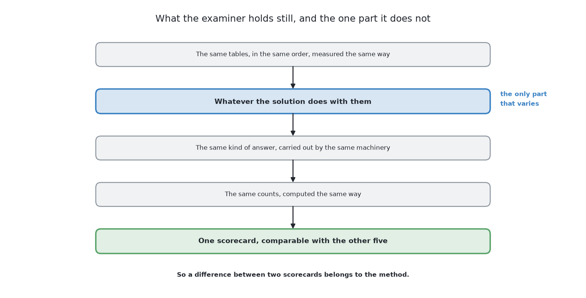
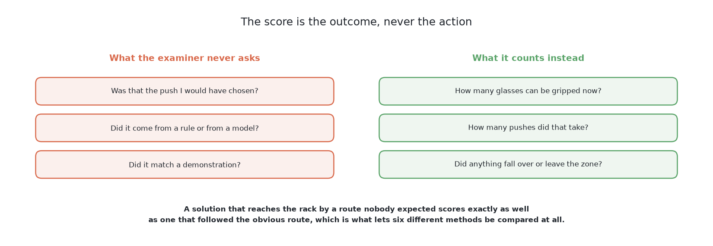

# The examiner — the same question for every answer

## 1. Introduction

This problem is answered six different ways, and six answers are only
comparable if they were asked the same question and marked by the same
examiner. The examiner is that examiner. It draws the crowded tables, holds
the physics the glasses slide and tip in, hands each solution the same
measurements, carries out whatever push comes back, and then marks the result
against what it knows really happened. By the end of this document you will
understand why there is an examiner at all, how it draws its tables and why
its physics is MuJoCo, why the marking looks at the outcome and never at the
action, what the scorecard counts, and which two things this scorecard needs
that the examiner for [telling the glasses
apart](../../08_seeing-the-glasses/03_the-examiner/01_the-examiner.md) did not.

What a solution is handed and what it hands back, through the examiner's
`look()`, `push()` and `take()`, is on the page before this one, [what goes in
and what comes out](02_what-goes-in-and-what-comes-out.md), and this page
assumes it.

The examiner is built. It lives in `code/src/09_pushing-the-glasses-apart/bench/`,
and every solution in this book runs on it. Where this document describes
something that is a decision rather than working code, it says so.

## Contents

1. [Introduction](#1-introduction)
2. [Why there is an examiner at all](#2-why-there-is-an-examiner-at-all)
3. [What the examiner draws](#3-what-the-examiner-draws)
4. [The score is the outcome, not the action](#4-the-score-is-the-outcome-not-the-action)
5. [What the examiner measures](#5-what-the-examiner-measures)
6. [Two things this scorecard needs that the camera work's did not](#6-two-things-this-scorecard-needs-that-the-camera-works-did-not)
7. [Where to go next](#7-where-to-go-next)

## 2. Why there is an examiner at all

Without one, each of the six would arrive with its own tables, its own idea of
a good push and its own way of counting success, and nothing could be concluded
by setting their results side by side. The examiner exists to remove every
difference between the six except the one being studied.

It does that by holding three things fixed. The **input** is the same
measurements of the same tables, in the same order. The **output** is the same
kind of thing, carried out by the same machinery. The **marking** is the same
set of counts, computed the same way. Everything a solution is free to change
sits between the input and the output, and that middle part is exactly what we
want to compare. So when a learned policy clears more tables than a fixed
nudge, the difference belongs to the policy and not to a kinder table or a
gentler scorecard.

## 3. What the examiner draws

The tables are the first of those three fixed things, so they come first.

**Every table is crowded on purpose.** It holds four to six glasses of one
kind, with the kind and the count cycling from one table to the next so that
all four kinds are met in turn — the straight glass, the tapered glass, the
stemmed glass and the short stemmed glass. The glasses stand inside the glass
zone, and none of them touch: there is always a little daylight between any
two.

**The crowding comes from where the glasses are stood, not from their
shapes.** When the examiner places a glass, it mostly stands it deliberately
close to a glass already down — closer than the gripper can work with, but
still not touching. The rest go anywhere on the glass zone they fit, which
crowds some of them as well by accident. A table is only accepted if at least
one glass on it has no room, so there is never a table where the right answer
is to do nothing.

**Having room is the gripper's test, measured to the neighbour's edge.** A
glass has room when no other glass's edge lies within 76 mm of its middle.
[The gap that
matters](01_what-is-asked-for.md#6-the-gap-that-matters-is-not-the-gap-between-the-glasses)
explains the number and why the test is not symmetric.

**The tables are numbered, and the numbers are split.** Each table is drawn
from a single number, so the same number always gives the same table, and any
solution can be run on exactly the tables another was run on. Numbers above a
fixed dividing line are for testing only; training draws from below it. This
means no solution is ever marked on a table it was fitted on, which matters
here more than it did when [telling the glasses
apart](../../08_seeing-the-glasses/02_the-problem/01_what-is-asked-for.md),
because four of the six solutions are trained.

**The physics is MuJoCo, standing in for Gazebo.** There are two reasons. The
first is speed: a learned approach needs thousands of pushes, and Gazebo runs
each one at the speed of real time, so a training set that MuJoCo produces in
hours would take weeks. The second reason is fairness, and it is the more
interesting one. MuJoCo is physics that neither approach wrote. If the examiner
pushed glasses around using a push model written for this project, then a
programmed solution built on that same model would win by knowing the answer,
and the comparison would measure nothing. A contact solver nobody here
authored is a thing both sides are equally ignorant of.

The glasses in it are not simplified away. Each one is built as a stack of
cylinders, each cylinder as wide as the glass is at its widest anywhere inside
it, so the collision shape is never thinner than the real glass. The bottom
cylinder is the foot, which is the edge the glass tips over.

## 4. The score is the outcome, not the action

The tables above are what a solution is marked on, and the first rule of the
marking answers an obvious objection. [What must come
out](02_what-goes-in-and-what-comes-out.md#6-what-must-come-out) allows two
kinds of output, so if one solution hands over three numbers and another hands
over twenty waypoints, how can their results be compared at all?

The answer is that **the examiner never marks the action**. It does not ask
whether a push was the push it would have chosen, whether the heading was
sensible, or whether the waypoints were smooth. It looks only at the state of
the table afterwards: which glasses have room, which are still standing, where
each one ended up, and how many pushes it took to get there.

This is what makes the two outputs comparable. A score that looked at the
action would need a single language to express every action in, and there is no
such language that is fair to both a three-number push and a learned chunk of
waypoints. A score that looks at the table needs no such language, because the
table is the same table either way. Both solutions are asked the one question
that the problem actually cares about: are the glasses far enough apart now,
and is everything still standing?

## 5. What the examiner measures

The scoring code reads the simulator's record after a run has finished and
turns it into one scorecard, in the same shape for every solution.

**Each table gets one of three outcomes**, which are the three
[the problem](01_what-is-asked-for.md) defines. A table is **done** when every glass was
racked, and each one was racked while it really had room. It is **correct but
incomplete** when some glasses are still on the table, each one reported with a
reason, and nothing went wrong. It is **wrong** when anything went wrong at
all.

**Each glass is then counted individually**, which is where the detail lives.
A glass may have been racked; or refused with a reason; or it may have gone
wrong in one of several ways. The problem names three wrong endings — a glass
**toppled**, a glass **pushed off the table**, and a glass **pushed into the
rack** — and the examiner detects all three with two tests. Toppling it decides
by how far the glass leans from upright. The other two are the same thing
geometrically, because in both the glass has ended up outside the region it
was allowed to be in, so one test covers them: the glass **left the glass
zone**. The examiner adds two more wrong endings of its own. A glass **picked
without room** is one the arm believed it could grip when it could not, which
is a mistake the arm would not otherwise notice. A glass **left with no
reason** is one abandoned on the table in silence.

**Glasses grippable at the end** is the measurement the problem is really
about, and the examiner gets it from racking rather than by measuring gaps. A
glass is only counted as racked if it had genuine room at the moment it was
taken, so a run that clears the table has demonstrated grippability rather than
asserted it.

**That measurement rests on an assumption, and it is worth saying what the
assumption hides.** When the examiner racks a glass it asks one question, which
is whether the glass had room around it, and it never asks the other one, which
is whether the cell could have picked that glass up at all. Those are not the
same question, and the distance between them is larger than it sounds. The cell
has a rule of its own for where to hold a glass, in
[`glasses/rules.py`](../../../code/src/08_seeing-the-glasses/work_cell/work_cell/glasses/rules.py),
and that rule can simply be asked. Given the real gripper's measurements and
each held-out glass's own shape, **it finds somewhere to hold only 97 of the
251**.

Read the table below a row at a time: each row is one kind of glass, and the
numbers are how many of that kind the rule can hold out of how many there are.

| kind | a grip found |
|---|---|
| straight | 62 of 65 |
| tapered | 18 of 66 |
| stemmed | 17 of 60 |
| short stemmed | **0 of 60** |

**The commonest reason is reach rather than width.** The gripper comes in level
from the side, so the whole tool lies across the height it holds at instead of
sitting above it, and whatever hangs furthest below the tool's own axis decides
how low it can go. That leaves a floor 50 mm above the table. A glass with
nothing worth holding between that floor and its own halfway point is refused,
and a short stemmed glass is all stem below the line, which is why not one of
the 60 can be held.

This is a limit of the picking step rather than of anything in this book, and
no solution's score depends on it, because all six are marked by the same
examiner in the same way. The films are honest about it too: the pick-up each
one draws is a stand-in, and the line on screen says that the real pick belongs
to the cell's own grip rule. What the finding adds is that **spreading the
glasses apart is not the whole of the job**. This book's half of the work can
succeed completely and still leave a glass that the next half, closing the hand
on it, cannot take.

**Pushes are counted against a budget.** The scorecard records how many pushes
were spent in total, how many of them were repeat pushes on a glass already
pushed, and how many went wrong in each of the ways a push can: blocked on the
way down, never touching anything, or jamming. The budget itself — a fixed
maximum per glass and per table, after which the remaining glasses must be
refused — used to live in the code that drives each run, so the counts were not
comparable. It now lives in the examiner, as `PUSHES_PER_GLASS` and
`PUSHES_PER_TABLE`, so all six are given the same number. When the two numbers
were brought together the larger pair was taken, 4 and 16 rather than 3 and 15,
so that moving to one budget could not cramp a solution that already worked.
The solution that had been running on the smaller pair, the fixed nudge, was
measured under both and scores the same either way, because it refuses for want
of room long before it runs out of tries.

**Refusals are counted with their reason, and a refusal is a result rather
than a failure.** Some glasses cannot be pushed safely at all, because they tip
before they slide, and for those the only correct answer is to refuse. So the
examiner groups refusals by the reason given and reports the groups. A solution
that refuses the glasses it should refuse scores *correct but incomplete*,
which is a good outcome; a solution that quietly leaves those same glasses with
no reason scores *wrong*. Saying "I cannot do this, and here is why" is part of
the answer.

**Finally, the examiner records how far each glass ended from where the push aimed
it.** Every push carries the place the solution expected the glass to arrive,
and once the glass has settled the examiner measures the real distance between the
two, reporting the middle value and the worst. For most of the six that
expected place comes from [the target layout](04_the-target-layout.md), which
computes where the glasses should end up. This number is a **reference and not
a pass mark**. A push that lands some way from its aim is not wrong, because
the problem never asked for the glasses to be anywhere in particular — only
far enough apart. What the number is good for is reading a solution's own
model of pushing: a method whose glasses land close to its aim understands
what a push does, and a method whose glasses scatter is succeeding by looking
again rather than by predicting, which is a real strategy but a different
one.

**The scorecard also keeps one row for each table.** Everything above is a
total over the whole run, and a total answers how a solution did without saying
anything about how it did on any one table. Those are different questions: a
run that finishes 14 tables out of 50 does not say which of the 50 is the one
worth looking at. So beside each run's scorecard the examiner writes a second
file holding one row per table, which records that table's outcome, how many
glasses were racked, how many were knocked over, how many pushes were spent and
how far the glasses travelled in total. The rows exist so that a table can be
chosen because it stands for the run rather than because it flatters the
solution, and that is how the film on each solution's own page was picked. They
also show something a reader might not guess: the typical table is a different
kind of table for each solution. The world model usually finishes one, the two
written-geometry solutions and the two borrowed models usually leave one
unfinished, and the fine-tuned policy usually ends one in a state the cell
should never reach. That is why the one table all six are filmed on had to be
chosen by a rule covering all six at once, rather than by picking whichever
table looked representative.

## 6. Two things this scorecard needs that the camera work's did not

The examiner for [telling the glasses
apart](../../08_seeing-the-glasses/03_the-examiner/01_the-examiner.md) could run each solution
once and read the result. This one cannot, and there are two reasons. Both are
consequences of four of the six solutions being trained rather than written,
and both are now in `scoring.py`: `Repeats` holds several evaluation runs and
reports the spread across every number, and `Scorecard` reports the time per
push beside the counts.

**One run is not a measurement.** The learned policies here are stochastic:
asked the same question twice they may act differently, because the action is
drawn rather than computed. On top of that, training itself varies with its own
random seed, so the same method trained twice gives two different policies of
different quality. The uncomfortable part is that this variation is sometimes
**larger than the gap between two methods**, which means a single run of each
can easily report the wrong winner — and report it with no sign that anything
is uncertain. So each trained solution has to be trained with several seeds and
evaluated over several runs, and the scorecard has to carry the **spread** and
not only the middle. A result quoted without a spread is not a result. A method
that wins by less than its own spread has not been shown to win.

Drawing the action rather than computing it has one more consequence, and it is
easy to be caught by. For such a solution **one table on its own is not the
same table as that table reached in a run**, because every draw the policy made
on the earlier tables has already moved its stream of random numbers along. So
reproducing what a row says about the fourth table of a run means running the
first three tables as well, and a solution filmed table by table will not
always do what the scorecard says it did.

**Running cost differs by orders of magnitude, so it belongs on the
scorecard.** The six are not equally expensive to run for a single push, and
the range is enormous. A fixed nudge is arithmetic and costs essentially
nothing. A planner that uses a learned world model searches over candidate
actions at run time, simulating each one forward through the model before
committing, so its cost per push is hundreds or thousands of times the
arithmetic. A foundation model is a large neural network forward pass, which
is a different kind of expense again, and one that usually needs rented
hardware. Leaving this out would make the scorecard misleading, because **a
solution that wins while taking a hundred times longer has not obviously
won** — on a real arm it may not be runnable at all, and the honest comparison
is not "which scored best" but "which scored best for what it cost". So each
solution reports what it needs and roughly what renting that costs, in the same
way its licence is stated, and the time per push sits on the scorecard beside
the counts.

## 7. Where to go next

- [The target layout](04_the-target-layout.md) — where the glasses should end up,
  computed rather than learned, and the least movement the task needs.
- [Pushing without toppling](05_pushing-without-toppling.md) — how low the push
  has to be, why that is a property of the glass, the refusal path, and the
  loop of plan, feel and look again.
- [The six solutions](../03_the-six-solutions/01_how-the-six-compare.md) — what each method puts between
  the input and the output.

← [What goes in and what comes out](02_what-goes-in-and-what-comes-out.md) · [The target layout](04_the-target-layout.md) →
