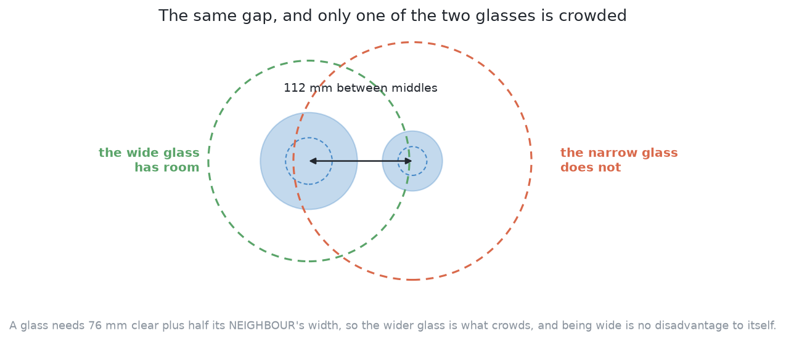
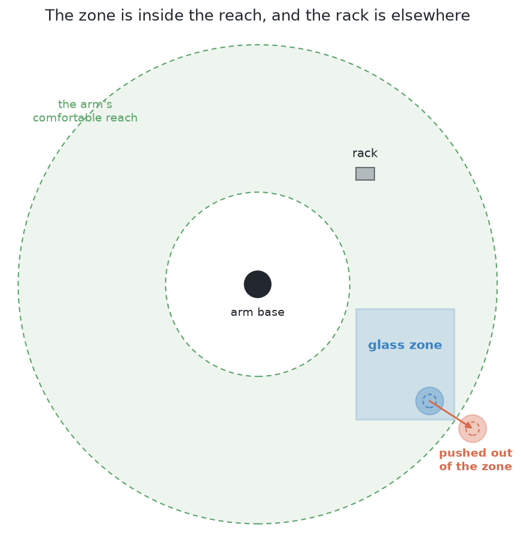
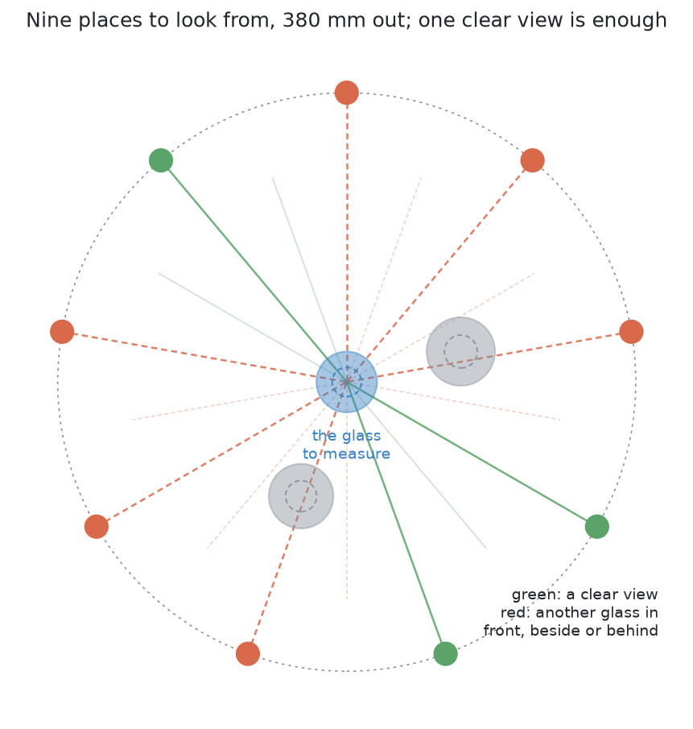
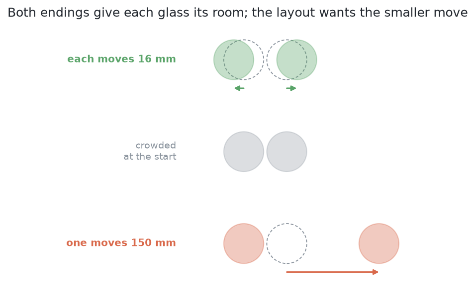

# The target layout — where the glasses should end up

## 1. Introduction

A push has two halves. One half is *how* to push a glass, which is where
friction, tipping and the arm's own clumsiness live, and which is the whole of
the rest of this problem. The other half is *where to push it to*, and this
document is about that half. It is deliberately separate from the six
solutions, for the same reason [looking again at what was
hidden](../../08_seeing-the-glasses/02_the-problem/02_looking-again-at-what-was-hidden.md)
is separate from the [six answers of the camera
work](../../08_seeing-the-glasses/04_the-six-solutions/01_how-the-six-compare.md): **every
one of them needs it and none of them differs in it.** By the end of this
document you will understand why choosing where a glass should end up
is not a learning problem at all but plain geometry, what each condition on
the answer looks like when it is broken, four methods that solve
that geometry and what each one is good for, why the answer is computed once
and handed to all six rather than left to each, how the same computation
produces the least movement the task could possibly need — which turns out to
be the most valuable thing in here — and what the layout still does not tell
you.

Read this after [the problem](01_what-is-asked-for.md), which explains the
clear room the gripper needs, and [what goes in and what comes
out](02_what-goes-in-and-what-comes-out.md), which explains the measurements
`look()` hands over.

## Contents

1. [Introduction](#1-introduction)
2. [The question, written out](#2-the-question-written-out)
3. [Each condition, drawn](#3-each-condition-drawn)
4. [Four ways to place the discs](#4-four-ways-to-place-the-discs)
5. [Why this is shared and not a solution](#5-why-this-is-shared-and-not-a-solution)
6. [The displacement floor](#6-the-displacement-floor)
7. [Two cautions](#7-two-cautions)
8. [What the layout does not tell you](#8-what-the-layout-does-not-tell-you)
9. [Where to go next](#9-where-to-go-next)

## 2. The question, written out

The pushing task is finished when every glass has about 70 mm of clear room in
every direction, at least one usable viewpoint for a side-on photograph, and
nothing has been knocked over. That is a statement about **where the glasses
are**, so before anything can be pushed, somebody has to decide where each glass
is supposed to go.

Written out, the decision has three conditions it must satisfy, and one thing
it should make as small as possible:

- every glass has its clear room;
- every glass stands inside the glass zone, and so also within reach and clear
  of the rack;
- every glass keeps a usable line of sight from the side;
- and the glasses move as little as possible.

[Each condition, drawn](#3-each-condition-drawn) gives every one of them its
own picture and says what goes wrong when it is broken.

Now look at what those three conditions and that one preference need to know.
They need where each glass stands and how wide it is, both of which `look()`
reports. They need the
gripper's clear room, the glass zone, the rack and the reach, all of which the
cell publishes as constants. **They do not need friction, or weight, or how a
glass behaves when it is shoved** — none of which anybody here knows. So every
glass is a disc of known size at a known place on a flat rectangle, and the
question is where to slide those discs so that none of them overlaps another's
clear room, none leaves the rectangle, and the total sliding is least. That is
a geometry exercise, it has no unknowns in it, and it can be solved completely
before the arm touches anything.

A list of conditions is hard to picture from words alone, so the next section
draws each one in turn.

## 3. Each condition, drawn

The previous section listed what the layout must satisfy, and this section
shows each condition as a picture of a table that breaks it, so that the issue
can be seen rather than worked out from numbers.

### Every glass has its clear room

The picture shows a wide glass and a narrow glass standing 112 mm apart. The
dashed circle round each glass is the room it needs clear before the open jaw
fits round it. The wide glass's circle has nothing in it, so the wide glass can
be gripped. The narrow glass's circle reaches into the wide glass, so the
narrow glass cannot.

**The issue is that one gap can crowd one glass and not the other.** The room a
glass needs is counted from its own middle out to its neighbour's edge, so it
grows with the neighbour's width. A wide neighbour reaches further into the gap
than a narrow one does. A layout that only checked the distance between two
middles would call this pair fine, and the narrow glass would still be
ungrippable. So the layout checks every glass against the edge of every
neighbour. [The gap that
matters](01_what-is-asked-for.md#5-the-gap-that-matters-is-not-the-gap-between-the-glasses)
explains where the room comes from.

### Every glass stands inside the glass zone

The picture shows the table from above with the arm's base in the middle. The
green ring is where the arm works comfortably. The blue rectangle is the glass
zone, the stretch of table where glasses are allowed to stand. The small grey
box is the rack, which stands on the arm's other side.

**The issue is a glass pushed somewhere the rest of the job cannot follow.** The
red glass has been pushed over the edge of the zone. It may have plenty of
room there, but the examiner marks a glass that has left the zone as a wrong
ending, because leaving the zone is how a glass goes off the table or into the
rack's stretch of it.

The picture also shows why one rectangle is enough. Every corner of the zone is
between 330 and 777 mm from the arm's base, so the whole zone lies inside the
reach ring. And the rack never shares a stretch of table with the zone. So in
this cell a glass inside the zone is also within reach and clear of the rack,
and the layout needs only the one test.

### Every glass keeps a usable line of sight from the side

Measuring a glass means photographing it from the side. The arm is offered
nine places for the camera, spread evenly on a circle 380 mm out from the
glass, 40° apart. The picture shows those nine places round one glass, with two
neighbours nearby. A place is green when the glass would be alone in its
picture. It is red when another glass would appear in the same picture, in
front of the glass, beside it or behind it.

**The issue is a glass that can be gripped but not measured.** When another
glass shares the picture, the two touch in the camera's view, and the
measurement reads them as one glass as wide as both. Here three of the nine
places are clear, which is enough, because the measurement needs only one
clear view. A layout that left all nine red would leave a glass that has its
room and still cannot be picked up properly.

### The glasses move as little as possible

The middle row of the picture is a crowded pair: two narrow glasses with only
5 mm of daylight between them. The top row parts them by moving each one 16 mm.
The bottom row parts them by pushing one glass 150 mm to open table. Both
endings satisfy the three conditions above.

**The issue is that many layouts are legal, and they are not equally safe to
reach.** Every millimetre a glass is pushed is a millimetre in which it can be
knocked over. So of all the legal layouts, the wanted one is the one nearest to
where the glasses already stand, which here is the top row.

Those pictures turn the conditions into a precise question, and the next
section gives four standard ways of answering it.

## 4. Four ways to place the discs

The exercise has several standard solutions, and they are worth knowing
together because they trade different things against each other. Two words are
needed first, because all four use them.

An **objective** is the single number a method is trying to make as small as
possible. Here it is the total travel: for each glass, the square of how far it
moved, added up over all the glasses. Squaring is the usual choice because it
makes the number smooth, which is what lets a method follow its slope downhill,
and because it dislikes one long push more than it dislikes several short ones.

A **constraint** is a condition the answer is not allowed to break, however
good its objective would be. Here the constraints are the three conditions
above: a pair of middles no closer than the required distance, every glass
inside the zone, outside the rack, inside the reach, and with one of its nine
side-on viewpoints clear.

Read the four that follow against this table, which says what each one is for
before the detail arrives. The first column is the method, the second what it
buys, and the third what it costs.

| method | what it is good for | what it costs |
|---|---|---|
| a constrained optimisation | being right: it is the one actually minimising the travel, so its answer defines the floor | needs a solver, slowest of the four, and can settle in a local optimum |
| repulsive relaxation | speed and simplicity, and it hands back the path as well as the destination | no guarantee it lands anywhere optimal |
| assignment to slots | certainty: the layout cannot come out illegal | the answer is as good as the slots somebody chose |
| Lloyd's algorithm | being almost nothing to write | a starting layout and a sanity check rather than an answer |

### A constrained optimisation

The first method is to hand the objective and the constraints to a solver and
ask it for the answer directly. Nothing is approximated and nothing is left
out: minimise total squared displacement, subject to every pair of middles
being at least the required distance apart and every glass lying inside the
zone, outside the rack, inside the reach and with a clear viewpoint.

The method that solves this kind of problem is **sequential quadratic
programming**, and the idea behind the name is simpler than the name. The real
problem is awkward because the clearance constraints are curved — a distance
between two middles is a square root. So the solver does not try to solve it
directly. At the current layout it replaces the objective with the nearest
simple curved approximation and each constraint with the nearest straight-line
approximation.
What that leaves is a **quadratic program** — a curved objective with
straight-line constraints — which is the one shape of this family of problems
that is solved exactly and quickly. The solver takes that answer as a step,
moves there, and builds a fresh approximation at the new layout. Repeated, the
steps settle on an answer that satisfies the true constraints, which is where
the word *sequential* comes from.

**What it is good for** is being right. This is the method whose answer defines
the floor described below, because it is the one actually minimising the
objective rather than arriving near it by another route. The price is that it
needs a solver, it is the slowest of the four, and it can settle in a local
optimum, which is the first of the two cautions at the end.

### Repulsive relaxation

The second method does without a solver and uses physics instead. Give every
pair of glasses a **repulsive potential**: a cost that is near zero while they
are comfortably apart and climbs steeply as they close in on the required
distance. Give every wall of the zone, and the rack, the same kind of cost. Add
all those costs together and the whole layout has one number attached to it,
which is high when anything is crowded and low when nothing is. Then move every
glass a small step in the direction that lowers that number most, and repeat
until nothing moves any further — which is an **equilibrium**, the state in
which the repulsion on every glass from every side cancels.

This is exactly the move of letting a handful of like charges loose in a box.
They repel, they spread, they stop when each one is being pushed equally from
every side. Nobody solves anything; the arrangement arrives on its own.

**What it is good for** is speed and simplicity. It is a few lines of
arithmetic with no solver behind it, and for four to six glasses it finishes
before anything else has started. It is also crude: it has no idea that travel
is supposed to be small, so it will cheerfully spread glasses further than the
task requires, and the layout it settles on is not the nearest legal one.

Its real advantage is something else, and it is a practical one. The method
produces not one layout but a whole sequence of them, one per step, each a
little less crowded than the last, every one of them free of overlaps. **That
sequence is a set of waypoints.** A layout on its own says only where a glass
should finish; this method also says a route it can take to get there without
passing through a neighbour on the way, which is a question the other three
methods leave entirely open.

### Assignment to slots

The third method is different in kind from the other three, and the difference
is the point of it. Instead of asking where the glasses should go, it decides
the available positions in advance and then asks only **who goes where**.

Work out, once, a set of positions inside the zone, outside the rack, inside
the reach, and far enough apart that the clear room holds for any glass of this
kind standing at any of them. Call each one a **slot**. Because the slots were
built to satisfy the constraints, every way of putting glasses into distinct
slots is legal by construction, and there is nothing left to check. All that
remains is the choice of which glass takes which slot, and the cost of a choice
is the total distance the glasses travel.

That is a classical problem with a name worth knowing, the **assignment
problem**: given a cost for every pairing of a worker with a job, choose a
one-to-one pairing with the least total cost. It is solved exactly — not
approximately — by the **Hungarian algorithm**, in time that grows as the cube
of the number of items, which for four to six glasses is no time at all.

**What it is good for** is certainty. The layout cannot be illegal, the answer
is exact, there is no seed and no local optimum to worry about, and the same
slots come out of every run, which makes two runs easy to compare. The price is
paid in travel: the nearest slot to a glass is rarely the nearest legal
position, so this method's total displacement sits above what a free layout
could achieve. It is the method to use when an answer that is certainly
legal and instantly available is worth more than an answer that is best.

### Lloyd's algorithm

The fourth method comes from a different field and solves a slightly different
question — spread points evenly through a region — but it answers this one
nearly for free, so it is worth knowing.

First the idea it rests on. Take the glasses' middles and divide the whole glass
zone by nearest middle: every point of the table belongs to whichever glass is
closest to it. The set of points belonging to one glass is that glass's
**Voronoi cell**. A crowded glass has a small cell, squeezed by its neighbours;
a glass alone in a corner has a large one. The cells tile the zone exactly, with
no gaps and no overlaps.

**Lloyd's algorithm** is then two steps repeated. Work out every glass's
Voronoi cell, move every glass to the middle of its own cell, and do it again.
A glass whose cell is lopsided because a neighbour is pressing on one side gets
moved away from that neighbour, so crowding undoes itself, and the arrangement
drifts towards one where every glass sits in the middle of its own fair share
of the table.

**What it is good for** is being almost nothing to write. With a Voronoi
routine available it is a few lines, it is very hard to make it fail, and it
spreads points more evenly than repulsion does. Its weakness is that even
spreading is not what the task asked for: it optimises neither the clearance
nor the travel, and it is perfectly capable of walking a glass across the table
to balance a cell when the glass only needed a nudge. Its honest place is as a
starting layout for the constrained optimisation, or as a cross-check that the
zone has room for the glasses at all.

### Which to use

All four produce the same kind of answer, so the choice is about what the answer
is for. The constrained optimisation is the one that defines the floor and is
therefore the one that has to be run. Repulsive relaxation is worth keeping
beside it for its waypoints. Assignment to slots is the fallback for when a
legal layout is wanted instantly and optimality is not the point, and Lloyd's
algorithm is a starting layout and a sanity check. One of them has to be
chosen and then frozen, for reasons the cautions below make plain.

**None of this is written yet, and it is worth being plain about that.** The
examiner exists, and so does the programmed geometry that picks a landing spot one
push at a time, which is a different thing: it answers *where can this glass go
next* rather than *where should every glass finish*. The layout described in
this document is a design for shared machinery, not code that runs today.

## 5. Why this is shared and not a solution

Having seen that the layout is computable, the next question is who should
compute it, and the answer is that it must not be each solution separately.

Suppose every solution worked out its own targets. Then two solutions could
score differently for two quite different reasons: one might genuinely push
better, or one might simply have aimed at an easier arrangement. A solution that
chose targets a long way apart would find the clearance easy to satisfy and
would look good at pushing; a solution that chose targets close to the legal
limit would have to be far more accurate to pass, and would look worse at
pushing while being no worse at it. The difference in the score would be a
difference in targets masquerading as a difference in skill, and the comparison
would be worthless.

One layout, computed once from the same measurements, handed to all six, removes
that completely. Every solution that aims at a destination is then aiming at the
same places, so the only thing that can differ between their scores is how well
it gets the glasses there — which is the thing this book exists to compare. A
solution is free to decline the layout and push a glass away from its neighbour
rather than towards a place, and one of the six does; what that costs it is
visible on the same scale, as travel against the floor described below.

This is precisely the argument the camera work's [test
examiner](../../08_seeing-the-glasses/03_the-examiner/01_the-examiner.md#6-what-must-come-back)
makes about its own shared step. There, the step that turns a mask into a place
and a width belongs to the examiner rather than to any of the six, because if each
solution did its own arithmetic a difference in the result might be a difference
in the arithmetic rather than in the mask. Here, the step that turns a set of
measurements into a set of destinations belongs to the examiner for exactly the
same reason. In both books
the rule is the same: **the shared part is everything that is not the thing
being compared.**

## 6. The displacement floor

The layout is useful for aiming, but the more valuable thing comes out of
computing it, and it is a yardstick.

When the constrained optimisation finishes, it reports not only the layout but
the value of its objective: the total movement that layout requires. Because the
solver was minimising exactly that number subject to exactly the conditions the
task imposes, **no arrangement that satisfies the task needs less movement than
this**. It is the least the task can possibly cost in travel, and it is called
the **displacement floor**.

That makes every solution readable on a scale that means something. A solution
does not just move the glasses some number of millimetres; it moves them some
multiple of the necessary movement. A solution at two times the floor spent
twice the travel the task demanded. A solution at ten times the floor was
wandering. And the scale is available **before any solution exists**, because it
comes from the measurements and the constants and nothing else — no model, no
training, no run. It cannot flatter a solution because it never saw one.

The most useful reading is at the bottom of that scale, and it needs saying
carefully. A solution close to the floor is not thereby a *good* solution.
What being close to the floor means is that **its remaining error is not its
fault**: the travel it spent was travel the task required, and no amount of
further cleverness in choosing pushes could have spent less. That is the signal
to stop optimising this part and look elsewhere, because effort put into a
solution already at its floor buys nothing.

The camera work has the same instrument and uses it the same way. Its examiner
runs its own exact masks through the shared arithmetic to find [the best place
and width that step could ever
produce](../../08_seeing-the-glasses/03_the-examiner/04_comparing-the-outputs.md#7-the-best-possible-answer-and-the-trap-below-it),
and a solution within a hair of that floor of error is, in that document's
words, not a good solution so much as one whose remaining error is not its
fault. The displacement floor is that measurement for this problem: computed
from perfect information, independent of every method, and the thing that makes
all the other numbers readable.

## 7. Two cautions

The floor is only trustworthy if two mistakes are avoided, and both of them are
easy to make.

**The solver and its seed have to be fixed.** Minimising travel subject to
clearance has more than one local optimum, which means more than one layout
that cannot be improved by any small change but is not the best overall.
Imagine two glasses crowding each other: moving the left one left and moving
the right one right are both perfectly good answers, and which one a method
finds depends on where it started. So if the solver, its starting layout and
its random seed are not all fixed in advance, two solutions can be handed
different targets
from the same measurements, and the confound this whole document exists to
remove returns by the side door. So the layout is computed once per
arrangement, stored with it, and reused by every solution tried on it.

**Success stays defined on the clearance, not on the layout.** A solution that
gives every glass its 70 mm of clear room has done what the problem asked, even
if the arrangement it reached is nothing like the computed one. There is more
than one way to uncrowd a table, and the alternatives are not wrong. So the
check that decides whether a run is done has to be the clearance condition
applied to wherever the glasses actually are, and it must never be the distance
from each glass to its assigned target. **The computed layout is the reference
and the floor, not the pass mark.** Scoring the distance to the targets would
quietly punish a solution for finding a different good answer, which is the
opposite of what an examiner is for.

## 8. What the layout does not tell you

The layout settles where the glasses should go and nothing whatever about
getting them there, and everything it leaves open is the real content of the six
solutions.

**A push is not a translation.** The layout hands over a displacement — move
this glass this far in this direction — as though a glass could be lifted and
set down again. A glass that is shoved slides and rotates at the same time,
because the contact is not a point and the friction under its base is not even.
The displacement the layout asks for and the displacement a push delivers are
two different things.

**The motions that can be achieved depend on friction, and nobody knows it.**
The relation between a push and the slide it produces runs through the
coefficient between the glass and the table. No sensor in this cell measures it,
and the examiner does not tell any solution what it is. So which pushes are even
available is uncertain before the first one is made.

**A glass may tip instead of sliding.** A push above a certain height tips the
glass over rather than moving it along, that height depends on the glass's own
base and on the same unknown friction, and for some glasses it is below where
the gripper can reach — which means the correct answer for those glasses is to
refuse to push them, however clear their target is. [Pushing without
toppling](05_pushing-without-toppling.md) is that whole subject.

**Reaching a target takes several pushes, and their errors compose.** Because a
single push does not land where it was aimed, a glass arrives at its target by
being pushed, looked at, and pushed again. Each push adds its own error to the
last, and how a solution manages that accumulation is a large part of what
distinguishes the six.

**And the other glasses are in the way, so the order matters.** The layout is
the finished arrangement, not a plan for reaching it. A glass pushed first may
pass straight through where another glass is still standing, and a glass pushed
into its own target may block the route of the next one. Choosing the order, and
sometimes moving a glass twice because of it, is a planning problem the layout
does not touch.

So the division is clean. Geometry says where. The six solutions, and only the
six solutions, say how.

## 9. Where to go next

- [The problem](01_what-is-asked-for.md) — why dragging rather than lifting, the three
  distances that matter, and what "done" means.
- [What goes in and what comes out](02_what-goes-in-and-what-comes-out.md) —
  what every solution is handed and hands back.
- [The examiner](03_the-examiner.md) — the crowded tables, the physics and the marking, and
  where the floor sits on the scorecard.
- [Pushing without toppling](05_pushing-without-toppling.md) — how low a push has
  to be, why that is a property of the glass, and the refusal path.
- [The six solutions](../03_the-six-solutions/01_how-the-six-compare.md) — what each one puts between the
  measurements and the pushes.

← [The examiner](03_the-examiner.md) · [Pushing without toppling](05_pushing-without-toppling.md) →
