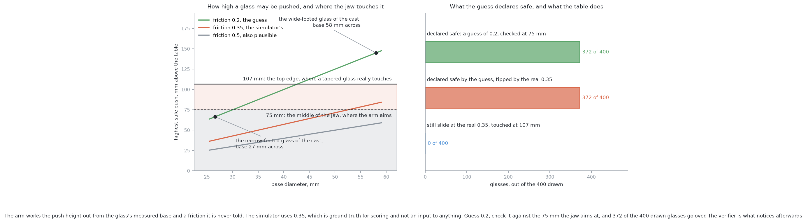
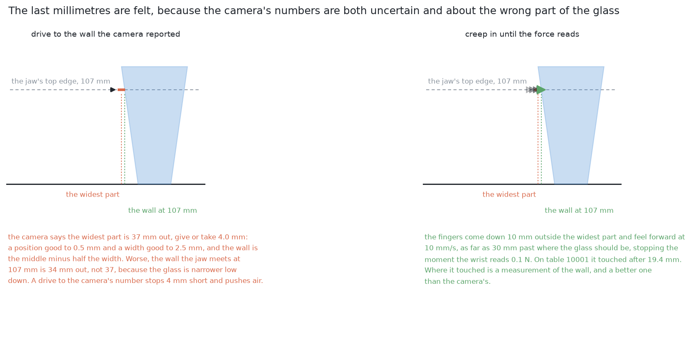
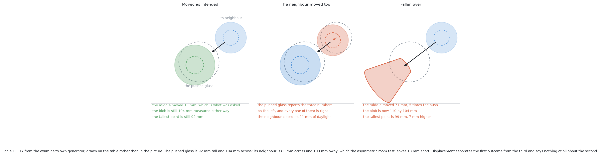
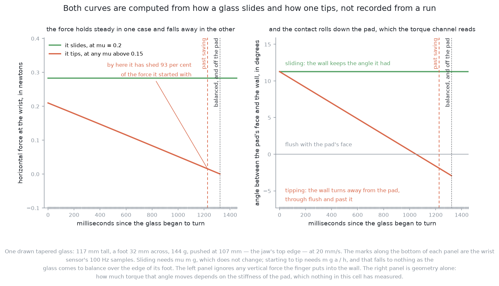
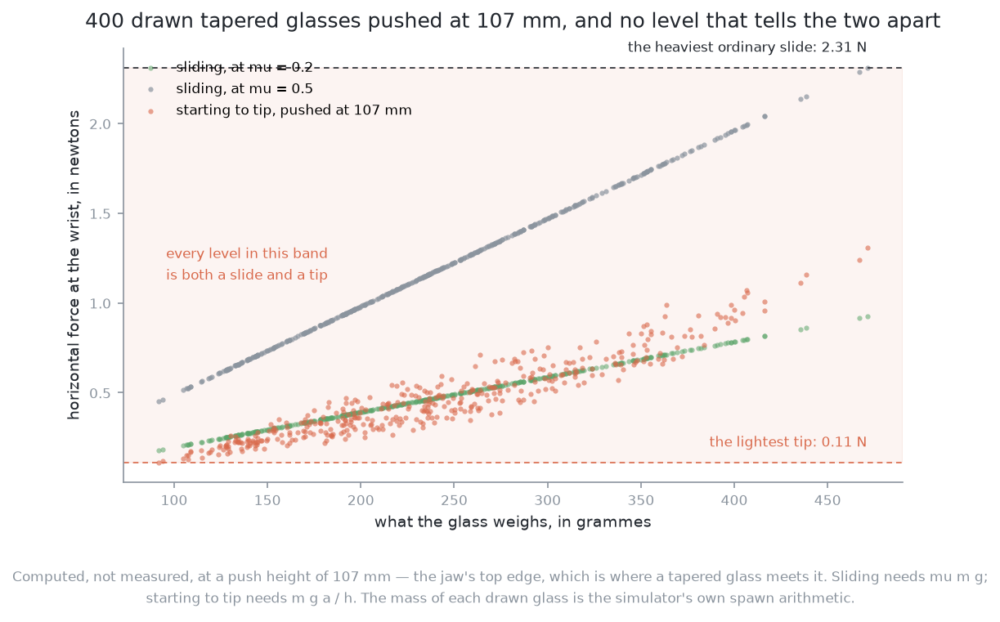

# Pushing without toppling

## 1. Introduction

A glass pushed sideways across a table either slides or falls over. This is not
luck. The height where the jaw touches the glass decides it, before the arm
moves. This page gives the rule that decides it. It explains why the rule is
worked out again for every glass. It explains why some glasses must be refused.
It also explains what the arm does about friction, a number in the rule that
nothing in this cell can measure.

All seven solutions need this page, and none of them differs in it. By the end
you will know four things. The height that matters is not the height the arm
aims at. A refusal is a result, not a failure. Every solution acts and then
measures, instead of trusting a prediction. And a trained model can help inside
that loop without being able to break it.

## Contents

1. [Introduction](#1-introduction)
2. [Why no solution can answer this on its own](#2-why-no-solution-can-answer-this-on-its-own)
3. [The limit: slide, or tip](#3-the-limit-slide-or-tip)
4. [The number nobody has](#4-the-number-nobody-has)
5. [The loop: plan, feel, look again](#5-the-loop-plan-feel-look-again)
6. [The honest limit](#6-the-honest-limit)
7. [Where to go next](#7-where-to-go-next)

## 2. Why no solution can answer this on its own

The seven solutions differ in how they choose a push. They choose which glass to
move, in which direction, and how far. That difference stops at this page, for
two reasons.

First, the table does not know which method chose the push. A glass touched too
high falls over, whether simple geometry chose the contact or a large trained
model did. The contact and the glass decide the outcome. So the limit belongs to
the situation, not to the method, and it must be the same for all seven.

Second, none of the seven can predict exactly where a pushed glass will stop.
Friction is not the same everywhere under the foot of a glass. The flat jaw
touches the curved glass on a small patch, not at one point. And a glass turns
as well as moves. A precise prediction needs numbers that nobody here has. So
every solution must act, measure what really happened, and correct. This loop
is shared too.

So this page holds two things. **The limit says whether a push may happen at
all.** **The loop runs around every push that does happen.** The next section
starts with the limit.

## 3. The limit: slide, or tip

The rule comes from comparing two forces, so this section starts with those two
forces.

A glass on a table is held down by its weight. Friction holds it still. Push it
sideways at some height, and one of two things gives way first. The foot can
**slide** over the table. This happens once the push is larger than friction.
Friction is the friction coefficient times the weight. Or the glass can **tip**.
It turns about the bottom edge furthest from the jaw. This happens once the
turning effect of the push is larger than the turning effect of the weight.

Use these letters:

- `h` is the height where the jaw touches the glass.
- `a` is half the width of the glass's foot.
- `μ` (the Greek letter mu) is the friction coefficient between glass and table.
  It is a plain number that says how much the two surfaces grip each other.

Sliding needs a push of `μ` times the weight. Tipping needs a push of the
weight times `a / h`. This is because the push acts at height `h`, and the
weight acts at distance `a` from the edge the glass turns about. So the glass
slides first while

    h  <  a / μ

and it tips first above that height.

Two facts about this rule help a lot. First, the weight appears on both sides
and cancels. So **the limit does not depend on how heavy the glass is**. This
is good, because nothing weighs a glass before it is pushed. Second, the rule
does not depend on how hard or how fast the jaw pushes. So a gentle push does
not make a high contact safe. A push that is too high tips the glass slowly
instead of quickly. This was also tested, and [a slower push does not topple
fewer glasses](#a-slower-push-does-not-topple-fewer-glasses) gives the result.

The rule uses three numbers, and the next three parts look at them in turn:
the foot, the height, and the case where no height works. A fourth part then
checks the claim about speed.

### The push height is worked out per glass

The rule uses `a`, which is half the foot width. Every glass has its own foot.
So the highest safe contact is a different number for every glass.

This is why the push height is **computed from the measurement, not chosen
once**. The camera work reports [how wide each glass is at its
foot](../../08_seeing-the-glasses/02_the-problem/01_what-is-asked-for.md#4-what-must-come-out).
So the arm can check the limit for that glass before it touches it. One safe
height for every glass would not work. A low height refuses glasses that could
have been pushed. A higher height pushes glasses that will fall. The whole
project follows this pattern: compute what the measurement allows for each
case.

### The height that counts is the top edge of the jaw

The arm cannot choose `h` freely either. And the right value for `h` is not the
obvious one.

The middle of the jaw rides at 75 mm above the table. This is as low as the
hand can go. The front part of the jaw is 63 mm tall, so its top edge stands at
107 mm. These numbers come from the gripper, and they do not change between
glasses. They are large because the hand is turned on its side to fit between
the glasses. [The gap that
matters](01_what-is-asked-for.md#6-the-gap-that-matters-is-not-the-gap-between-the-glasses)
explains why it is turned.

A glass that is wider higher up touches the top edge of the jaw first. The
tapered glasses here are wider higher up. So for them the contact is at the top
edge, and `h` is 107 mm, not the 75 mm the arm aims at.

The difference is 32 mm. The limit itself is often only a few tens of
millimetres, so this difference matters a lot. Checking at the middle of the
jaw calls far too many glasses safe. For example, take 400 drawn tapered
glasses at the friction the simulator uses. A check at the middle calls about
one in eleven safe to push. A check at the top edge calls none of them safe.

The same is true for every kind of glass, not only the tapered one. The table
below has one row for each kind. The first column is the share that a check at
the middle of the jaw calls safe. The second column is the share that is really
safe, because the contact is at the top edge. Both use the friction the
simulator uses.

| kind | check at the jaw's middle | check at its top edge |
|---|---|---|
| straight | 57% | 7% |
| tapered | 10% | none |
| stemmed | 86% | 22% |
| short stemmed | 55% | none |

The two checks make different kinds of mistake. The middle check admits glasses
that will be touched too high, and those glasses fall. The top-edge check
leaves some glasses alone that could have moved. A fallen glass is lost for
good. A refused glass is only a refusal in the report. **So the wrong choice
here makes the mistake that cannot be undone.** This is why this page fixes the
rule, instead of leaving it to each solution.

### Some glasses cannot be pushed at all

The two parts above lead to a third fact. It is easy to miss, because it looks
like a gap rather than an answer.

The limit `a / μ` is small when the foot is narrow or the friction is high. It
can be below 107 mm. It can even be below 75 mm, the lowest the jaw can go
without hitting the table. For such a glass, no contact height is safe. The
glass tips before it slides, whatever the arm does.

**The only correct answer for that glass is to refuse it.** The glass stays
standing where it was, and the report gives the reason. The run then ends as
*correct but incomplete*. [The
examiner](03_the-examiner.md#5-what-the-examiner-measures) explains how
refusals are counted, and why a refusal is a result. A refused glass is still
standing, so something later may move it. A fallen glass is lost. So anything
doubtful ends with the glass untouched and a line in the report. No solution
may add a fallback that tries anyway.

**The safety check sits outside the policy.** A policy is the part of a
solution that chooses the push. Six of the seven solutions check the rule from
the measured foot width before any model is asked. So a bad model cannot
approve a push that tips a glass. The world-model solution is different. It
holds no friction value, so it cannot use the rule. It refuses a glass when its
own learned model turns down every push it tried. The limit is the same in
both cases. Only the thing trusted to apply it is different.

### A slower push does not topple fewer glasses

A refusal leaves a glass unmoved, so a gentler push may sound like a better
answer. The rule above says it is not. Speed does not appear in `h < a / μ`.
So the rule predicts that a slow push tips a glass just as often as a fast one.

The project tested this prediction with
[`measure_push_speed.py`](https://github.com/RobinNagpal/robot-arm-projects/blob/main/v5-pick-glasses/03-push-glasses-apart/02-geometry-ranked/measure_push_speed.py).
Solution 2 chose one push on each of 367 tables. The same push was then made
on fresh copies of each table, at five speeds. The examiner's own speed is
20 mm per second.

In the table below, each row is one speed. The middle column counts the glasses
that toppled. The last column is how far the pushed glass moved, as a median.

| push speed | glasses toppled, of 367 | median distance moved |
|---|---|---|
| 5 mm/s, a quarter of the examiner's speed | 73, or 19.9% | 34.7 mm |
| 10 mm/s | 71, or 19.3% | 41.9 mm |
| 20 mm/s, the examiner's speed | **66, or 18.0%** | **45.5 mm** |
| 40 mm/s | 73, or 19.9% | 41.3 mm |
| 80 mm/s, four times the examiner's speed | 92, or 25.1% | 32.2 mm |

**The slowest push toppled slightly more glasses, not fewer.** The difference
is 1.9 percentage points. Its standard error is 2.9 points. A standard error
says how much a number would change by chance alone. So this difference is
noise, as the rule predicted.

Two more things show in the table. Four times the speed is really worse. It
toppled 7.1 points more, which is 2.3 standard errors. And slow pushes moved
the glass less far, 34.7 mm against 45.5 mm. A push exists to make room, so a
slow push costs room and buys no safety. These numbers are from [the project's
own page on
toppling](https://github.com/RobinNagpal/robot-arm-projects/blob/main/v5-pick-glasses/docs/03-push-glasses-apart/pushing-without-toppling.md#pushing-more-slowly-does-not-help-and-that-has-been-measured).

So the refusal rule is the only defence against toppling here. Speed is not a
way round it.

All of this depends on `μ`. The next section looks at where that number comes
from.

## 4. The number nobody has

The rule above needs `μ`, so this section asks where `μ` comes from.

No solution is ever told the friction, and nothing in the cell measures it.
[What a solution is never
told](02_what-goes-in-and-what-comes-out.md#4-what-a-solution-is-never-told)
explains this in full. So every solution has to guess `μ`.

The guess matters a lot. Glass on a dry wooden top has a friction coefficient
of about 0.2 to 0.5. At 0.5, the limit `a / μ` is less than half of what it is
at 0.2. So a wrong guess can decide whether a glass should be pushed at all.

The programmed geometry handles this by using the whole range, 0.2 to 0.5. It
asks one of three questions about each glass:

- If the glass is safe even at the worst friction, it is pushed.
- If the glass is unsafe even at the best friction, it is refused.
- If the two ends disagree, the arm makes a **5 mm test push**. It looks before
  and after. A glass that slid has moved. A glass that leaned has fallen back
  to where it stood.

All seven solutions also follow two habits.

**They always push as low as the gripper can reach.** The height is already the
lowest the hardware allows. So there is nothing to tune. Pushing higher never
helps.

**They watch what really happens, instead of trusting the prediction.** If the
guessed friction is too low, the limit comes out too high. Only evidence from
the table can catch this. That evidence comes during the push and just after
it. The next section describes the loop that collects it.

## 5. The loop: plan, feel, look again

No solution here acts on a prediction and walks away. Each one acts, senses
what happened, and decides again. This section describes that loop.

A programming comparison helps. One way is to compute a plan once and then run
it blindly. This is like unrolling a loop into a fixed list of steps, because
you think you know how many times it will run. These solutions do something
else. They keep **state that is re-read**. The arrangement of the table is a
value. The arm measures it, acts on it, and measures it again. The loop
continues while that value says there is still work to do. So the arm repeats
one step: look at the table, choose one push, make it, look again. It stops
when every glass has its room, or when every glass left has been refused.

Each pass through the loop has three parts.

**Plan.** The solution uses the measurements. It chooses which glass to move,
where to move it, and which way the jaw comes in. The topple limit is checked
here. A glass that fails the check never reaches the next part.

**Feel.** The jaw does not drive to a computed contact point. Every measurement
has some error. So a jaw driven to a computed point will hit a glass whenever a
measurement is a few millimetres wrong. Instead, the closed jaw comes down
behind the glass. It moves forward slowly until it touches. Then it pushes,
backs off, and **reports the force it felt**. The last millimetres are felt,
not driven. The whole project handles contact this way.

**Look again.** New measurements show where the glass really stopped. This is
compared with where it was sent. The difference is the only true information
about the push, because no model could have known it in advance. Then the loop
starts again from the table as it is now.

There is room for two learned helpers inside this loop. Because they sit inside
the loop, we can judge them by what a wrong answer would cost. **Neither one is
a solution.** Neither chooses a push or a destination, and neither can approve
anything. They are checkers, one after the push and one during it. **Both are
designs, not code.** This page describes them because every solution could use
them in the same way. The repository does not contain them.

### A change verifier, placed after the action

The first helper answers the question that the look-again step asks: did this
push do what it was meant to do?

Geometry answers part of this well. It can say how far the glass moved, and
compare that with how far it was sent. But it answers the most important part
badly. A camera looking straight down at a fallen glass sees a wider shape than
before. A glass that slid a long way also leaves a shape in a new place. A small
trained model could look at the scene before and after the push. It would answer
three questions. Did the chosen glass move as intended? Did anything else move?
Has anything fallen over?

**This model is safe because of where it sits.** It runs after the push. So it
can only be wrong about something that already happened. It cannot tip a glass,
because the push is over when it speaks. It cannot cause a collision, because it
does not choose where the arm goes. A wrong answer costs only a few seconds. For
example, the arm takes one more look, or a run stops early. A model placed
before the push is different. It would choose contacts, and its mistakes would
be made with the arm. So a checker after the push has a limit on how much harm
it can do. That limit comes from where it sits, not from how good it is.

### An early abort, acting during the push

The second helper answers a different question. The difference is when it acts.

The jaw reports the force it feels while it pushes. It reports far more often
than a camera takes pictures. A sliding glass and a tipping glass feel different
through this signal, because the force changes in a different way over the push.

A monitor could read this signal. When the contact stops feeling like a slide,
it would stop the arm and back the jaw off a little. One force level is not
enough to do this. Across the glasses of one kind, every force a tip produces
is also a force some slide produces. So the monitor must read how the signal
changes, not compare it with one fixed value.

**This monitor acts during the push, and the verifier acts after it.** The
verifier needs a picture, and a picture can only be taken after the arm stops.
By then a fallen glass is already on its side. The monitor touches the glass
while the glass is still starting to move. So **an early abort is the only
thing here that could prevent a topple, instead of reporting one.** That is the
reason to build it. But it is only a design. Nothing in this project
implements it. The solutions that topple glasses do so partly because it is
missing. [Solution 6](../09_the-same-model-fine-tuned-here/01_what-it-is.md)
topples glasses most often, so it shows what the missing monitor costs.

The monitor has very little power on purpose. It cannot steer, choose a target
or approve a push. It can only stop a push. If it fires when it should not, it
costs one push and a few seconds. This is the same kind of cost as a wrong
verifier answer. Neither helper can do anything except stop or describe.

The two helpers work together. The monitor knows only that the contact stopped
feeling like a slide. It cannot say what the glass did, or whether a neighbour
moved, because the force signal comes from one contact. The verifier can say
this from a picture. So after an abort, the verifier is the natural next check.

The loop recovers from many mistakes, but not from all of them. The next
section says which ones it cannot recover from.

## 6. The honest limit

Looking again saves the run from a bad prediction. This section says which
failures it saves, and which it does not.

Many failures are just new states of the table. For example, a push can stop
short or go too far. A glass can turn as it moves, or end up in a new crowd.
The next pass through the loop measures each of these and plans against it.
Nothing is lost, because the table is measured again, not assumed. A wrong
guess at friction also shows up here, as a push that did not go where it was
aimed.

**But nothing in this loop stands a fallen glass back up.** No step in this book
lifts anything. The arm has no way to stand a glass up again. Everything after
that point works around the fallen glass. This is why the topple limit is a
refusal rule, and not a risk to weigh against the value of moving the glass. A
risk is worth taking only if the system can recover from the bad outcome. Here
it cannot. So the rule is used to say no. The two helpers exist to catch the
cases where the rule said yes because of a wrong guess at friction.

## 7. Where to go next

- [The problem](01_what-is-asked-for.md) — why dragging rather than lifting, the distances
  that matter, and what "done" means.
- [What goes in and what comes out](02_what-goes-in-and-what-comes-out.md) —
  what every solution is handed and hands back.
- [The examiner](03_the-examiner.md) — the crowded tables, the physics and the marking.
- [The target layout](04_the-target-layout.md) — where the glasses should end up,
  and the least movement the task needs.
- [The seven solutions](../03_the-seven-solutions/01_how-the-six-compare.md) — what each one puts between the
  measurements and the pushes.

← [The target layout — where the glasses should end up](04_the-target-layout.md) · [Questions and answers — the problem in short answers](06_questions-and-answers.md) →
