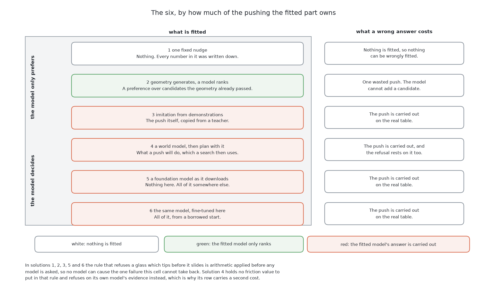
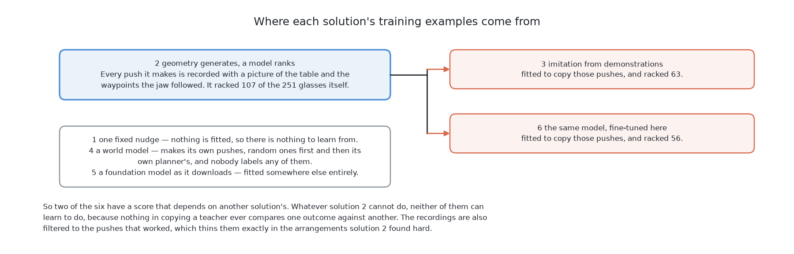

# The seven solutions — same table, seven ways to push

## 1. Introduction

This book asks the arm to push crowded glasses apart. Each glass must end with
room for the gripper, and no glass may fall over.
[What is asked for](../01_the-problem/01_what-is-asked-for.md) sets out the task
in full. This chapter answers it in seven different ways. The point is not to
find one winner. The point is to compare them, so that you can choose one and
know what the choice costs. Six have been measured. The seventh is still being
measured.

This page is the map of all seven. It has three tables. The first says what each
solution is built from. The second says how each one works. The third says what
each one scored.

After this page, the chapter has one short page for each solution. Each short
page takes about eight minutes. Later in the book, seven full chapters cover the
same seven solutions in about an hour each. So read this page first, then the
short page for a solution that interests you, and then its full chapter. The
chapter ends with a page of questions and answers.

## Contents

1. [Introduction](#1-introduction)
2. [What all six share](#2-what-all-six-share)
3. [What each one is built from](#3-what-each-one-is-built-from)
4. [How each one works](#4-how-each-one-works)
5. [What each one scored](#5-what-each-one-scored)
6. [Two things that cut across the six](#6-two-things-that-cut-across-the-six)
7. [Where to go next](#7-where-to-go-next)

## 2. What all six share

Before the seven differ, it helps to see what they have in common. All seven get
the same tables, the same measurements, the same push budget and the same
scorecard. So a gap between two scores says something about the method.
[The examiner](../01_the-problem/03_the-examiner.md) describes this setup in full.

The examiner scores the table after the pushes, not the pushes themselves. This
means a solution may answer in any form it likes. Each solution gets a list of
glasses like the first object below, with lengths in metres. Four solutions get
a 384 by 384 colour picture of the table instead. A solution then answers in one
of the two forms below it. The first is a push given as numbers, which the
examiner turns into a path. The second is a short list of waypoints, which the
jaw follows as given.

```json
[{"id": 0, "x": 0.4570, "y": -0.4170, "height": 0.1554, "widest": 0.0740, "foot": 0.0419, "standing": true}]
```

```json
{"glass": 4, "start": [0.3726, -0.4500], "heading": 1.5708, "reach": 0.0881, "travel": 0.0660,
 "aim": [0.3726, -0.3259]}
```

```json
{"glass": 4, "aim": [0.3726, -0.3259],
 "waypoints": [{"x": 0.3726, "y": -0.4500, "z": 0.3000, "heading": 1.5708},
               {"x": 0.3726, "y": -0.4500, "z": 0.2900, "heading": 1.5708}]}
```

Both forms get the same reply, with five fields.
[What goes in and what comes out](../01_the-problem/02_what-goes-in-and-what-comes-out.md#5-what-push-does-and-what-it-reports-back)
explains each field.

```json
{"blocked": false, "touched": 0.0146, "jammed": false, "peak": 1.73, "pushed": 0.0660}
```

Two parts of the job belong to no solution. Where the glasses should end up is
in [the target layout](../01_the-problem/04_the-target-layout.md). Whether a glass
slides or tips is in
[pushing without toppling](../01_the-problem/05_pushing-without-toppling.md).
With the shared parts set aside, the next table shows what each solution adds.

## 3. What each one is built from

This table shows what you must install, collect and train to run each solution.
Read the right column as that shopping list. The rows go from nothing fitted at
the top to everything fitted at the bottom.

| Solution | What it is built from |
|---|---|
| **1. [One fixed nudge](02_one-fixed-nudge.md)** | NumPy, and nothing else. Nothing is fitted, so there is no model, no training set and no weights file. No licence condition of any kind. |
| **2. [Geometry generates, a model ranks](03_geometry-generates-a-model-ranks.md)** | Gradient-boosted regression trees from scikit-learn, about two hundred of them, three levels deep, on top of solution 1's own candidate geometry. Needs a few thousand candidate-and-outcome pairs, which the examiner labels for free. Permissively licensed. |
| **3. [Imitation from demonstrations](04_imitation-from-demonstrations.md)** | ACT, an action chunking transformer, taken from LeRobot and fitted here from random numbers. Needs demonstrations, which solution 2 produces. A second way swaps ACT for Diffusion Policy. Apache-2.0, and nothing is downloaded but the library. |
| **4. [A world model, then plan with it](05_a-world-model-then-plan-with-it.md)** | Five copies of a small network written for this cell, in PyTorch, with a sampling search on top. Needs tens of thousands of pushes made in a physics engine, which nobody labels. A second way would use TD-MPC2 off the shelf, and is not built. Permissively licensed. |
| **5. [A foundation model as it downloads](06_a-foundation-model-as-it-downloads.md)** | SmolVLA from LeRobot, about 450 million parameters, used exactly as it downloads. Nothing is fitted here, so there is no training set and no training run. The library is Apache-2.0 and **the weights carry their own terms**, which this project does not record. |
| **6. [The same model, fine-tuned here](07_the-same-model-fine-tuned-here.md)** | The same SmolVLA and the same downloaded weights as solution 5, with a low-rank correction of about four million numbers trained on this cell's own pushes. Needs the demonstrations solution 2 produces. The same terms on the weights, inherited by anything trained from them. |
| **7. [A newer, larger model, fine-tuned here](08_a-newer-larger-model-fine-tuned-here.md)** | Evo-1, a newer borrowed model of about 775 million parameters. About 122 million of them are trained, on solution 6's own demonstrations. The weights carry their own terms. |

The list says what each solution needs. The next table says what each one does
with it.

## 4. How each one works

This table follows the same seven in the same order. It says what happens when the
arm looks at a table. Each row is one answer to the same difficulty. Nobody here
knows where a pushed glass will stop, because nobody has measured the friction.

| Solution | How it works |
|---|---|
| **1. One fixed nudge** | Geometry lists every safe push for the glass. A printed rule takes the shortest one that gives a glass room. Then the arm looks again. Nothing is fitted. |
| **2. Geometry generates, a model ranks** | The same geometry lists the same safe pushes. A fitted model puts them in order. The model cannot add a push or bring back a rejected one. Its recorded pushes teach solutions 3 and 6. |
| **3. Imitation from demonstrations** | A top view goes in and a short run of jaw waypoints comes out. A network is fitted to copy solution 2's successful pushes. It never judges an outcome. |
| **4. A world model, then plan with it** | Five copies of a small network learn what a push does to the table. Before each push, about 1,500 candidates are tested on all five copies. The best safe one is carried out. |
| **5. A foundation model as it downloads** | A model trained elsewhere on real robot data gets a top view and a plain-English instruction. Its answer is carried out as waypoints. Nothing is trained here. |
| **6. The same model, fine-tuned here** | The same model as solution 5, with a small correction trained on solution 2's pushes. The correction is folded into the weights, so it runs at the same cost. |
| **7. A newer, larger model, fine-tuned here** | Solution 6 with one change: a newer and larger borrowed model. Everything else is the same, so the gap in score is the model's. |



The picture above is a ladder of the six measured solutions. Solution 7 would
sit at the bottom, beside solution 6. Each box on the left is one solution. Its colour
says what the fitted model does:

- A **white** box has no fitted model.
- A **green** box has a model that only orders pushes the geometry has already
  approved. It can choose badly, but it cannot add an unsafe push.
- A **red** box has a model whose answer becomes the push, so the arm does what
  the model says.

The grey label groups the boxes. In the top two, the model at most **prefers**
one safe push. In the lower four, the model **decides** what the arm does.

The boxes on the right say what one wrong answer costs. In the top two, it costs
nothing or one wasted push. In the lower four, it is a real push, and a glass can
fall over. So lower on the ladder, the model has more control, and its mistakes
cost more. The next table shows how that played out in the scores.

## 5. What each one scored

Now that you know how they work, this section shows the result of each.
Six have a result. Solution 7 is still being measured. Every solution runs on the same **50 arrangements** of glasses. Each arrangement
holds 4, 5 or 6 glasses. Together they hold 251 glasses, and 203 of them have no
room for the gripper at the start. Every solution gets 4 pushes per glass and 16
per arrangement.

An arrangement is **done** when every glass in it could be picked up. A glass is
**racked** when it was picked up and put away. A glass is **toppled** when it
ends the run lying down. A toppled glass cannot be stood up again.

Solutions 3, 5 and 6 draw their actions at random from a fitted model. So the
examiner runs each of them three times. Their figures are the middle run, with
the lowest and highest runs in brackets. Solutions 1, 2 and 4 repeat exactly, so
they show one run and no brackets.

Read the table below one row at a time. The left cell names the solution. The
right cell gives three numbers, then one sentence on why.

| Solution | Results, then why |
|---|---|
| **1. [One fixed nudge](02_one-fixed-nudge.md)** | Arrangements done, of 50: 14<br>Glasses racked, of 251: 107<br>Glasses toppled: **1**<br>It refuses when unsure, so it almost never breaks a glass. |
| **2. [Geometry generates, a model ranks](03_geometry-generates-a-model-ranks.md)** | Arrangements done, of 50: 14<br>Glasses racked, of 251: 107<br>Glasses toppled: **1**<br>It reaches exactly the same glasses as the printed rule, with nine more pushes. |
| **3. [Imitation from demonstrations](04_imitation-from-demonstrations.md)** | Arrangements done, of 50: 2 (1–3)<br>Glasses racked, of 251: 63 (51–64)<br>Glasses toppled: 12 (7–13)<br>Its push heading is often wrong, so the hand hits a neighbour on the way down. |
| **4. [A world model, then plan with it](05_a-world-model-then-plan-with-it.md)** | Arrangements done, of 50: **20**<br>Glasses racked, of 251: **146**<br>Glasses toppled: 20<br>It racks the most glasses, but its model rated each of the 20 toppling pushes as safe. |
| **5. [A foundation model as it downloads](06_a-foundation-model-as-it-downloads.md)** | Arrangements done, of 50: 1 (0–1)<br>Glasses racked, of 251: 48 (46–51)<br>Glasses toppled: 12 (10–14)<br>Its 48 racked glasses already had room. Its jaw mostly stays far above the table. |
| **6. [The same model, fine-tuned here](07_the-same-model-fine-tuned-here.md)** | Arrangements done, of 50: 1 (0–2)<br>Glasses racked, of 251: 56 (50–65)<br>Glasses toppled: 40 (33–44)<br>Its jaw now reaches the table, but about three pushes in five are blocked on the way down. |
| **7. [A newer, larger model, fine-tuned here](08_a-newer-larger-model-fine-tuned-here.md)** | Being measured. No score is claimed yet. |


[The results](../11_the-results.md) has every column, and
[what the comparison says](../11_the-results.md#5-what-the-comparison-says)
explains what the scores mean. Three results stand out:

- The world model racks the most glasses. It also topples 20, where the
  geometry topples 1.
- Solution 2 and solution 4 both fit a model. Only solution 4 gains, because it
  learns the thing the geometry gets wrong.
- Solutions 5 and 6 differ only in training. The trained one topples far more
  glasses.

Solutions 5 and 6 also carry the SmolVLA weights' own licence terms. This
project does not record those terms, so read them before you ship anything built
on them. Solution 7's weights carry their own terms too. Two parts are designs
and were not run. These are solution 1's own choosing rule and solution 4's
second way. Two more patterns cut across all the solutions, and the next section
names them.

## 6. Two things that cut across the six

The scores above come from separate runs. This section names two facts that link
the solutions to each other.

### Where the refusal lives

The most important refusal is for a glass that would tip before it slides. In
every solution but one, plain arithmetic makes that refusal before any model is
asked. Solution 4 is the exception, because it refuses on its own model's
prediction. [Pushing without toppling](../01_the-problem/05_pushing-without-toppling.md)
explains both cases.

### Where the demonstrations come from

Solutions 3, 6 and 7 learn by copying solution 2's pushes. So their scores
depend on solution 2, and they cannot do better than it.
[It is the teacher](../05_geometry-generates-a-model-ranks/03_how-it-works.md#7-it-is-the-teacher)
explains why. Solutions 2 and 4 collect their own data, so they depend on no
other solution.



With the map and these two links in hand, the last section lists where to read
next.

## 7. Where to go next

- [The problem](../01_the-problem/01_what-is-asked-for.md) — what is asked for, and what makes it hard.
- [What goes in and what comes out](../01_the-problem/02_what-goes-in-and-what-comes-out.md) —
  what every solution is handed and hands back. **Read this before any solution
  document.**
- [The examiner](../01_the-problem/03_the-examiner.md) — the crowded tables, the physics and the marking.
- [The target layout](../01_the-problem/04_the-target-layout.md) — where the glasses should end
  up, and the least movement the task needs.
- [Pushing without toppling](../01_the-problem/05_pushing-without-toppling.md) — the limit and
  the loop, shared by all seven.
- Then the seven short pages of this chapter, in order: [one fixed
  nudge](02_one-fixed-nudge.md), [geometry generates, a model
  ranks](03_geometry-generates-a-model-ranks.md), [imitation from
  demonstrations](04_imitation-from-demonstrations.md), [a world model, then
  plan with it](05_a-world-model-then-plan-with-it.md), [a foundation model as
  it downloads](06_a-foundation-model-as-it-downloads.md), and [the same model,
  fine-tuned here](07_the-same-model-fine-tuned-here.md) and [a newer, larger
  model, fine-tuned here](08_a-newer-larger-model-fine-tuned-here.md). Each one
  ends with a link to the chapter that treats it in full.
- [Questions and answers](09_questions-and-answers.md) — short answers about the
  seven as a group.
- [The results](../11_the-results.md) — the full scorecard, with every column.

← [The problem — questions and answers](../01_the-problem/06_questions-and-answers.md) · [One fixed nudge](02_one-fixed-nudge.md) →
