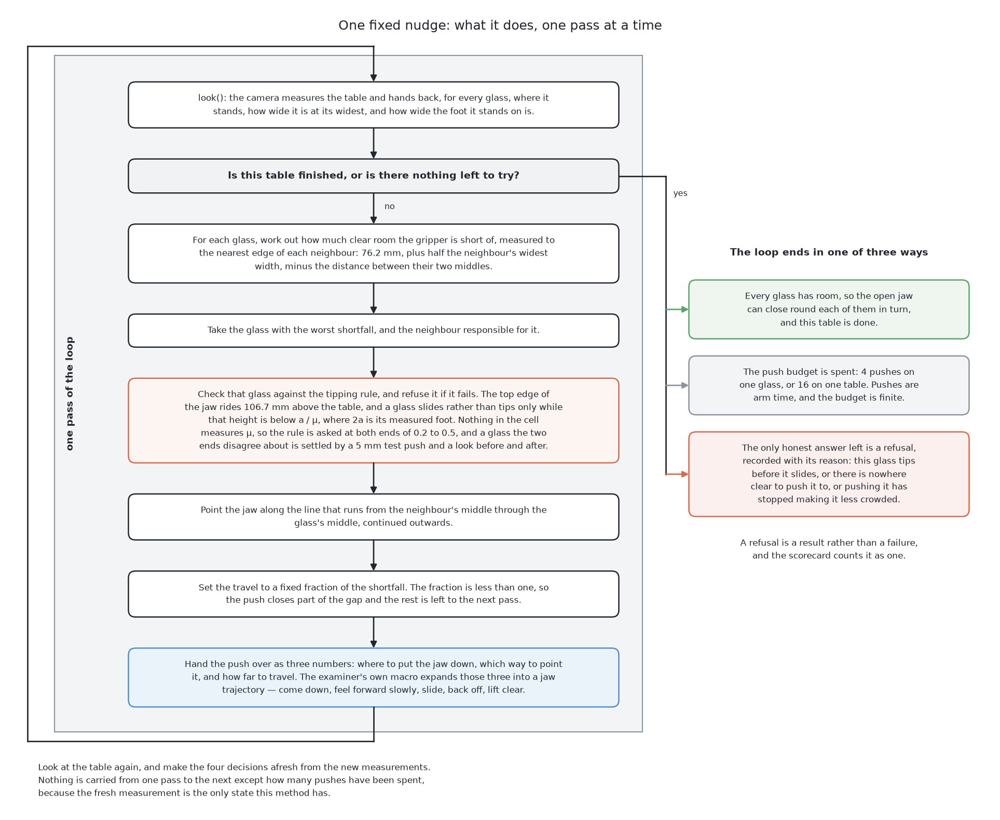
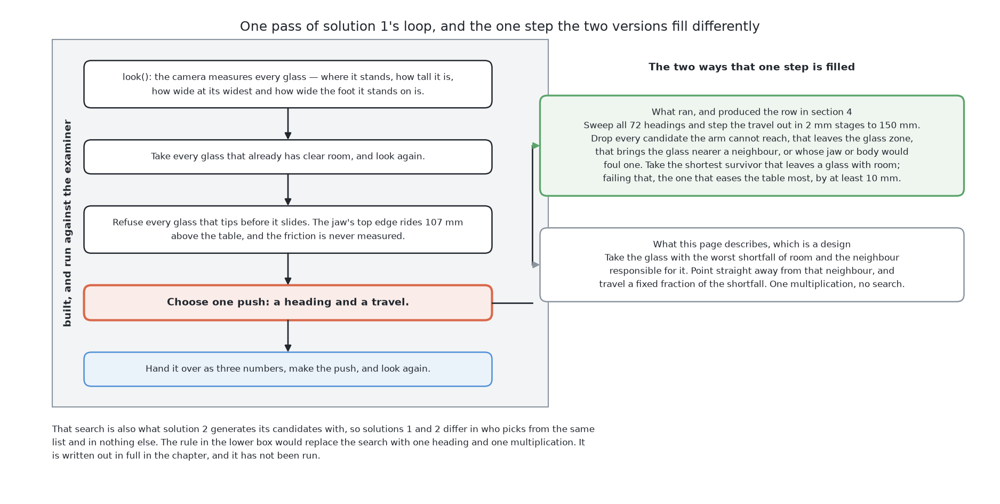

# One fixed nudge

This page is a short summary of the first of the seven solutions. This solution
fits no model at all. Of the six measured so far, it broke the fewest glasses. The page says
what it does, what makes it different, what it scored and one lesson. The full
method is in [the chapter on this solution](../04_one-fixed-nudge/01_what-it-is.md).

## Contents

1. [What it is](#1-what-it-is)
2. [How it works](#2-how-it-works)
3. [What it needs](#3-what-it-needs)
4. [What it scored](#4-what-it-scored)
5. [Where it is strong and where it breaks](#5-where-it-is-strong-and-where-it-breaks)
6. [When to choose it](#6-when-to-choose-it)

## 1. What it is

The first question is what this solution does. Nobody knows where a pushed glass
will stop, because nobody has measured the friction. This solution does not try
to predict it. It pushes a glass a short way, away from the neighbour that
crowds it, and then looks again. That direction always helps, and the short
distance cannot overshoot.

This makes it the baseline for the other six. Any other solution must beat it,
or the extra cost buys nothing.
[What it is](../04_one-fixed-nudge/01_what-it-is.md#4-the-main-idea) explains
this idea in full. The next section shows the loop it runs.

## 2. How it works

The idea above becomes a loop of five steps. The arm looks at the table. It picks
up every glass that already has room. It refuses every glass that would tip
before it slides. It chooses one push. Then it makes the push and looks again.

The choosing step has two versions. The designed rule pushes straight away from
the worst neighbour, by a fixed part of the missing room. The planner that
really ran searches instead. It tries every heading and takes the shortest safe
push that gives a glass room. The scores below come from that planner.
[What is built and what is a design](../04_one-fixed-nudge/03_how-it-works.md#5-what-is-built-and-what-is-a-design)
separates the two.

Solution 2 uses the same search to make its list of pushes. The next section
shows how little this loop needs to run.

## 3. What it needs

The loop above needs only a few things. It needs the measured position, width,
foot and height of each glass, and the gripper's own fixed sizes. It needs only
NumPy. It needs no training data, no model file and no graphics card.
[What it needs](../04_one-fixed-nudge/05_what-it-needs.md) gives the full list.
With so little needed, the next question is how well it scored.

## 4. What it scored

The examiner gives every solution the same 50 tables.
[The examiner](../01_the-problem/03_the-examiner.md) describes them. In the table
below, read each column as a count over all 50 tables. A table is "wrong" when
the run ends in a state the cell should never reach.

| tables finished | tables wrong | glasses racked | toppled | pushes |
|---|---|---|---|---|
| 14 | **1** | 107 | **1** | **173** |

It toppled only one glass, which is the best of the six measured so far. It refused 143 glasses,
and most of those refusals come from the gripper, not the method. The hand is too
wide to stand beside some glasses. It also cannot push low enough to slide some
others. [The results](../11_the-results.md) compares them all. The next section
looks at where this method is strong and where it fails.

## 5. Where it is strong and where it breaks

The score above follows from how little the method claims. It cannot be wrong
about where a glass will stop, because it never says. Every step is a number you
can print and check. Its weaknesses are also clear. The designed rule fails for a
glass crowded from two sides, because pushing away from one neighbour pushes
towards the other. And neither version uses the force the jaw feels during a
push. That force is the only clue about friction.
[How it compares](../04_one-fixed-nudge/06_how-it-compares.md#1-where-it-is-strong-and-where-it-breaks)
covers each point. The last section says when to use it.

## 6. When to choose it

Given those strengths and weaknesses, build this solution first. It is the
cheapest way to get a real push on a real glass. It also sets the score that
every other solution must beat. The lesson is simple. If a model cannot beat
this fixed nudge, the model adds nothing.

The code is in
[`src/09_pushing-the-glasses-apart/01-one-fixed-nudge/`](../../../code/src/09_pushing-the-glasses-apart/01-one-fixed-nudge).
The full treatment starts at [what it is](../04_one-fixed-nudge/01_what-it-is.md).

← [How the solutions compare](01_how-the-six-compare.md) · [Geometry generates, a model ranks](03_geometry-generates-a-model-ranks.md) →
