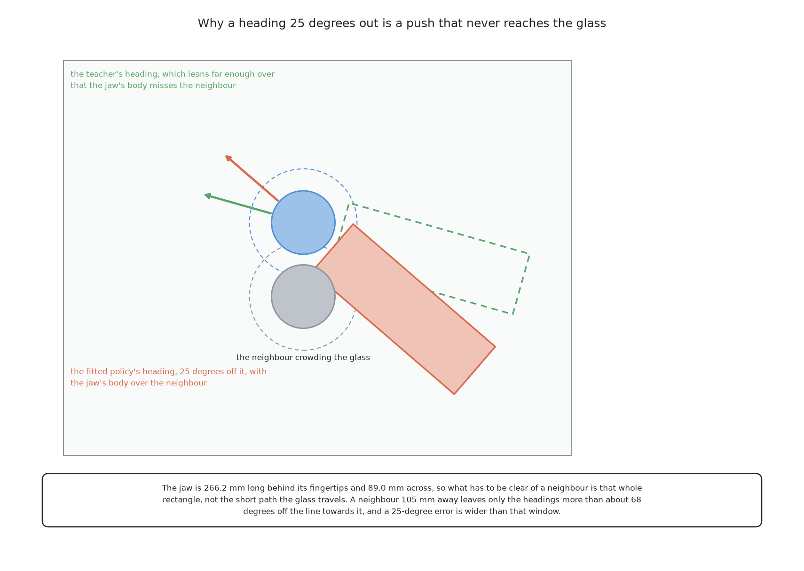

# Imitation from demonstrations

This page is a short summary of the third solution. In this solution a network
learns to push glasses by copying examples. Nothing in it is downloaded, and it
holds no geometry and no friction model. The page says what it does, what it
scored, and its one main lesson. The full story is in [the chapter on this
solution](../06_imitation-from-demonstrations/01_what-it-is.md).

## Contents

1. [What it is](#1-what-it-is)
2. [How it works](#2-how-it-works)
3. [What it needs](#3-what-it-needs)
4. [What it scored](#4-what-it-scored)
5. [Where it is strong and where it breaks](#5-where-it-is-strong-and-where-it-breaks)
6. [When to choose it](#6-when-to-choose-it)

## 1. What it is

**Behaviour cloning** means learning a skill by copying examples. You collect
pairs of a situation and the action a good performer took. Then you fit a
function that maps the situation to the action.

Here, a view of the table from the top goes in, and a short run of jaw
waypoints comes out. The model is **ACT**, an action chunking transformer from
[LeRobot](https://github.com/huggingface/lerobot). The examples come from
[geometry generates, a model ranks](03_geometry-generates-a-model-ranks.md).
That solution is the teacher, and the student can never be better than it.

The next section shows the steps from the teacher's pushes to the student's
pushes.

## 2. How it works

This section follows the data through the solution in order.

1. The teacher's pushes on the training tables are recorded. Failed pushes
   are dropped.
2. The network learns to map a picture to an **action chunk**. A chunk is a
   short run of jaw waypoints, predicted together in one pass.
3. At run time the examiner follows the chunk as it is. Then the arm looks
   again, and the loop repeats.

[How it works](../06_imitation-from-demonstrations/03_how-it-works.md) explains
each step, and why dropping failures makes the data biased. The next section
says what the solution needs to run.

## 3. What it needs

This section lists the cost of the solution before we look at its score.

It needs LeRobot, PyTorch, and a working teacher. Training takes hours on an
Apple M4 laptop, so no rented hardware was needed. [What it
needs](../06_imitation-from-demonstrations/05_what-it-needs.md) gives the
details. The next section shows what this cost bought.

## 4. What it scored

This section puts the student beside its teacher. Both had the same 50 tables.
The student was run three times, and the table shows the middle run.

| | tables done | tables wrong | glasses racked | toppled | pushes |
|---|---|---|---|---|---|
| this solution (ACT) | 2 | 11 | 63 | 12 | 438 |
| its teacher, the ranked geometry | 14 | 1 | 107 | 1 | 182 |

The student did much worse than its teacher. It placed the start of each push
about right. But it pointed the push 22 to 27 degrees off the teacher's
direction. So the long jaw came down on a neighbour glass, and nothing moved.

[A worked example](../06_imitation-from-demonstrations/04_a-worked-example.md)
shows this error on one table. Giving the policy the glass positions made it
more consistent but did not raise its score, as [telling the policy where the
glasses are](../06_imitation-from-demonstrations/04_a-worked-example.md#5-telling-the-policy-where-the-glasses-are)
shows. The six scores measured so far are in [the
results](../11_the-results.md). The next section says what this score teaches.

## 5. Where it is strong and where it breaks

This section uses the score above to show the method's good and bad sides.

It is cheap, and nobody writes rules about pushing. But nothing in it checks
whether a push worked, so it cannot beat its teacher. It also cannot refuse a
glass. [How it
compares](../06_imitation-from-demonstrations/06_how-it-compares.md#1-where-it-is-strong-and-where-it-breaks)
gives the evidence for each point. The next section turns this into advice.

## 6. When to choose it

This section says when this method is the right choice.

Choose it when a good teacher already exists and you only want a faster copy of
it. Do not choose it to beat the teacher. For that you need a method that
compares outcomes, such as [a world model, then plan with
it](05_a-world-model-then-plan-with-it.md).

The main lesson is about averaging. Often several good pushes exist for one
table. A network trained to copy all of them returns something in between, and
that is often not a good push. Four times the examples did not fix this. A
model that can hold more than one answer, such as Diffusion Policy, is the
right fix.

The code is in
[`src/09_pushing-the-glasses-apart/03-imitation-from-demonstrations/`](https://github.com/RobinNagpal/robotics-basics/tree/main/code/src/09_pushing-the-glasses-apart/03-imitation-from-demonstrations).
The full chapter starts at [what it
is](../06_imitation-from-demonstrations/01_what-it-is.md).

← [Geometry generates, a model ranks](03_geometry-generates-a-model-ranks.md) · [A world model, then plan with it](05_a-world-model-then-plan-with-it.md) →
