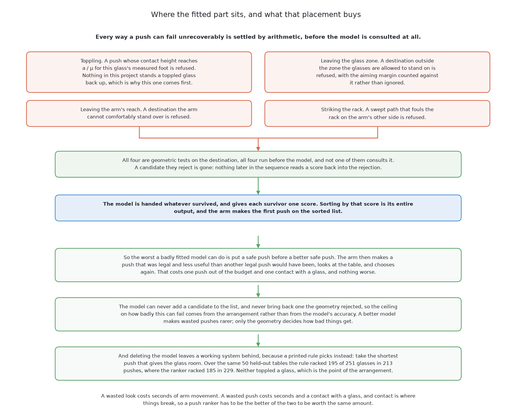
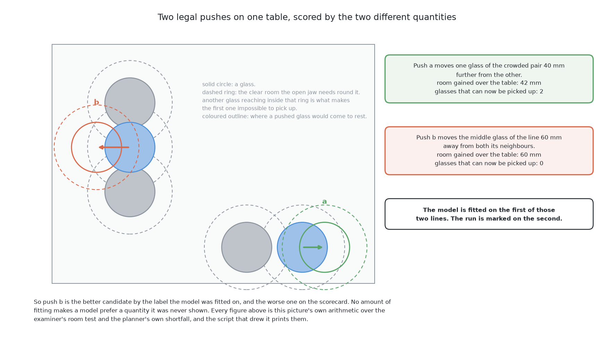

# Geometry generates, a model ranks

This page is a short summary of the second of the six solutions. Here, plain
geometry lists every safe push, and a small fitted model only puts that list in
order. The page says what it does, what makes it different, what it scored and
one lesson. The full method is in
[the chapter on this solution](../05_geometry-generates-a-model-ranks/01_what-it-is.md).

## Contents

1. [What it is](#1-what-it-is)
2. [How it works](#2-how-it-works)
3. [What it needs](#3-what-it-needs)
4. [What it scored](#4-what-it-scored)
5. [Where it is strong and where it breaks](#5-where-it-is-strong-and-where-it-breaks)
6. [When to choose it](#6-when-to-choose-it)

## 1. What it is

The first question is what this solution changes. [One fixed
nudge](02_one-fixed-nudge.md) picks one push with a printed rule. This solution
lists every safe push, and a fitted model chooses among them. The model cannot
add a push, and it cannot bring back a push the geometry rejected. So the worst a
bad model can do is waste a push.
[What it is](../05_geometry-generates-a-model-ranks/01_what-it-is.md#4-the-main-idea)
explains why this arrangement is safe. The next section shows the steps.

## 2. How it works

The idea above runs in three steps, and only the last one is fitted. First, the
geometry lists many possible pushes. Second, the geometry removes every push that
is unsafe. Third, the model scores the pushes that are left, and the arm makes
the best one. The model is a set of gradient-boosted trees. These are many small
decision trees whose scores are added up.

This solution is also the teacher. Solutions 3 and 6 learn by copying its
recorded pushes.
[How it works](../05_geometry-generates-a-model-ranks/03_how-it-works.md#7-it-is-the-teacher)
explains this. The next section lists what the three steps need.

## 3. What it needs

The steps above need little. They need scikit-learn and NumPy, and no graphics
card. They need a few thousand training examples, and the examiner labels these
for free. The trees fit in seconds.
[What it needs](../05_geometry-generates-a-model-ranks/05_what-it-needs.md) gives
the full list. The next section shows whether the model helped.

## 4. What it scored

The real test is to compare the model with the printed rule it was meant to
improve. The table below has two rows. The first row is the fitted model. The
second row is the same loop with the model deleted, so the printed rule picks
instead. Both ran on the same 50 tables.

| | tables done | tables wrong | glasses racked | toppled | pushes |
|---|---|---|---|---|---|
| the fitted ranker | 14 | **1** | 107 | **1** | 182 |
| the same loop, printed rule picking | 14 | **1** | 107 | **1** | 173 |

The model reached the same glasses as the rule, and it used nine more pushes.
There are two reasons. First, the safe pushes for a glass all gain about the same
room, so there is little to choose between. Second, the model learned "room
gained", but the score counts glasses that can be picked up. These are not the
same thing, as the picture below shows.

[How it compares](../05_geometry-generates-a-model-ranks/06_how-it-compares.md#1-where-it-is-strong-and-where-it-breaks)
explains both reasons. The next section weighs its strengths against this result.

## 5. Where it is strong and where it breaks

The score above does not tell the whole story. The design is safe, because the
model cannot cause a toppled glass. If you delete the model, the printed rule
still runs. The weakness is that the model can only pick from the geometry's
list. When the model is fitted badly, nothing breaks, so the failure is easy to
miss.
[How it compares](../05_geometry-generates-a-model-ranks/06_how-it-compares.md#1-where-it-is-strong-and-where-it-breaks)
covers each point. The last section says when to use this design.

## 6. When to choose it

Given that safety, use this design when a mistake cannot be undone. The lesson
is to check two things before you fit a ranker. Check that the choices really
differ. Check that the label you train on is the thing you are scored on.

[The results](../10_the-results.md#5-what-the-comparison-says) compares this
solution with the world model, which learns what a push does.

The code is in
[`src/09_pushing-the-glasses-apart/02-geometry-ranked/`](../../../code/src/09_pushing-the-glasses-apart/02-geometry-ranked).
The full treatment starts at
[what it is](../05_geometry-generates-a-model-ranks/01_what-it-is.md).

← [One fixed nudge](02_one-fixed-nudge.md) · [Imitation from demonstrations](04_imitation-from-demonstrations.md) →
