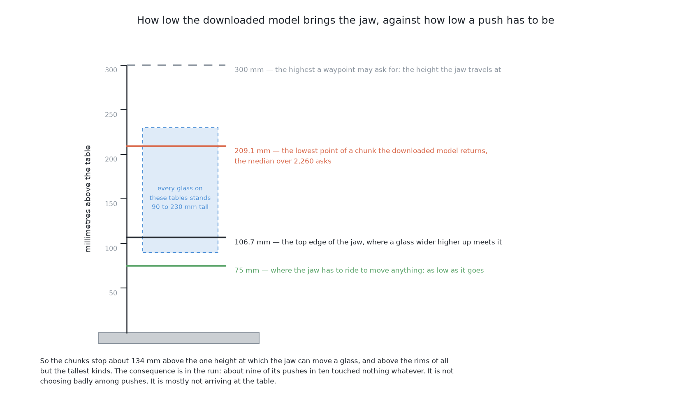

# A foundation model as it downloads

This page is a short summary of the fifth solution. This solution downloads a
large robot model that others trained, and uses it unchanged. Nothing in it is
trained here. The page says what it does, what it scored, and its one main
lesson. The full story is in [the chapter on this
solution](../08_a-foundation-model-as-it-downloads/01_what-it-is.md).

## Contents

1. [What it is](#1-what-it-is)
2. [How it works](#2-how-it-works)
3. [What it needs](#3-what-it-needs)
4. [What it scored](#4-what-it-scored)
5. [Where it is strong and where it breaks](#5-where-it-is-strong-and-where-it-breaks)
6. [When to choose it](#6-when-to-choose-it)

## 1. What it is

A **vision-language-action model** is one network that takes a picture and a
written instruction, and returns robot actions. The model here is **SmolVLA**,
from [LeRobot](https://github.com/huggingface/lerobot). It runs on a laptop.

This solution is in the book mainly for one reason. [The same model, fine-tuned
here](07_the-same-model-fine-tuned-here.md) uses the same model and the same
starting weights. The only difference is extra training on this cell's pushes.
So the gap between the two scores shows what that training did.

The next section shows the steps from a picture to a push.

## 2. How it works

This section follows one decision from start to end.

1. The model gets a view of the table from the top, one instruction in plain
   English, and the arm's joint readings.
2. It returns a short run of jaw waypoints, and the examiner follows them.
3. The arm looks again, and the loop repeats.

The model was trained on real cameras in real rooms. Here it sees flat shapes
on an empty table. This difference is called the **domain gap**. [How it
works](../08_a-foundation-model-as-it-downloads/03_how-it-works.md#7-the-domain-gap-which-is-the-heart-of-this-document)
explains it, and the other limits of the model. The next section says what this
costs.

## 3. What it needs

This section lists the cost of the solution before we look at its score.

It needs less than any other solution. It needs LeRobot, the downloaded
weights, and a laptop. It needs no data and no training. [What it
needs](../08_a-foundation-model-as-it-downloads/05_what-it-needs.md) gives the
details. The next section shows what the model did with no training.

## 4. What it scored

This section shows the score. The model had the same 50 tables as the other
solutions. It was run three times, and the table shows the middle run.

| tables done | tables wrong | glasses racked | toppled | pushes | thinking per push |
|---|---|---|---|---|---|
| 1 | 9 | 48 | 12 | 620 | slow |

It finished one table in fifty. It racked 48 glasses, but those 48 had room
before any push. The reason is simple. The model holds the jaw too high, so
most of its pushes touch nothing.

[What was expected, and what
happened](../08_a-foundation-model-as-it-downloads/03_how-it-works.md#8-what-was-expected-and-what-happened)
gives the measured heights. All six scores are in [the
results](../10_the-results.md). The next section says what this score teaches.

## 5. Where it is strong and where it breaks

This section uses the score above to show the method's good and bad sides.

It is cheap and quick to try. But it has no input for the force the jaw felt,
and it cannot learn from its mistakes. The one repair is more training on this cell's
pushes, and that is the next solution. [How it
compares](../08_a-foundation-model-as-it-downloads/06_how-it-compares.md#1-where-it-is-strong-and-where-it-breaks)
gives the evidence. The next section turns this into advice.

## 6. When to choose it

This section says when this method is the right choice.

Try it first, and expect to replace it. It is the cheapest way to learn whether
the task needs any training at all. It can be good enough when the task looks
like the model's own training data. Do not choose it when the scene is very
different, as it is here.

The main lesson is that a poor score here is still useful. It gives the
fine-tuned model a clear starting point to compare against.

The code is in
[`src/09_pushing-the-glasses-apart/05-smolvla-as-it-downloads/`](../../../code/src/09_pushing-the-glasses-apart/05-smolvla-as-it-downloads).
The full chapter starts at [what it
is](../08_a-foundation-model-as-it-downloads/01_what-it-is.md).

← [A world model, then plan with it](05_a-world-model-then-plan-with-it.md) · [The same model, fine-tuned here](07_the-same-model-fine-tuned-here.md) →
